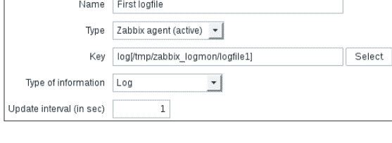
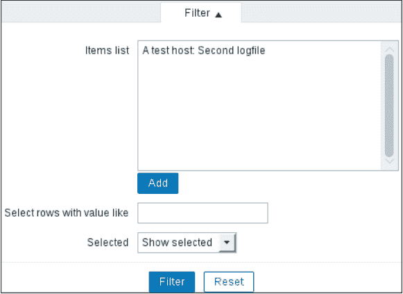
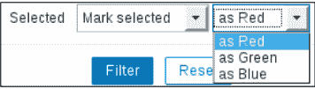
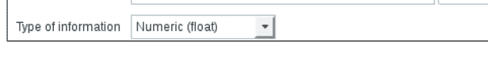
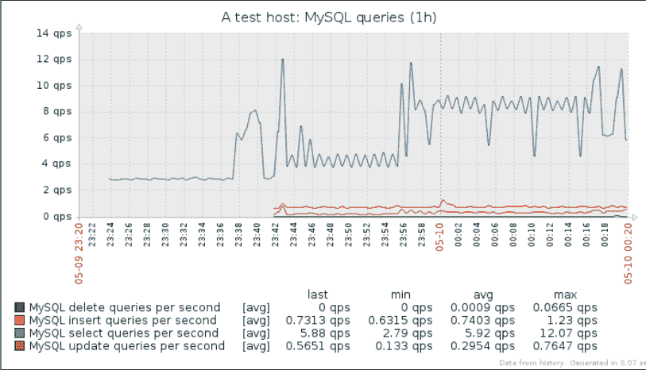
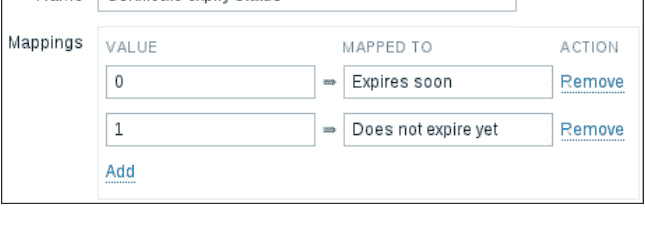
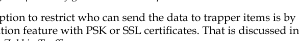
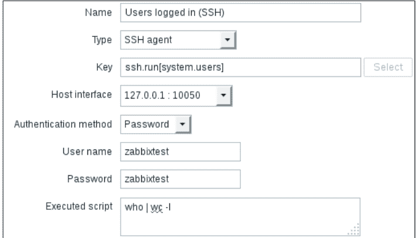

## 11 高级监控项

在设置好被动和主动 Zabbix 代理监控项、ICMP ping 或 TCP 服务检查等简单检查，以及 SNMP 和 IPMI 检查之后，我们还能更进一步吗？当然可以。Zabbix 提供了更多在不同情况下有用的监控项类型——让我们来试试它们。

在本章中，我们将探讨日志文件监控、在服务器上根据已收集数据计算值、在 Zabbix 服务器或代理上运行自定义脚本、使用一个出色的实用程序 zabbix_sender 发送完整自定义数据，以及通过 SSH 和 Telnet 运行命令。在这些方法中，我们应该能够实现对 Zabbix 开箱即用不支持的任何自定义数据源的监控。

### 日志文件监控

日志文件是宝贵的信息来源。Zabbix 提供了一种使用 Zabbix 代理监控日志文件的方法。为此，提供了两个特殊的键：

- `log`：允许我们监控单个文件
- `logrt`：允许我们监控多个轮转文件

这两个日志监控项键都只能作为主动监控项使用。为了了解其工作方式，让我们通过实际监控一些文件来尝试 Zabbix 日志文件监控。


# 监控单个文件

让我们从更简单的情况开始：监控单个文件。为此，我们可以创建几个测试文件。为了保持条理，让我们在 A test host 上创建一个目录 /tmp/zabbix_logmon/，并在其中创建两个文件 logfile1 和 logfile2。两个文件的内容都如下：

```
2016-08-13 13:01:03 a log entry
2016-08-13 13:02:04 second log entry
2016-08-13 13:03:05 third log entry
```

> 日志监控要正常工作，必须正确配置主动式监控项——我们在第3章“使用Zabbix代理和基础协议进行监控”中已经完成了配置。

文件就绪后，让我们继续创建监控项。导航到“配置 | 主机”，点击“A test host”旁边的“监控项”，然后点击“创建监控项”。填写以下内容：

-   **名称：** First logfile
-   **类型：** Zabbix 代理（主动式）
-   **键值：** log[/tmp/zabbix_logmon/logfile1]
-   **信息类型：** 日志
-   **更新间隔：** 1



完成后，点击底部的“添加”按钮。如前所述，日志监控只能作为主动式监控项工作，所以我们使用了该监控项类型。对于键值，第一个参数是必需的——它是我们要监控的文件的完整路径。这里我们还使用了特殊的信息类型“日志”。但更新间隔呢？为什么我们用这么小的1秒间隔？对于日志监控项，这个间隔不是关于在代理和服务器之间建立实际连接的，它只是让代理检查文件是否发生了变化——它会执行一次 `stat()` 调用，类似于 `tail -f` 在某些平台/文件系统上的操作。只有代理有东西要发送时，才会与服务器建立连接。

使用主动式监控项，日志监控反应迅速，因为它在本地检查文件，同时也避免了过多的连接。它也可以实现为效率稍低的被动式监控项，但截至 Zabbix 3.0.0 尚不支持。

监控项创建好后，数据到达应该不会超过3分钟——当然，前提是一切按预期工作。服务器更新配置缓存最多可能需要1分钟，主动式代理更新其监控项列表最多可能需要2分钟。让我们验证一下——导航到“监测 | 最新数据”，然后按主机“A test host”过滤。我们的“First logfile”监控项应该在那里，并且应该有一些值：

| First logfile | 2016-05-09 10:01:05 | 2016-08-13 13:03:05 third log ... |

即使是很短的值，在这里也会被过度截断。希望这能在后续版本中改进。

如果监控项不受支持，并且配置部分提示权限问题，请确保权限确实允许 Zabbix 用户访问该文件。如果文件本身的权限看起来正确，还要检查所有上级目录的执行权限。在这里及后续操作中，请记住，不受支持的监控项在问题解决后最多需要10分钟才会更新。

与其他非数字监控项一样，Zabbix 知道它无法对日志绘制图形，因此右侧有一个“历史记录”链接——让我们点击它：

| 时间戳 | 本地时间 | 值 |
| 2016-05-09 10:01:05 |  | 2016-08-13 13:03:05 third log entry |
| 2016-05-09 10:01:05 |  | 2016-08-13 13:02:04 second log entry |
| 2016-05-09 10:01:05 |  | 2016-08-13 13:01:03 a log entry |

如果你在历史记录模式中没有看到任何值，可能是 Zabbix 时间滚动条的一个 bug 导致的。尝试在右上角的下拉菜单中选择“最新的500个值”。

日志文件中的所有行都在这里了。默认情况下，Zabbix 日志监控会从文件开头解析整个文件。在这种情况下这很好，但如果我们想开始监控某个巨大的现有日志文件呢？不仅解析会很浪费，而且还可能向 Zabbix 服务器发送大量无用的旧信息。幸运的是，有一种方法可以让 Zabbix 只解析从该日志文件开始监控以来的新数据。我们可以用第二个文件来试试，为了简单起见，也可以克隆第一个监控项。让我们返回“配置 | 主机”，点击“A test host”旁边的“监控项”，然后点击“名称”列中的“First logfile”。在监控项配置表单的底部，点击“克隆”并进行以下更改：

-   **名称：** Second logfile
-   **键值：** log[/tmp/zabbix_logmon/logfile2,,,skip]

> 监控项键值中有四个逗号——这样我们跳过了一些参数，只指定了第一个和第五个参数。

完成后，点击底部的“添加”按钮。和之前一样，这个监控项可能需要最多3分钟才能开始工作。即使它开始工作了，最新数据页面中也不会有任何内容——因为我们指定了 skip 参数，所以只会考虑新的行。

> 添加监控项后，请至少等待3分钟再执行下面的命令。否则，代理还没有新的监控项定义。

为了测试，我们可以向 Second logfile 添加一些行。在“A test host”上执行：

```
$ echo "2016-08-13 13:04:05 fourth log entry" >> /tmp/zabbix_logmon/logfile2
```

> 这条及后续的模拟日志条目会递增行内的时间戳——这不是必需的，但看起来更好一些。目前 Zabbix 无论如何都会忽略该时间戳。

片刻之后，该条目应该出现在最新数据页面中：

| Second logfile | 2016-05-09 11:42:15 | 2016-08-13 13:04:05 fourth log... |

如果我们检查监控项历史记录，它是唯一的条目，因为 Zabbix 现在只关心新的行。

> 💡 skip 参数只影响监控新日志文件时的行为。无论是否使用该参数来监控日志文件，Zabbix 代理都不会重新读取文件，它只读取新增的数据。

## 过滤特定字符串

对于较小的文件，发送所有内容是可以接受的，但如果一个文件包含大量信息，而我们只对错误消息感兴趣呢？Zabbix 代理也可以在本地过滤行，只把我们需要的内容发送到服务器。例如，我们可以只抓取包含字符串 error 的行。修改 **Second logfile** 监控项并将其键值改为：

```
log[/tmp/zabbix_logmon/logfile2,error,,,skip]
```

也就是说，在日志文件路径后面添加了一个 error。请注意，现在 `error` 和 `skip` 之间有三个逗号——我们填充了监控项键值的第二个参数。点击 **更新**。和之前一样，此更改传播到 Zabbix 代理可能需要最多3分钟，因此建议过一段时间再继续。泡杯茶后，在“A test host”上执行以下命令：

```
$ echo "2016-08-13 13:05:05 fifth log entry" >> /tmp/zabbix_logmon/logfile2
```

这次，**最新数据**页面中不会出现任何新内容——我们过滤了 error 字符串，但这行中没有该字符串。让我们再添加一行：

```
$ echo "2016-08-13 13:06:05 sixth log entry - now with an error" >> /tmp/zabbix_logmon/logfile2
```

检查 `logfile2` 日志监控项的历史记录，我们应该只看到最新的条目。

那么一些更复杂的条件呢？假设我们要过滤所有出现 error 和 warning 字符串的行，但对于 warning，只保留后面跟着以数字 60-66 开头的数字代码的行。幸运的是，过滤参数实际上是一个正则表达式——让我们修改第二个日志监控项并将其键值改为：

```
log[/tmp/zabbix_logmon/logfile2,"error|warning 6[0-6]",,,skip]
```

## 高级监控项监控

我们将第二个键值参数改为 `"error|warning 6[0-6]"`，包括双引号。这个正则表达式应当匹配所有以数字 60-66 开头的 error 和 warning。我们必须用双引号括起来，因为正则表达式包含方括号，而方括号也用于括住键值参数。为了测试这一点，让我们在日志文件中插入几行测试数据：

```sh
$ echo "2016-08-13 13:07:05 seventh log entry – all good" >> /tmp/zabbix_logmon/logfile2

$ echo "2016-08-13 13:08:05 eighth log entry – just an error" >> /tmp/zabbix_logmon/logfile2

$ echo "2016-08-13 13:09:05 ninth log entry – some warning" >> /tmp/zabbix_logmon/logfile2

$ echo "2016-08-13 13:10:05 tenth log entry – warning 13" >> /tmp/zabbix_logmon/logfile2

$ echo "2016-08-13 13:11:05 eleventh log entry – warning 613" >> /tmp/zabbix_logmon/logfile2
```

根据我们的正则表达式，日志监控项应该：

-   忽略第七条条目，因为它完全不包含 error 或 warning
-   捕获第八条条目，因为它包含 error
-   忽略第九条条目——它包含 warning，但后面没有数字
-   忽略第十条条目——它包含 warning，但后面的数字不是以 `60-66` 范围内的数字开头
-   捕获第十一条条目——它包含 warning，数字以 61 开头，位于我们要求的 `60-66` 范围内

最终，只有第八条和第十一条条目应该被收集。请在最新数据页面中验证，只有匹配我们正则表达式的条目才应该被收集。

我们使用的正则表达式并不十分复杂。如果我们想排除多个字符串，或者进行其他更复杂的过滤呢？使用 POSIX 扩展正则表达式，这可能会介于非常复杂和不可能之间。Zabbix 中有一个称为**全局正则表达式**的功能，它允许我们以更简单的方式定义正则表达式。如果我们有一个名为 `Filter logs` 的全局正则表达式，就可以像这样在监控项中复用它：

```text
log[/tmp/zabbix_logmon/logfile2,@Filter logs,,,skip]
```

全局正则表达式将在*第12章“自动化配置”*中更详细地介绍。


## 监控轮换文件

监控单个文件并不算太难，但有许多软件会使用多个日志文件。例如，Apache HTTP 服务器通常会配置为每天记录到一个新文件中，并将日期包含在文件名内。Zabbix 支持使用单独的监控项键 `logrt` 来监控这种日志轮换方案。要进行尝试，请导航到**配置 | 主机**，点击**测试主机**旁边的**监控项**，然后点击**创建监控项**。填写以下内容：

- **名称：** `Rotated logfiles`
- **类型：** **Zabbix agent (active)**
- **键值：** `logrt["/tmp/zabbix_logmon/access_[0-9]{4}-[0-9]{2}-[0-9]{2}.log"]`
- **信息类型：** **日志**
- **更新间隔：** `2`

完成后，点击底部的**添加**按钮。不过，与之前使用的内容相比，键值及其第一个参数发生了一些变化。现在键值是 `logrt`，第一个参数是一个正则表达式，用于描述应匹配的文件。请注意，这里的正则表达式仅支持用于文件部分，而路径部分必须指定一个具体目录。由于正则表达式中使用了方括号，我们还将其放在双引号中。该正则表达式应匹配以 `access_` 开头、后跟四位数字、一个短横线、两位数字、一个短横线、另外两位数字，并以 `.log` 结尾的文件名。例如，文件名 `access_2015-12-31.log` 就会被匹配。还有一点不同之处——更新间隔被设置为 2 秒，而不是 1 秒。原因是，`logrt` 键会定期重新读取目录内容，这可能比检查单个文件消耗更多资源。这也是它使用单独监控项键的原因，否则我们本可以在日志监控项中使用文件正则表达式。

> 如果受监控的文件中仍有待解析的行，Zabbix 代理不会每 2 秒重新读取目录内容——只有当已知文件中的内容全部解析完毕后，它才会再次查看目录。

设置好监控项后，让我们创建并填充一些应被正则表达式匹配的文件。在“测试主机”上执行：

```
$ echo "2016-08-30 03:00:00 rotated first" > /tmp/zabbix_logmon/access_2015-12-30.log
```

查看最新数据页面，轮换日志文件监控项应该会获得这个值。假设这一天就到此为止，现在我们将在第二天记录一些内容：

```
$ echo "2015-12-31 03:00:00 rotated second" > /tmp/zabbix_logmon/
access_2015-12-31.log
```

查看该监控项的历史记录，它应该已经成功获取了新文件：

| 时间戳 | 本地时间 | 值 |
|---|---|---|
| 2016-05-09 13:56:55 |  | 2015-12-31 03:00:00 rotated second |
| 2016-05-09 13:56:25 |  | 2016-08-30 03:00:00 rotated first |

随着日期不同的文件不断出现，Zabbix 会完成当前文件的处理，然后开始处理下一个文件。

## 基于日志数据生成告警

随着数据不断传入，让我们来讨论如何使用触发器基于这些数据生成告警。这里有一些内容与我们目前在触发器中使用的阈值及类似的数值比较有所不同。

如果我们有一个收集所有行的日志监控项，并希望针对包含某个特定字符串的行生成告警，可以使用以下几个触发器函数：

- str()：检查子字符串；例如，如果我们收集所有值，就可以使用此函数针对错误生成告警：str(error)
- regexp：与 str() 函数类似，允许我们指定一个用于匹配的正则表达式
- iregexp：regexp() 的不区分大小写版本

> 这些函数只能作用于单行；无法匹配多行日志条目。

对于这三个函数，还支持第二个参数——在这种情况下，它可以表示要检查的秒数或值的数量。例如，str(error,600) 会在最近 10 分钟内的任意值中包含 error 子字符串时触发。

这看起来没问题，但如果我们只通过在代理端进行过滤，将错误行发送到服务器，就会出现一个问题。为了了解问题所在，我们来考虑一个“普通”触发器，例如检查**CPU 负载**是否超过某个阈值的触发器。假设阈值为 5，当前触发器处于**正常**状态，并且依次收到 0、1、2 等值，不会发生任何事情，也不会生成事件。当第一个大于 5 的值到达时，会生成一个**问题**事件，并且触发器切换到**问题**状态。之后所有大于 5 的值都不会生成任何事件，也不会发生其他变化。

对于日志监控来说，问题也是如此。我们会针对第一行错误生成一个**问题**事件，之后便什么也不会发生。触发器会保持在**问题**状态，也不会有其他变化。解决办法相对简单——触发器属性中有一个复选框：**生成多个问题事件：**


选中此复选框后，上述**CPU 负载**触发器会针对每个超过 5 阈值的值生成一个新的**问题**事件。在大多数情况下，这并不太有用，但对于日志监控触发器来说却很有用。如果我们只接收错误行，那么每一行错误都会生成一个新的**问题**事件。

请注意，即使我们同时发送错误行和正常行，正常行之后的错误仍会被捕获，但后续的错误会被忽略，这同样可能造成问题。

解决这个问题后，我们又遇到了另一个问题——一旦触发器针对一个只接收错误行的监控项触发，该触发器就永远不会恢复，而会一直处于**问题**状态。虽然在某些情况下这并不是问题，但在其他情况下却并不理想。我们可以使用已经熟悉的触发器函数 `nodata()`，轻松让此类触发器超时。如果监控项同时接收错误行和正常行，而我们希望在最后一条错误到达 10 分钟后使触发器超时，即使这期间没有“正常”行到达，也可以构造如下触发表达式：

```
{host.item.str(error)}=1 and {host.item.nodata(10m)}=0
```

这里，我们反向使用了 `nodata()` 函数——即使最后一条记录包含错误，只要最近 10 分钟内没有其他值，触发器就会切换到**正常**状态。

> 💡 我们还在*第 6 章：使用触发器检测问题*的*会超时的触发器*部分讨论了会超时的触发器。

如果监控项只接收错误行，我们可以使用类似上面的表达式，但也可以将其简化。在这种情况下，任何值的存在都表示出现问题，因此我们再次使用反向的 nodata() 函数，并针对值的存在生成告警：

```
{host.item.nodata(10m)}=0
```

这里，只要最近 10 分钟内存在任何值，就表示出现**问题**。没有值时，触发器会切换到正常状态。由于 Zabbix 不必评估实际的监控项值，这种方式的资源消耗相对更低。

我们还可以在这里使用另一个触发器函数 count()。它可以让我们在某个时间段内出现一定数量的关注字符串（例如错误）时触发告警。例如，以下表达式会在最近 10 分钟内出现超过 10 个错误时生成告警：

```
{host.item.count(10m,error,like)}>10
```

## 提取行中的部分内容

有时，我们只需要知道记录了一个错误。在这种情况下，获取整行内容就足够了。但有时日志行中可能包含某个感兴趣的子字符串，例如某个队列中的消息数量。一行日志可能如下所示：

```
2015-12-20 18:15:22 Number of messages in the queue: 445
```

理论上，我们可以针对整行编写触发器。例如，当消息数量达到 10,000 或更多时，以下正则表达式应当能够匹配：

```
messages in the queue: [1-9][0-9]{4}
```

但是，如果我们希望在消息数量超过 15,000 时使用另一个触发器，该触发器的正则表达式可以如下所示：

```
messages in the queue: (1[5-9]|[2-9].)[0-9]{3}
```

如果我们希望从第一个正则表达式中排除超过 15,000 的值，则它将变为：

```
messages in the queue: 1[0-4][0-9]{3}
```


这绝对不容易维护。而且这还只是两个阈值。不过，如果我们只需要那个数字，还有一种更简单的方法。Zabbix 日志监控允许我们通过正则表达式提取值。为了进行尝试，我们先创建一个包含待提取值的文件。仍然在“A test host”上，创建文件`/tmp/zabbix_logmon/queue_log`，内容如下：

```
2016-12-21 18:01:13 Number of messages in the queue: 445
2016-12-21 18:02:14 Number of messages in the queue: 5445
2016-12-21 18:03:15 Number of messages in the queue: 15445
```

现在配置监控项——进入“Configuration | Hosts”，点击“A test host”旁边的“Items”，然后点击“Create item”。填写以下内容：

- **名称：** 提取日志内容
- **类型：** Zabbix agent (active)
- **键值：** `log[/tmp/zabbix_logmon/queue_log,"messages in the queue: ([0-9]+)",,,\1]`
- **信息类型：** Log
- **更新间隔：** 1

我们之所以给正则表达式加上引号，是因为其中再次包含了方括号。该正则表达式本身会提取文本“messages in the queue”，后面跟着冒号、空格和一个数字。数字包含在一个捕获组中——这对我们添加到键值中的最后一个参数`\1`很重要，因为它引用了捕获组的内容。这个参数“output”告诉 Zabbix 不要返回整行，而只返回该参数所引用的内容。在本例中，就是这个数字。

> 我们还可以在 output 参数中添加额外文本——例如，键值`log[/tmp/zabbix_logmon/queue_log, messages in the queue: "([0-9]+)",,,,Extra \1 things]`会针对日志文件中的第一行返回“Extra 445 things”。也可以使用多个捕获组，并在 output 参数中通过`\2`、`\3`等进行引用。


## 高级监控项监控

完成后，点击底部的**Add**按钮。大约 3 分钟后，我们可以在“latest data”页面中查看该监控项的历史记录：

| 时间戳 | 本地时间 | 值 |
|---|---|---|
| 2016-05-09 14:25:01 |  | 15445 |
| 2016-05-09 14:25:01 |  | 5445 |
| 2016-05-09 14:25:01 |  | 445 |

太好了，值的提取工作符合预期。针对这些值编写触发器也应该容易得多。不过需要注意一点——对于这个监控项，我们无法查看图形。原因在于日志监控项中的**信息类型**属性——我们将其设置为**Log**，但该类型不适合绘制图形。现在修改它。进入**Configuration | Hosts**，点击**A test host**旁边的**Items**，然后点击**NAME**列中的**Extracting log contents**。将**信息类型**更改为**Numeric (unsigned)**，然后点击底部的**Update**按钮。

> 💡 如果提取出的数字包含小数部分，请对这类监控项使用**Numeric (float)**。

在“latest data”部分检查该监控项——现在应该会出现**Graph**链接。不过，点击查看后会发现没有数据。这是为什么？Zabbix 会在内部为每种信息类型分别存储值。更改信息类型不会删除这些值，但 Zabbix 只会检查当前配置的信息类型。因此，务必从一开始就设置正确的信息类型。为了验证其是否按预期工作，请在“A test host”上运行以下命令：

```sh
$ echo "2016-12-21 18:16:13 Number of messages in the queue: 113" >> /tmp/zabbix_logmon/queue_log

$ echo "2016-12-21 18:17:14 Number of messages in the queue: 213" >> /tmp/zabbix_logmon/queue_log

$ echo "2016-12-21 18:18:15 Number of messages in the queue: 150" >> /tmp/zabbix_logmon/queue_log
```

在**Latest data**部分查看此监控项时，应该可以看到这些值，图形也应该可用。注意，日志文件条目中的日期和时间仍然无关紧要——这些值会被赋予当前时间戳。

> 💡 使用**logrt**监控项键值时，值提取的工作方式相同。

## 解析时间戳

说到我们推送到 Zabbix 中的行的时间戳，文件中的日期和时间与 Zabbix 中显示的日期和时间并不一致。Zabbix 使用采集这些条目的时间标记它们。在进行持续监控时，这在大多数情况下没有问题——内容每隔一秒左右检查一次，被收集、加上时间戳，然后推送到服务器。不过，在解析一些较旧的数据时，时间戳可能会有很大偏差。Zabbix 确实提供了从日志条目中解析时间戳的方法。我们来使用最开始创建的日志文件监控项进行操作。进入“Configuration | Hosts”，点击“A test host”旁边的“Items”，然后点击“NAME”列中的“First logfile”。注意其中的“Log time format”字段——这正是我们现在要使用的字段。它允许我们使用特殊字符提取日期和时间。支持的字符如下：

- y：年
- M：月
- d：日
- h：小时
- m：分钟
- s：秒

在我们的测试日志文件中，时间格式如下：

```
2015-12-13 13:01:03
```

用于解析日期和时间的时间格式字符串如下：

```
yyyy-MM-dd hh:mm:ss
```

请注意，只有受支持的字符才有意义——其他字符会被忽略，可以是任意内容。例如，以下格式的工作方式完全相同：

```
yyyyPMM PddPhhPmmPss
```

除了这些特殊字符之外，你可以选择任意字符。选择哪些字符最好？一般来说，最好以可读性为目标。在“Log time format”字段中输入这里的某个示例：


> 指定日志时间格式时，所有日期和时间组件都必须存在——例如，如果缺少秒，就无法提取时间。

完成后，点击底部的**Update**按钮。等待几分钟，然后继续向受监控文件中添加条目。选择当前时间往前一小时以内的日期和时间，并在“A test host”上运行：

```sh
$ echo "2016-05-09 15:30:13 a timestamped log entry" >> /tmp/zabbix_logmon/logfile1
```

现在，在“latest data”页面中查看**First logfile**监控项的历史记录：

| 时间戳 | 本地时间 | 值 |
|---|---|---|
| 2016-05-09 15:31:52 | 2016-05-09 15:30:13 | 2016-05-09 15:30:13 a timestamped log entry |

这与之前的情况有一个不同之处。现在**LOCAL TIME**列已填充，其中包含我们在日志行中指定的时间。**TIMESTAMP**列仍然保存 Zabbix 收集该行的时间。

请注意，目前日期和时间提取仅支持数字数据。标准 syslog 格式使用简短的文本月份名称，例如 Jan、Feb 等——此类日期/时间格式目前不支持提取。

## 查看日志数据

现在所有日志监控项都在收集数据，我们快速看一下显示选项。进入**Monitoring | Latest data**，然后点击**Second logfile**对应的**History**。展开**Filter**。这里有几个非常简单的日志查看选项：



- **Items list：** 我们可以添加多个监控项，同时查看它们的日志条目。条目会按照时间戳排序，这样我们就能确定不同日志文件甚至不同系统之间的事件顺序。
- **Select rows with value like 和 Selected：** 根据子字符串，可以显示、隐藏或着色条目。

作为快速测试，在**Select rows with value like**字段中输入“error”，然后点击**Filter**。此时只会保留包含该字符串的条目。在**Selected**下拉菜单中选择**Hide selected**——现在只显示不包含该字符串的条目。接着在**Selected**下拉菜单中选择**Mark selected**，注意包含“error”字符串的条目会以红色突出显示。在出现的附加下拉菜单中，可以选择红色、绿色或蓝色进行突出显示：



现在再添加一个监控项——点击**Items list**条目下方的**Add**。在弹出窗口中，在**Group**下拉菜单中选择**Linux servers**，在**Host**下拉菜单中选择**A test host**，然后点击**NAME**列中的**First logfile**。注意，两个文件中的条目都会显示出来，并且着色选项也会应用于这些条目。

这基本上就是 Zabbix 前端中的日志查看选项。请注意，这项功能非常有限；如果需要一个集中式 syslog 服务器，并在此基础上提供完整的日志分析功能，应使用专门的解决方案——目前有相当多的免费软件产品可供选择。

## 在服务器上重新利用数据

到目前为止，我们使用的监控项都是从某个 Zabbix agent 或 SNMP 设备收集数据。我们也可以在某些计算中重新利用这些数据，存储计算结果，并将其作为普通监控项，用于图形、触发器及其他用途。Zabbix 提供了两种此类监控项：

- **Calculated**监控项要求编写精确的公式，并引用每个单独的监控项。它们比聚合监控项更灵活，但当监控项数量较多时并不实用；如果计算中包含的监控项发生变化，还必须手动调整。


+   - **聚合监控项**对主机组中共享相同键的监控项进行操作。可以计算最小值、最大值、总和或平均值。它们不能用于同一主机上的多个监控项，但如果主机被添加到组中或从组中移除，则无需对聚合监控项进行调整。

## 计算监控项

我们将从需要输入公式的计算监控项开始。我们已经在监控总磁盘空间和已用磁盘空间。如果我们还想监控可用磁盘空间，我们可以向代理查询此信息。这就是计算监控项的用武之地——如果代理或设备不暴露数据的特定视图，或者我们希望避免查询被监控的主机，我们可以根据已检索到的值进行计算。要创建计算可用磁盘空间的计算监控项，请导航到“配置 | 主机”，点击“A test host”旁边的“监控项”，然后点击“创建监控项”。填写以下信息：

+   - **名称：** / 上的磁盘空间（可用）
+   - **类型：** 计算
+   - **键：** calc.vfs.fs.size[/,free]
+   - **公式：** last("vfs.fs.size[/,total]")-last("vfs.fs.size[/,used]")
+   - **单位：** B
+   - **更新间隔：** 1800

完成后，点击底部的“添加”按钮。

> 我们选择了一个不会与内置键冲突的键，以防将来有人决定使用该键，但我们可以为计算监控项使用任何键。

所有被引用的监控项都必须存在。我们不能在这里输入键，并让它们通过计算监控项来扩展收集数据。用于计算计算监控项的值是从 Zabbix 服务器缓存或数据库中检索的；不会建立与被监控设备的连接。

添加此监控项后，我们转到“最新数据”页面。由于间隔设置为 1,800 秒，我们可能需要等待更长时间才能看到该值，但最终它应该会出现：

| / 上的磁盘空间（可用） | 2016-05-09 17:40:05 | 56.16 GB |

> 如果监控项变为不支持，请检查错误消息并确保您输入的公式正确。

我们使用的间隔 1,800 秒与两个被引用监控项的间隔不匹配。总磁盘空间和已用磁盘空间监控项每 3,600 秒收集一次数据，但计算监控项与被引用监控项的数据收集没有任何连接。计算监控项不会在被引用监控项获取值时被计算——它遵循自己的调度，该调度完全独立于被引用监控项的调度，并且是半随机的。如果被引用监控项停止收集数据，我们的计算监控项将继续使用最新值进行计算，因为我们使用了 last() 函数。如果其中一个停止收集数据，我们的计算将基于一个最新值和一个过时值。而且，如果我们的计算监控项在错误的时间被触发，因为其中一个被引用监控项已发生显著变化，而另一个尚未收到新值，可能会导致非常错误的结果，遗憾的是，对此没有简单的解决方案。第 3 章“使用 Zabbix 代理和基本协议进行监控”中讨论的自定义调度可能对此有所帮助，但它也可能因不均匀批次轮询值而导致性能问题——并且管理起来也更复杂。建议仅将其作为例外情况使用。

> 我们计算的可用磁盘空间可能与系统工具报告的“可用”磁盘空间不匹配。许多文件系统和操作系统会保留一些空间，这些空间不计入已用空间，但会计入可用磁盘空间。

我们可能还想计算某个接口的流入和流出流量总和，计算监控项在这里很适用。公式如下：

```
last(net.if.it[enp0s8])+last(net.if.out[enp0s8])
```

> 你是否注意到我们在第一个示例中给监控项键加了引号，但这里没有？原因是计算监控项公式条目遵循 function(key, function_parameter_1, function_parameter_2...) 的语法。我们为磁盘空间监控项引用的监控项键中包含逗号，如下所示：vfs.fs.size[/,total]。如果我们不给键加引号，Zabbix 会将键解释为 vfs.fs.size[/ 并将 total] 作为函数参数。这样是行不通的。

对于触发器，当我们引用监控项时，这些触发器与监控项来源的主机关联。计算监控项也引用监控项，但它们总是在单个特定主机上创建。我们创建的监控项将仅存在于 “A test host” 上。这意味着这样的监控项也可以存在于公式中未包含的主机上——例如，跨集群的某些计算可以在一个元主机上进行，该元主机保存集群范围的监控项，但它本身不被直接监控。

让我们看看这个监控项是否能在 **监控 | 最新数据** 中正常工作。确保我们两台主机都显示出来，并展开所有条目。查找三个值——**A test host** 和 **Another host** 的 **CPU 负载**，以及 **两台服务器的平均系统负载**：

| 主机 | 名称 | 上次检查 | 上次值 |
|---|---|---|---|
| Another host | - 其他 - (1 个监控项) |  |  |
|  | CPU 负载 | 2016-05-09 21:06:34 | 0.94 |
| A test host | - 其他 - (2 个监控项) |  |  |
|  | 两台服务器的平均系统负载 | 2016-05-09 21:06:06 | 0.46 |
|  | CPU 负载 | 2016-05-09 21:06:25 | 0.01 |

> 💡 您可以按“load”过滤监控项名称，以仅查看相关条目。

该值似乎计算正确。现在它可以像任何普通监控项一样使用，例如将其以及来自两台主机的单个 **CPU 负载** 监控项包含在单个图形中。但如果我们查看这些值，各主机的系统负载分别为 0.94 和 0.01，但平均值计算为 0.46。如果我们手动计算，应为 0.475——如果四舍五入到两位小数，则为 0.48。为什么会存在这种差异？计算监控项所依赖的两个监控项的数据以不同间隔到达，而计算值也在稍有不同的时间被计算，因此，虽然值本身是正确的，但它可能与任意给定时间看到的确切平均值不匹配。这里，两个 **CPU 负载** 监控项都有一些值，计算出的平均值是正确的。然后，一个或两个 **CPU 负载** 监控项获得了新值，但计算监控项尚未用这些新值进行更新。

> 💡 我们在 *第 12 章，自动化配置* 中讨论了关于计算监控项的其他一些方面。

## 聚合监控项

计算监控项允许我们编写特定的公式，引用精确的单个监控项。这对于小规模计算效果很好，但我们最后创建的 **CPU 负载** 监控项对于几十台主机来说很难创建和维护——对于几百台主机则不可能。如果我们想在许多主机上计算相同的监控项键，我们可能会选择 *聚合监控项*。它们将使我们能够找出集群上的平均负载，或一组文件服务器的总可用磁盘空间，而无需单独命名每个监控项。与计算监控项一样，结果将是一个可用于触发器或图形的普通监控项。

要了解在这种情况下可以使用什么，请转到 **配置 | 主机**，在 **组** 下拉菜单中选择 **Linux servers**，点击 **A test host** 旁边的 **监控项**，然后点击 **创建监控项**。现在我们必须弄清楚要使用什么监控项类型。展开 **类型** 下拉菜单，查找名为 **Zabbix 聚合** 的条目。这就是我们需要的，因此选择它，然后点击 **键** 字段旁边的 **选择**。目前，键显示为 `grpfunc`，但这只是一个占位符——点击它。我们必须将其替换为实际的组键——`grpsum`、`grpmin`、`grpmax` 或 `grpavg` 之一。我们将为多台主机计算平均值，因此将其更改为 `grpavg`。这个键（或组函数）接受几个参数：

+   - `group`：顾名思义，这里填写主机组名称。为此参数输入 Linux servers。
+   - `key`：用于计算的监控项键。在此输入 `system.cpu.load`。
+   - `func`：用于从主机上的各个监控项检索数据的函数。虽然可以使用多个函数，但在这种情况下，我们想要了解最新负载是什么。为此字段输入 `last`。
+   - `param`：上述函数的参数，遵循与普通函数参数相同的规则（指定秒数或值数量，以 # 为前缀）。我们使用的函数 `last()` 可以不带参数使用，因此只需删除最后一个逗号及其后面的占位符即可。

对于单个监控项数据，支持以下函数：

| 函数 | 说明 |
|---|---|
| `avg` | 平均值 |
| `count` | 值的数量 |
| `last` | 最后一个值 |
| `max` | 最大值 |


| 函数 | 说明 |
|---|---|
| min | 最小值 |
| sum | 值的总和 |

对于聚合项，可以使用两级函数。它们是嵌套的——首先，`func`参数指定的函数从组中的所有主机收集所需数据。然后，`grpfunc`（在我们的示例中是`grpavg`）根据`func`检索到的所有中间结果计算出最终结果。

> 所有引用的项都必须存在。我们不能在这里输入键，然后让它们通过聚合项的扩展来收集数据。计算计算项所需的值是从Zabbix服务器缓存或数据库中检索的；不会与被监控设备建立连接。

最终的项键应为 `grpavg[Linux servers,system.cpu.load,last]`。

> 如果被引用的项键带有参数，就必须对其加引号。

要完成项配置，请填写以下内容：

- **名称：** `Linux服务器的平均系统负载`
- **信息类型：** **数字（浮点型）**

最终的项配置应如下所示：



这样，有限的一组函数就可以应用于大量主机。虽然不如计算项灵活，但对于包含数百台主机的组进行此类计算而言，它要实用得多。此外，每次在计算中添加或移除主机或项时，计算项都必须更新。而聚合项会自动找到所有相关的主机和项。请注意，只有已启用主机上已启用的项才会被纳入考虑。

聚合项在服务器上的使用不受任何限制。它们也可以用于任何其他类型的设备，例如，通过SNMP监控的一组交换机的平均CPU负载计算。

## 跨多个组进行聚合

基本语法允许我们指定一个主机组。虽然我们之前提到，跨任意主机进行聚合需要创建一个新组，但还有另一种可能——聚合项可以引用多个主机组。如果我们修改聚合项键，使其也包含“Solaris servers”组中的主机，则如下所示：

```
grpavg[[Linux servers,Solaris servers],system.cpu.load,last]
```

也就是说，可以在方括号中指定多个以逗号分隔的组。如果任何主机出现在其中多个组中，则该主机的项在计算中只会被包含一次。这里对主机组数量没有严格限制，但应考虑可读性和项键总长度限制——2,048个字符。

> 计算项和聚合项都可以复用任何其他项的值，包括计算项和聚合项。它们还可以用于触发器、图形、网络地图标签，以及任何其他可以使用项的地方。

## 用户参数

到目前为止，我们看到的项允许我们查询Zabbix agent的内置功能、查询SNMP设备以及复用Zabbix服务器上的数据。时不时地，我们需要监控一些Zabbix开箱即用不支持的内容。扩展Zabbix数据收集最简单、最流行的方法是用户参数。它们是由Zabbix agent运行的命令，结果作为项值返回。让我们尝试设置一些用户参数，看看有哪些需要特别注意的地方。

## 让它工作起来

首先，我们要确保能够让agent返回任何值。用户参数在agent端配置——agent守护进程包含键规范，其中包含对命令的引用。在“A test host”上，编辑`zabbix_agentd.conf`，查看文件末尾附近。语法说明如下：

```
UserParameter=<key>,<shell command>
```

这意味着我们可以自由选择键名和要执行的命令。建议将键名保持为小写字母数字字符和点。开始时，添加一个非常简单的行：

```
UserParameter=quick.test,echo 1
```

始终只返回1。保存配置文件并重启Zabbix agent守护进程。虽然在frontend中添加这样的项可能很诱人，但强烈建议在frontend中配置它们之前测试所有用户参数。这样会更快地提供结果，总体上会让你的生活更简单。测试项最简单的方法是使用`zabbix_get`——我们在*第3章，使用Zabbix Agent和基本协议进行监控*中讨论过这个小工具。在“A test host”上运行：

```
$ zabbix_get -s 127.0.0.1 -k quick.test
```

> 如果在另一台主机上测试用户参数，请从Zabbix服务器运行`zabbix_get`，或者确保agent允许来自localhost的连接——这是通过`zabbix_agentd.conf`中的server参数配置的。

这应该只返回“1”。如果确实如此，太棒了——你的第一个用户参数正在工作。如果没有，嗯，也不会有什么大问题。确保编辑了正确的文件，并且agent守护进程确实已重启。还要确保查询了正确的主机。

> 这个简单的用户参数实际上说明了一个故障排除建议。每当用户参数失败且你无法找出原因时，简化它，并用`zabbix_get`测试每次迭代。最终，你会找到导致失败的部分。

我们实际上不会在前端中添加这个项，因为它不会提供太多价值。相反，让我们重新实现一个Zabbix agent中已经可用的项——统计已登录用户的数量。再次编辑zabbix_agentd.conf，并在我们之前的修改附近添加以下内容：

```
UserParameter=system.test,who | wc -l
```

注意我们如何将多个命令链式使用。一般来说，底层shell能接受的任何命令都可以。保存文件并重启Zabbix agent守护进程。现在再次快速测试：

```
$ zabbix_get -s 127.0.0.1 -k system.test
```

这应该返回一个数字——由于你可能在同一个系统上运行zabbix_get，它应该至少为1。让我们在前端创建一个项来接收这些数据。打开配置|主机，确保在组下拉列表中选择Linux servers，点击A test host旁边的项，然后点击创建项。填写以下值：

- **名称：** 已登录用户
- **类型：** Zabbix agent（主动式）
- **键：** system.test

我们将主动式项类型与我们的用户参数一起使用。建议将用户参数用作主动式项，因为如果它们不能很快返回，可能会占用服务器连接。注意，我们使用的键名与agent守护进程配置文件中指定的完全相同。完成后，点击添加。

现在查看监测|最新数据。由于这是一个主动式项，我们可能需要等待agent从服务器请求项列表，然后返回数据，除了服务器每分钟更新一次缓存外，这最多可能需要2分钟。数据迟早会出现在。

最棒的是，从服务器端来看，这一切完全是透明的——该项看起来和运行起来都像是内置的。

我们已经让一个基本的用户参数工作了，但这个参数复制了现有的Zabbix agent项，因此它仍然不是那么有用。用户参数带来的最大好处是能够监控几乎任何内容，甚至包括Zabbix agent原生不支持的内容，所以让我们尝试一些稍微更高级的指标。

## 查询Zabbix agent不支持的数据

我们可能感兴趣的一件事是打开的TCP连接数。我们可以使用`netstat`命令获取这些数据。在Zabbix服务器上执行以下命令：

```
$ netstat -t
```

-t开关告诉netstat只列出TCP连接。因此，我们得到一个连接列表（此处已裁剪）：

```
Active Internet connections (w/o servers)
Proto Recv-Q Send-Q Local Address              Foreign Address        State
tcp       0      0 localhost:zabbix-trapper localhost:52932        TIME_WAIT

tcp       0      0 localhost:zabbix-agent   localhost:59779        TIME_WAIT

tcp       0      0 localhost:zabbix-agent   localhost:59792        TIME_WAIT
```

> 在现代发行版上，ss实用程序可能是更好的选择。它的性能也更好，尤其是在连接数很多的时候。与前述`netstat`命令对应的ss备选命令是`ss -t state connect`。

要获取连接数，我们将使用以下命令：

```
netstat -nt | grep -c ^tcp
```

这里，grep首先过滤出连接行，然后只计算它们的数量。我们本可以使用许多其他方法，但这个足够简单。此外，-n标志被传递给netstat，指示它不对主机进行解析，从而提高性能。

编辑`zabbix_agentd.conf`，并在其他用户参数附近添加以下行：

```
UserParameter=net.tcp.conn,netstat -nt | grep -c ^tcp
```

在前端中，转到**配置 | 主机**，点击**A test host**旁边的**项**，然后点击**创建项**并填写以下值：

- **名称：** 打开的连接
- **类型：** Zabbix agent（主动式）
- **键：** `net.tcp.conn`


完成操作后，点击底部的**添加**按钮。你注意到我们在修改配置文件后没有重启 agent 守护进程吗？现在重启它。按此操作顺序会更快地获得数据，因为 agent 在启动后立即查询活动监控项列表，这样当 agent 重启时服务器已经配置好了该监控项。请随意查看**监测 | 最新数据**：

| 打开的连接数 | 2016-05-09 21:55:55 | 33 |

## 灵活的用户参数

我们现在正在收集所有打开连接的数据。但查看 netstat 输出时，可以看到处于不同状态的连接，例如 `TIME_WAIT` 和 `ESTABLISHED`：

```
tcp        0       0 127.0.0.1:10050              127.0.0.1:60774       TIME_WAIT

tcp        0       0 192.168.56.10:22             192.168.56.1:51187     ESTABLISHED
```

如果我们想要监控不同状态的连接，是不是必须为每种状态创建一个新的用户参数？幸运的是，不需要。Zabbix 支持所谓的灵活用户参数，允许我们向执行的命令传递参数。

再次编辑 `zabbix_agentd.conf`，将之前添加的用户参数行修改为如下内容：

```
UserParameter=net.tcp.conn[*],netstat -nt | grep ^tcp | grep -c "$1"
```

> 在现代发行版中，`ss` 工具可能更好。例如，过滤已建立的连接可以通过 `ss -t state` 轻松完成。

我们在这里做了几处改动。首先，添加 `[*]` 表明该用户参数本身接受参数。其次，添加第二个 grep 语句允许我们在命令中使用传递进来的参数。我们还将 `-c` 标志移到了最后一个 grep 语句上用于计数。

> 之前是否提到过使用 `ss` 会更简单？

我们现在为这个键使用的所有参数都会传递给脚本——$1 替换第一个参数，$2 替换第二个，依此类推。注意 $1 周围使用了双引号。这样，如果没有传递参数，结果与完全不使用 grep 时相同。

重启 agent 以使其加载修改后的用户参数。

回到前端“配置 | 主机”页面，点击“A test host”旁边的“监控项”，在“名称”列点击“打开的连接数”，然后点击编辑表单底部的“克隆”按钮。修改以下字段：

- **名称：** 处于 $1 状态的打开的连接数
- **键值：** net.conn[TIME_WAIT]

点击底部的“添加”按钮。现在在“名称”列点击“处于 TIME_WAIT 状态的打开的连接数”，点击“克隆”，修改“键值”字段为 net.conn[ESTABLISHED]，然后点击底部的“添加”按钮。

> 有关可能的连接状态的完整列表，请参阅 netstat 的手册页。

查看“监测 | 最新数据”：

| 打开的连接数 | 2016-05-10 05:14:53 | 48 |
| 处于 ESTABLISHED 状态的打开的连接数 | 2016-05-10 05:14:23 | 2 |
| 处于 TIME_WAIT 状态的打开的连接数 | 2016-05-10 05:14:23 | 45 |

这些值可能不匹配——将所有状态的打开连接数相加可能不等于打开的连接总数。首先，请记住还有其他连接状态，因此必须把它们全部加起来才能得到完整视图。其次，正如我们之前所见，所有这些值并非同时获取，因此一个监控项抓取数据后，片刻之后另一个监控项才获取数据，但数据已经发生了细微变化。

> 我们还将所有通过远程连接到服务器、仅运行 Zabbix 服务器或其他方式创建的连接也计算在内。

我们现在正在接收各种监控项的值，但只需要添加一个用户参数。灵活的用户参数允许我们基于多个参数返回数据。例如，如果我们做如下简单修改，就可以为用户参数提供额外的功能：

```
UserParameter=net.conn[*],netstat -nt | grep ^tcp | grep "$1" | grep -c "$2"
```

我们针对第二个参数添加了另一个 grep 命令，同样使用双引号以确保缺少参数时不会引发问题。现在我们可以使用 IP 地址作为第二个参数，来统计特定主机上处于特定状态的连接数。在这种情况下，监控项键值可能是 net.conn[TIME_WAIT,127.0.0.1]。

请注意，在这种情况下，监控项参数的顺序（先传递状态，再传递 IP）完全是任意的。我们可以交换它们并获得相同的结果，因为我们只是通过 grep 用两个字符串过滤输出。如果我们交换它们，描述就会略有偏差，因为我们在描述中使用了基于位置的监控项键参数引用。

## 监控的详细级别

可以对某个目标监控的详细内容组合几乎是无限的。你可以监控进程的每一个详细参数，例如详细的内存使用情况、PID 文件是否存在等等；也可以简单地检查某个进程是否正在运行。

有时，单个服务可能需要多个进程同时运行，而监控某一类进程是否按预期运行可能就足够了，剩下的可以交给其他组件去判断。一个例子是电子邮件服务器 Postfix。Postfix 运行多个不同的进程，包括 master、pickup、anvil、smtpd 等。虽然可以针对每个单独的进程创建检查，但通常只需检查 init 脚本是否认为一切正常就足够了。

我们需要一个支持 status 命令的 init 脚本。由于 init 脚本通常会输出类似“检查服务 Postfix：正在运行”的文本，因此最好只向 Zabbix 返回一个指示服务状态的数字值。常见的退出码为“0”表示成功，如果出现问题则为非零。这意味着我们可以这样做：

```
/etc/init.d/postfix status > /dev/null 2>&1 || echo 1
```

## 高级监控项监控

这会调用 init 脚本，丢弃所有 stdout 和 stderr 输出（因为我们只想向 Zabbix 返回一个数字），并在退出码非零时返回“1”。这应该可行，对吧？只有一个大问题——参数绝不应返回空字符串，而如果 Postfix 正在运行，这种检查就会返回空字符串。如果 Zabbix 服务器检查这样的监控项，它会认为该参数不受支持，并因此将其停用。我们可以修改这个命令，使其变成这样：

```
/etc/init.d/postfix status  > /dev/null 2>&1 && echo 0 || echo 1
```

这种方法效果很好，因为现在返回的是布尔值，Zabbix 总能获得有效数据。但可能还有更好的方法。由于退出码为 0 表示成功，非零表示出现问题，我们可以直接返回退出码。虽然这意味着我们不会只得到漂亮的布尔值，但我们仍然可以在触发器表达式中检查非零值，例如：

```
{hostname:item.last()}<>0
```

额外的好处是，如果 init 脚本返回更详细的状态并带有非零退出码，我们可能会得到更详细的返回消息。根据 **Linux 标准规范** 的定义，status 命令的退出码如下：

| 代码 | 含义 |
|---|---|
| 0 | 程序正在运行或服务正常 |
| 1 | 程序已死且 `/var/run` pid 文件存在 |
| 2 | 程序已死且 `/var/lock` 锁文件存在 |
| 3 | 程序未运行 |
| 4 | 程序或服务状态未知 |

有几个保留范围可能包含其他代码，用于特定的应用程序或发行版——这些代码应在相应的文档中查阅。

在这种情况下，我们的用户参数命令变得更加简单，完整命令如下：

```
UserParameter=service.status[*],/etc/init.d/"$1" status > /dev/null 2>&1; echo $?
```

我们只是简单地将退出码返回给 Zabbix。为了使输出更加友好，我们肯定需要使用值映射。这样，每个返回码都会在前端附带一条类似上述的解释性消息。注意 $1 的使用。这样，我们可以创建一个用户参数，并将其用于任何我们想要的服务。对于这样的监控项，合适的键值可以是 service.status[postfix] 或 service.status[nfs]。如果这样的检查对非 root 用户无效，则必须使用 sudo。

在开源领域，单个服务对应多个进程的情况不太常见，但在专有软件中却很常见，在这种情况下，这样的技巧可以大大简化此类服务的监控。

> 一些发行版最近已迁移到 systemd。在这种情况下，用户参数行将是 UserParameter=service.status[*],systemctl status "$1" > /dev/null 2>&1; echo $?。

## 环境陷阱

让我们试着找出通过这种方式还能收集哪些有趣的统计数据。一个常见的需求是监控数据库的一些统计信息。我们可以尝试收集一些 MySQL 查询数据；例如，每秒有多少查询？MySQL 内置了每秒查询数的度量，但这并不是大多数用户所期望的。该特定值是根据 MySQL 启动以来的整个运行时间计算的，这意味着它相当有用，但仅限于最初的几分钟。运行时间较长的 MySQL 实例，该数字会接近平均值且仅略有波动。绘制成图表后，每秒查询数图表会随着时间推移变得越来越平坦。

Zabbix 的灵活性允许我们使用不同的指标。让我们尝试创建更有意义的 MySQL 查询监控项。我们可以通过如下查询获取一些关于 SELECT 语句的数据：

```
mysql> show global status like 'Com_select';
```

现在，我们应该尝试将其作为用户参数来使用。一个只解析出我们感兴趣数字的测试命令如下：

```
$ mysql -N -e "show global status like 'Com_select';" | awk '{print $2}'
```


我们使用 awk 来输出第二个字段。mysql 的 -N 选项用于省略列标题。接下来是 agent 守护进程的配置——请在其他用户参数附近添加以下内容：

```
UserParameter=mysql.queries[*],mysql -u zabbix -N -e "show global status like 'Com_$1';" | awk '{print $$2}'
```

这基本上就是用户参数定义并附加了命令，但我们在这里做了几处改动。注意我们在键后面使用了 [*]，并将 Com_select 中的 "select" 替换成了 $1——这样我们就能将查询类型用作监控项键参数。这也需要在 awk 语句中再加一个美元符号。如果需要在灵活的用户参数中使用字面意义上的美元符号占位符，那么这种美元符号必须再加一个美元符号作为前缀。我们做的最后一处改动是在 mysql 命令中添加了 -u zabbix。当然，在可能的情况下，最好不要使用 root 或类似的权限来获取数据库统计信息——但如果这个命令本应由 Zabbix agent 运行，为什么还要再次指定用户名呢？主要是由于一个古老而奇怪的 bug，MySQL 有时会尝试用错误的用户连接。如果你想查看该问题的当前状态，请参阅 https://bugs.mysql.com/bug.php?id=64522。完成这些修改后，保存并关闭文件，然后重启 agent 守护进程。

> 你可能需要创建一个完全独立的、没有任何实际写权限的数据库用户，仅用于监控。

现在，和之前一样，我们快速执行一个 zabbix_get 测试：

```
$ zabbix_get -s 127.0.0.1 -k mysql.queries[select]
```

好吧，你可能已经预料到这个结果了：

```
ERROR 1045 (28000): Access denied for user 'zabbix'@'localhost' (using password: NO)
```

我们的数据库用户确实需要密码，但我们没有指定任何密码。那该怎么办呢？mysql 工具允许我们通过 -p 选项在命令行上指定密码，但最好避免这样做。将密码放在命令行上可能会让其他用户在进程列表中看到这些数据，所以最好养成一个习惯——绝不在命令行上放置秘密信息。

> 在某些平台上，某些版本的 MySQL 客户端会掩蔽所传递的密码。虽然这是 MySQL 开发者的一番好意，但它并非在所有平台和所有软件上都有效，因此为了养成习惯，还是应该避免这种做法。在这种情况下，密码很可能会被写入 shell 历史文件，即使进程不再运行，攻击者也能获取到。

那么我们如何以安全的方式传递密码呢？幸运的是，MySQL 可以从文件中读取密码，而我们可以通过权限设置来保护该文件。MySQL 会在多个目录中查找 .my.cnf 文件，在我们的场景下，最好的选择可能是将其放在用户的主目录中。在 Zabbix 服务器上，以 zabbix 用户身份执行以下命令：

```
$ touch ~zabbix/.my.cnf
$ chmod 600 ~zabbix/.my.cnf
$ echo -e "[client]\npassword=<password>" > ~zabbix/.my.cnf
```

> 如果密码包含井号 #，请在此文件中用双引号将其括起来。
> 你可以使用 su - zabbix 切换到 zabbix 用户，或使用 sudo。

请使用 Zabbix 数据库用户的密码。你可以通过查看 zabbix_server.conf 来确认密码是什么。如果以 root 身份运行上述命令，还需要在创建文件后运行 chown -R zabbix.zabbix ~zabbix。请注意，我们先创建并保护文件，然后才把密码放入其中。在继续 agent 端之前，让我们测试一下 MySQL 工具是否能读取到这个密码文件。以 zabbix 用户身份运行：

```
$ mysqladmin -u zabbix status
```

> 请在同一个 su 会话中运行上述命令，或使用 sudo -u zabbix mysqladmin -u zabbix status 运行。

如果我们放入密码的文件一切正常，它应该会返回一些数据：

```
Uptime: 10218  Threads: 23  Questions: 34045  Slow queries: 0  Opens: 114
Flush tables: 2  Open tables: 140  Queries per second avg: 3.331
```

如果不起作用，请仔细检查密码、路径以及文件的权限。我们使用 mysqladmin 进行此测试，但 mysql 和 mysqladmin 应该使用相同的过程来查找 .my.cnf 文件并从中读取密码。既然我们知道它已生效，让我们再次使用 zabbix_get（这次无需重启 agent，因为我们没有修改 agent 配置文件）：

```
$ zabbix_get -s 127.0.0.1 -k mysql.queries[select]
```

但结果似乎有些奇怪：

```
ERROR 1045 (28000): Access denied for user 'zabbix'@'localhost' (using password: NO)
```

> 在某些情况下，使用 systemd 时，主目录可能已被设置——如果是这样，请跳过下一步修改，但请记住这个潜在的陷阱。

仍然失败，而且错误信息相同。如果我们仔细阅读完整的错误信息，会发现密码仍然没有被使用。这怎么可能呢？

> 我们以哪个用户身份运行 zabbix_get 并不重要——它通过 TCP 端口连接到正在运行的 agent 守护进程，因此当用户参数命令执行时，运行 zabbix_get 的用户信息完全没有影响。

用户参数命令的环境并未被初始化。这包括几个常见变量，其中一个我们非常关心——HOME。MySQL 客户端使用该变量来确定在哪里查找 .my.cnf 文件。如果该变量缺失，就无法找到这个文件（进而也就无法找到密码）。这意味着我们无计可施了吗？当然不是，我们不会让这样一个小问题难倒。我们只需要告诉 MySQL 在哪里查找该文件，而且可以用一个非常简单的方法。再次编辑 zabbix_agentd.conf，将用户参数行修改为以下内容：

```
UserParameter=mysql.queries[*],HOME=/home/zabbix mysql -u zabbix -N -e "show global status like 'Com_$1';" | awk '{print $2}'
```

> 如果你是通过软件包安装的，请使用为 zabbix 用户设置的主目录。

这为 mysql 工具设置了 HOME 变量，应该能让 MySQL 客户端找到包含密码的配置文件。再次重启 Zabbix agent，然后运行以下命令：

```
$ zabbix_get -s 127.0.0.1 -k mysql.queries[select]
229420
```

你会看到一个不同的值，终于可以看到监控项正常工作了。但这个数字是什么意思？如果你反复运行 zabbix_get，会看到这个数字在增加。这看起来很像另一个计数器——确实，这是自数据库引擎启动以来的 SELECT 查询次数。我们知道该如何处理这种情况。回到前端，让我们添加一个监控项来监视每秒 SELECT 查询数。导航到“配置 | 主机”，点击“A test host”旁边的“监控项”，然后点击“创建监控项”按钮。填写以下值：

- **名称：** MySQL $1 每秒查询数
- **类型：** Zabbix agent（主动式）
- **键：** mysql.queries[select]
- **信息类型：** 数字（浮点型）
- **单位：** qps
- **存储值：** 差值（每秒速率）
- **新建应用：** MySQL

完成后，点击底部的“添加”按钮。请注意，这里我们对 **差值（每秒速率）** 和 **数字（浮点型）** 组合使用。对于网络流量监控项，我们选择了 **数字（无符号）**，因为那里的值可能会超出浮点数的范围。对于这个查询监控项，这几乎不可能发生，甚至可以说完全不可能，而且我们实际上会从更高的精度中受益匪浅。单位 qps 只是一个字符串。除了显示在数据旁边外，它不会以任何方式影响数据的显示。

同样，我们可能需要等待几分钟才能收到数据。如果你没耐心，可以随时重启 Zabbix agent 守护进程，然后查看“最新数据”页面：

| 名称 ▲ | 上次检查 | 最后的值 |
|---|---|---|
| MySQL（1 个监控项） |  |  |
| MySQL select 每秒查询数 | 2016-05-09 23:36:52 | 2.96 qps |

## 高级监控项监控

数据正在正常传入，我们可以看到测试服务器负载并不太高。现在让我们利用用户参数的灵活性。导航回 **配置 | 主机**，点击 **A test host** 旁边的 **监控项**，然后在 **名称** 列中点击 **MySQL select 每秒查询数**。在表单底部点击 **克隆** 按钮，将键中的 select 改为 update，然后点击底部的 **添加** 按钮。再克隆两次这个监控项，将键参数分别改为 insert 和 delete。最终应该有四个监控项：

| 名称 | 触发器 | 键 |
|---|---|---|
| MySQL delete 每秒查询数 |  | mysql.queries[delete] |
| MySQL insert 每秒查询数 |  | mysql.queries[insert] |
| MySQL update 每秒查询数 |  | mysql.queries[update] |
| MySQL select 每秒查询数 |  | mysql.queries[select] |

监控项应该很快开始收集数据；让我们看看它们放在一起的效果。点击监控项列表上方导航栏中的 **图形**，然后点击 **创建图形**。在 **名称** 字段中输入“MySQL 查询”，然后点击 **监控项** 区域中的 **添加**。选中我们创建的四个 MySQL 监控项旁边的复选框，点击底部的 **选择**，然后点击底部的 **添加** 按钮。现在，前往 **监控 | 图形**，在 **主机** 下拉框中选择 **A test host**，在 **图形** 下拉框中选择 **MySQL 查询**。过一段时间后，图形可能如下所示：




正如我们所见，`SELECT` 查询在这里处于顶部，而 `DELETE` 查询几乎不存在。还有其他查询类型，但这对于我们的用户参数实现来说已经足够了。

## 关于用户参数需要记住的事情

我们看到用户参数的灵活性基本上是无限的。尽管如此，在某些情况下可能需要采取额外的措施。

## 包装脚本

要执行的命令只能在 Zabbix agent daemon 配置文件中单行指定。将整个脚本推入其中可能会非常混乱，有时很难弄清楚引号。在这种情况下，必须编写一个包装脚本。如果解析数据需要更复杂的操作，或者如果无法使用灵活的用户参数轻松解析多个不同的值，这种脚本就很有用。

需要注意的是，使用用户参数和自定义脚本要求这些内容分发到所有被监控主机上——这涉及脚本本身以及对 Zabbix agent daemon 配置文件的更改。

这很快就会变得难以管理。各种系统需要不同的用户参数，因此你最终会得到一个包含所有参数的混乱的 agent 配置文件，或者大量不同的组合。有一种相当广泛的特性可以帮助解决这个问题——配置文件包含。你可以通过向 `zabbix_agentd.conf` 添加类似以下条目来指定包含单个文件：

```
Include=/etc/zabbix/userparameters/zabbix_lm_sensors.conf
Include=/etc/zabbix/userparameters/zabbix_md_raid.conf
```

如果缺少此类文件，Zabbix 会抱怨，但仍会启动。包含可以嵌套——你可以包含一个文件，而该文件又包含多个其他文件，依此类推。

也可以包含整个目录——在这种情况下，该目录中放置的所有文件都将被使用。这种方法允许其他软件包将例如用户参数配置放置在特定目录中，然后 Zabbix 会自动使用它：

```
Include=/etc/zabbix/userparameters/
```

或者，为了确保只有以 "conf" 结尾的文件被包含：

```
Include=/etc/zabbix/userparameters/*.conf
```

然后其他软件包只需将诸如 `zabbix_lm_sensors.conf` 或 `zabbix_md_raid.conf` 这样的文件放置在目录 `/etc/zabbix/userparameters` 中，它们就会被使用，而无需对 agent daemon 配置文件进行任何额外更改。安装 Apache Web 服务器会添加一个文件，安装 Postfix 会添加另一个文件，等等。

## 何时不使用用户参数

也有一些情况，用户参数最好被不同的解决方案取代。通常，这将是在以下情况：

- 脚本花费很长时间
- 脚本返回许多值

在第一种情况下，脚本可能会超时。agent 端的默认超时为 3 秒，在大多数情况下不建议增加它。

在第二种情况下，我们可能对脚本一次调用返回的 100 个值感兴趣，但 Zabbix 不允许从单个 key 或单个调用中获取多个值，因此我们必须运行脚本 100 次——效率不高。

> 如果脚本为多个 trapper 项提供值，可能值得为其中一些添加 `nodata()` 触发器——这样，任何脚本问题和缺失数据都会被快速发现。

有几种潜在的解决方案，每种方案都有各自的缺点和优点：

- 一个特殊项（通常是外部检查，下面讨论，或另一个用户参数），如果数据收集脚本很快，可以使用 `zabbix_sender` 立即发送数据。如果不是，它可以写入临时文件或使用 `nohup` 调用另一个脚本。
- `crontab`：一种经典的解决方案，可以帮助脚本花费很长时间和返回许多值的情况。它也有一个缺点，即间隔管理在 Zabbix 之外。值通常使用 `zabbix_sender` 立即发送（本章后面会讨论），尽管它们也可以写入临时文件，并由使用 `vfs.file.contents` 或 `vfs.file.regexp` key 的其他项读取。

- 一个特殊项（通常是另一个用户参数），它添加一个 `atd` 作业。这种解决方案有点复杂，但允许我们在仍使用长时间运行的脚本进行数据收集的同时，保持间隔管理在 Zabbix 中。有关更多详细信息，请参阅 http://zabbix.org/wiki/Escaping_timeouts_with_atd。

> 有报告称 `atd` 在 RHEL 5 和 6 中可能会崩溃，也可能在其他发行版中出现。如果使用此方法，也请监控 `atd`。

## 外部检查

我们在之前探索的所有检查类别涵盖了非常广泛的可能设备，但总会有那种与标准监控协议配合不佳、无法安装 agent、总体上存在问题的设备。现实生活中的例子是 UPS，它在 Web 界面上提供温度信息，但不通过 SNMP 提供此数据。或者也许我们想远程收集 Zabbix 尚未支持的一些信息——例如，监控 SSL 证书还有多长时间到期。

在 Zabbix 中，可以通过外部检查或外部脚本收集此类信息。虽然用户参数是由 Zabbix agent 运行的脚本，但外部检查脚本是由 Zabbix server 直接运行的。

首先，我们应该弄清楚查找剩余证书有效期的命令。我们这里至少有两个选项：

- 返回证书到期的时间
- 返回 0 或 1 来标识证书在某个时间段内到期

让我们尝试这两种选项。

### 查找证书到期时间

我们可以用类似这样的 OpenSSL 命令找到证书到期时间：

```
$ echo | openssl s_client -connect www.zabbix.com:443 2>/dev/null | openssl x509 -noout -enddate
```

> 随意在此处和稍后使用任何其他域名进行测试。

我们通过 echo 关闭 openssl 命令的 stdin 并将检索到的证书信息传递给另一个 openssl 命令 x509，以返回证书将到期的日期和时间：

```
notAfter=Jan  2 10:35:38 2019 GMT
```

 resulting 字符串并不是我们可以在 Zabbix 中轻松解析的东西。我们可以将其转换为 UNIX 时间戳，如下所示：

```
$ date -d "$(echo | openssl s_client -connect www.zabbix.com:443 2>/dev/null | openssl x509 -noout -enddate | sed 's/^notAfter=//')" +%s
```

我们使用 sed 去掉非日期部分，然后使用 date 实用程序将日期和时间格式化为 UNIX 时间戳：

```
1546425338
```

看起来我们已经准备好命令了，但我们要把它放在哪里？对于外部检查，使用一个特殊目录。打开 zabbix_server.conf 并查找 ExternalScripts 选项。你可能会看到一个特定路径，或一个占位符：

```
# ExternalScripts=${datadir}/zabbix/externalscripts
```

如果它是一个特定路径，那就很简单了。如果它是像上面这样的占位符，它引用的是编译时的数据目录。请注意它不是一个变量。编译源代码时，${datadir} 路径默认为 /usr/local/share/。如果你是从软件包安装的，它很可能为 /usr/share/。无论如何，在那里应该有一个 zabbix/externalscripts/ 子目录。我们的外部检查脚本必须放在那里。创建一个脚本 zbx_certificate_expiry_time.sh 并包含以下内容：

```
#!/bin/bash

date -d "$(echo | openssl s_client -connect "$1":443 2>/dev/null | openssl x509 -noout -enddate | sed 's/^notAfter=//')" +%s
```

注意我们如何用 $1 占位符替换了实际的网站地址——这允许我们将要检查的域名作为参数指定给此脚本。使该文件可执行：

```
$ chmod 755 zbx_certificate_expiry_time.sh
```

现在进行快速测试：

```
$ ./zbx_certificate_expiry_time.sh www.zabbix.com
1451727126
```


太好了，我们可以将域名传递给脚本，并获得该域名的证书过期时间。现在，我们将这些信息放入 Zabbix。在前端，转到配置 | 主机，点击“A test host”旁边的“监控项”，然后点击“创建监控项”。填写以下内容：

- 名称：$1 上的证书过期时间
- 类型：外部检查
- 键值：zbx_certificate_expiry_time.sh[www.zabbix.com]
- 单位：unixtime

我们将要检查的域名指定为键参数，它将被作为第一个位置参数传递给脚本，在脚本中我们使用 $1 引用它。如果需要多个参数，我们使用逗号分隔，这与任何其他监控项类型相同。这些参数将作为 $1、$2 等正确传递给脚本。如果不需要参数，我们可以使用空的方括号 []，或者完全省略。如果我们想对主机信息进行操作，而不是像我们这样硬编码值，我们可以使用一些宏——例如，{HOST.HOST}、{HOST.IP} 和 {HOST.DNS} 是常见值。另一个有用的宏是 {HOST.CONN}，它会根据接口属性中选择的是 IP 还是 DNS，解析为相应的值。

完成后，点击底部的“添加”按钮。现在在“最新数据”页面检查此监控项：

| 名称 | 值 | 最后检查 |
| --- | --- | --- |
| www.zabbix.com 上的证书过期时间 | 2016-05-09 23:59:21 | 2019-01-02 12:35:38 |

过期时间似乎被正确收集，并且 unixtime 单位将值转换为人类可读的版本。关于此监控项的触发器呢？最简单的解决方案可能还是使用 fuzzytime() 函数。假设我们想检测将在 7 天或更短时间内过期的证书。触发器表达式如下：

```
{A test host:zbx_certificate_expiry_time.sh[www.zabbix.com].fuzzytime(604800)}=0
```

触发器函数参数中的巨大数值 604800 是 7 天对应的秒数。我们能让它更易读吗？当然可以，下面这个是完全相同的：

```
{A test host:zbx_certificate_expiry_time.sh[www.zabbix.com].fuzzytime(7d)}=0
```

触发器会在剩余 1 周时发出警报，从监控项值中我们可以确切地看到剩余多少时间。我们在第 6 章“使用触发器检测问题”中更详细地讨论了触发器。

## 确定证书有效性

> 我们有意忽略了证书可能尚未生效这一事实。虽然我们的触发器会在证书在一周或更长时间内无效时触发，但它会忽略那些在不到一周内才会生效的证书。

更简单的方法可能是将阈值传递给 OpenSSL 工具，让它们确定证书在那么多秒后是否仍然有效。检查证书在 7 天内是否有效的命令如下：

```bash
$ echo | openssl s_client -connect www.zabbix.com:443 2>/dev/null | openssl x509 -checkend 604800
Certificate will not expire
```

看起来足够简单。如果证书在给定时间内过期，消息会显示“Certificate will expire”。好的一点是，退出代码也会根据过期状态而不同，因此我们可以在证书仍然有效时返回 1，在过期时返回 0。

> 这种方法在成功时返回 1，与许多内置监控项类似。也可以在执行 openssl 命令后使用“echo $?”，它会在成功时返回 0。

```bash
$ echo | openssl s_client -connect www.zabbix.com:443 2>/dev/null | openssl x509 -checkend 604800 -noout && echo 1 || echo 0
```

> 在这个版本中，即使像 7d 这样的值可以被接受，但也不被支持。请务必只使用以秒为单位的值。

在与之前相同的目录中，创建一个脚本 zbx_certificate_expires_in.sh，内容如下：

```bash
#!/bin/bash
echo | openssl s_client -connect "$1":443 2>/dev/null | openssl x509 -checkend "$2" -noout && echo 1 || echo 0
```

这次，除了将域名替换为 $1 外，我们还将检查的时间段替换为 $2 占位符。使该文件可执行：

```bash
$ chmod 755 zbx_certificate_expires_in.sh
```

现在进行快速测试：

```bash
$ ./zbx_certificate_expires_in.sh www.zabbix.com 604800
1
```

看起来不错。现在，开始创建监控项——在前端，让我们转到配置 | 主机，点击“A test host”旁边的“监控项”，然后点击“创建监控项”。首先点击“显示值”下拉菜单旁边的“显示值映射”。在弹出的窗口中，点击“创建值映射”。在“名称”字段中输入“Certificate expiry status”，然后点击“映射”部分中的“添加”链接。填写以下内容：

- 0：即将过期
- 1：尚未过期



我们在这里不指定时间段，因为这可以按监控项自定义。完成后，点击底部的“添加”按钮并关闭弹出窗口。刷新监控项配置表单以获取我们新的值映射，并填写以下内容：

- **名称：** $1 的证书过期状态
- **类型：** 外部检查
- **键值：** zbx_certificate_expires_in.sh[www.zabbix.com,604800]
- **显示值：** Certificate expiry status

完成后，点击底部的“添加”按钮。然后再次在“最新数据”页面检查此监控项：


似乎运行正常。它尚未过期，所以一切正常。与之前方法相比的一个好处是，在查看列表时，哪些证书即将过期会更明显。

重要的是要记住，外部检查可能会花费相当长的时间。默认超时时间为 3 或 4 秒（我们将在第 22 章“Zabbix 维护”中讨论详细信息），任何超过一两秒的操作都已经太危险了。另外，请记住，服务器轮询进程在运行脚本期间始终处于忙碌状态；我们不能像对待用户参数活动项那样将外部检查卸载到代理。建议仅在所有其他收集信息的方法都失败时，才将外部检查作为最后手段。一般来说，外部检查应保持轻量且快速。如果脚本太慢，它将超时，监控项将变为不受支持。

## 发送数据

在某些情况下，可能存在自定义数据源，而之前讨论的方法都无法很好地工作。脚本可能运行很长时间，或者我们的系统没有 Zabbix 代理，但具备推送数据的能力。Zabbix 提供了一种方式，可以使用命令行实用程序 Zabbix sender 将数据发送到特殊监控项类型 Zabbix trapper。解释其工作原理的最简单方法可能是设置这样一个工作监控项——让我们导航到配置 | 主机，点击“A test host”旁边的“监控项”，然后点击“创建监控项”，并填写以下内容：

- **名称：** 房间里的人数
- **类型：** Zabbix trapper
- **键值：** room.persons

完成后，点击底部的“添加”按钮。我们现在必须确定如何将数据传递到此监控项，这时 zabbix_sender 就派上用场了。在 Zabbix 服务器上，执行以下命令：

```bash
$ zabbix_sender --help
```

我们不会在这里重复输出内容，因为它有点长。相反，让我们看看最简单操作（从命令行发送单个值）需要哪些参数：

- -z 指定 Zabbix 服务器
- -s 指定主机名，即在 Zabbix 中配置的名称
- -k 指定监控项键值
- -o 指定要发送的值

不过，Zabbix 并不接受这种方式。我们提供的数据由于数据类型不匹配而被拒绝，因此很明显，任何传递数据的进程都要对数据内容和格式负责。

现在，关注安全的人可能会问——谁能向 trapper 类型的监控项发送数据？任何人都可以在任何主机上运行 zabbix_sender，只需要知道主机名和监控项键值即可。可以通过几种方式对此进行限制——其中一种，请看配置 | 主机，点击“A test host”旁边的“监控项”，然后点击“名称”列中的“Amount of persons in the room”。注意最后几个属性之一：“允许的主机”。我们可以在这里指定 IP 地址或 DNS 名称，此监控项的任何数据都只允许来自指定主机：



多个地址可以用逗号分隔。此字段也支持用户宏。我们在第 8 章“使用模板简化复杂配置”中讨论了用户宏。

另一种限制谁可以向 trapper 监控项发送数据的方法是使用带有 PSK 或 SSL 证书的身份验证功能。这将在第 20 章“加密 Zabbix 通信”中讨论。

## 使用代理守护进程配置文件

到目前为止，我们在命令行上指定了 zabbix_sender 所需的全部信息。也可以从代理守护进程配置文件中自动检索其中一些信息。让我们尝试一下（使用正确的代理守护进程配置文件路径）：

```bash
$ zabbix_sender -c /usr/local/etc/zabbix_agentd.conf -k room.persons -o 3
```

这会成功，因为我们指定了配置文件而不是 Zabbix 服务器地址和主机名——这些信息是从配置文件中获取的。如果你在多个同时运行 Zabbix 代理的主机上运行 zabbix_sender，这比手动解析配置文件更简单、更安全。我们还可以为 zabbix_sender 使用一个只包含其所需参数的特殊配置文件。

> 如果 ServerActive 参数包含多个条目，则只会发送到第一个条目。zabbix_sender 不支持 HostnameItem 参数。


## 从文件中发送值

我们使用的方法允许每次运行 zabbix_sender 时发送一个值。如果我们有一个返回大量值的脚本，那将是非常低效的。我们还可以通过 zabbix_sender 从文件中发送多个值。在任意位置创建一个这样的文件——例如，在 /tmp/ 中：

```
"A test host" room.persons 4
"A test host" room.persons 5
"A test host" room.persons 6
```

每一行包含主机名、监控项键和值。这意味着可以从单个文件中提供任意数量的主机和键。

> 请注意，包含空格的值使用双引号括起来——输入文件是以空白字符（空格和制表符）分隔的。

用于提供文件的标志是 -i。假设文件名为 sender_input.txt，我们可以运行以下命令：

```
$ zabbix_sender -z 127.0.0.1 -i /tmp/sender_input.txt
```

这应该成功发送所有三个值：

```
info from server: "processed: 3; failed: 0; total: 3; seconds spent: 0.000087"
sent: 3; skipped: 0; total: 3
```

从文件发送值时，我们仍然可以利用 agent 守护进程配置文件：

```
$ zabbix_sender -c /usr/local/etc/zabbix_agentd.conf -i /tmp/sender_input.txt
```

在这种情况下，服务器地址将从配置文件中获取，而主机名仍将从输入文件中提供。我们能否避免这种情况，并从 agent 守护进程配置文件中获取主机名呢？可以，只需将输入文件中的主机名替换为短横线，如下所示：

```
- room.persons 4
"A test host" room.persons 5
- room.persons 6
```

在这种情况下，第一条和第三条记录的主机名将从配置文件中获取，而第二条记录的主机名仍然会被覆盖。

> 如果输入文件包含许多条目，`zabbix_sender` 会以每次连接发送 250 个值的批次进行发送。

当需要持续发送大量值时，可能希望避免重复运行 `zabbix_sender` 二进制文件。相反，我们可以让一个进程在不关闭文件的情况下向文件中写入新条目，然后让 `zabbix_sender` 从该文件读取。不幸的是，默认情况下，只有在文件关闭时——或者每收到 250 个值时——值才会被发送到服务器。幸运的是，还有一个命令行标志可以影响此行为。标志 `-r` 启用了所谓的**实时模式**。在此模式下，`zabbix_sender` 会从文件中读取新值并等待 0.2 秒。如果没有新值到来，则将已获取的值发送出去。如果有更多值到来，它会再等待 0.2 秒，以此类推，最长等待 1 秒。如果有一个主机持续向 Zabbix 服务器传输值，`zabbix_sender` 最多每秒连接服务器一次，并在一次连接中发送该秒内收到的所有值。是的，在某些特殊情况下，可能会有更多连接——例如，如果我们恰好每 0.3 秒提供一个值。

如果发送大量值并使用文件可能成为性能问题，我们甚至可以考虑使用命名管道代替文件——尽管这种情况相当罕见。

## 发送带时间戳的值

到目前为止我们发送的数据都被认为是在确切时刻收到的——这些值的时间戳由服务器在收到时分配。有时，需要批量发送一段较长时间内的值，或者导入旧值的历史积压数据。这可以通过 `zabbix_sender` 轻松实现——当从文件发送值时，它支持提供时间戳。此时，输入文件中的值字段向右移动，时间戳作为第三个字段插入。为了快速测试，我们可以生成 1 天、2 天和 3 天前的时间戳：

```
for i in 1 2 3; do date -d "-$i day" "+%s"; done
```

取得生成的时间戳并在新的输入文件中使用：

```
- room.persons 1462745422 11
"A test host" room.persons 1462659022 12
- room.persons 1462572622 13
```

使用名为 `sender_input_timestamps.txt` 的文件，我们还需要使用 `-T` 标志来告诉 zabbix_sender 它应该期望其中包含时间戳：

```bash
$ zabbix_sender -c /usr/local/etc/zabbix_agentd.conf -T -i /tmp/sender_input_timestamps.txt
```

所有三个值都应成功发送。

> 当发送较长时间段内的值时，请确保该监控项的历史数据和趋势数据保留周期符合你的需求。否则，housekeeper 进程可能会在较旧的值发送进来后不久将其删除。

查看此监控项的图形或最新数据，可能会发现情况有些混乱。我们刚刚发送的带时间戳的值很可能与之前的值在时间上重叠。在大多数情况下，不建议对同一监控项既正常发送值又发送带时间戳的值。

> 如果 Zabbix trapper 监控项配置了触发器，则带时间戳的值只能以递增的时间戳发送。如果值以颠倒或混乱的新-旧-新顺序发送，生成的事件将毫无意义。
> 
> 如果为处于无数据维护中的主机发送数据，并且值的时间戳不在当前维护窗口内，这些值也会被丢弃。维护已在*第 5 章，管理主机、用户和权限*中讨论过。

## SSH 和 Telnet 监控项

我们已经了解了许多相当自定义和可定制的方式将数据采集到 Zabbix 中。虽然外部检查应该允许我们以任何方式获取数据，但在某些情况下，我们可能需要从某个可通过 SSH 甚至 Telnet 访问的系统收集数据，但无法在其上安装 agent。在这种情况下，更高效的检索值的方法是使用内置的 SSH 或 Telnet 支持。

## SSH 监控项

让我们首先了解 SSH 监控项。作为一个简单测试，我们可以重新实现我们第一个用户参数所做的相同 Zabbix agent 参数，即通过运行 `who | wc -l` 来确定当前登录用户数。为了尝试这一点，我们需要一个可用于运行该命令的用户账户，并且最好在“A test host”上创建一个单独的账户。创建账户可以像下面这样简单：

```
# useradd -m -s /bin/bash zabbix test
# passwd zabbix test
```

> 不要在生产系统中创建未经授权的用户账户。对于远程系统，请验证该用户是否被允许从 Zabbix 服务器登录。

有了用户账户后，让我们创建 SSH 监控项。在前端，转到 配置 | 主机，点击 A test host 旁边的 监控项，然后点击 创建监控项。填写以下内容：

- **名称：** 登录用户数（SSH）
- **类型：** SSH agent
- **键值：** ssh.run[system.users]
- **用户名：** zabbix test（或你的测试账户的用户名）
- **密码：** 填写该账户使用的密码
- **执行的脚本：** who | wc -l



> 用户名和密码将以明文形式保存在 Zabbix 数据库中。

完成后，点击底部的 添加 按钮。对于键值，我们可以将 IP 地址和端口分别自定义为第二个和第三个参数。省略它们将使用默认端口 22 和主机接口地址。监控项键的第一个参数只是一个唯一标识符。对于 SSH 监控项，键本身必须是 ssh.run，但第一个参数的工作方式类似于用户参数的整个键。在 最新数据 页面中，我们的第一个 SSH 监控项应该正常工作并返回预期的值。这样，我们可以运行任意命令并获取返回值。

> 在大多数情况下，建议使用用户参数而不是 SSH 检查——只有在无法在被监控系统上安装 Zabbix agent 时，才应该使用直接的 SSH 检查。

我们刚刚创建的监控项使用直接提供的密码。我们也可以使用基于密钥的身份验证。为此，在监控项属性中，为 身份验证方法 下拉框选择 公钥，并在 私钥文件 字段中填写包含私钥的文件名。虽然底层库在编译时使用 OpenSSL 时可以跳过公钥，但 Zabbix 目前要求在 公钥文件 字段中指定公钥文件名。如果密钥受口令保护，则应在 密钥口令 字段中提供口令。但该文件应位于何处？检查 Zabbix 服务器配置文件并查找 SSHKeyLocation 参数。默认情况下未设置，因此请将其设置为某个目录，并将私钥和公钥文件放置在那里。确保该目录和所有密钥文件仅对 Zabbix 用户可访问。

> 在多个发行版（包括 Debian）中，默认情况下不支持加密或受口令保护的密钥。可能必须使用 OpenSSL 编译依赖库 libssh2 才能允许加密密钥。更多详情请参见 https://www.zabbix.com/documentation/3.0/manual/installation/known_issues#ssh_checks。

## Telnet 监控项

对于既无法安装 Zabbix agent 也不支持 SSH 的设备，Zabbix 还提供了一种通过 Telnet 获取值的内置方法。由于 Telnet 是一种非常古老且不安全的协议，这可能是最不推荐的数据采集方法之一。


## 高级监控项

Telnet 监控项与 SSH 监控项类似。最简单的监控项键语法如下：

```
telnet.run[<unique_identifier>]
```

键本身是一个固定字符串，第一个参数是唯一标识符，与 SSH 监控项的用法相同。如果 IP 地址和端口与主机接口 IP 及默认 Telnet 端口（23）不同，则第二个和第三个参数分别是 IP 地址和端口。要运行的命令将放在**已执行脚本**字段中，同时还需要提供用户名和密码。

> 使用 Telnet 时，用户名和密码以明文传输。如有可能，请避免使用。

对于登录提示符，Zabbix 会查找以 :（冒号）结尾的字符串。对于命令提示符，支持以下符号：

- `$`
- `#`
- `>`
- `%`

当命令返回时，字符串开头最多会去除这些符号中的一个。

## 自定义模块

除了前面介绍的所有方法之外，Zabbix 还提供了一种编写可加载模块的方式。这些模块必须使用 C 语言编写，并且可以加载到 Zabbix agent、Zabbix server 和 Zabbix proxy 守护进程中。当模块包含在 Zabbix agent 中时，从服务器的角度看，它们的行为与内置监控项或用户参数相同。当包含在 Zabbix server 或 proxy 中时，它们会显示为简单检查。

必须使用 LoadModulePath 和 LoadModule 参数显式加载模块。我们不会在这里详细探讨模块，但有关模块 API 和其他详细信息，请访问 https://www.zabbix.com/documentation/3.0/manual/config/items/loadablemodules 。

## 12
