## 自动化配置

到目前为止，我们主要通过添加主机、监控项、触发器和其他实体来完成 Zabbix 的手动配置。除了在第 8 章“使用模板简化复杂配置”中讨论的模板之外，我们还没有探讨如何适应更大规模、更动态的环境。在本章中，我们将学习如何自动发现资源，例如通过低级别自动发现（LLD）发现主机上的网络接口或文件系统，通过网络发现扫描子网，以及通过主动代理自动注册让主机自行注册。

在学习这些方法的同时，我们还将探索相关功能，例如全局正则表达式，并进一步了解我们已经掌握的功能的更多细节——包括用户宏的上下文。

由于 Zabbix 有几种管理自动实体配置的方式，而且这些方式的运作机制各不相同，强烈建议在谈论 Zabbix 时不要使用 auto-discovery（自动发现）这个术语——没有人能确定具体指的是哪个功能。相反，建议始终明确说明是低级别自动发现、网络发现，还是主动代理自动注册。

## 低级别自动发现

目前，我们正在监控主机上的多个参数，包括网络流量。我们是通过查找接口名称，然后为所有相关监控项手动指定该名称来完成这些监控项的配置。不同系统的接口名称可能不同，每个系统上的接口数量也可能不同。文件系统、CPU 和其他实体也可能存在类似情况。这些实体还可能发生变化——文件系统可能被挂载或卸载。Zabbix 提供了一项名为低级别自动发现（low-level discovery）的功能来应对这些不同且可能动态变化的配置。在 Zabbix 文档和社区中，该功能通常被称为 LLD，在本书中我们也这样称呼它。

## 自动化配置

低级别自动发现通常使我们能够发现现有主机上的实体（我们将在*第 18 章“监控 VMware”*中讨论使用 LLD 发现主机的更高级功能）。LLD 是一种使用极其广泛的功能，几乎没有 Zabbix 用户不从中受益。LLD 内置了多种方法，并且创建新方法也相当容易。可用的 LLD 方法有：

- 网络接口（Zabbix agent）
- 文件系统（Zabbix agent）
- CPU（Zabbix agent）
- SNMP 表
- ODBC 查询
- 自定义 LLD

我们将在*第 14 章“监控 Windows”*中讨论 Windows 服务发现。当需要监控的数据库数量较多时，ODBC 监控会有些繁琐，因此我们不会花太多时间讨论它，也不会在本书中介绍 ODBC LLD。有关它的官方文档，请参阅 `https://www.zabbix.com/documentation/3.0/manual/discovery/low_level_discovery#discovery_using_odbc_sql_queries`。

## 网络接口发现

服务器上的网络接口看起来易于监控，但随着环境规模的扩大和时间的推移，它们往往会变得更加复杂。过去，我们有 `eth0`，大家都很满意。嗯，不是所有人——人们需要更多接口，所以出现了 `eth1`、`eth2`，依此类推。要手动将现有接口与 Zabbix 监控项匹配，以确保所有接口都被妥善监控，这本身已是一个挑战。后来，基于 Linux 的系统改变了接口命名方案，现在可能会出现 `enp0s25` 或类似的名称，也可能是完全不同的接口名称。在大量不同系统上管理这些名称并不容易。Windows 上的接口名称甚至更有趣——它们可能包含供应商、驱动程序、防病毒软件、防火墙软件以及其他各种内容的名称。过去，人们甚至编写 VB 脚本，试图在 Windows 系统上创建假的 `eth0` 接口。

幸运的是，LLD 应该能解决所有这些问题：它提供了一种内置方式来自动发现所有接口，并在每个接口上监控所需的监控项。Zabbix agent 运行的大多数平台都支持该功能，包括 Linux、Windows、FreeBSD、OpenBSD、NetBSD、Solaris、AIX 和 HP-UX。下面来看看如何在受监控系统上自动发现所有接口。导航到**配置 | 模板**，点击 **C_Template_Linux** 旁边的**发现**。这一部分列出了 LLD 规则——目前我们还没有任何规则。在创建规则之前，了解一下 LLD 规则是什么，以及哪些其他实体对其起补充作用，可能会有所帮助。

**发现规则**是一个配置实体，告诉 Zabbix 它应该发现什么。以网络接口为例，LLD 规则会返回所有接口的列表。假设我们的系统有名为 `eth0` 和 `eth1` 的接口，LLD 规则就会返回一个包含它们的列表：

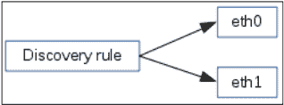

然后，LLD 规则包含原型。首先，需要监控项原型，不过 LLD 也允许我们添加触发器原型和自定义图形原型。原型到底是什么？我们在*第 8 章“使用模板简化复杂配置”*中讨论过模板。你可以将 LLD 原型视为迷你模板。它们影响的不是整个主机，而是主机上的监控项、触发器或自定义图形。例如，网络接口发现的监控项原型可以告诉 Zabbix，以相同的方式监控所有已发现接口的入站网络流量。

回到创建 LLD 规则的话题。在空白的 LLD 规则列表中，点击右上角的**创建发现规则**。填写以下内容：

- **名称：** `Interface discovery`
- **键：** `net.if.discovery`
- **更新间隔：** `120`

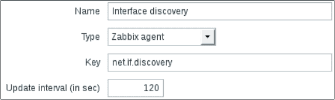

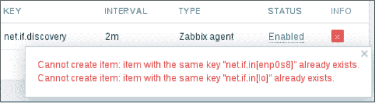

系统提示，根据 LLD 监控项原型需要创建的监控项已经存在了。没错；之前我们手动为接口监控添加监控项时，正好创建了一个完全一样的监控项。

> 如果 LLD 规则试图创建已经存在的监控项，则发现过程会失败，并且不会创建任何监控项。

和往常一样，监控项的唯一性由监控项键（包括所有参数）决定。遗憾的是，无法将手动配置的监控项与 LLD 生成的监控项合并，也没有简单的方法来保留已收集的历史数据。我们可以稍微更改现有监控项或监控项原型的键，并保留手动添加的监控项以作历史参考，等新的、由 LLD 生成的监控项收集到足够的历史数据后再将其删除。在这种情况下，我们可以对现有监控项的键稍作改动。导航到**配置 | 模板**，点击 **C_Template_Linux** 旁边的**监控项**。在**名称**列中点击 **Incoming traffic on interface eth0**。在属性中，进行以下更改：

- **名称：** `Incoming traffic on interface $1 (manual)`
- **键：** `net.if.in[enp0s8,]`

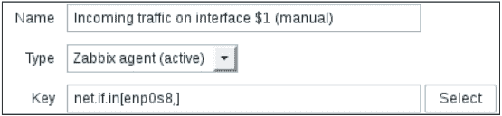

也就是说，在名称中添加 `(manual)`，并在方括号内添加一个尾部逗号。第一个更改并非严格必需，但它能让我们识别这些监控项。第二个更改在功能上不会带来任何变化——监控项仍然会收集完全相同的信息。不过，我们确实更改了监控项键。即使是这样一个小小的改动，也会使键发生变化，发现规则现在应该能够创建这些监控项了。完成后，点击**更新**。现在，对出站网络流量监控项和环回接口监控项进行相同的更改。


## 自动化配置

这个技巧之所以有效，是因为监控项键值可以接受参数。对于不接受参数的监控项键值，无法通过添加空的方括号来表示无参数。

修改监控项键值之后，我们还可以自动监控出站流量。让我们进入 **配置 | 模板**，点击 **C_Template_Linux** 旁边的 **发现**，然后点击 **接口发现** 旁边的 **监控项原型**。点击 **{ #IFNAME } 上的入站流量**，然后点击 **克隆** 按钮。在 **名称** 字段中将 **入站** 改为 **出站**，并将 **键值** 字段改为 `net.if.out[{#IFNAME}]`。完成后，点击底部的 **添加** 按钮。

等待几分钟，然后返回 **配置 | 主机**。点击 **A test host** 旁边的 **发现**。错误图标应该消失了——如果没有，请检查此处提到的其他监控项，并对它们进行同样的修改。一旦此部分不再列出错误，请导航到 **配置 | 主机**，然后点击 **A test host** 旁边的 **监控项**。应该会有几个新监控项，它们都应该以 LLD 规则名称——接口发现——作为前缀：

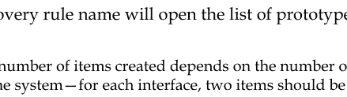

点击发现规则名称将打开 LLD 规则中的原型列表。

创建的监控项数量取决于系统上的接口数量——每个接口应创建两个监控项。

我们的第一条发现规则现在似乎运行良好；系统上的所有接口都已被发现，并且网络流量正在被监控。如果我们想监控每个接口上的其他参数，我们需要添加更多原型，在监控项键值参数中使用发现宏，以便创建的监控项具有唯一的键值。

让我们尝试改为通过 LLD 规则为每个接口创建一个计算监控项——进入 **配置 | 模板**，点击 **C_Template_Linux** 旁边的 **发现**，然后点击 **接口发现** 旁边的 **监控项原型**。然后，点击 **创建监控项原型**。填写以下值：

- **名称：** `$1 上的总流量`
- **类型：** 计算
- **键值：** `calc.net.if.total[{#IFNAME}]`
- **公式：** `last(net.if.in[{#IFNAME}])+last(net.if.out[{#IFNAME}])`
- **单位：** B

> 我们没有更改 **信息类型**，因为对于此处引用的网络流量监控项，我们有意将其保留为 **数字（无符号）**。如需提醒自己原因，请参阅 *第 3 章，使用 Zabbix 代理和基本协议进行监控*。

完成后，点击底部的 **添加** 按钮。如果您查看最新数据页面，此监控项应在几分钟内开始收集数据。

> 计算监控项的键值是为了我们自己的方便。该键值不会以任何方式影响数据收集——数据收集完全由公式决定。

但是，假设我们对总流量的非常详细的统计不那么感兴趣，而更关注长期趋势。我们可以修改刚刚创建的监控项，使其收集过去 10 分钟内平均入站和出站流量的总和，并每 10 分钟执行一次。让我们返回 **配置 | 模板**，点击 **C_Template_Linux** 旁边的 **发现**，然后点击 **接口发现** 旁边的 **监控项原型**。然后，点击 **{ #IFNAME } 上的总流量**。修改以下四个字段：

- **名称：** `$1 上过去 10 分钟的总流量`
- **键值：** `calc.net.if.total.10m[{#IFNAME}]`
- **公式：** `avg(net.if.in[{#IFNAME}],10m)+avg(net.if.out[{#IFNAME}],10m)`
- **更新间隔：** `600`

> 在公式中，我们也可以使用 `600` 来代替 `10m`。

完成后，点击底部的 **更新** 按钮。我们现在需要等待几分钟让发现规则再次运行，然后再等待最多 10 分钟让此监控项获取新值。

让我们讨论一下我们所做的更改。最重要的更改是 **公式** 更新。我们将两个监控项引用的 `last()` 函数都改为了 `avg()`。我们可以在计算监控项中使用任何触发器函数。我们还在逗号后为该函数提供了一个参数，这就是为什么我们必须在磁盘空间监控项中将监控项键值用双引号括起来的原因。被引用的键值包含逗号，而 Zabbix 可能会误解该逗号，将其视为将监控项键值与函数参数分隔的分隔符。

> 可以通过添加更多逗号来指定其他参数。例如，在 `avg(net.if.in[{#IFNAME}],10m,1d)` 中，`1d` 将是时间偏移，因为它是 `avg()` 触发器函数的第二个参数。更多关于触发器函数的内容，请参阅 *第 6 章，使用触发器检测问题*。
> 
> 如果我们只想在图形上显示总量，则无需创建监控项——堆叠图形可以做到这一点。我们在 *第 9 章，使用图形和地图可视化数据* 中讨论了堆叠图形。

总流量监控项应在最新数据中更新，以显示过去 10 分钟的平均总流量。通常，我们可能会为这些平均值使用更长的间隔，例如一小时，但 10 分钟能更快地为我们提供数据。这种方法也可以用于为某个监控项配置浮动平均值。例如，这样的公式可以计算 CPU 负载 6 小时的浮动平均值：

```
avg(system.cpu.load,6h)
```

计算监控项不必引用多个监控项；它们也可以引用单个监控项并对其进行某种计算。这种浮动平均值可以用于更好的趋势预测，或通过将当前 CPU 负载值与浮动平均值进行比较来编写相对触发器。

### 自动创建触发器

为所有已发现的实体创建监控项很有用，但即使只是查看这些监控项也可能是一项相当繁重的任务。幸运的是，LLD 也允许我们自动创建触发器。与监控项相同，这需要首先创建原型；实际的触发器将由发现过程稍后创建。

要创建原型，请导航到 **配置 | 模板**，点击 **C_Template_Linux** 旁边的 **发现**，然后点击 **触发器原型**。在右上角，点击 **创建触发器原型**，并按如下方式配置：

- **名称：** {HOST.NAME} 上的 {#IFNAME} 入站流量过高。
- **表达式：** 点击此字段旁边的 **添加**。在弹出的窗口中，点击 **选择原型**，然后在 NAME 列中点击 **{ #IFNAME } 上的入站流量**。点击 **插入** 并修改生成的表达式。将 `=0` 改为 `>5K`。这样，只要入站流量超过每秒 5,000 字节，您就会收到警报，因为该监控项以每秒字节数收集数据。
- **严重性：** 选择 **警告**。

完成后，点击底部的 **添加** 按钮。这是针对入站流量的；现在，让我们为出站流量创建一个原型。点击我们刚刚创建的原型的名称，然后点击 **克隆**。在新表单中，将 NAME 字段中的 **入站** 改为 **出站**，并将 Expression 字段中的 `net.if.in` 改为 `net.if.out`，然后点击底部的 **添加** 按钮。两个原型都就位后，让我们进入 **配置 | 主机**，然后点击 **A test host** 旁边的 **触发器**。这里很可能已经有一些针对入站流量的新触发器——我们先创建了那个原型，所以发现过程可能已经有时间处理它了。不过，所有由 LLD 创建的触发器最多只需几分钟就会显示出来。请务必手动刷新页面以查看任何更改——配置页面不会像监控页面那样自动刷新：

| 严重性 | 触发器 | 表达式 |
|---|---|---|
| 警告 | 接口发现：{HOST.NAME} 上 enp0s3 的入站流量过高 | {A test host:net.if.in[enp0s3].last()}>5K |
| 警告 | 接口发现：{HOST.NAME} 上 enp0s8 的入站流量过高 | {A test host:net.if.in[enp0s8].last()}>5K |
| 警告 | 接口发现：{HOST.NAME} 上 lo 的入站流量过高 | {A test host:net.if.in[lo].last()}>5K |

与监控项相同，触发器以 LLD 规则名称作为前缀。请注意，每个接口的每个原型都会生成一个触发器，这与监控项的情况相同。{#IFNAME} LLD 宏也被接口名称替换了。请注意，我们不必担心如何使创建的触发器保持唯一——我们必须在触发器中引用监控项键值，而该键值已经包含了适当的 LLD 宏。

我们这里选择的阈值非常低——即使在我们的小型测试系统上也很可能触发。如果我们有各种不同的系统，并且希望每个系统有不同的阈值，该怎么办？我们之前讨论过的用户宏概念可以在这里派上用场。我们可以在触发器表达式中使用用户宏而不是硬编码值，并在特定主机上根据需要覆盖它。我们在 *第 8 章，使用模板简化复杂配置* 中讨论了用户宏。


## 过滤发现结果

查看已创建的项目、触发器和图表，除了真实接口外，回环接口也被发现了，并且为其创建了所有这些实体。在某些情况下，监控该接口也可能有用，但对于大多数系统来说，这类数据并无用处。

如果我们查看配置中的项目列表，由 LLD 生成的项目旁边有复选框被禁用，我们也不能点击它们直接编辑属性。**STATUS** 列中的控件允许我们单独启用或禁用它们。不过，主机上的 LLD 生成项目无法编辑，只能禁用或启用。请注意，在前端，这只能逐个对每个项目进行操作——我们无法使用批量更新，因为复选框是禁用的。

在许多主机上禁用 LLD 生成的项目可能是一项庞大的手动任务。我们可以考虑禁用原型，但这行不通，原因有两个。首先，我们只想禁用回环接口的项目，但同一个原型用于所有接口上的项目。其次，原型中的状态更改不会传播到生成的项目中。这些项目在创建时的初始状态——启用或禁用——会一直保留。

那么其他对这些项目的更改呢，比如更改项目键或其他属性？这些更改会被向下传播，但仅当发现是由 Zabbix 服务器运行的时候，而不是我们在前端对原型进行更改时。实际上，这意味着我们必须等待最多 LLD 规则间隔，才能看到这些更改在下游应用。

幸运的是，有一种方法可以轻松避免为某些发现的实体创建项目，例如在我们的案例中：不为回环接口创建项目。这可以通过在 LLD 规则级别上过滤实体的 LLD 返回来实现。让我们更改现有的规则以忽略名称为 lo 的接口。

> 如果我们想保留 LLD 生成的项目但禁用或启用其中几个，在某些情况下，这可能值得通过 Zabbix API 来完成——我们将在 *第 21 章，紧密协作数据* 中简要介绍 API。


## 自动化配置

导航到 **Configuration | Templates**，并点击 **C_Template_Linux** 旁边的 **Discovery**。然后，在 NAME 列中点击 **Interface discovery**。注意这里还有另一个标签页：**Filters**。切换到该标签页，并在第一个也是唯一一个 **Filters** 条目中填写以下内容：

- **MACRO:** `{#IFNAME}`
- **REGULAR EXPRESSION:** `^([^1].*|[^lo].+)$`

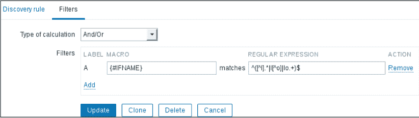

完成后，点击 **Update**。LLD 过滤器通过只返回匹配的条目来工作。在本例中，我们想排除条目 `lo` 并保留其他所有内容。不幸的是，Zabbix 守护进程仅支持 POSIX 扩展正则表达式——在这种风格中，否定一个字符串相当复杂。我们使用的过滤器将排除 `lo` 但匹配其他所有内容——包括 `eth0`、`enp0s8` 和 `loop0`。

> 💡 我们将在本章后面探索一种更简单的方式来否定字符串。

要查看是否生效，导航到 **Configuration | Hosts** 并点击 **A test host** 旁边的 **Items**。在列表中，注意到两个 `lo` 接口项目在 **INFO** 列中都有一个带有感叹号的橙色图标。如果你将鼠标光标移至其上，会有一条消息解释该项目不再被发现，并将在稍后某个时间被删除：


在本例中，该项目未被发现是因为它被过滤器排除了，但原因并不重要——也可能是接口被移除或名称被更改。但为什么它会在那个特定时间后被移除，大约 29 天多一点？如果我们再次查看 LLD 规则的属性，会有一个名为 **Keep lost resources period** 的字段：


在这里，我们可以指定当它们不再被发现时项目将被保留多长时间，默认值为 30 天。工具提示友好地告诉我们项目将在何时被删除以及确切的删除时间。其他实体，包括触发器和自定义图表，只要底层项目被保留，就会一直被保留。

> LLD 规则仅在获得新数据时才会被评估。如果规则停止获取数据，项目会提示它们应该被删除，但它们不会在规则获取新数据并被评估之前被删除。

现在，导航到 **Monitoring | Latest data**，并点击 **Incoming traffic on lo** 的 **Graph**。等待一段时间，注意到已安排删除的项目仍在继续收集数据。当我们最初在设备上监控了大量内容、使其过载，然后应用过滤希望改善情况时，这可能是不可取的。无法直接控制这一点，但我们可以暂时将资源保留时间设为 0，这样在 LLD 规则下一次运行时，未再被发现的项目将被移除。在 LLD 规则属性中，将该字段的值设为 0 并点击 **Update**。几分钟后，检查 **A test host** 在配置中的项目列表——两个自动的 lo 接口项目现在应该都不见了。

如果我们希望为不同的发现实体拥有不同的项目集，例如对具有特定名称的接口进行更多监控呢？遗憾的是，这并不容易实现。一种方法是通过创建两个不同的 LLD 规则并使用不同的项目原型，然后在其中一个 LLD 规则中过滤一组实体，在另一个 LLD 规则中过滤另一组实体。尽管如此，这比预期更复杂。LLD 规则具有与项目相同的唯一性标准：键。对于某些项目，我们可以使用一个小技巧，让一个项目的键称为 key，另一个项目的键为 key[ ]。指定空方括号表示空参数，但功能上项目完全相同。不幸的是，agent LLD 键不接受参数，因此此技巧行不通。一个变通方法是在项目键上指定别名——我们将在 *第 22 章，Zabbix 维护* 中讨论如何做到这一点。

## 文件系统发现

我们发现 Zabbix agent 内置了发现网络接口的支持。它还可以发现其他事物，其中最受欢迎的是文件系统。在配置之前，让我们先了解一下此类功能能带来什么。

## 介绍 LLD JSON 格式

发现不仅在前端看起来有点像项目；在其底层也以相同的方式运行。魔术基于特定项目值的內容。所有找到的事物都编码在 JSON 结构中。查看返回内容最简单的方法是使用 `zabbix_get` 查询 Zabbix agent。在测试主机上运行此命令：

```
```bash
$ zabbix_get -s 127.0.0.1 -k net.if.discovery
```
```

这里，`net.if.discovery` 只是一个项目键，与其他项目键没有区别。这将返回一个小字符串，类似于以下内容：

```
```json
{data:[{{#IFNAME}:enp0s3},{{#IFNAME}:enp0s8},{{#IFNAME}:lo}]}
```
```

虽然大多可以理解，但如果有格式会更好。最简单的方法是使用 Perl 或 Python 工具。Python 方法是：

```
```bash
$ zabbix_get -s 127.0.0.1 -k net.if.discovery | python -mjson.tool
```
```

Perl 方法是以下其中一种：

```
```bash
$ zabbix_get -s 127.0.0.1 -k net.if.discovery | json_pp
$ zabbix_get -s 127.0.0.1 -k net.if.discovery | json_xs
```
```

后一种方法应该更快，但需要 JSON::XS Perl 模块。对于我们的目的，性能不应成为问题，因此选择你能用的方法即可。输出将类似于：

```
```json
{
    data : [
        {
            {#IFNAME} : enp0s3
        },
        {
            {#IFNAME} : enp0s8
        },
        {
            {#IFNAME} : lo
        }
    ]
}
```
```


接口的数量及其名称可能会有所不同，但我们可以看出，对于每个找到的接口，我们返回一个宏：接口名称。文件系统发现的键类似：`vfs.fs.discovery`。我们现在可以运行这个：

```
$ zabbix_get -s 127.0.0.1 -k vfs.fs.discovery | json_pp
```

这很可能会返回大量条目。以下是片段：

```
{
    data : [
        {
            {#FSNAME} : /dev/pts,
            {#FSTYPE} : devpts
        },
        {
            {#FSNAME} : /,
            {#FSTYPE} : ext3
        },
        {
            {#FSNAME} : /proc,
            {#FSTYPE} : proc
        },
        {
            {#FSNAME} : /sys,
            {#FSTYPE} : sysfs
        }
        ...
```

这里可以看到两件事：一，它返回的结果肯定远多于我们想要监控的。二，它为每个文件系统返回两个值：名称和类型。虽然我们可以通过文件系统名称进行过滤，但某些被监控系统可能只有根文件系统，某些可能有单独的 `/home`，等等。最好的方式是按文件系统类型进行过滤。在此示例中，我们只想监控类型为 `ext3` 的文件系统。掌握了这些知识后，让我们导航到 **Configuration | Templates**，点击 **C_Template_Linux** 旁边的 **Discovery**，然后点击 **Create discovery rule**。填写以下值：

- **Name:** `Filesystem discovery`
- **Key:** `vfs.fs.discovery`
- **Update interval:** `120`

## Automating Configuration

与网络接口发现一样，我们将更新间隔设置为 120。表单中的默认值 30 秒非常低，不应使用。发现操作可能资源密集，如果可能，应每小时运行一次左右。现在，切换到 **Filters** 选项卡，并填写以下值：

- **Macro:** `{$FSTYPE}`
- **Regular expression:** `^ext3$`

> 用你系统上使用的文件系统类型替换。多个文件系统类型也可以被接受，像这样：`^ext3|ext4$`。

完成后，点击底部的 **Add** 按钮。我们现在有了发现规则，但没有原型。点击 **Filesystem discovery** 旁边的 **Item prototypes**，然后点击 **Create item prototype**。填写以下内容：

- **Name:** `Free space on {$FSNAME}`
- **Key:** `vfs.fs.size[{$FSNAME},free]`

完成后，点击底部的 **Add** 按钮。我们现在期望发现获取所有文件系统的列表，丢弃除类型恰好为 ext3 的那些之外的所有文件系统，然后为每个文件系统创建一个可用磁盘空间项。我们按一个 LLD 宏 `{$FSTYPE}` 进行过滤，但在实际的项配置中使用另一个宏 — `{$FSNAME}`。等待几分钟后，导航到 **Configuration | Hosts** 并点击 **A test host** 旁边的 **Items**。对于每个类型为 ext3 的文件系统，都应该有一个可用磁盘空间项：


有了更多原型，我们也可以监控总空间、inode 统计和其他数据。我们可以根据需要为所有这些文件系统设置触发器。

由于此发现返回多个宏，同时按多个宏进行过滤可能是可取的。例如，我们可能希望排除 `/boot` 文件系统不被监控。与 *Chapter 7, Acting upon Monitored Conditions* 中讨论的动作条件中的计算类型类似，我们可以在 **And**、**Or** 和 **And/Or** 之间选择自动选项——还有 **Custom expression** 选项。这应该允许我们创建不同复杂度的发现逻辑。

## Including discovered graphs in screens

当我们用普通图表配置屏幕时，我们只需选择应包含在屏幕中的图表。对于 LLD 生成的图表，情况变得更复杂——我们永远无法确定每个主机可能有多少个图表。幸运的是，Zabbix 允许我们以自动计算发现实体数量的方式包含 LLD 生成的图表。要尝试此功能，让我们前往 **Monitoring | Screens**，进入屏幕列表，并点击 **Local servers** 旁边的 **Constructor**。点击左下角的 + 图标在此处添加另一行，然后点击左下角的 **Change**。在 **Resource** 下拉菜单中，选择 **Graph prototype**。点击 **Graph prototype** 字段旁边的 **Select**。在弹出窗口中，在 **Group** 下拉菜单中选择 **Linux servers**，在 **Host** 下拉菜单中选择 **A test host**，然后点击 **NAME** 列中的 **Traffic on {#IFNAME}**。在 **Width** 字段中输入 `400`。


点击 **Add**。注意此单元格在屏幕配置中似乎没有多大用处——没有数据显示，标题只是 **Traffic on {#IFNAME}**。让我们在监控视图中检查此屏幕，看看是否更好。

根据系统拥有的网络接口数量，屏幕的左下角将有不同数量的图表。如果只有一个接口（不包括 lo），屏幕看起来会不错。如果有更多，所有图表都将被显示，但它们会被塞进一个单元格中，使屏幕布局不那么美观：

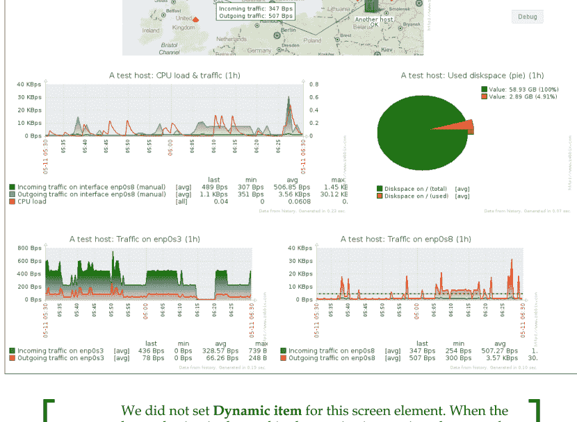

> 我们没有为此屏幕元素设置 Dynamic item。当在监控部分更改主机选择时，这些图表始终显示 A test host 的数据。我们在 Chapter 10, Visualizing the Data with Screens and Slideshows 中更详细地讨论了屏幕配置。

为了改进这一点，返回 Local servers 屏幕的构造器并点击左下角的 Change 链接。将 Column span 更改为 2。我们的屏幕有两列，因此网络接口图表现在将使用全屏宽度。此外，查看 Max columns 字段：默认情况下它设置为 3。如果你的系统发现了三个或更多网络接口，图表将占用三列的宽度，而不是两列，再次破坏屏幕布局。让我们将其设置为 2。完成后，点击 Update，然后再次在监控视图中检查屏幕：

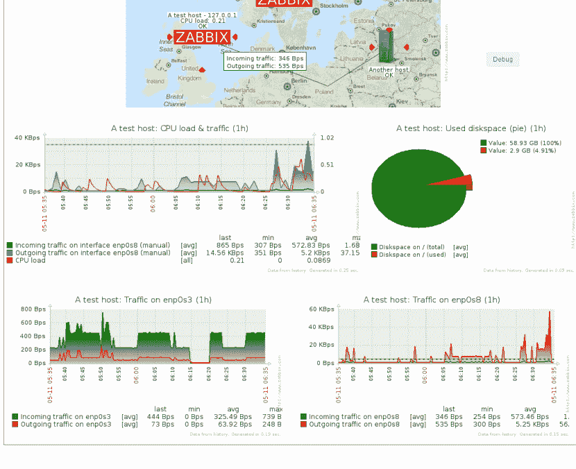

> 使用 avg() 或 max() 等触发器函数可能是一个好主意，以避免触发器抖动，如 Chapter 6, Detecting Problems with Triggers 中所讨论的。

这将对任何可用磁盘空间少于 20% 或利用率超过 80% 的文件系统发出警报。我们可以重写它以使用用户宏作为阈值：

```
{C_Template_Linux:vfs.fs.size[{#FSNAME},free].last()}<{$FS_FREE_THRESHOLD}
```

这将允许我们按主机自定义阈值，但不能按文件系统自定义。在此基础上扩展，我们将指示 LLD 规则将发现的文件系统作为宏上下文，像这样：

```
{C_Template_Linux:vfs.fs.size[{#FSNAME},free].last()}<{$FS_FREE_THRESHOLD:{#FSNAME}}
```

当 LLD 原型被处理时，LLD 宏会被发现的值替换为创建的项中。对于将在主机上创建的根文件系统的触发器，其外观如下：

```
{A test host:vfs.fs.size[{#FSNAME},free].last()}<{$FS_FREE_THRESHOLD:/}
```

对于 /home 文件系统的触发器，其外观如下：

```
{A test host:vfs.fs.size[{#FSNAME},free].last()}<{$FS_FREE_THRESHOLD:/home}
```

当 Zabbix 评估此触发器时，它会首先在主机上查找具有此上下文值的宏。如果未找到，它将查找链接模板中具有此上下文的宏。如果在那里也找不到，它将查找具有此类上下文的全局宏。如果仍然找不到，它将回退到没有上下文的宏并将其作为普通用户宏进行评估。这意味着我们不必为所有可能的上下文值定义用户宏——只需在我们想要修改行为的那些值即可。如果某个文件系统没有可用的特定用户宏，始终可以回退到主机、模板或全局宏。


## 自动化配置

这个功能非常实用，但要把它解释清楚似乎比较复杂，因此这里用一张示意图来说明。在没有上下文的情况下，用户宏会按照右栏所示的方式求值——即先检查主机级别，然后是模板，最后是全局。在有上下文的情况下也是如此——只是会先在所有三个级别中查找带上下文的宏名称，然后我们再回退到不带上下文的宏名称，同样在所有三个级别中查找。最先找到匹配项的位置将决定该宏的值。

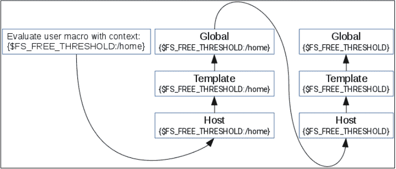

在触发器中使用时，这个功能允许我们为不同的文件系统设置不同的阈值——并且还可以按主机进行定制。我们可以让用户宏 {$FS_FREE_THRESHOLD:/home} 在一台主机上设为 20，在另一台主机上设为 30，依此类推。

当然，这不仅限于触发器——在支持用户宏的所有位置都可以使用，包括监控项键参数和触发器函数参数。一个触发器可以在一台系统上检查 5 分钟内的平均温度，而在另一台系统上检查 15 分钟内的平均温度。

## CPU 发现

Zabbix agent 支持的另一种发现方法是 **CPU 发现**。它会返回系统上所有的 CPU（或核心）。现在我们已经知道如何获取 LLD JSON，只需要知道哪个监控项键用于返回 CPU 信息——那就是 `system.cpu.discovery`。在测试主机上运行以下命令：

```
$ zabbix_get -s 127.0.0.1 -k system.cpu.discovery | json_pp
```

导航到“配置 | 主机”，在之前为其创建了 SNMP 监控项的主机旁边点击“发现”，然后点击“创建发现规则”。填写以下字段：

- 名称：SNMP 接口发现
- 类型：SNMPv2 agent（或选择其他受支持的 SNMP 版本）
- 键：snmp.interface.discovery
- SNMP OID：discovery[{#IFDESCR}, IF-MIB::ifDescr]
- 更新间隔：120

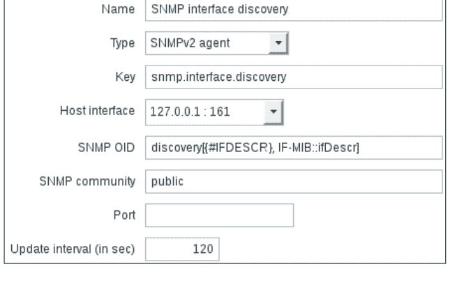

> 2.4 之前的 Zabbix 版本使用不同的 SNMP OID 语法来定义 LLD 规则。升级 Zabbix 会将语法改为当前版本，但导入旧模板时仍会使用旧语法，这在 Zabbix 2.4 及更高版本中会失败。目前尚不清楚哪个 Zabbix 版本能够修复此问题。

完成后，点击底部的添加按钮。发现过程本身与之前创建的内容非常相似，只有一个例外：SNMP OID 的值。对于 SNMP LLD，我们定义宏名称和要发现的 OID 表。在这种情况下，Zabbix 会查看 IF-MIB::ifDescr 表中的所有单独值，并将它们分配给 {#IFDESCR} 宏，也就是我们刚刚在 SNMP OID 字段中指定的名称。除了我们指定的宏之外，Zabbix 还会为每个找到的实体添加一个额外的宏：{#SNMPINDEX}。稍后我们将看到，这在创建监控项原型时非常有用。

要创建一些原型，请在新发现规则旁边点击**监控项原型**，然后点击**创建监控项原型**。填写以下内容：

- **名称：** `Incoming traffic on interface $1 (SNMP LLD)`
- **类型：** **SNMPv2 agent**
- **键：** `lld.ifInOctets[{#IFDESCR}]`
- **SNMP OID：** `IF-MIB::ifInOctets.{#SNMPINDEX}`
- **单位：** `Bps`
- **存储值：** **增量（每秒速率）**

完成后，点击底部的**添加**按钮。

注意，我们在监控项键前添加了 `lld` 前缀——这样它就不会与我们之前手动创建的监控项冲突。至于 SNMP OID，我们使用了内置的 `{#SNMPINDEX}` 宏，它应该能唯一标识 SNMP 表中的值。如果我们手动添加这样的监控项，就需要找出所需接口的正确索引，然后直接使用该数字。以上是传入流量的情况——为了更完整，请点击**名称**列中的**接口 {#IFDESCR} 上的传入流量（SNMP LLD）**，然后点击底部的**克隆**按钮。在“名称”字段中，将 Incoming 改为 Outgoing。在“键”和“SNMP OID”字段中，都将 In 改为 Out，使 OID 变为 ifOutOctets。完成后，点击底部的**添加**按钮。导航到**配置 | 主机**，并点击刚才操作的主机旁边的**监控项**。几分钟后，这里应该会根据这两个原型出现新的监控项。由于这是一个配置页面，请确保经常刷新，否则更改将不可见。

> 如果过了较长时间监控项仍未显示，请转到该主机的发现列表并检查 INFO 列——那里可能会列出错误信息。

很可能回环接口也会出现在列表中——我们没有为这条 LLD 规则应用任何过滤：

| SNMP 接口发现：接口 enp0s3 上的传入流量（SNMP LLD） | lld.ifInOctets[enp0s3] |
| SNMP 接口发现：接口 lo 上的传入流量（SNMP LLD） | lld.ifInOctets[lo] |
| SNMP 接口发现：接口 enp0s8 上的传入流量（SNMP LLD） | lld.ifInOctets[enp0s8] |

## 自动化配置

和之前一样，我们来为这些监控项创建一个图形原型。点击监控项列表上方导航栏中的**发现规则**，点击 **SNMP 接口发现**旁边的**图形原型**，然后点击**创建图形原型**按钮。在**名称**字段中输入 `Traffic on {#IFDESCR} (SNMP)`。在**监控项**部分点击**添加原型**，勾选两个原型旁边的复选框，然后点击**选择**。点击底部的**添加**按钮。几分钟后，如果查看该主机配置部分的图形列表，应该会为每个接口出现一个新图形。

`ifDescr` OID 通常就是接口名称。使用 `ifAlias` OID 来提供更友好的描述也很常见。我们可以将发现规则改为使用 `ifAlias` 而不是 `ifDescr`，但并非所有系统上的所有接口都会有可用的 `ifAlias` 值，而且我们可能仍然想知道 `ifDescr` 值。Zabbix 也可以在一个 LLD 规则中发现多个 OID。让我们回到该主机的发现规则配置，点击**名称**列中的 **SNMP 接口发现**。将 **SNMP OID** 字段修改为：

```
discovery[{#IFDESCR}, IF-MIB::ifDescr, {#IFALIAS}, IF-MIB::ifAlias]
```

更多的 OID 以额外参数的形式添加，其中宏名称后面总是跟着 OID。如果需要，我们还可以添加更多 OID：

```
key[{#MACRO1}, MIB::OID1, {#MACRO2}, MIB::OID2, {#MACROn}, MIB::OIDn]
```

不过在这种情况下，`ifAlias` 应该就足够了。点击底部的**更新**按钮，然后点击 **SNMP 接口发现**条目旁边的**图形原型**。点击**名称**列中的 **{#IFDESCR} 上的流量（SNMP）**，并修改这个图形原型的名称：

```
Traffic on {#IFDESCR} ({#IFALIAS}) (SNMP)
```

这样，如果某个接口设置了 `ifAlias`，它就会包含在图形名称中。我们仍然保留 `ifDescr` 值，因为它是唯一的接口标识符，而且有些接口的 `ifAlias` OID 可能没有返回值。让我们进入该主机的图形配置。几分钟后，图形名称应该会更新，括号中会包含 `ifAlias`。

> 如果你正在监控运行 Net-SNMP 守护进程的 Linux 系统，`ifAlias` 很可能是空的。

这种方法还提供了一种只监控选定接口的简便方式。如果你有大量网络设备，而只需要监控少数选定的端口，可以在设备上更改这些端口的描述——例如，它们都可以加上 zbx 前缀。这将显示在 ifAlias OID 中，我们可以在 LLD 规则属性中按 {#IFALIAS} 宏进行过滤。

> 宏名称是用户可配置的，在不同的 Zabbix 安装环境中可能会有所不同。只有内置的 {#SNMPINDEX} 宏始终具有相同的名称。

## 创建自定义 LLD 规则

内置的低级别发现支持非常适合发现文件系统、网络接口、CPU 和其他实体。但如果我们有一些自定义软件，想用它来发现组件，或者某个系统上运行的 Zabbix agent 版本较旧，尚不支持某种特定类型的发现，那该怎么办？LLD 的妙处在于，我们可以非常轻松地用自己的发现规则对其进行扩展。让我们来看两个例子：

- 在 Linux 上重新实现 CPU 发现
- 发现 MySQL 数据库

> LLD 规则永远不会返回监控项的值。它发现的是允许根据原型创建监控项的实体。监控项从 agent、SNMP 设备、使用 zabbix_sender 或任何其他数据收集方法获取值。

## 重新实现 CPU 发现

首先，让我们尝试做一件在最近的 Zabbix agent 中已经可用的事情——发现 CPU。我们这样做，一方面是因为如果你有某个系统运行旧版 agent，它可能会很有用；另一方面是因为它展示了 LLD 有时可以多么简单。为此，让我们考虑以下脚本：

```
for cpu in $(ls -d /sys/devices/system/cpu/cpu[0-9]*/); do
  cpui=${cpu#/sys/devices/system/cpu/cpu}
  [[ $(cat ${cpu}/online 2>/dev/null) == 1 || ! -f ${cpu}/online ]] &&
  status=online || status=offline;
  cpulist=$cpulist,'{#CPU.NUMBER}: '${cpui$/' ',
  {#CPU.STATUS}: '$status'}'
done
echo '{data: ['${cpulist#, }']}'
```


它依赖于 `/sys/devices/system/cpu/` 为每个 CPU 保留一个目录，命名为 `cpu`，后跟 CPU 编号。在这些目录中的每一个里，我们查找 online 文件——如果该文件存在，我们检查其内容。如果内容为 1，则认为 CPU 为在线状态；如果为其他内容——则为离线。在某些情况下，更改 CPU0 的在线状态可能不被允许——此时该文件会缺失，我们会将其解释为 CPU 处于在线状态。然后我们附加 `{#CPU.NUMBER}` 和 `{#CPU.STATUS}` 宏并赋予适当的值，最终将其全部打印出来，包装在 LLD 数据数组中。现在让我们将其用作用户参数。

> 我们在第 11 章《高级项监控》中探讨了用户参数。

我们将全部在一行中拼接，因为此命令不需要包装脚本。在 A test host 上的 Zabbix agent daemon 配置文件中，添加以下内容：

```
UserParameter=reimplementing.cpu.discovery,for cpu in $(ls -d /sys/devices/system/cpu/cpu[0-9]*/); do cpui=${cpu#/sys/devices/system/cpu/cpu}; [[ $(cat ${cpu}/online 2>/dev/null) == 1 || ! -f ${cpu}/online ]] && status=online || status=offline; cpulist=$cpulist,'{"{#CPU.NUMBER}":"'${cpui%/*}'","{#CPU.STATUS}":"'$status'"}' ; done; echo '{"data":['${cpulist#,}']}'
```

> 对于更复杂的情况或生产环境实现，请考虑使用适当的 JSON 实现，例如 JSON::XS Perl 模块。

重启 agent daemon，并在同一系统上运行以下命令：

```
$ zabbix_get -s 127.0.0.1 -k reimplementing.cpu.discovery
```

在四核系统上，它会返回类似如下内容：

```
{"data":[{"{#CPU.NUMBER}":"0","{#CPU.STATUS}":"online"},{"{#CPU.NUMBER}":"1","{#CPU.STATUS}":"online"},{"{#CPU.NUMBER}":"2","{#CPU.STATUS}":"offline"},{"{#CPU.NUMBER}":"3","{#CPU.STATUS}":"online"}]}
```

> 你可以使用 Perl 或 Python 重新格式化 JSON 以提高可读性——我们在本章前面已经做过。

我们现在可以像使用内置项一样以相同的方式将此项键用于 LLD 规则。项原型将完全以相同的方式工作，我们甚至不需要使用不同的 LLD 宏。

完成后，点击底部的 Add 按钮。对于此项，我们使用了 active agent，因为这对于用户参数是建议的，并且我们还将更新间隔设置为 5 分钟——通常数据库大小不会变化那么快，我们更感兴趣的是长期趋势。我们现在有了该项，它将是一个 UserParameter 变量，而该项又将由 Zabbix sender 填充的 LLD 规则创建。让我们现在设置 UserParameter 变量。在 A test host 的 Zabbix agent daemon 配置文件中，添加以下内容：

```
UserParameter=mysql.db.size[*],HOME=/home/zabbix mysql -Ne select sum(data_length+index_length) from information_schema.tables where table_schema='$1';
```

此 UserParameter 变量将查询总数据库大小，包括实际数据和所有索引。注意我们再次设置了 HOME 变量。保存文件后不要忘记重启 agent daemon。最好立即进行测试：

```
$ zabbix_get -s 127.0.0.1 -k mysql.db.size[zabbix]
```

这很可能会返回某个数字：

```
147865600
```

如果失败，请重新检查我们在第 11 章《高级项监控》中使用的 MySQL 参数配置。

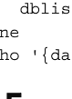

> 注意返回此值需要一些时间。对于大型数据库，使用 Zabbix Sender 来处理此类项可能是一个更好的主意。

在 LLD 规则和项原型就位后，让我们开始发送用于发现的 JSON。以下内容应发现当前用户可访问的所有数据库并为 Zabbix 生成 LLD JSON：

```
for db in $(mysql -u zabbix -Ne show databases); do
  dblist=$dblist,'{"{#MYSQL.DBNAME}":"'$db'"}'
done
echo '{"data":['${dblist#,}']}'
```


> 我们正在删除 JSON 数据库列表中的尾随逗号——JSON 不允许尾随逗号，包含它会导致发现失败。Zabbix 会抱怨传入的数据不是有效的 JSON。

这里的原理与之前的 CPU 发现重新实现类似：我们找到所有数据库并在正确的宏名称后将它们列在 JSON 中。它应返回类似以下的行：

```
{"data":[{"{#MYSQL.DBNAME}":"information_schema"},{"{#MYSQL.DBNAME}":"zabbix"}]}
```

现在让我们将其实际发送到我们的 LLD 规则——我们将为此使用 Zabbix Sender。

如果你测试过此操作从而修改了 dblist 变量，请在运行以下命令前执行 `unset dblist`：

```
$ zabbix_sender -z 127.0.0.1 -s "A test host" -k mysql.db.discovery -o $(for db in $(mysql -u zabbix -Ne show databases); do dblist=$dblist,'{"{#MYSQL.DBNAME}":"'$db'"}'; done; echo '{"data":['${dblist#,}']}')
```

> 此命令应以 Zabbix agent daemon 运行的用户身份运行；否则，它可能会包含 Zabbix 用户无权限的数据库，并且此类项将变得不受支持。

在配置中访问 A test host 的项列表应显示为每个数据库创建了一个项：

| Item | Key |
| --- | --- |
| MySQL database discovery: Database information_schema size | `mysql.db.size[information_schema]` |
| MySQL database discovery: Database zabbix size | `mysql.db.size[zabbix]` |

首次值出现在 Latest data 页面可能需要长达 3 分钟——首先，最长一分钟用于配置缓存刷新，然后，最长两分钟用于 active agent 从服务器更新其配置。

> 还请记住，规则仅在收到新数据时才会被评估。如果数据库被删除并计划删除，只要 trapper 项不再接收数据，它就永远不会被删除。

点击最底部的 Add 按钮。

使用 `10` 且 Character string not included 将排除包含 `10` 的任何内容，而不仅仅是确切字符串 `10`。

但一旦在此处配置了类似的东西，我们如何在 LLD 规则过滤器中使用它？全局正则表达式可以通过在其名称前加上 at (@) 符号来代替普通正则表达式使用。为此，请转到 Configuration | Templates，点击 C_Template_Linux 旁边的 Discovery，然后点击 NAME 列中的 Interface discovery。切换到 Filters 选项卡，并将 REGULAR EXPRESSION 列中唯一的值替换为 `@Exclude loopback`。

此处不应使用引号——只需 at 符号然后是全局正则表达式名称，与在管理部分中配置的完全一致。

完成后，点击 Update。新的配置应完全相同工作，但似乎更容易理解。

当全局正则表达式的名称被更改时不会进行任何检查——这样一来，配置在其他地方可能会被破坏，因此应谨慎进行，如果可能的话根本不要进行。

全局正则表达式派上用场的另一个地方是日志监控。与 LLD 规则过滤器类似，我们只需使用 @-前缀的表达式名称，而不是直接输入 regexp。例如，我们可以定义如下正则表达式：

```
(ERROR|WARNING) 13[0-9]{3}
```

它会捕获任何错误和警告，其错误代码在 13,000 范围内——因为这可能被定义为我们关心的问题。假设我们将全局命名为 "regexp errors and warnings 13k"，日志监控键将如下所示：

```
log[/path/to/the/file,@regexp errors and warnings 13k]
```

## 测试全局 regexp

让我们返回到 **Administration | General**，在下拉菜单中选择 **Regular expressions**，并点击 **New regular expression**。按如下方式在此处添加三个表达式：

- 第一个表达式：
  - **EXPRESSION TYPE:** Character string included
  - **EXPRESSION:** `A`
  - **CASE SENSITIVE:** yes
- 第二个表达式：
  - **Expression type:** Result is TRUE
  - **Expression:** `^[0-9]`
- 第三个表达式：
  - **Expression type:** Result is FALSE
  - **Expression:** `[0-9]$`

这应匹配包含大写 A 的字符串，以数字开头，且不以数字结尾的字符串。现在，切换到 **Test** 选项卡并在 **Test string** 字段中输入 `1A2`；然后，点击 **Test expressions**。在以下结果区域的截图中，它显示以数字开头且包含大写 A 的字符串匹配，但随后字符串以数字结尾，而我们已将其否定。因此，最终测试失败。

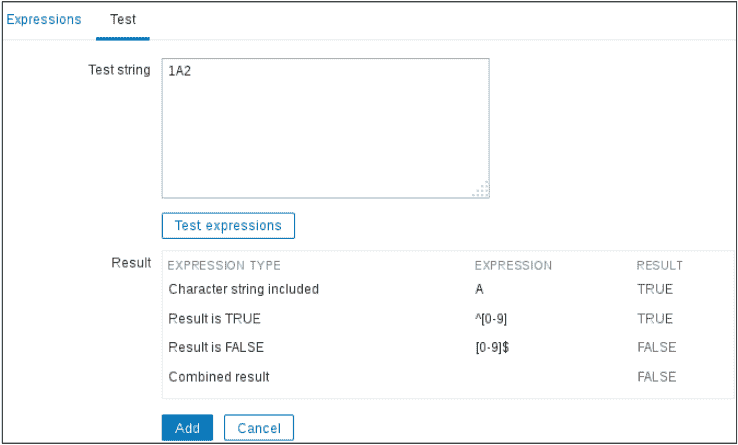


> Zabbix 前端使用 PCRE，但 Zabbix 守护进程使用 POSIX EXTENDED。不要使用 PCRE 字符类、环视或其他 PCRE 支持但 POSIX ERE 不支持的任何特性——它们在前端测试时看似能工作，但在由 Zabbix 守护进程解释时就会失败。

## 默认模板中的用法

既然我们创建了自己的全局正则表达式，你可能已经注意到其中已有一些现成的。让我们导航到 Administration | General 并再次在下拉菜单中选择 Regular expressions。除了我们为回环接口过滤创建的那个之外，还有三个现有的表达式：

| File systems for discovery | 1 » ^(btrfs|ext2|ext3|ext4|jfs|reiserfs|xfs|jffs|ufs|jffs2|qfs|hfs|nfs|fat32|zfs)$ | [Result is TRUE] |
| Network interfaces for discovery | 1 » ^lo$ | [Result is FALSE] |
|  | 2 » ^Software Loopback Interface | [Result is FALSE] |
| Storage devices for SNMP discovery | 1 » ^(Physical memory|Virtual memory|Memory buffers|Cached memory|Swap space)$ | [Result is FALSE] |

其中一个，Network interfaces for discovery，实际上做的事情几乎与我们做的相同，只是它还排除了名称以 Software Loopback Interface 开头的接口——这是针对 MS Windows 监控的。File systems for discovery 可以用来限制要监控的文件系统类型——除了我们过滤的 ext3 之外，它还包含一大堆其他文件系统类型。Storage devices for SNMP discovery 用于在通过 SNMP 监控时将内存统计信息从存储设备中排除。虽然文件系统类型正则表达式可以直接输入，但其他两个几乎不可能——POSIX EXTENDED 实际上并没有以合理的方式支持否定多个字符串。

## 网络发现

LLD 关注的是在单个主机上发现实体。Zabbix 还支持一种扫描网络地址范围并根据发现的内容执行某些操作的方式——这称为网络发现。

## 查看结果

等待几分钟后，检查 **Monitoring | Discovery** 部分：

| DISCOVERED DEVICE | MONITORED HOST | UPTIME/DOWNTIME | ICMP PING |
|---|---|---|---|
| **A test discovery** (2 devices) |  |  |  |
| 192.168.56.10 (testhost) |  | 00:23:22 | 🟩 |
| 192.168.56.11 | Another host | 00:23:20 | 🟩 |

所有在配置范围内响应 ping 的设备都将在这里列出。如果某个设备已作为 Zabbix 中的主机被监控，它将在 **MONITORED HOST** 列中列出。我们还将看到该主机已知处于活动状态的时间长短，以及 **ICMP PING** 列将为所有主机以绿色列出此特定服务。但为什么这里只有一台主机被列为已监控？主机在这里是通过其 IP 地址识别的，而对于 A test host，我们使用了 `127.0.0.1`。发现时使用的地址不同，因此它并不被视为同一主机或设备。

> 主机目前在此处不可点击——可能最简单的方法是通过全局搜索字段复制并粘贴主机名来访问主机属性。

现在，导航回 **Configuration | Discovery** 并在 **NAME** 列中点击 **A test discovery**。在 **Checks** 块中点击 **New** 并选择一个在这些主机上可访问且易于控制的服务——也许再次选择 **SMTP**。在 **Checks** 部分点击 **Add**，然后再次点击 **New**。这次，选择一个在配置范围内任何主机上都不存在的服务——**FTP** 可能是不错的选择。然后，再次在该块中点击 **Add**：

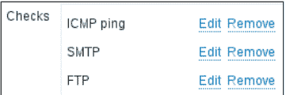

最后，点击 **Update**。等待几分钟后，访问 **Monitoring | Discovery**：

| DISCOVERED DEVICE ▲ | MONITORED HOST | UPTIME/DOWNTIME | ICMP PING | SMTP |
|---|---|---|---|---|
| A test discovery (2 devices) |  |  |  |  |
| 192.168.56.10 (testhost) |  | 02:07:13 |  |  |
| 192.168.56.11 | Another host | 02:07:11 |  |  |

**SMTP** 已出现，这很棒。但为什么没有 **FTP** 列？这个视图是否限制为两个服务？它并不限制服务数量，但如果某个服务在任何主机上都未被发现，则目前根本不会显示该服务。如果某个服务最初在某些系统上被发现而在其他系统上未被发现，则会显示该列，未发现该服务的系统将得到灰色单元格。

如果我们将光标移到绿色单元格上，我们将能够看到该服务已处于活动状态（或被发现）的时间长短：

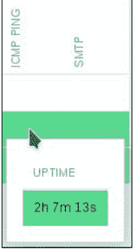

让我们破坏一下——在其中一台主机上关闭 SMTP 服务，并等待几分钟。该主机对应的 **SMTP** 单元格应变为红色，并且弹出窗口应开始跟踪该服务的停机时间。如果主机上的所有服务都宕机，则该主机本身将被视为宕机，这将在 **UPTIME/DOWNTIME** 列中反映出来。

## 对发现结果做出反应

发现监控页面起初很有趣，但长期来看并不太有用。幸运的是，我们可以让 Zabbix 根据发现结果执行操作，其配置方式与我们对触发器触发做出反应时的方式有些相似。要查看此配置方式，请导航到 Configuration | Actions，并在右上角的 Event source 下拉菜单中切换到 Discovery。然后，点击 Create action。立刻就能注意到的一点是，此操作仍填入了默认的主题和消息，但内容不同：这里使用的宏特定于网络发现。填写 Network discovery test 的名称，然后让我们切换到 Conditions 选项卡并展开 New condition 部分中的第一个下拉菜单：

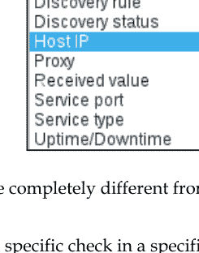

可用的条件与触发器操作中可用的条件完全不同。让我们回顾一下它们：

- **Discovery check**：这里必须选择特定发现规则中的特定检查。
- **Discovery object**：这里可以选择设备或服务。在我们的示例中，被发现的主机是设备对象，而 SMTP 是服务对象。
- **Discovery rule**：必须选择特定的网络发现规则。
- **Discovery status**：此条件可能的取值为 **Up**、**Down**、**Discovered** 和 **Lost**。对于设备，如果其上的至少一个服务可以到达，则被认为已发现或处于活动状态。以下是这些值的含义：
  - **Discovered**：此设备或服务首次被看到或在检测到宕机后再次被检测到
  - **Lost**：此设备或服务以前被看到过，但刚刚消失
- **Up:** 设备或服务已被发现——无论发生过多少次
- **Down:** 设备或服务曾在某个时间点被发现，但现在无法到达——无论发生过多少次
- **Host IP:** 这里可以指定单个地址或范围。
- **Proxy:** 操作可以限制为特定的 Zabbix 代理。我们将在 *第 19 章，使用代理监控远程位置* 中讨论代理。
- **Received value:** 如果我们轮询的是 Zabbix agent 项目或 SNMP OID，我们可以对特定值做出反应——例如，如果通过 `system.uname` 项目键发现，我们可以将返回字符串中包含 `Linux` 的所有主机链接到 Linux 模板。
- **Service port:** 操作可以限制为发现时发生的特定端口或端口范围。
- **Service type:** 操作可以限制为服务类型。这与 **Discovery check** 条件类似，只是选择 SMTP 将匹配所有网络发现规则中的所有 SMTP 检查，而不仅仅是特定的一个。
- **Uptime/Downtime:** 这里可以输入秒数，以将操作仅限制在设备或服务已处于活动或宕机状态一段时间之后。

其中大多数都很容易理解，但让我们更仔细地看看其中两个。**Discovery status** 条件允许我们在初始检查或在停机后被发现与周期性检查之间进行区分。例如，如果我们匹配 **Up** 状态并将主机添加到 **Host group**，此添加将在每次主机可到达时被检查并执行。如果有人将该主机从该主机组中移除，它将在每次发现周期中被重新添加。如果我们匹配 **Discovered** 状态，它只会在主机首次被发现以及主机宕机后再次上线时发生。在这种情况下，自动重新添加到组中很可能发生在更晚的时候。

**Uptime/Downtime** 条件允许我们在有延迟的情况下做出反应，而不是立即反应。例如，我们可能希望在设备上运行几小时的监控，因为它可能是一台临时用于故障排除的笔记本电脑，已连接到网络。可能更重要的是，我们可能不希望在主机停机 5 分钟时删除该主机及其所有历史记录。检查一周的停机时间可能是合理的——如果一周内没人关心该主机，则可以安全删除。


## 自动化配置

现在，我们暂时将条件留空，切换到**操作**选项卡。添加一个新操作并展开**操作类型**下拉列表，即可看到所有可用的操作。稍后我们会更详细地讨论它们，但现在，我们选择**添加到主机组**。在输入框中开始输入`linux`，然后从下拉列表中选择**Linux 服务器**。接着，点击**操作详情**块中的小号“添加”控件。这里要非常小心，因为很容易丢失某些配置。完成后，点击底部的**添加**按钮：

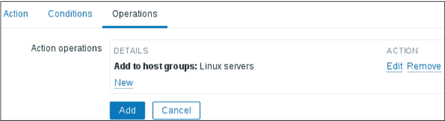

几分钟后，前往**配置 | 主机**查看结果。如果发现了我们的测试系统，应该会看到新增了一台主机。

> 尽管我们没有在操作中明确指定添加主机本身，但它仍然发生了。如果操作隐式地表明存在一台主机——例如，将其添加到主机组或链接到模板——该主机将被自动添加。

为什么只有一台主机？另一台主机之前已经根据**监控 | 发现**存在了。对于这台主机，你将看到它的主机名，或者 Zabbix 中用作主机名的 IP 地址。如果 Zabbix 服务器能够对该 IP 地址执行反向查找，则结果将用作主机名。如果无法执行反向查找，则 IP 地址将用作主机名。

> 如果多个地址反向解析为相同的名称，则其他地址将被添加为 name_2 等。

点击“名称”列中的**新主机**。在**组**部分，这台主机按预期位于**Linux 服务器**组中。但它也在其他某个组中，即**已发现主机**。这是从哪里来的？

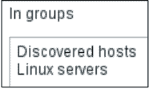

## 自动化配置

- **启用主机：** 主机将被启用。如果不存在这样的主机，则先添加一台。
- **禁用主机：** 主机将被禁用。这可以作为删除主机的一种更安全的替代方案，或者我们可以先禁用主机，之后再删除。如果不存在这样的主机，则先添加一台。

当链接到模板时，主机仍然需要该模板中监控项所要求的所有正确接口。在发现过程中，只有成功的发现检查才会导致添加相应类型的接口。例如，如果我们只在主机上发现了 SNMP，则只会添加 SNMP 接口。如果 SNMP 和 Zabbix agent 发现检查都在一台主机上成功，则两个接口都会添加。如果某些检查稍后成功，则会创建额外的接口。

### 唯一性标准

但是，对于具有多个暴露给 Zabbix 网络发现的接口的多宿主主机，又该如何处理呢？让我们返回**配置 | 发现**，点击**测试发现**。查看**设备唯一性标准**选项——那里唯一的设置是**IP 地址**。在**检查**块中，点击**新建**，并在**检查类型**下拉列表中选择 **Zabbix agent**。在**键**字段中，输入`system.uname`，然后点击**检查**块中的**添加**。注意，**设备唯一性标准**是如何获得一个新选项的——**Zabbix agent "system.uname"**：

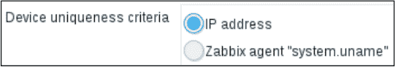

默认情况下，当唯一性标准设置为**IP 地址**时，Zabbix 将为每个发现的 IP 地址创建一个新主机。如果某个系统有多个地址，则会为每个地址创建一个新主机。如果唯一性标准设置为某个 Zabbix agent 监控项，它将检查之前见过的所有 IP 地址以及针对该监控项键返回的值。如果新值与之前的某个值匹配，它将在现有主机上添加一个新接口，而不是创建新主机。对于 SNMP 也是如此——添加一个 SNMP 检查会增加另一个唯一性标准选项，Zabbix 将比较针对该特定 OID 收到的值。通常通过 SNMPv2-MIB::sysDescr.0 OID 来发现 SNMP 设备。

> 必须预先配置 Zabbix agent 和 SNMP，使其接受来自 Zabbix 服务器的连接。

现在我们已经讨论了网络发现，我将给您一个简短的建议——不要使用它。好吧，也许没那么绝对，但不要过于依赖它。网络发现有其使用场景，但通常情况下，应该被监控的设备列表来自**配置管理数据库（CMDB）**或其他来源。在这种情况下，最好是基于该权威来源进行集成并自动更新您的 Zabbix 配置。如果您对“您环境中主机的最权威列表是什么？”的回答是“Zabbix”，那么网络发现就是为您准备的。

### 主动 agent 自动注册

我们刚刚探讨了网络发现——它扫描一个网络范围。Zabbix 还支持一种反向的功能，即 Zabbix agent 可以主动注册，Zabbix 服务器可以自动开始监控它们。这被称为主动 agent 自动注册。

每当 Zabbix agent 连接到 Zabbix 服务器时，服务器会将传入的 agent 主机名与现有主机进行比较。如果存在同名主机，它将继续正常的主动监控项监控序列。这包括已启用和已禁用的主机。如果主机不存在，则自动注册序列启动，即生成一个事件。

每次未知 agent 连接到 Zabbix 服务器时都会生成一个事件，这一点很重要。如果您不使用主动监控项或自动注册，请在 agent 端关闭主动检查。否则，每次此类检查都会产生一个网络连接、agent 端和服务器端的日志条目，以及 Zabbix 数据库中的一个事件。在某些情况下，这会增加数据库大小并导致性能显著下降。在某些实例中，有数百万个这类完全无用的自动注册事件，占事件总数的比例高达 90%。建议检查服务器日志中是否有如下条目：

```
cannot send list of active checks to [127.0.0.1]: host [Register me]
not found
```

如果找到，它们都应该被解决。第一对方括号告诉我们连接来自哪里，第二对告诉我们 agent 声称的主机是什么。

与触发器事件和网络发现事件类似，我们可以通过操作来响应该事件。现在让我们配置一个自动注册操作——前往**配置 | 操作**，并在**事件源**下拉列表中切换到**自动注册**。然后，点击**创建操作**。在**名称**字段中输入`Testing registration`，然后切换到**操作**选项卡。点击**操作操作**块中的**新建**。**操作类型**下拉列表显示了可用于网络发现的操作子集。最值得注意的是，我们无法删除主机、无法将主机从主机组中移除，也无法将主机从模板中取消链接。这些操作在功能上与网络发现相同，因此我们不会深入探讨——这次只需选择**添加主机**，并点击**操作详情**块中的小号**添加**控件。然后，点击底部的**添加**按钮。操作配置好后，可能最简单的测试方法是模拟一个新 agent。编辑 A test host 上的 agent 守护进程配置文件，将**Hostname**参数改为`Register me`。然后，重启 agent 守护进程。前往**配置 | 主机**——又出现了一台新主机。如果检查主机属性，它包含在**已发现主机**组中——这里使用的组与网络发现中使用的组相同。让我们将 agent 守护进程配置文件中的**Hostname**参数改回之前的值，并重启 agent。

我们还没有查看自动注册的条件——让我们返回**配置 | 操作**，点击**Testing registration**，然后切换到**条件**选项卡。“新建条件”部分旁边的下拉列表显示了可用的条件：

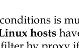

正如我们所见，这里可用的条件列表要短得多。我们可以按主机名进行过滤——例如，如果我们所有的**Linux 主机**名称中都包含“linux”，我们可以用这种方式来检测它们。如果我们使用 Zabbix 代理进行自动注册，我们也可以按代理进行过滤。还有一个名为**主机元数据**的条目——那是什么？


## 自动注册元数据

当 Zabbix agent 连接到服务器时，它会发送其主机名。但它还可能向服务器发送一些自定义字符串。发送的内容由 agent 守护进程配置文件中的一个配置参数 `HostMetadata` 控制。这可用于定义主机类型：数据库或应用。或者它可以列出主机上运行的各个服务。由于我们可以在自动注册动作中匹配接收到的元数据，因此我们可以列出所有正在运行的服务，以管道分隔。在动作条件中，我们可以查找 `|MySQL|` 并将新主机链接到适当的模板。

> 元数据限制为 255 个字符。

直接在配置文件中控制元数据参数是可能的，但可能很麻烦。有一种方法可以让 agent 动态获取该值。不是使用 `HostMetadata`，我们将定义 `HostMetadataItem` 并指定一个 item 键。我们可以使用内置的 item 键之一，或配置用户参数并运行脚本。请注意，我们也可以在此处使用 `system.run` item 键，并在 `HostMetadataItem` 参数中直接指定任何命令，即使未启用远程命令也是如此——因为它不是从网络到达的，所以不被视为远程命令。例如，以下是一个有效的 `HostMetadataItem` 行：

```
HostMetadataItem=system.run[rpm -qa mariadb]
```

如果在基于 RPM 的系统上存在 `mariadb` 包，agent 将在元数据中发送它；我们可以在动作条件中匹配它并将该主机链接到 MariaDB/MySQL 模板。

此参数还有另一个用例。你可能已经注意到，只要存在自动注册动作，某人就可能恶意或意外地创建大量主机，从而可能极大地减慢 Zabbix 的速度。没有秘密挑战机制来防止这种情况，但我们可以在这里使用元数据。动作条件可以检查元数据中是否包含特定的秘密字符串——如果存在，则创建主机。如果不存在，则发送电子邮件供某人调查。请注意，密钥不能太长，因为 255 个字符的长度限制仍然适用。

## 摘要

在本章中，我们了解了 Zabbix 中允许自动创建和维护配置的几个功能：

- 低级发现或 LLD
- 网络发现
- 活动 agent 自动注册

LLD 允许使用 Zabbix agents 发现实体——它内置支持网络接口、文件系统和 CPU。我们讨论了如何使用用户宏上下文支持按发现的实体自定义阈值和其他值。Zabbix 还可以发现 SNMP 表，如网络接口，但它并不限于此——任何 SNMP 表都可以被发现。我们还查看了创建自定义发现，包括 MySQL 数据库发现。

LLD 提供了一种通过正则表达式过滤结果的方法，我们检查了全局正则表达式如何使这里以及其他地方（如日志监控）变得更容易。

之后，我们探索了网络发现，它涉及扫描地址范围并自动添加主机，可能将它们链接到适当的模板并添加到主机组。

在另一个方向上，有活动 agent 自动注册，其中活动 agent 可以加入，服务器会自动开始监控它们。此功能的元数据支持允许对要链接哪些模板或主机应属于哪些主机组进行相当精细的规则。我们注意到，如果不使用，agent 上的活动检查应被禁用；否则会给整个 Zabbix 基础设施带来不必要的负载。

在下一章中，我们将探索内置的 Web 监控功能。它允许我们定义由步骤组成的场景。步骤检查页面并可能查找特定的 HTTP 响应代码或返回页面中的字符串。我们还将尝试登录应用程序并从一个页面提取数据然后传递到另一个页面。

## 13
