## 监控 Web 页面

在本章中，我们将查看 Zabbix 内置监控 Web 页面的功能。我们将检查 Web 页面的不同部分并监控其故障，以及监控下载速度和响应时间。我们还将了解 Zabbix 如何从某个页面提取值然后重用该值。除了更高级的场景和基于步骤的解决方案外，我们还将探索可用于 Zabbix agent 的与 Web 监控相关的 item。

### 监控简单的 Web 页面

互联网在现代生活的方方面面都很重要：社交、商业、娱乐，以及其他一切都通过网络进行。鉴于投入到这个网络的资源，许多人负责维护网站——无论是内部托管的站点还是委托给外部托管提供商的站点，我们至少想知道其基本健康状况。我们可以从在真实网站上监控一些简单的事情开始。

### 创建 Web 监控场景

Zabbix 中的 Web 监控通过场景进行，而场景又包含步骤。每个步骤由一个 URL 和对其进行的检查组成。这允许检查单个页面并验证多个页面按顺序正常工作。Zabbix 中的 Web 监控场景仍然分配给主机，并且也可以进行模板化。为了了解其工作原理，我们可以监控开源地图项目 OpenStreetMap 的几个页面。

虽然我们可以将 Web 监控场景附加到任何现有主机，但这并不能正确反映场景监控的内容，因此我们将创建一个专用主机。由于只有一个 OpenStreetMap 网站，我们不会为此使用模板。导航到 Configuration | Hosts，点击 Create host，并填写以下值：

- **Name:** OpenStreetMap
- **Groups:** 如果 In Groups 框中有任何组，请标记它们并点击 ▶ 按钮
- **New group:** Web pages

我们不必在此更改任何其他值，因此点击底部的 Add 按钮。现在我们准备创建场景本身——在主机列表中，点击 OpenStreetMap 旁边的 Web 并点击 Create web scenario。在场景属性中，输入以下值：

- **Name:** Main page
- **New application:** Webpage
- **Update interval:** 300

现在进入各个步骤。Web 监控的步骤是对 Web 服务器执行的实际查询；每个步骤都有一个 URL。切换到 Steps 选项卡并在 Steps 部分点击 Add。在新弹出窗口中填写以下值：

- **Name:** First page
- **URL:** http://www.openstreetmap.org/
- **Required string:** Enter OpenStreetMap is a map of the world, created by people like you. 此字段将在返回的页面中搜索特定字符串，如果找不到该字符串，此步骤将失败。我们可以在此处使用 POSIX 正则表达式，但不能使用第 12 章《Automating Configuration》中讨论的全局正则表达式。
- **Required status codes:** Enter 200。在此处，可以指定可接受的 HTTP 返回代码，以逗号分隔。同样，如果返回代码不匹配，此步骤将被视为失败。状态代码 200 表示 OK。

> required string 仅针对页面源进行检查，而不是针对 HTTP 标头。场景仅下载步骤 URL 指向的内容；Web 页面的其他元素永远不会被下载。

此表单应如下所示：

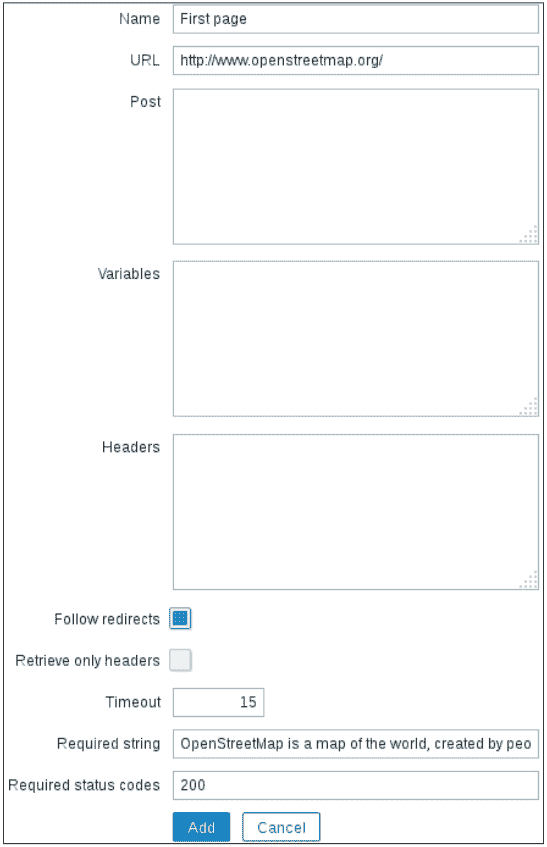

如果确实如此，点击 Add 按钮。让我们也检查是否可以访问 GPS traces 页面。再次点击 Steps 部分中的 Add，并输入以下值：

- **Name:** Traces
- **URL:** http://www.openstreetmap.org/traces/
- **Required string:** Public GPS traces
- **Required status codes:** 200

## 监控 Web 页面

在 **Required** 字符串字段中，我们输入了应在 traces 页面上出现的文本。完成后，点击 **Add**。

配置的最后一步应如下所示：

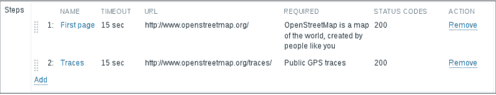

如果一切看起来正常，点击底部的 **Add** 按钮。让我们看看 Web 监控在视觉上是什么样的。打开 **Monitoring | Web** 并点击 **OpenStreetMap** 旁边的 **Main page**。看起来所有步骤都已成功完成，因此我们可以认为被监控的网站运行正常，因为 **STATUS** 列高兴地说 **OK**——或者至少是我们监控的部分。与普通 item 一样，我们可以看到最后一次检查的执行时间：

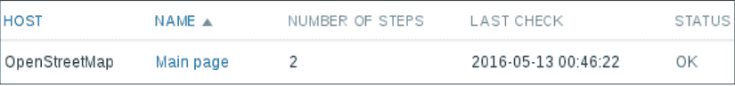

我们还对每个场景包含多少步骤有一个概览，但这非常模糊。点击 **NAME** 列中的 **Main page**——也许有更多信息。确实有！在这里，我们可以看到每个步骤的统计信息，例如 **SPEED**、**RESPONSE TIME** 和 **RESPONSE CODE**。而且，如果这还不够，还有漂亮的预定义图表用于 **SPEED** 和 **RESPONSE TIME**。请注意，这些是堆叠图，因此我们可以识别出所有步骤一起花费更多时间的时间点。在图表上方，我们可以看到那些熟悉的时间尺度控件——滚动条、缩放和日历控件——因此这些图表提供与其他地方相同的功能，包括点击并拖动以放大：


# Web场景的详细信息：主页

| 步骤 | 速度 | 响应时间 | 响应代码 | 状态 |
|---|---|---|---|---|
| 主页 | 31.29 KBps | 429.7ms | 200 | 正常 |
| 追踪 | 80.01 KBps | 302.5ms | 200 | 正常 | 调试 |
| 总计 |  | 732.2ms |  | 正常 |

缩放：5分钟 15分钟 30分钟 1小时 全部
2016-05-13 00:31 - 2016-05-13 01:06 (现在)
«« 1小时 5分钟 | 5分钟 1小时 »» 35分钟 固定

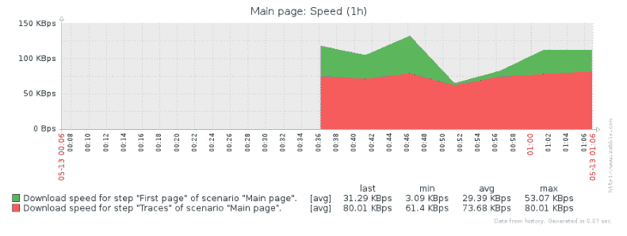

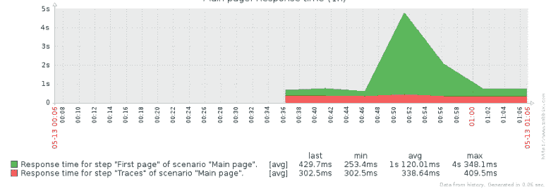

我们可以看到每个步骤花费的相对时间，以及与其他步骤相比的速度。在本例中，这两个操作平均合计耗时略低于一秒，尽管曾出现接近5秒的峰值。

虽然这个视图很不错，但灵活性不够。也许我们可以直接访问底层数据？让我们访问**监控 | 最新数据**来了解。在**主机组**字段中选择**网页**，然后点击**筛选**。**网页**应用中的监控项将会显示出来。看看这些数据——所有收集到的值都可以作为独立的监控项访问，包括下载**速度**、**响应时间**、**响应代码**，甚至每个场景的最后一条错误信息。我们可以重用这些监控项，从而创建任何我们想要的图表——也许我们想要每个步骤响应时间的饼图，或者非堆叠的下载速度图。当然，与所有监控项一样，我们无需任何额外配置即可获得简单图表。

| 名称 ▲ | 上次检查 | 上次值 |
|---|---|---|
| 网页（9个监控项） | | |
| 场景“主页”的下载速度。 | 2016-05-13 01:16:37 | 28.78 KBps |
| 场景“主页”中步骤“主页”的下载速度。 | 2016-05-13 01:16:37 | 3.16 KBps |
| 场景“主页”中步骤“追踪”的下载速度。 | 2016-05-13 01:16:37 | 54.41 KBps |
| 场景“主页”的失败步骤。 | 2016-05-13 01:16:37 | 0 |
| 场景“主页”的最后一条错误信息。 | | |
| 场景“主页”中步骤“主页”的响应代码。 | 2016-05-13 01:16:37 | 200 |
| 场景“主页”中步骤“追踪”的响应代码。 | 2016-05-13 01:16:37 | 200 |
| 场景“主页”中步骤“主页”的响应时间。 | 2016-05-13 01:16:37 | 4s 257.7ms |
| 场景“主页”中步骤“追踪”的响应时间。 | 2016-05-13 01:16:37 | 439.2ms |

还有一个失败步骤监控项，如果没有步骤失败，则返回0。由于一切正常时该值为0，我们可以在触发器中检查此值不为0，并基于此发出告警。

> 虽然我们可以使用值映射在失败步骤为0时显示**成功**，但我们不得不为每个步骤编号添加值映射条目——值映射还不支持范围或默认值。

# 其他场景和步骤属性

在继续讨论告警之前，让我们回顾一下场景级别的其他选项：

- **尝试次数**：网页是很有趣的东西。它们大多数时候都能正常工作，但监控系统检查它的那一刻，却失败了。或者只是用户重新加载了一个一次加载失败的页面，然后从不抱怨？无论如何，这个字段允许我们指定Zabbix尝试下载网页的次数。对于偶尔出现小问题的页面，2或3的值可能是合适的。

- **代理**：当Web浏览器连接到Web服务器时，它通常会发送一个标识自身的字符串。这个字符串包括浏览器名称、版本、操作系统，通常还有其他信息。此信息用于诸如收集统计信息、使网站的特定部分在某些浏览器中更好地工作、拒绝访问或限制网站体验等目的。Zabbix Web监控检查也会向Web服务器发送用户代理字符串。默认情况下，它标识为Zabbix，但也可以从预定义的浏览器字符串列表中选择，或通过选择其他...来输入完全自定义的字符串：

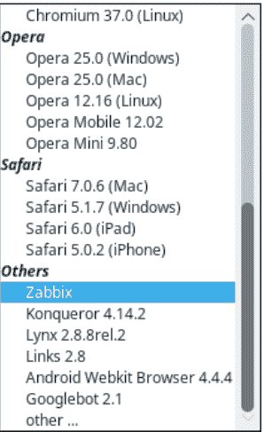

- **HTTP代理**：如果需要，可以为每个场景设置HTTP代理。也可以指定用户名、密码和端口：


默认HTTP代理可以通过为Zabbix Server进程设置http_proxy和https_proxy环境变量来配置——这些变量将被libcurl获取，而libcurl在底层用于Web监控。如果场景级别指定了代理，它将覆盖此类默认代理设置。无法在步骤级别设置代理。

稍后我们将讨论其余字段：变量和请求头。

Zabbix中的Web监控完全不支持JavaScript。

# Web场景的告警

让我们创建一个触发器，当场景中的任何步骤失败时警告我们。如前所述，失败步骤监控项在一切正常时值为0。任何其他值都是失败步骤的序号。由于Web场景在任何失败时都会停止，失败步骤编号为3意味着前两个步骤已成功执行，然后第三个步骤失败。如果有任何进一步的步骤，我们不知道它们的状态——它们没有被处理。

要创建触发器，我们总是需要一个监控项键。我们可以尝试在监控项列表中找到它。进入配置 | 主机，点击OpenStreetMap主机旁边的监控项——没有监控项。原因是这些监控项很特殊——它们是Zabbix Web场景内部的监控项（不要与第22章“Zabbix维护”中讨论的内部监控项混淆），因此不可用于手动配置。不过，在创建触发器时我们应该能够选择它们。点击导航头中的触发器，然后点击创建触发器。在触发器编辑表单中，输入以下值：

- **名称：** `{HOST.NAME} 网站问题`

- **表达式：** 点击**添加**，然后在弹出的对话框中点击**监控项**字段旁边的**选择**。在**组**下拉菜单中选择**网页**，在**主机**下拉菜单中选择**OpenStreetMap**，然后在**名称**列中点击**场景“主页”的失败步骤**。我们必须找出此监控项何时不返回零。在**功能**下拉菜单中选择**最后（最新）T值不等于N**，然后点击**插入**。最终的触发器表达式应如下所示：

`{OpenStreetMap:web.test.fail[Main page].last()}>0`

完成后，点击底部的**添加**按钮。我们可以看到监控项键`web.test.fail[Main page]`是如何使用的；因此，Web场景监控项与普通监控项非常相似。它们有名称和键，即使它们在监控项配置视图中不可见。这样，我们可以为所有Web场景监控项创建触发器，例如响应时间和下载速度，以发现性能问题，或者为返回码创建触发器以发现确切的失败步骤。这些监控项也可用于自定义图表。

我们创建的触发器会在Web场景第一次失败时发出告警。有人可能希望降低这种监控的敏感度，至少有两种方法可以实现：

- 将场景属性中的**尝试次数**设置为更大的值。
- 在更长的时间段内检查监控项值。我们在*第6章“使用触发器检测问题”*中讨论过这种策略。

如果Web监控步骤失败，Zabbix会停止，不会继续执行下一步。如果你正在监控的网站有多个可以独立工作的部分，你应该为每个部分创建单独的场景。

> 当Web监控失败时，了解我们究竟从Web服务器收到了什么会非常有用。不幸的是，Zabbix默认不会在任何地方存储检索到的内容。我们将在*附录A“故障排查”*的*控制运行中的守护进程*一节中讨论一种临时查看所有检索到的网页的方法。

# 登录Zabbix界面

我们在网站测试中的最初几个步骤相当简单。现在让我们做一些更复杂的事情。我们将尝试登录Zabbix前端，检查是否成功，然后注销。顺便说一下，我们还应该验证注销操作是否成功。

> 我们将使用默认的Admin用户帐户进行这些测试。请注意，这将使用户的登录/注销条目污染审计日志。

为了更清晰，我们将使用更多单独的步骤来完成此操作：

- 步骤1：检查主页
- 步骤2：登录
- 步骤3：检查登录
- 步骤4：注销
- 步骤5：检查注销


我们将在A test host上设置此场景。转到配置|主机，点击A test host旁边的Web，然后点击创建Web场景。填写以下值：

- **名称：** Zabbix frontend
- **新应用程序：** Zabbix frontend
- **变量：** 在此处输入以下行：
  `{user}=Admin`
  `{password}=zabbix`

> 请记住，我们将Web场景分配给哪台主机并不重要——实际检查仍由Zabbix服务器执行。

我们填写的变量与Zabbix中的其他宏/变量使用了不同的语法。我们将能够在场景步骤中使用它们，稍后我们将看到具体如何操作。现在，进入步骤——切换到“步骤”选项卡。对于每个步骤，首先点击“步骤”部分中的“添加”链接。最后，点击步骤属性中的“添加”按钮，然后继续下一步。对于所有步骤，根据需要调整URL——IP地址或主机名以及Zabbix前端的实际位置。

## 步骤1：检查第一页

在第一页，填写以下详细信息：

- **名称：** First page
- **URL：** http://127.0.0.1/zabbix/index.php
- **必需字符串：** Zabbix SIA
- **必需状态代码：** 200

在URL中，我们还附加了`index.php`以减少所需的重定向数量。必需字符串将根据页面内容进行检查。这也包括所有HTML标签，因此如果你的目标字符串包含任何标签，请务必列出它们。我们还选择了一个出现在页面底部的文本，以确保页面可能已完全加载。至于状态代码：HTTP响应代码200没问题；我们要求返回该特定代码。

## 步骤2：登录

现在开始登录：

- **名称：** `Log in`
- **URL：** `http://127.0.0.1/zabbix/index.php`
- **POST：** `name={user}&password={password}&enter=Sign in`
- **必需状态代码：** `200`

此步骤中的大多数内容应该很清晰，除了新的**POST**字符串。它遵循指定多个值的标准语法，用与号（&）连接。我们终于使用之前指定的变量，并根据登录表单中的输入字段名称传递它们。最后一个变量`enter`是Zabbix前端登录页面中的一个隐藏输入，我们必须向其传递硬编码值`Sign in`。要查明其他页面的这些值，请查看页面源代码，使用浏览器调试功能，或嗅探网络流量。

## 步骤3：检查登录

我们可以假设登录成功。但是最好还是检查一下这类事情。我们可能漏掉了某个隐藏变量，或者密码可能出错。因此，我们将使用一个单独的步骤来确保登录确实成功。请注意，此场景中的所有后续步骤都将以已登录用户身份操作，直到我们注销。在整个场景期间，Zabbix会保留所有收到的cookie以供后续步骤使用。登录后，一个明显的特征就是个人资料链接，它使用`top-nav-profile`类——这就是我们要检查的字符串：

- **名称：** `Check login`
- **URL：** `http://127.0.0.1/zabbix/index.php`
- **必需字符串：** `top-nav-profile`
- **必需状态代码：** `200`

先不要添加此步骤。在继续下一步（注销）之前，我们应该讨论一下需要什么。注销被视为修改性操作，因此我们实际上必须将会话ID作为`sid`变量传递。我们现在必须以某种方式获取它，可以通过在此处从页面源代码中提取ID来实现。可以从网页中提取值，分配给变量，并在后续步骤中重用。让我们也填写以下内容：

```
Variables: {sid}=regex:sid=([0-9a-z]{16})
```

现在，可以添加该步骤了。这里的语法值得更详细地讨论。变量赋值的第一部分与手动赋值相同，等号后面的第二部分以关键字`regex`开头。然后，用冒号分隔，后面跟一个正则表达式。它将与页面源代码进行匹配。在我们的例子中，我们首先查找`sid=`字符串，后跟16个字母数字字符。这些字母数字字符就是会话ID，我们已将它们包含在一个捕获组中。请注意，这不是Zabbix特有的，而是标准的正则表达式功能。匹配的捕获组内容将被赋值给该变量。提取和重用会话ID是此功能最常见的用途，但只要我们能为正则表达式想出一个匹配模式，任何想在后续步骤中重用的内容都可以从页面中提取并赋值给变量。

> 不支持换行匹配，因此匹配的内容必须位于单行上。

## 步骤4：注销

现在我们有了会话ID，准备注销。不过，我们必须使用不同的URL。如果你查看页面源代码，注销控件使用JavaScript重定向到一个相对URL，如下所示：

```
index.php?reconnect=1&sid=b208d0664fa8df35
```

这里两个重要的变量是`reconnect`和`sid`。`reconnect`只需设置为1。至于`sid`，幸运的是我们在上一步中提取了该值，因此我们有注销所需的所有组件：

- **名称：** 注销
- **URL：** http://127.0.0.1/zabbix/index.php?reconnect=1&sid={sid}
- **必需状态代码：** 200

> 注销很重要。否则，默认情况下会话会在一年内不被移除，而且每次前端检查都会增加一个会话。大量会话会拖慢Zabbix前端的速度。我们将在第22章“Zabbix维护”中讨论会话维护。

## 步骤5：检查注销

我们将检查是否存在只在登录页面上才能看到的字符串。否则，注销可能已经悄然失败：

- **名称：** `Check logout`
- **URL：** `http://127.0.0.1/zabbix/index.php`
- **必需字符串：** `Sign in`
- **必需状态代码：** `200`

最终步骤应如下所示：

| 步骤 | 名称 | 超时 | URL | 必需的 | 状态代码 | 操作 |
|---|---|---|---|---|---|---|
| 1: | 第一页 | 15秒 | http://127.0.0.1/zabbix/index.php |  | 200 | 移除 |
| 2: | 登录 | 15秒 | http://127.0.0.1/zabbix/index.php |  | 200 | 移除 |
| 3: | 检查登录 | 15秒 | http://127.0.0.1/zabbix/index.php | top-nav-profile | 200 | 移除 |
| 4: | 注销 | 15秒 | http://127.0.0.1/zabbix/index.php?reconnect=1&sid={sid} |  | 200 | 移除 |
| 5: | 检查注销 | 15秒 | http://127.0.0.1/zabbix/index.php | Sign in | 200 | 移除 |

如果一切看起来正常，点击页面底部的**添加**按钮，最终保存此场景。我们可以让场景运行一段时间，然后讨论一些我们没有使用的步骤参数：

- **跟随重定向：** 指定Zabbix是否应跟随重定向。如果启用，它会跟随最多10个硬编码的重定向，因此无法检查是否存在特定次数的重定向。如果禁用，我们可以检查HTTP响应代码是否为`301`或其他有效的重定向代码。
- **仅检索标头：** 如果页面很大，我们可以选择仅检索标头。在这种情况下，**必需字符串**选项将被禁用，因为Zabbix尚不支持在标头中匹配字符串。
- **超时：** 指定此特定步骤的超时时间。它分别应用于连接和执行HTTP请求。请注意，默认超时时间为15秒，这可能导致Zabbix在一个页面上花费长达30秒。

> 我们可以对URL的一部分或全部使用用户宏——这样我们只需定义一次，然后在每个步骤中引用它。我们在*第8章，使用模板简化复杂配置*中讨论了用户宏。

该场景似乎运行正确：登录和注销看起来工作正常。请注意，如果对你来说失败了，失败实际上可能出在之前的步骤中。例如，如果在步骤3：检查登录时失败，实际故障很可能在步骤2：登录——也就是说，登录失败了。

我们采用的五步方法并不是最简单的。虽然它允许我们将每个操作拆分到各自的步骤中（并提供了带有五个值的漂亮图表），但我们可以使用更简单的方法。要检查登录和注销，最简单的且步骤数量最少的方法如下：

- 登录并检查是否成功
- 注销并检查是否成功

作为额外练习，请考虑创建一个新场景，并用两个步骤实现相同的目标。

## 认证选项

在场景属性中，还有一个我们没有使用的选项卡——认证：

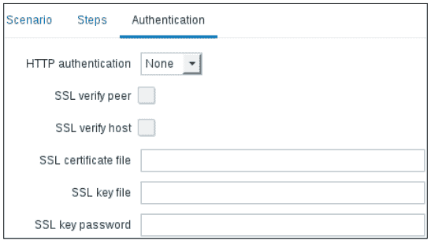

对于HTTP认证，Zabbix目前支持两个选项——Basic和NTLM。目前不支持摘要认证。

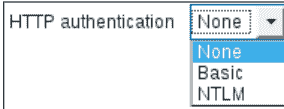

选择其中一种HTTP认证方法将提供用户名和密码的输入字段。


所有其他选项都与 SSL/TLS 相关。复选框允许我们验证服务器证书——**SSL verify peer** 选项会检查证书的有效性，而 **SSL verify host** 则额外检查服务器主机名是否与证书中的 **Common Name** 或 **Subject Alternate Name** 相匹配。证书颁发机构会根据系统默认设置进行验证。CA 证书的位置也可以通过服务器配置文件中的 `SSLCALocation` 参数进行覆盖。

最后三个字段使我们能够使用证书设置客户端身份验证。Zabbix 支持证书、密钥和密钥密码的所有可能组合：单个未加密文件、完全分离的证书、密钥和密钥密码等等。客户端证书文件必须放置在服务器配置文件中 `SSLCertLocation` 参数指定的目录中。密钥文件（如有）必须放置在服务器配置文件中 `SSLKeyLocation` 参数指定的目录中。

## 使用 agent 项

我们刚刚设置的基于 Web 场景的监控功能非常强大，但在某些情况下，更简单的方法可能就足够了。在 agent 级别，有一些有趣的项键可以检索网页并执行简单验证。额外的好处是可以从任何 agent 执行，因此从多个地理分布位置检查网页可用性非常容易。有三个与网页相关的项键：

- `web.page.get`
- `web.page.perf`
- `web.page.regexp`

> 还请记住诸如 net.tcp.service 之类的更简单的项键，见第 3 章《使用 Zabbix Agents 和基本协议进行监控》。

## 获取页面

最简单的与网页相关的 agent 项键 `web.page.get` 允许我们检索页面内容。与基于场景的 Web 监控一样，它不会检索任何包含内容，例如图像。让我们使用此键创建一个简单的项。导航到 **Configuration | Hosts**，并在 **Group** 下拉菜单中选择 **Web pages**。点击 **OpenStreetMap** 旁边的 **Items**，然后点击 **Create item**。填写以下内容：

- **Name:** `OpenStreetMap main page`
- **Key:** `web.page.get [www.openstreetmap.org, /]`

- **Type of information:** Text
- **New application:** OSM

> 我们正在为 Zabbix 服务器创建 agent 项。这意味着此 Web 项将由本地 agent 检查。

完成后，点击底部的 Add 按钮。在此项中，我们指定了 / 作为第二个参数，但这是可选的——默认情况下会请求 Web 服务器的根目录。如果必须使用自定义端口，可以将其指定为第三个参数，如下所示：

```
web.page.get[www.site.lan,/,8080]
```

与其单独检查我们正在创建的每个项的结果，不如先创建全部三个项，然后再验证结果。

## 检查页面性能

另一个与网页相关的 agent 项是 web.page.perf。它以秒为单位返回页面的加载时间。仍在项列表中，点击 Create item，并填写以下内容：

- **Name:** OpenStreetMap main page load time
- **Key:** web.page.perf[www.openstreetmap.org,/]
- **Type of information:** Numeric (float)
- **Units:** s
- **Applications:** OSM

完成后，点击底部的 Add 按钮。我们更改了 Type of information，因为此项键返回加载页面所需的时间（以秒为单位），该值通常会有小数部分。

## 从网页中提取内容

在创建 Web 监控场景时，我们使用了从页面中提取内容并在以后重用的功能。使用更简单的 agent 监控，仍然可以从页面中提取一些内容。作为测试，我们可以尝试提取 OpenStreetMap is 之后直到第一个逗号之前的文本。再次点击 Create item，并填写以下内容：

- **Name:** OpenStreetMap is
- **Key:** web.page.regexp[www.openstreetmap.org,,,OpenStreetMap is ([a-z ]*),,\1]

## Monitoring Web Pages

- **Type of information:** Character
- **Applications:** OSM

> 内部方括号包含 a-z——z 后面有一个空格。

完成后，点击底部的 **Add** 按钮。

> 该项键在撰写本文时可与 **OpenStreetMap** 页面内容配合使用。如果网页被重新设计，请将其视为额外挑战来调整正则表达式。

对于此项，我们直接从页面中提取搜索结果。这里重要的参数是第四个参数——它是一个将在页面源中匹配的正则表达式。在本例中，我们正在查找 OpenStreetMap is 字符串并将它之后直到第一个逗号之前的所有内容包含在一个捕获组中。我们将正则表达式包含在双引号中，因为它包含逗号。逗号是 **item key parameter separator**，因此可能会被误解。然后，在最后一个参数中，我们请求仅包含第一个捕获组的内容。默认情况下，返回整个匹配字符串。有关使用此方法进行值提取的更多详细信息，请参阅 *第 11 章《高级项监控》* 中的 *Log file monitoring*。我们还选择 **Type of information** 为 **Character**——这将把值限制为 255 个符号，以防它匹配到一个巨大的字符串。

> 对于此键，第五个参数允许我们限制返回键的长度。如果您想提取一个数字并通过 SMS 发送，限制提取字符串的长度为 50 个字符将降低消息过长的可能性。

此项的实际应用是使用 mod_status 或其他服务器软件的类似功能从 Apache Web 服务器中提取统计信息。

> 目前，这三个 web.page.* 项均不支持 HTTPS、身份验证或重定向。

配置好项后，让我们检查其返回的值——前往 **Monitoring | Latest data**，清空 **Host groups** 字段，在 **Hosts** 字段中选择 **OpenStreetMap**，然后点击 **Filter**。查找 OSM 应用中的项：

| NAME ▲ | LAST CHECK | LAST VALUE |
|---|---|---|
| OSM (3 items) | | |
| OpenStreetMap is | 2016-05-13 13:41:21 | a map of the world |
| OpenStreetMap main page | 2016-05-13 13:41:20 | HTTP/1.1 200 OK Date: Fri, 13 May 2016 10:41:20 GMT ... |
| OpenStreetMap main page load time | 2016-05-13 13:41:21 | 604.8ms |

> 每个项都会单独请求页面。

这些项应返回完整的页面内容、加载页面所需的时间以及我们正则表达式的结果。web.page.get 项始终包含标头也是如此。如果您看到 web.page.get 和 web.page.regexp 项偶尔出现空值，这可能是因为请求超时。虽然 Web 场景有自己的超时设置，但 agent 项默认遵守 agent 超时 3 秒。web.page.perf 项在超时时返回 0。

> Zabbix web.page.get 项目前不能正确处理分块传输编码，而分块传输编码被广泛使用。额外数据会被插入到页面内容中。预计在 Zabbix 3.0 中使用 libcurl 处理这些 agent 项时将修复此问题，但该开发尚未完成。在撰写本文时，还不知道何时可以修复。

使用这些项，我们可以在页面加载时间过长或完全无法工作时触发警报，或当页面上找不到特定字符串时触发警报——使用 str() 和类似的触发器表达式对整个页面项或内容提取项进行操作。

> Web 场景在 Zabbix 服务器上执行，agent 项在 agent 上执行。我们将在第 19 章《使用代理监控远程位置》中讨论在远程系统上运行 Web 场景的能力。

我们创建的项都发送到同一个 Zabbix agent。我们也可以创建一个具有多个接口的主机并将项分配给每个接口。这使我们能够从多个位置检查网页，但将结果保留在单个主机中。我们仍然必须使项键唯一——如果需要，可以使用空键参数的技巧、键参数中的额外逗号或键别名，这些在第 22 章《Zabbix 维护》中讨论。请注意，在这种设置中不能使用模板。


# 总结

首先，我们学习了如何根据各种参数监控网页，包括响应时间、传输速度、HTTP返回码以及页面本身包含的文本。我们还了解了如何设置多个场景及其中的步骤，以及如何设置可在所有步骤中使用的变量。作为一个更高级的示例，我们登录了 Zabbix 前端并退出。为了实现这一点，我们提取了会话 ID 并在后续步骤中重复使用它。掌握了这些知识，应该可以监控网页所拥有的大部分功能。

对于生产系统，通常会有更多的应用程序、场景和步骤。Web 监控可用于多种不同目的，最流行的是站点可用性和性能，但可以监控的情况有很多，例如查看 Slashdot 首页上的公司名称，并将通常的首页替换为更简单的页面，以便更容易承受即将到来的流量冲击——即 Slashdot 效应。

作为更简单的替代方案，我们还探索了代理端的网页监控项。它们有三个功能：

- 检索完整页面内容
- 获取页面加载时间
- 使用正则表达式从页面提取字符串

Web 场景仅在服务器端可用，而更简单的监控项仅在代理端可用。

到目前为止，我们主要专注于 Linux 系统监控，在下一章中我们将离开这个主题，转而学习 *第14章，监控Windows*。我们将学习 Windows 原生代理、性能计数器和 **Windows管理规范（WMI）** 监控，以及服务发现和 Windows 事件日志监控。

Zabbix 代理的 Windows 版本可以从两个官方位置获取——要么从 http://www.zabbix.com/download.php 的下载页面，要么从源代码归档中。虽然在源代码中保留二进制文件的做法并不被建议，但 Zabbix 就是这样做的，有时我们可以利用这一点。如果您是从源代码安装的，最好使用同一归档中的 Windows 代理二进制文件，以便版本匹配。代理可执行文件位于 bin/win32 或 bin/win64 子目录中——请选择适合您系统架构的那个。如果您是从软件包安装的，请访问下载页面并获取 Windows 代理归档文件——但请确保使用与 Zabbix 服务器相同或更早的主版本。无论如何拿到代理，请将其放在 Windows 机器上的同一目录中。为了简单起见，这次我们将使用 C:\zabbix，但您可以使用任何其他目录。我们还需要配置文件，因此如果您使用了源代码中的二进制文件，请获取 conf/zabbix_agentd.win.conf 中提供的示例；如果您从 Zabbix 网站下载了二进制文件，则从归档文件中的 conf/ 目录获取。将配置文件放在同一目录中——现在应该有两个文件了。在继续研究代理本身之前，让我们确定是否需要以任何方式修改配置。用您喜欢的文本编辑器打开 C:\zabbix\zabbix_agentd.win.conf，查找任何我们可能想要更改的参数。首先，日志文件的位置不太正确——它设置为 C:\zabbix_agentd.log，所以让我们将其改为：

```
LogFile=c:\zabbix\zabbix_agentd.log
```

在 Windows Zabbix 代理守护进程的命令行和配置文件中，您可以使用正斜杠和反斜杠。

我们已经知道服务器行（目前读作 Server=127.0.0.1）必须更改。将 127.0.0.1 部分替换为您的 Zabbix 服务器的 IP 地址。为了确保主动监控项能按预期工作，让我们检查一下 Hostname 指令——默认情况下它设置为 Windows 主机，我们可以保持原样。另一个用于主动检查的参数是 ServerActive。将这里的 127.0.0.1 也替换为 Zabbix 服务器 IP 地址，然后保存文件。

如果我们现在启动代理，它会根据我们在第12章“自动化配置”中创建的配置自动注册到 Zabbix 服务器。虽然这很方便，但这次我们想以更严格的方式测试——转到“配置 | 动作”，在“事件源”下拉列表中切换到“自动注册”，然后点击“测试注册”旁边的“已启用”——这将禁用我们之前设置的自动注册。

现在让我们尝试启动代理。启动 Windows `cmd.exe` 并执行：

```
C:\zabbix>zabbix_agentd.exe -c c:/zabbix/zabbix_agentd.win.conf
```

> 💡 在某些版本的 Windows 上，你可能需要在命令前加上 `.\`。
> 
> 如果你没有看到任何输出，或者另一个窗口一闪而过，你应该以管理员用户身份启动命令提示符。在近期版本的 Windows 中，菜单项被称为**命令提示符（管理员）**。

代理守护进程拒绝启动：

```
zabbix_agentd.exe [6348]: use foreground option to run Zabbix agent as console application
```

那么，让我们弄清楚如何提供前台选项。Windows 上的代理守护进程可执行文件具有可以传递给它的附加选项，因此在命令提示符中执行它（当位于 `zabbix_agentd.exe` 所在的目录时）：

```
C:\zabbix>zabbix_agentd.exe --help
```

查看**选项**部分，其中列出了前台参数：

| 选项 | 描述 |
|---|---|
| `-f --foreground` | 在前台运行 Zabbix 代理 |

让我们尝试使用该选项：

```
C:\zabbix>zabbix_agentd.exe --foreground -c c:/zabbix/zabbix_agentd.win.conf
Starting Zabbix Agent [Windows host]. Zabbix 3.0.0 (revision 58455).
Press Ctrl+C to exit.
```

看起来代理已启动。为了快速测试，请尝试在 Zabbix 服务器上运行以下命令。在 Zabbix 服务器上执行：

```
$ zabbix_get -s <Windows host IP> -k system.cpu.load
0.316667
```

# 监控 Windows

代理正在运行，我们可以从中查询值——看起来很棒。不过有一个问题——我们当前是在终端中运行它。如果我们关闭终端，代理将不再运行。如果系统重新启动，代理不会自动启动。在前台运行代理很好，但我们也可以将其作为 Windows 服务运行。具体该怎么做？首先，按 **Ctrl + C** 停止它，然后再次查看 `--help` 输出。在所有参数中，我们这次对**功能**部分感兴趣：

```
Functions:
-i --install     Install Zabbix agent as service
-d --uninstall   Uninstall Zabbix agent from service
-s --start       Start Zabbix agent service
-x --stop        Stop Zabbix agent service
```

> 选项部分中的 `--multiple-agents` 用于在同一系统上作为单独的 Windows 服务运行多个代理。如果使用，服务名称将包含指定配置文件中 Hostname 参数值。

Windows 版 Zabbix 代理守护进程包含将其安装为标准 Windows 服务的功能，该功能由本部分中的选项控制。除非你只是在做一些测试，否则你会希望正确地安装它，所以现在让我们这样做：

```
C:\zabbix>zabbix_agentd.exe -c c:/zabbix/zabbix_agentd.win.conf -i
```

此时可能会出现确认对话框。点击**是**。如果你是以管理员用户身份运行命令提示符，安装服务应该会成功：

```
zabbix_agentd.exe [6248]: service [Zabbix Agent] installed successfully
zabbix_agentd.exe [6248]: event source [Zabbix Agent] installed successfully
```

如果不是这样，此命令可能会失败，并显示以下内容：

```
zabbix_agentd.exe [3464]: ERROR: cannot connect to Service Manager:
[0x00000005] Access is denied.
```

在这种情况下，你应该以管理员用户身份运行命令提示符，或者允许程序以管理员用户身份运行。要执行后者，请右键单击 `zabbix_agentd.exe`，然后选择**兼容性疑难解答**。在出现的窗口中，点击**疑难解答程序**，并勾选**程序需要其他权限**：

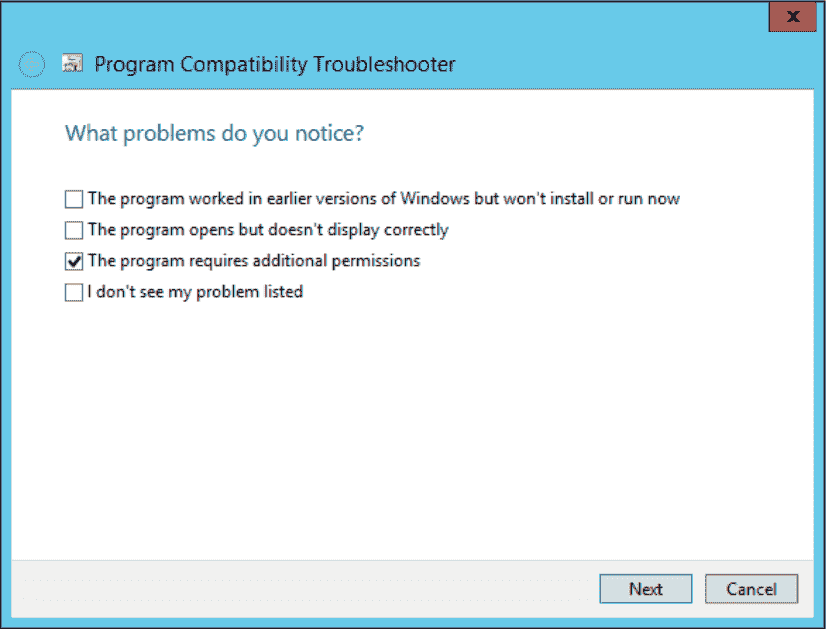

点击**下一步**，然后**测试程序**，再次点击**下一步**。在最后的窗口中，选择**是**，为此程序保存这些设置，然后点击**关闭**。

> 💡 如果运行代理守护进程似乎没有输入，或者窗口一闪而过，请使用前面建议的管理员命令提示符。


## 监控 Windows

如果一切顺利，Zabbix 代理守护进程将使用 -c 标志指定的配置文件，作为 Windows 服务安装。您可以在 **Windows 控制面板** 的 **服务** 部分验证 Zabbix 服务确实已安装：

| 名称 | 描述 | 状态 | 启动类型 | 登录身份 |
|---|---|---|---|---|
| Zabbix Agent | 提供系统监控 |  | 自动 | 本地系统 |

虽然它已设置为自动启动，但当前处于停止状态。我们可以右键单击 **Zabbix Agent** 服务条目并选择 **启动**，或者使用 `zabbix_agentd.exe` 的命令行开关来启动它。现在让我们尝试后一种方法：

```
C:\zabbix>zabbix_agentd.exe --start
```

您可能还需要在此处回答另一个安全提示，但服务应能成功启动。我们可以在服务列表中验证 Zabbix 服务是否已启动：

| 名称 | 描述 | 状态 | 启动类型 | 登录身份 |
|---|---|---|---|---|
| Zabbix Agent | 提供系统监控 | 正在运行 | 自动 | 本地系统 |

> 如果您之前打开了服务列表，请按 F5 刷新内容。

看起来被监控主机一切正常，现在我们必须在 Zabbix 前端配置它。打开 **配置 | 主机**，点击 **创建主机**，然后填写以下值：

- **主机名称：** `Windows host`
- **组：** 如果 **在组** 框中有任何组，请将其移除
- **新组：** `Windows servers`
- **代理接口，IP 地址：** 输入该主机的 IP 地址

完成后，点击底部的添加按钮。现在在组下拉框中选择 Windows servers，点击 Windows host 旁边的监控项，然后点击创建监控项。输入以下值：

- **名称：** `CPU load`
- **键值：** `system.cpu.load`
- **信息类型：** 数字（浮点）

完成后，点击底部的添加按钮。现在我们可以查看监控中的最新数据：监控 | 最新数据 —— 清除其他筛选字段，在主机组字段中选择 Windows host，然后点击筛选：

| 主机 | 名称 ▲ | 上次检查 | 上次值 |
|---|---|---|---|
| Windows host | - 其他 - (1 个监控项) | | |
| | CPU load | 2016-05-14 17:15:52 | 0.07 |

> Windows 上的 CPU load 与 Unix 系统上的工作方式类似，尽管 Windows 管理员对它不太熟悉。在 Windows 上，CPU 利用率更为常用。

我们现在已成功获取到这台 Windows 机器的 CPU load 数据。请注意，键值语法与 Linux 相同。其他几个键值也是如此，您可以查阅 Zabbix 文档，了解哪些平台支持哪些键值。

## 查询性能计数器

虽然许多键值在各平台间是通用的，但有一整个类别是 Windows 所特有的。Zabbix 支持 Windows 内置的指标收集系统——性能计数器。熟悉 Windows 的人可能知道，在旧版 Windows 中，可以在“控制面板 | 管理工具 | 性能”中找到它们，而在较新版本中则在“管理工具 | 性能监视器”中找到，其中有许多计数器可添加。其具体操作方式再次取决于 Windows 版本——在旧版本中，我们可以单击子工具栏中的 + 图标，或按 Ctrl + I 查看可用的计数器：

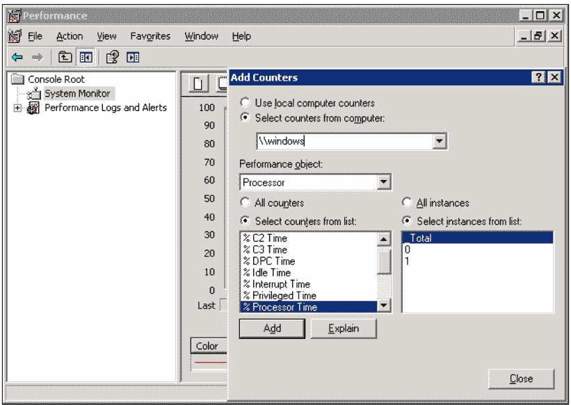

在此对话框中，我们可以收集构建性能计数器字符串所需的信息。首先，字符串必须以反斜杠 \ 开头。接下来是性能对象，在本例中为 Processor。然后我们需要在括号中包含所需的实例，这样到目前为止我们的字符串就是 \Processor(_Total)（注意 Total 前面的下划线）。从“从列表选择计数器”列表框中添加单个计数器字符串后，计数器字符串就完成了，同样用反斜杠分隔。因此，最终的性能计数器字符串如下所示：

```
\Processor(_Total)\% Idle Time
```

在较新的 Windows 版本中，我们展开“数据收集器集”，右键单击“用户定义”，然后选择“新建 | 数据收集器集”：

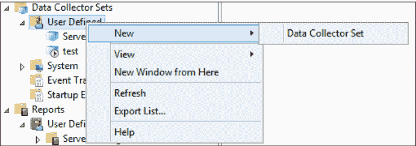

在出现的窗口中，为数据收集器集输入名称，选择“手动创建”，然后点击“下一步”。选择“性能计数器警报”，再次点击“下一步”，然后点击“添加”。这里我们终于看到了性能计数器——展开 Processor 并点击“% Idle Time”，然后点击“添加 >>”。现在点击“确定”查看构建好的性能计数器字符串：

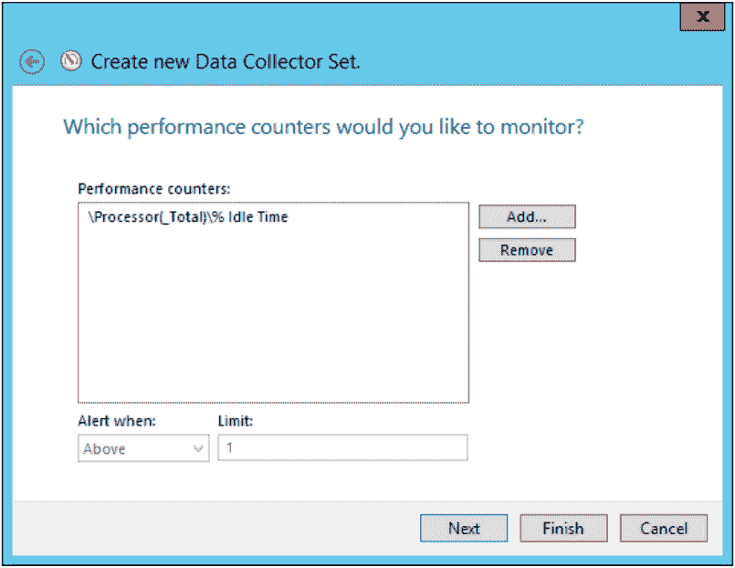

现在我们已经构建好了它，接下来该做什么呢？当然是创建一个监控项。回到前端，导航至 **配置 | 主机**，点击 **Windows host** 旁边的 **监控项**，然后点击 **创建监控项**。填写以下值：

- **名称：** `CPU idle time, %`
- **键值：** 这里更有意思，虽然原理很简单——`perf_counter` 键值必须使用我们之前构建的性能计数器字符串作为参数；因此，在此输入 `perf_counter[\Processor(_Total)\% Idle Time]`
- **信息类型：** 数字（浮点）
- **单位：** %

完成后，点击底部的添加按钮。这个监控项应该会显示机器上所有 CPU 的空闲总时间，所以让我们查看 **监控 | 最新数据**。我们可以看到数据是直接从内置性能计数器获取的：


查看 Windows 中可用的性能对象及相应计数器列表，我们可以看到许多不同的指标。浏览此窗口充其量也很麻烦，因为控件较小，没有合适的筛选或搜索功能，而且由于条目无法复制，构建要用作键值的字符串需要手动输入。幸运的是，有一个可用的解决方案——命令行实用程序 `typeperf.exe`。要了解它如何帮助我们，请执行：

```
C:\zabbix>typeperf -qx > performance_counters.txt
```

这会将此命令的所有输出保存到文件 `performance_counters.txt` 中。使用文本编辑器打开该文件并查看内容。您会看到大量性能计数器字符串，涵盖各种软件和硬件信息。再也不必与那个笨拙的对话框搏斗了；我们可以轻松搜索并复制这些字符串。

## 使用性能计数器的数字引用

如果您的 Windows 安装是本地化的，您可能已经注意到所有性能计数器都使用本地化语言，而不是英语。如果您必须监控多台配置了不同区域设置的 Windows 机器，这会变得尤其麻烦。例如，在英文 Windows 安装上是 \System\Processes 的计数器，在法文安装上则是 \Système\Processes。是否可以使用其他更通用的方法来引用性能计数器？确实可以；我们可以使用数字引用，但首先必须弄清楚它们是什么。

启动 regedit，查找注册表项 HKEY_LOCAL_MACHINE\SOFTWARE\Microsoft\Windows NT\CurrentVersion\Perflib。在此注册表项下，您会看到一个或多个条目，其中一个是 009，这是英语语言的条目。选择此条目，注意 Counter 键，它的内容与性能计数器名称惊人地相似。在旧版 Windows 中，您会看到类似这样的内容：

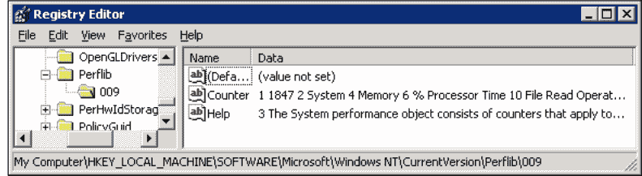

在较新版本中，您会看到类似这样的内容：

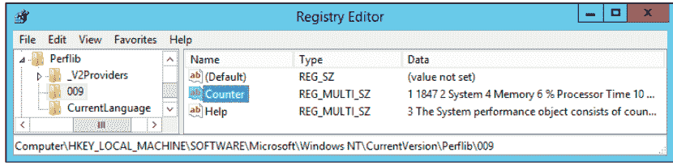

双击此值，以更易于管理的形式查看其内容：

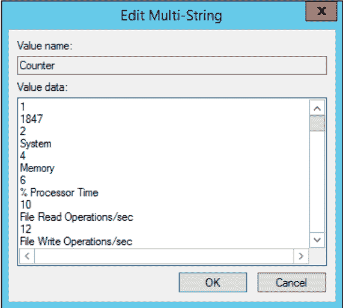

每个性能计数器字符串都可以转换为一个数字。但是在这个小窗口中找出准确的转换非常困难，所以让我们复制所有内容并保存到文件中，以便日后搜索——将其命名为 numeric.txt。为了了解其工作原理，让我们转换之前使用的性能计数器字符串：\Processor(_Total)\% Idle Time。

首先，我们必须转换性能对象 Processor。虽然可以通过任何文本编辑器搜索这些内容，但很快就会变得繁琐，尤其是需要转换大量值时。在这种情况下，我们可以求助于基本的 GNU 工具，例如 grep，您可能已经在 Windows 机器上安装了它——如果没有，请将此文件复制到 Zabbix 服务器：

```
$ grep -B 1 "^Processor$" numeric.txt
```

此命令将搜索完全包含字符串 Processor 的行，并同时输出紧邻其前的行，其中包含此性能对象的数字 ID：

```
238
Processor
```


不同 Windows 版本中的数值可能有所不同，因此请务必使用您文件中找到的数值。

如果您在 Zabbix 服务器上使用 grep，保存的文件可能包含 Windows 风格的换行符，您可能得不到任何输出。在这种情况下，请执行以下命令转换换行符：

```
$ sed -i 's/\r//' numeric.txt
```

既然我们已经获得了第一部分的数值，现在对性能计数器的第二部分执行同样的操作：

```
$ grep -B 1 "^% Idle Time$" numeric.txt
1482
% Idle Time
```

现在，除了 _Total 之外，我们已经获得了性能计数器所有部分的数值。如何翻译这一部分？我们不必翻译——该字符串在所有区域设置中均按原样使用。我们最终得到的性能计数器将如下所示：

```
\238(_Total)\1482
```

由于我们已经有一个用于收集此信息的监控项，我们不会添加另一个。相反，让我们使用 zabbix_get 实用程序来测试它。在 Zabbix 服务器上，执行：

```
$ zabbix_get -s <Windows host IP> -k "perf_counter[\238(_Total)\1482]"
```

这应该返回与 \Processor(_Total)\% Idle Time 键相同的数据：

```
99.577165
```

附加软件可以添加其他性能计数器，并且这些计数器的数值在不同系统之间可能有所不同。在某些情况下，软件会修改现有的性能计数器；例如，将防火墙软件供应商的名称添加到网络接口中。

## 使用性能计数器别名

另一种在使用 Zabbix 配置时统一监控项键的方法是指定性能计数器别名（这样单个模板就可以用于所有主机）。为此，请在 Zabbix 代理配置文件中添加 Alias 指令。

例如，如果我们想将使用的性能计数器 Processor(_Total)\% Idle Time 称为 cpu.idle_time，我们将添加以下内容：

```
Alias = cpu.idle_time:perf_counter[\Processor(_Total)\% Idle Time]
```

> 进行更改后，不要忘记重新启动代理。

在具有不同区域设置的系统上，Alias 条目将使用不同的性能计数器，但从现在起，我们可以对所有系统使用相同的监控项键：cpu.idle_time。

## 随时间对性能计数器取平均值

Zabbix 代理还有另一个 Windows 特有的功能。它可以收集性能计数器值并返回平均值。这样，我们可以平滑那些返回最后一秒数据的计数器，并减少错过异常数据的可能性。例如，我们可以在代理守护进程配置文件中添加如下一行：

```
PerfCounter = disk.writes,"\PhysicalDisk(_Total)\Disk Writes/sec",300
```

基于此，代理将每秒从该性能计数器收集值，并计算五分钟内的平均值。然后，我们可以每五分钟查询一次代理，并准确了解每秒平均写入次数。如果我们不使用平均值，我们只能每五分钟获取最后一秒的数据。

## 查询 WMI

除了对性能计数器的内置支持外，Zabbix 代理还支持 WMI 查询。

> Zabbix 通过 Zabbix 代理支持 WMI——目前不支持远程 WMI。

要提取一些有用的信息，我们需要一个 WMI 查询，并且我们可能希望快速测试这些查询——这可以在 Windows 中完成，也可以通过使用 Zabbix 代理来完成。在 Windows 方面，可以使用 wbemtest.exe 实用程序。启动它时，单击“连接”，接受默认的 root\cimv2 命名空间，然后再次单击“连接”。然后，在如下所示的对话框中，单击“查询”：

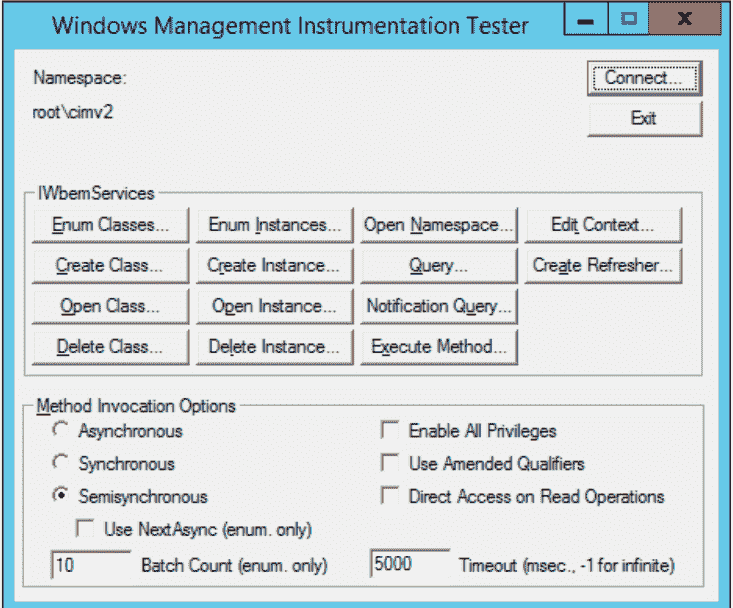

## 监控 Windows

您可以在此处输入完整的查询。例如，我们可以使用以下查询获取当前时区：

```
```sql
SELECT StandardName FROM Win32_TimeZone
```
```

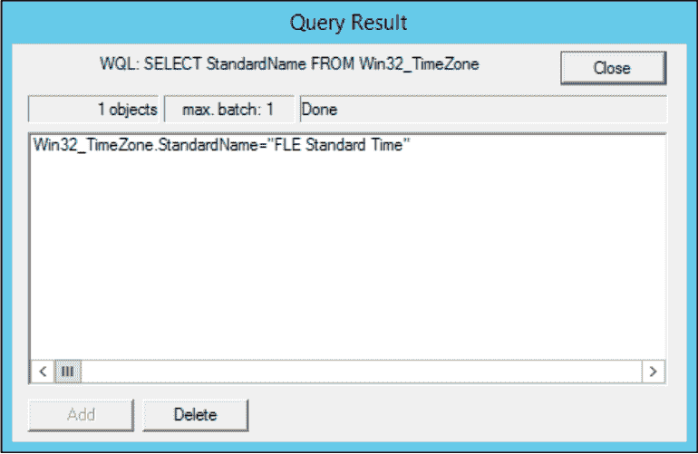

另一种通过 Zabbix 代理测试此类查询的方法是使用 zabbix_get 实用程序，这在*第 3 章“使用 Zabbix 代理和基础协议进行监控”*中讨论过。

有了可用的查询，我们可以继续创建监控项。导航到**配置 | 主机**，单击**Windows 主机**旁边的**监控项**，然后单击**创建监控项**。填写以下内容：

- **名称：** `Time zone`
- **键：** `wmi.get[root\cimv2,SELECT StandardName FROM Win32_TimeZone]`
- **信息类型：** **字符**
- **更新间隔：** `300`

这里的键是 wmi.get，第一个参数是命名空间，第二个参数是查询本身。我们不期望时区经常变化，所以我们稍微增加了更新间隔——通常人们会使用更大的间隔，但我们都希望第一个值能尽快出现。完成后，单击底部的“添加”按钮。检查“监控 | 最新数据”——大约五分钟后，值应该会出现：


这样，您可以监控 WMI 查询的任何输出——但请注意，应返回单个值；不支持多个值。如果返回多个值，则只处理第一个值。

## 监控 Windows 服务

还有一个 Windows 特有的监控项类别：用于 Windows 服务状态监控的专用键。现在让我们尝试监控一个服务。首先，我们必须弄清楚如何引用此服务。为此，打开服务列表，然后打开某个服务的详细信息——让我们选择 DNS Client：

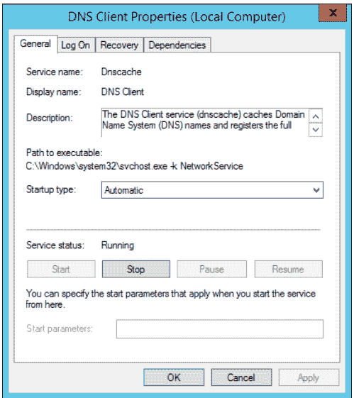

查看此选项卡的顶部。服务名称是我们必须使用的名称，我们可以看到它与显示名称明显不同——该名称不是 DNS Client，而是 Dnscache。现在让我们创建监控项。导航到“配置 | 主机”，单击 Windows 主机旁边的“监控项”，然后单击“创建监控项”。输入以下值：

- 名称：DNS 客户端服务状态
- 键：service.info[Dnscache]

> 服务名称不区分大小写。
> 这里使用的键 service.info 是 Zabbix 3.0 中新增的。旧版本的 Zabbix 使用 service_state 键。该键已弃用，但仍受支持，您可能会在较旧的 Zabbix 安装和模板中看到它。service.info 键有更多参数——有关完整文档，请参阅 Zabbix 手册。

完成后，单击底部的“添加”按钮，打开“监控 | 最新数据”，并查找我们新添加的监控项：

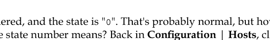

因此数据已收集，状态为“0”。这可能是正常的，但我们怎么知道状态数字的含义？回到“配置 | 主机”，单击 Windows 主机旁边的“监控项”，然后在“名称”列中单击“DNS 客户端服务状态”。看看我们的老朋友——“显示值”属性。单击“显示值映射”链接并检查列表底部的映射：

Windows 服务状态
0 ⇒ 正在运行
1 ⇒ 已暂停
2 ⇒ 正在启动
3 ⇒ 正在暂停
4 ⇒ 正在继续
5 ⇒ 正在停止
6 ⇒ 已停止
7 ⇒ 未知
255 ⇒ 没有此服务

事实证明，已经有一个预定义的 Windows 服务状态映射可用。关闭此窗口，在“显示值”下拉列表中选择“Windows 服务状态”，然后单击“更新”。回到“监控 | 最新数据”，验证服务状态现在是否以更用户友好的方式显示：

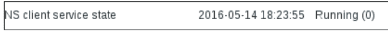

现在，我们将能够轻松识别前端中的不同服务状态。监控项就位后，让我们还创建一个触发器，以便在服务停止时提醒我们。转到“配置 | 主机”，单击 Windows 主机旁边的“触发器”，然后单击“创建触发器”。在“名称”字段中输入“{HOST.NAME} 上的 DNS 客户端服务已停止”，然后在“表达式”字段旁边单击“添加”。单击“监控项”字段旁边的“选择”，选择“DNS 客户端服务状态”，然后单击“插入”。等等，值为 0 表示服务正在运行；我们实际上应该测试值不为 0。我们刚才没有使用改变插入表达式的下拉功能：

```
{Windows host:service.info[Dnscache].last()}<>0
```

将严重性更改为“警告”，然后单击底部的“添加”按钮。除非这是生产系统，否则停止此服务应该是相当安全的——请停止该服务，并观察“监控 | 触发器”；在“组”下拉列表中选择“Windows 服务器”。Zabbix 现在应该警告您此服务已停止：

| 严重性 | 状态 | 信息 | 最近更改 ▼ | 时长 | 确认 | 主机 | 名称 |
| 警告 | 问题 |  | 2016-05-14 19:09:25 | 20秒 | 否 1 | Windows 主机 | Windows 主机上的 DNS 客户端服务已停止 |

## 检查自动服务

有时我们对每个服务的确切细节不感兴趣，而且我们可能必须为每个服务手动配置监控项和触发器。相反，我们可能希望看到高层次的概览；例如，是否有任何自动启动的服务已停止。Zabbix 提供了一个监控项，使您能够非常轻松地进行此类比较：services。它允许我们根据不同的参数检索服务列表，包括那些应该自动启动但已停止的服务。我们如何使用它？

应使用以下键添加监控项：

```
services[automatic, stopped]
```


要查看所有支持的服务键参数列表，请查阅 Zabbix 手册。

这将负责获取所需的数据。每当一个设置为自动启动的服务被停止时，它就会列在此项的数据中。

也有可能在某些 Windows 版本中存在一些本应自动启动随后又关闭的服务。在这种情况下，它们会出现在列表中并破坏我们的监控。幸运的是，Zabbix 对此问题也有解决方案——我们可以向此键添加第三个参数并列出要从此检查中排除的服务。例如，要排除 RemoteRegistry 和 sppsvc 服务，键应为：

```
services[automatic, stopped, "RemoteRegistry, sppsvc"]
```

注意要排除的服务是以逗号分隔的，并且整个列表包含在双引号中。

如果不同主机上此类服务的列表不同，请考虑使用用户宏来保存服务列表。我们在第 8 章《使用模板简化复杂配置》中讨论了用户宏。

那么我们在触发器中如何检查一切是否正常呢？如果列表为空，Zabbix agent 会返回 0。因此，只需简单检查最后的值是否为零，我们就可以在自动启动的服务被停止时触发。用于此类检查的触发器表达式为：

```
{Windows host:services[automatic, stopped].last()}<>0
```

当然，你可以应用一种方法——例如使用 count() 函数——仅在非零状态持续超过一次检查后才触发触发器：

```
{Windows host:services[automatic, stopped].count(#3,0)}=0
```

这样的触发器表达式只有在最近三次检查中至少有一次存在此类停止的服务时才会触发。

## 服务发现

前述方法只会告诉你某个本应运行的服务已停止。要知道是哪项服务，我们需要查看项值。我们实际上可以单独监控所有服务，因为 Zabbix 从 3.0 版本开始就支持 Windows 服务发现。让我们发现所有 Windows 服务并监控它们上的某些参数——我们可以在这里选择服务描述。

导航到 **Configuration | Hosts**，点击 **Windows host** 旁边的 **Discovery**，然后点击 **Create discovery rule**。填写以下内容：

- **Name:** `Windows service discovery`
- **Key:** `service.discovery`
- **Update interval:** `300`

我们使用了内置的 agent 键并增加了更新间隔。在生产环境中，更进一步增加间隔可能是个好主意；对于发现规则，平均默认间隔为一小时可能是一个不错的选择。完成后，点击底部的 **Add** 按钮。我们有了规则本身；现在我们需要一些原型——点击 **Item prototypes**，然后点击 **Create item prototype**。在填写数据之前，了解此发现项返回什么内容会很有用——一个服务的示例如下：

```json
{
    "{#SERVICE.STARTUP}": 0,
    "{#SERVICE.DISPLAYNAME}": "Zabbix Agent",
    "{#SERVICE.DESCRIPTION}": "Provides system monitoring",
    "{#SERVICE.STATENAME}": "running",
    "{#SERVICE.STARTUPNAME}": "automatic",
    "{#SERVICE.USER}": "LocalSystem",
    "{#SERVICE.PATH}": "C:\\zabbix\\zabbix_agentd.exe" --config "c:\\zabbix\\zabbix_agentd.win.conf",
    "{#SERVICE.STATE}": 0,
    "{#SERVICE.NAME}": "Zabbix Agent"
}
```

> Zabbix agent 可以使用 `zabbix_get` 查询原始的 LLD 数据。我们在 *第 12 章，自动化配置* 中更详细地讨论了低级发现。

此片段还显示了我们对每个服务可能监控的其他内容。目前，我们希望提取所有服务的描述，但要添加项我们需要实际的服务名称。虽然描述在这里可用，但我们将在项中查询它，因此对于项原型，它实际上是宏 `{#SERVICE.NAME}`。有了这些知识，我们就可以填写项原型表单：

- **Name:** `Service $1 description`
- **Key:** `service.info[{#SERVICE.NAME},description]`
- **Type of information:** **Character**
- **Update interval:** `300`

完成后，点击底部的 **Add** 按钮。我们的发现每五分钟运行一次，可能需要长达五分钟才能使此原型生成实际的项，然后这些项获取其第一个值可能需要长达六分钟——加上配置缓存更新和项间隔的时间。首先，前往 Windows 主机的项配置。过一段时间后，我们的发现规则应该会添加项：

| Windows service discovery: Service SysMain description | service.info[SysMain,description] |
| Windows service discovery: Service svpwrv description | service.info[svpwrv,description] |
| Windows service discovery: Service TabletInputService description | service.info[TabletInputService,description] |
| Windows service discovery: Service svsvc description | service.info[svsvc,description] |
| Windows service discovery: Service SystemEventsBroker description | service.info[SystemEventsBroker,description] |
| Windows service discovery: Service SSDPSRV description | service.info[SSDPSRV,description] |

很可能会有相当数量的此类项。访问 **Monitoring | Latest data**，再过几分钟后我们应该能看到所有服务的描述：

| Service ADWS description | 2016-05-14 19:21:58 | This service provides a Web Service interface to instances of the directory ser... |
| Service AeLookupSvc description | 2016-05-14 19:21:59 | Processes application compatibility cache requests for applications as they a... |
| Service ALG description | 2016-05-14 19:22:00 | Provides support for 3rd party protocol plug-ins for Internet Connection Sharing |
| Service AppHostSvc description | 2016-05-14 19:22:01 | Provides administrative services for IIS, for example configuration history and ... |
| Service AppIDSvc description | 2016-05-14 19:22:02 | Determines and verifies the identity of an application. Disabling this service w... |

更常见的做法是监控当前服务状态或其启动配置——`service.info` 键支持的任何内容都应该是可能的。

> 我们也可以使用任何 LLD 宏来过滤发现的服务。例如，通过过滤 {#SERVICE.STARTUP}，我们可以仅发现配置为自动启动的服务（值 0），或延迟自动启动的服务（值 1）。

## Windows 事件日志监控

Zabbix 也支持在 Windows 上进行日志文件监控——我们在 *第 11 章，高级项监控* 中讨论的话题仍然适用。但在 Windows 上还有一个专门的日志子系统，而 Zabbix 确实提供了内置的事件日志系统支持。Windows 有各种事件日志类别，我们可以监控安全事件日志。其他常见日志有系统和应用程序，并且在较新的 Windows 版本中会有更多日志。现在，让我们前往 **Configuration | Hosts**，点击 **Windows host** 旁边的 **Items**，然后点击 **Create item**。填写以下内容：

- **Name:** `Windows $1 log`
- **Type:** **Zabbix agent (active)**
- **Key:** `eventlog[Security,,,,,,skip]`
- **Type of information:** **Log**
- **Update interval:** `1`

> Windows 上的事件日志监控作为活动项工作，与普通文件日志监控相同。

这是项键中的六个逗号。完成后，点击底部的 **Add** 按钮。我们在此指定的最后一个参数 `skip` 将防止 agent 读取整个安全日志——对于存在一段时间了的系统来说，这是一个非常好的主意。访问 **Monitoring | Latest data** 并点击 **Windows Security log** 项的 **History**：

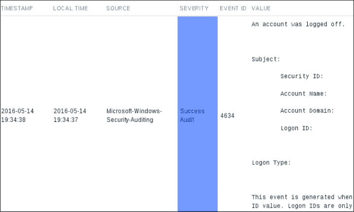

## 监控 Windows

> 如果没有值出现，请登录到 Windows 系统——这应该会在此日志中生成一些条目。

与普通日志文件监控相比，有几个值得注意的差异，包括 LOCAL TIME 列中的自动数据填充，以及源、严重性和事件 ID 被存储。实际上，我们已经可以在 agent 级别按这些内容进行过滤；我们不必将所有条目发送到服务器。让我们更详细地讨论一些项键参数。通用的键语法如下：

```
eventlog[name,<regexp>,<severity>,<source>,<eventid>,<maxlines>,<mode>]
```

第二个参数 regexp 的操作方式与普通日志文件监控中相同——它将正则表达式与日志条目进行匹配。maxlines 和 mode 参数的工作方式与 log 和 logtr 项键相同。severity、source 和 eventid 参数是 eventlog 键特有的，它们都是要与相应字段匹配的正则表达式。这样，我们就可以在 agent 端对 eventlog 进行相当广泛的过滤，但人们有时会犯一个相当常见的错误——他们忘记了这些是正则表达式，而不是精确匹配字符串。这意味着什么？嗯，以下项键不仅会匹配 ID 为 13 的事件，如下所示：

```
eventlog[security,,,13]
```

它也会匹配 ID 为 133、1333 和 913 的事件。要仅匹配 13，我们必须锚定正则表达式：

```
eventlog[security,,,^13$]
```

> 请记住，这对于 severity 和 source 参数也是如此——虽然它们不太可能匹配到 unintended 值，但在希望精确匹配时应始终确保表达式已锚定。


### 总结

在本章中，我们探讨了 Windows 上的各种差异特性，以及 Zabbix 明确支持 Windows 的功能。

我们将 Zabbix 代理作为 Windows 服务安装，并验证了在许多方面它与 Linux 代理的工作方式完全相同。接着，我们转向 Windows 特有的功能支持：

- 性能计数器
- 使用 Zabbix 代理的 WMI
- Windows 服务，包括自动发现这些服务的能力
- 事件日志系统

我们不仅讨论了所有这些功能的细节和潜在问题，还使用这些功能监控了一些数据。结合我们现在已经掌握的通用监控和报告知识，这应该使我们能够高效地监控 Windows 安装。

在探索了大量底层配置之后，下一章我们将关注更偏向业务的方面——SLA 监控。Zabbix 允许我们创建 IT 服务树，分配描述服务可用性的触发器，并计算 SLA 的符合程度。
