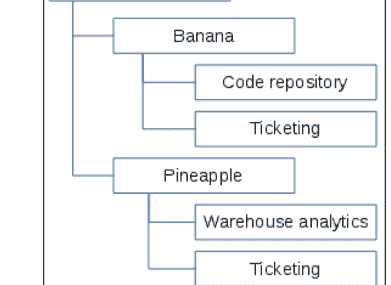
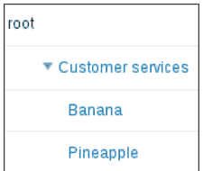
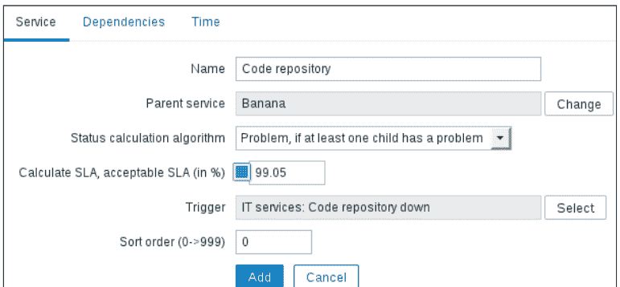
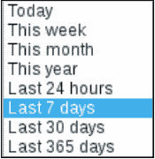
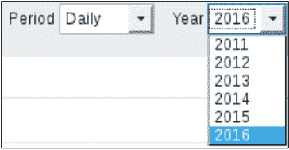
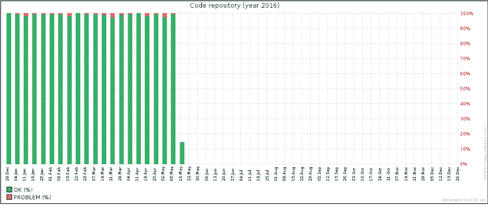
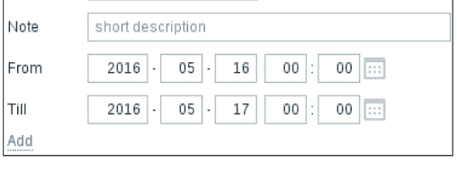
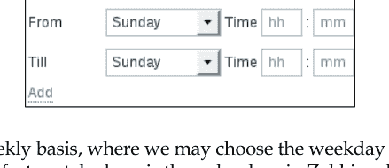

## 15 高层业务服务监控

监控 IT 系统通常涉及大量细小细节——CPU、磁盘、内存统计、进程状态以及无数其他参数。所有这些都非常重要，每个细节都应为技术人员所用。但归根结底，这些系统的目标不是拥有足够的磁盘空间——而是满足特定的业务需求。如果只关注底层细节，就很难判断当前问题可能对用户造成什么影响。Zabbix 提供了一种更高层视角的方式，称为 **IT 服务**。可以配置单个系统之间的关系，以了解它们如何协同交付服务，并且可以针对生成树中的任何部分启用 **服务等级协议（SLA）** 计算。

### 确定服务树

在配置任何东西之前，先思考整个设置是非常有用的，对于 IT 服务更是如此。一个庞大的服务树可能看起来很有气势，但它可能无法很好地代表实际功能，甚至可能掩盖真实的系统状态。磁盘空间不足很重要，但它实际上并不会使系统宕机——它不会影响 SLA。最佳方法可能只包含那些能确定服务可用或运行状态可被接受的特定检查——例如，SLA 可能要求维持一定的性能水平。除非我们想要一个庞大而复杂的 IT 服务树，否则我们应该识别交付服务的关键因素并监控它们。

我们的服务树可能如下所示：



如果顶层一切正常，我们就知道所有客户都满意。如果并非如此，我们就能看到哪个客户的某个系统出了问题，并看到哪个系统受到影响。工单系统宕机会影响两个客户。而这些服务之下的任何内容——嗯，那属于运维监控。

不幸的是，如果不长期收集数据，IT 服务功能并不容易评估；当我们拥有几周或更长时间的数据时，SLA 图表才更有意义。也许我们可以发送数据并假装它是过去的数据。实际上，我们确实可以这样做。我们在第 11 章“高级监控项监控”中讨论过的小而强大的工具 zabbix_sender，允许我们为每个值指定时间戳。这意味着我们将创建 Zabbix 采集器监控项，并向其中推送值。

### 创建测试监控项和触发器

前往“配置 | 主机”并点击“创建主机”。通常，此类监控项会存在于不同的主机中，但对于我们的测试设置，使用一台主机是最佳选择。在“主机名称”和“新建组”字段中输入 `IT services`，并确保“加入组”选择框中没有任何组，然后点击底部的“添加”按钮。在“组”下拉框中选择 IT services，点击 IT services 旁边的“监控项”，然后点击“创建监控项”。这样，我们将使用以下设置创建三个不同的监控项：

- 名称：代码仓库服务
- 类型：Zabbix 采集器
- 键：code_repo
- 新应用：IT services

你可以使用监控项克隆功能来更快地创建其余两个监控项。对于其余监控项，使用“应用”字段而不是“新应用”字段：

- **名称：** 仓库分析服务
- **类型：** Zabbix 采集器
- **键：** warehouse_analytics
- **应用：** IT services

对于最后一个监控项：

- **名称：** 工单服务
- **类型：** Zabbix 采集器
- **键：** ticketing
- **应用：** IT services

最终的监控项列表应如下所示：

| 名称 ▲ | 触发器 | 键 | 间隔 | 历史 | 趋势 | 类型 | 应用 |
|---|---|---|---|---|---|---|---|
| 代码仓库服务 |  | code_repo |  | 90d | 365d | Zabbix 采集器 | IT services |
| 工单服务 |  | ticketing |  | 90d | 365d | Zabbix 采集器 | IT services |
| 仓库分析服务 |  | warehouse_analytics |  | 90d | 365d | Zabbix 采集器 | IT services |

现在点击监控项列表上方导航栏中的“触发器”，然后点击“创建触发器”。按如下设置创建三个触发器。第一个触发器：

- **名称：** 代码仓库宕机
- **表达式：** {IT services:code_repo.last()}=0
- **严重性：** 高

第二个触发器：

- **名称：** 仓库分析宕机
- **表达式：** {IT services:warehouse_analytics.last()}=0
- **严重性：** 高

第三个触发器：

- **名称：** 工单宕机
- **表达式：** {IT services:ticketing.last()}=0
- **严重性：** 高

| 严重性 | 名称 | 表达式 |
|---|---|---|
| 高 | 代码仓库宕机 | `{IT services:code_repo.last()}=0` |
| 高 | 工单宕机 | `{IT services:ticketing.last()}=0` |
| 高 | 仓库分析宕机 | `{IT services:warehouse_analytics.last()}=0` |

> 💡 为了保持简短，我们这里没有在触发器名称中包含主机名——对于生产系统，你很可能需要这样做。

在这些触发器中，严重性设置非常重要。默认情况下，Zabbix 触发器具有最低严重性，**“未分类”**。IT 服务中的 SLA 计算会忽略两个最低严重性，**“未分类”**和**“信息”**。这似乎没有功能上的益处，原因很可能是历史遗留的。用户经常会创建快速测试触发器，却发现 SLA 计算不生效，这种现象很常见。在创建触发器时，由于严重性设置对于快速测试相对不重要，所以往往不会被修改。幸运的是，我们知道这一点，并创建了可用于 SLA 计算的触发器。

### 配置 IT 服务

我们离发送这些略假的数据越来越近了，但在数据进来之前，我们必须配置 IT 服务。在 Zabbix 中，SLA 结果不能追溯计算。IT 服务必须在我们想要收集 SLA 的期间开始时配置。SLA 状态与触发器和事件信息分开存储，由 Zabbix 服务器在运行时计算。

让我们转到**配置 | IT 服务**。管理 **IT 服务**的界面与 Zabbix 中大多数其他地方不同。我们有一个**根**，它是一个不可变条目。所有其他服务条目都必须作为其子项添加。点击根条目旁边的**添加子项**。

我们将首先把所有客户服务分组到一个条目中——稍后我们可能会有内部服务。在**名称**字段中输入 `Customer services`，然后点击底部的**添加**按钮。

我们有两个客户——点击**客户服务**旁边的**添加子项**。在**名称**字段中输入 `Banana`（香蕉），启用**计算 SLA**复选框，然后点击**添加**。

> 添加新服务条目时，默认可接受的 SLA 级别为 99.05，我们将所有服务保持在此级别。编辑现有服务条目时，默认值则为 99.9。在撰写本文时，尚不清楚这个问题何时会得到修复。

再次点击**客户服务**旁边的**添加子项**。在**名称**字段中输入“菠萝”，启用**计算 SLA**复选框，然后点击**添加**。注意，**客户服务**条目现在可以展开了。展开它并观察结果，应该如下所示：



客户已经就位；现在让我们添加他们的服务。点击**香蕉**旁边的**添加子项**。在**名称**字段中输入“代码仓库”，并启用**计算 SLA**复选框。这将是我们服务的“叶子”或底层服务，我们现在将其链接到一个触发器。触发器状态将影响此服务和所有启用了 SLA 计算的上层服务的 SLA 状态。点击**触发器**字段旁边的**选择**，然后在**名称**列中点击**代码仓库宕机**。此服务的最终配置应如下所示：




## 高层业务服务监控

如果条目已为你折叠，请全部展开并查看最终树：

| 服务 | 操作 | 状态计算 | 触发器 |
|---|---|---|---|
| 根 | 添加子项 |  |  |
| 客户服务 | 添加子项 | 如果至少一个子项存在问题，则存在问题 |  |
| 香蕉 | 添加子项 | 如果至少一个子项存在问题，则存在问题 |  |
| 代码仓库 | 添加子项 删除 | 如果至少一个子项存在问题，则存在问题 | 代码仓库故障 |
| 工单系统 | 添加子项 删除 | 如果至少一个子项存在问题，则存在问题 | 工单系统故障 |
| 菠萝 | 添加子项 | 如果至少一个子项存在问题，则存在问题 |  |
| 工单系统 | 添加子项 删除 | 如果至少一个子项存在问题，则存在问题 | 工单系统故障 |
| 仓库分析 | 添加子项 删除 | 如果至少一个子项存在问题，则存在问题 | 仓库分析故障 |

请注意，我们从公司层级开始启用了SLA计算。计算所有客户的总SLA可能不是常见需求，但也可以实现。在**状态计算**列中，我们所有的服务都采用**如果至少一个子项存在问题，则存在问题**。在**服务**属性中，我们也可以选择**如果所有子项都存在问题时才存在问题**。目前，这些是问题状态传播仅有的选项；无法设置子服务的百分比或数量（例如，对于集群解决方案可能很有用）。

### 发送数据

现在该发送我们的数据了，这些数据会有点假。如前所述，当数据覆盖较长时间时，IT服务/SLA功能会更有趣，我们可以尝试发送一年的数据。当然，我们不会手动创建——我们将生成数据。在Zabbix服务器上创建如下脚本：

```bash
#!/bin/bash
hostname="IT services"
time_period=$[3600*24*365] # 365 days
interval=3600 # one hour
probability=100
current_time=$(date "+%s")
for item_key in code_repo warehouse_analytics ticketing; do
    [[ -f $item_key.txt ]] && {
        echo "file $item_key.txt already exists"
        exit
    }
    for ((value_timestamp=$current_time-$time_period;
          value_timestamp<$current_time;
          value_timestamp=$value_timestamp+$interval)); do
```

```
echo "\"$hostname\" $item_key $value_timestamp
$([ [ $(( ${RANDOM}%$probability) ) < 1 ]] && echo 0 ||
echo 1)" >> $item_key.txt
done
done
```

此脚本将从当前时间开始，为过去一年中的每个小时为我们的三个监控项键生成值。每个条目都有小概率获得值0，表示失败。结果将是随机的，但应该在我们可接受的SLA水平附近波动，所以希望我们能够看到一些服务达到SLA水平，而另一些则没有。由于所有值都以一小时为间隔发送，并且连续两次失败的可能性很小，所以停机时间不应超过一小时。假设脚本保存为`generate_values.sh`，只需运行一次：

```
$ ./generate_values.sh
```

应该生成三个文件：

- code_repo.txt
- ticketing.txt
- warehouse_analytics.txt

> 以下操作可能会生成大量告警邮件。如果你想避免这种情况，请禁用我们之前添加的动作。

现在对每个文件运行`zabbix_sender`：

```
$ zabbix_sender -z 127.0.0.1 -T -i code_repo.txt
$ zabbix_sender -z 127.0.0.1 -T -i ticketing.txt
$ zabbix_sender -z 127.0.0.1 -T -i warehouse_analytics.txt
```

每次调用的输出应类似于：

```
info from server: "processed: 250; failed: 0; total: 250; seconds spent: 0.001747"
...
info from server: "processed: 10; failed: 0; total: 10; seconds spent: 0.000063"
sent: 8760; skipped: 0; total: 8760
```

我们现在查看的是**最近7天**的报告，如右上角所示。展开那里的下拉菜单，查看可用选项：



可以尝试这些选项，看看我们的随机数据是达到还是没有达到预期的SLA水平。遗憾的是，目前还无法为任意时间段生成这样的报告——如果你想查看两个月前某个特定周的SLA值，那就不走运了。

此页面上还隐藏着其他几个报告。点击这些选项将得到以下结果：

- **服务名称**：打开该服务的可用性报告
- **触发器名称**（如果链接到服务）：打开该触发器的事件历史记录
- **SLA条形图**：打开该服务的年度可用性图表

现在让我们点击**香蕉**——这将打开可用性报告。

默认情况下，它显示当前年份的周度报告。让我们在**周期**下拉菜单中选择**年度**：

| 年份 | 正常 | 问题 | 停机时间 | SLA | 可接受的SLA |
|---|---|---|---|---|---|
| 2016 | 134d 0h 4m | 2d 7h 0m |  | 98.3186 | 99.0500 |
| 2015 | 360d 18h 0m | 4d 6h 0m |  | 98.8356 | 99.0500 |
| 2014 | 365d 0h 0m |  |  | 100.0000 | 99.0500 |
| 2013 | 365d 0h 0m |  |  | 100.0000 | 99.0500 |
| 2012 | 366d 0h 0m |  |  | 100.0000 | 99.0500 |
| 2011 | 365d 0h 0m |  |  | 100.0000 | 99.0500 |

## 高层业务服务监控

这是过去五年的报告，几乎总是跨越六个日历年度——这就是为什么我们有六个条目。在这里和其他地方，Zabbix SLA计算假设我们会获得问题信息——如果没有问题信息，Zabbix会假定该时段服务是可用的。在这个页面上，我们还可以选择**月度**、**周度**和**每日**时间段——对于所有这些，都可以选择一个年份，并显示该年所有月份、周或日的数据。查看年份列表时，可以看到可用的年份与年度报告中的相同——即跨越六个日历年的五年：



点击触发器名称（如果触发器已链接到服务）将显示该触发器的事件历史记录。我们已经在*第6章，使用触发器检测问题*中查看过事件视图，因此这里不再多花时间。

现在让我们回到**监控 | IT服务**，点击**问题时间**列中的某个条形。将显示年度SLA图：



每列代表一周。该服务宕机的时间在顶部以红色显示。我们的服务大部分时间都在运行，但我们可以看到大多数周都有一些停机时间。

无论是可用性报告还是年度图，都没有什么可配置的，时间周期无法设置为自定义时间——我们只能使用预定义的时间段，并且无法自定义SLA图的大小或其他参数。对于年度图，我们只能查看当前年份。

> 无法限制对IT服务监控和报告的访问——它们对所有用户开放，此处不考虑普通权限。

### 指定正常运行时间和停机时间

配置好SLA监控后，我们可以愉快地确保系统平稳运行；我们在合理安排的计划维护时段内进行维护，却发现SLA水平下降了。你以为维护期间的停机不会被计入SLA监控吗？错了。Zabbix主机和主机组级别的维护不会影响SLA监控。如果某项服务在此类维护期间宕机，Zabbix仍会将其视为不可接受的不可用状态。

> 主机和主机组级维护已在*第5章，管理主机、用户和权限*中讨论过。

不过，有一种方法可以避免计算特定时段的SLA数据。让我们转到**配置 | IT服务**，点击**代码仓库**。在服务属性中，切换到**时间**选项卡。在这里我们可以添加三种类型的时间段：

- **正常运行时间**
- **停机时间**
- **一次性停机时间**


让我们从最简单的开始——一次性停机（One-time downtime）。在添加这样的时间段时，我们可以在“备注”（Note）字段中输入简短描述，并选择“从-至”（From-Till）的日期和时间：



不过，备注并没有太多实际用途——它只显示在已配置时间列表中，如前面的截图所示。

“停机”（Downtime）选项允许我们定义不参与 SLA 计算的时间段：



这是按周进行的，我们可以选择星期几和时间，精确到分钟。遗憾的是，这是 Zabbix 中唯一一个一周从星期日开始的地方。最大的问题是这些时间段不能跨越星期的边界，因此实际上无法一次性为周末添加 SLA 计算停机时间——我们必须为星期六添加一条记录，再为星期日添加一条。

那么“运行时间”（Uptime）选项呢？它的工作方式正好相反。如果添加了运行时间条目，SLA 计算只会在该时间段内进行；所有其他时间都被视为“停机时间”。

当然，在添加这些时间段时，应该遵循实际协议中的条款，而不是利用它来把问题从 SLA 计算中隐藏起来，对吧？

## 小结

在本章中，我们稍微偏离了对 CPU、磁盘和内存的低层监控。我们讨论了一种更高层次的监控，即面向业务服务的监控，在 Zabbix 中称为“IT 服务”。我们能够配置服务树来表示现实中的依赖关系和结构，将单个条目关联到触发器以将问题状态传播到服务，并为这些服务配置 SLA 计算。我们没有大型 IT 系统可以测试，因此发送了模拟数据并观察生成的各种报告，包括服务可用性报告和年度 SLA 图表。

关于 Zabbix 中的 IT 服务功能，我们注意到了两个重要事实：

- 计算 SLA 时，严重级别为“未分类”或“信息”的触发器将被忽略
- SLA 信息无法在事后计算——必须先配置好 IT 服务

对于那些 SLA 不覆盖全天候的服务，我们了解了如何根据每周时间段来指定 SLA 计算的发生时间——但我们也注意到，主机和主机组级别的维护不影响 SLA 计算，且运行时间/停机时间配置必须针对 IT 服务本身进行。

在下一章中，我们将回到更底层的监控——甚至比之前更底层。我们将介绍如何直接使用智能平台管理接口（IPMI）来监控硬件。Zabbix 既支持监控“普通”或模拟 IPMI 传感器，也支持离散 IPMI 传感器。甚至有一个专门用于离散传感器的触发器函数。它是什么？详见下一章。

## 监控 IPMI 设备

到目前为止，我们已经熟悉了使用 Zabbix agent、SNMP 以及其他几种方法进行监控。虽然 SNMP 非常流行，并且大多数联网设备都支持，但还有另一种面向系统管理和监控的协议：**智能平台管理接口（IPMI）**。IPMI 通常作为一个独立于主机操作系统的管理和监控模块来实现，甚至在机器关机时也能提供信息。IPMI 变得越来越流行，Zabbix 直接支持 IPMI。IPMI 在所谓的**灯光关闭**（lights-out）或**带外**（out-of-band）管理卡上尤其常见，如今大多数服务器硬件都提供这种管理卡。因此，直接通过这些管理卡来监控硬件状态可能是很理想的，因为这不依赖于操作系统类型，甚至与操作系统是否正在运行无关。

### 获取 IPMI 设备

在本节中，你需要一台支持 IPMI 的设备，通常是带有远程管理卡的服务器。这里的示例将使用真实硬件，可能会有供应商特有的怪异之处，但基本原则应该适用于任何供应商的任何产品。

### 准备 IPMI 监控

要使用 IPMI 收集数据，必须相应地配置 Zabbix，并且设备必须接受来自 Zabbix 的连接。如果你通过软件包安装了 Zabbix，则应该已经具备 IPMI 支持。如果你从源代码编译了 Zabbix Server，也应包括 OpenIPMI 库支持。为确保无误，请检查服务器日志文件中的启动消息。确保关于 IPMI 的行显示为 YES：

```
IPMI monitoring:              YES
```

## 监控 IPMI 设备

这还不够——默认情况下，Zabbix Server 配置为不启动任何 IPMI 轮询器；因此，任何添加的 IPMI 监控项都不会工作。要更改此设置，请打开 `zabbix_server.conf` 并查找以下行：

```
# StartIPMIPollers=0
```

取消注释并将其设置为 3 个轮询器，使其变为：

```
StartIPMIPollers=3
```

保存文件并重启 `zabbix_server`。

在被监控设备一端，添加一个 Zabbix 将使用的用户。IPMI 标准规定了各种权限级别，对于监控来说，用户级别可能是最合适的。IPMI 用户的配置可以使用供应商提供的命令行工具、Web 界面或其他方法完成。有关此步骤的详细信息，请查阅供应商特定文档。

## 设置 IPMI 监控项

在将 IPMI 监控项添加到 Zabbix 之前，我们应该测试 IPMI 访问。默认情况下，IPMI 使用 UDP 端口 623，请确保该端口未被防火墙阻止。检查你的 Zabbix 服务器是否安装了 `ipmitool` 软件包——如果没有，请安装它，然后执行以下命令：

```
$ ipmitool -U zabbix -H <IP address of the IPMI host> -I lanplus -L user sdr
Password:
```

提供你在 IPMI 配置中设置的密码。我们使用用户级访问，如 `-L user` 标志所指定，这样 Zabbix IPMI 用户就不需要管理员权限。`-I lanplus` 标志指示 `ipmitool` 使用 IPMI v2.0 LAN 接口，而 sensor 命令则向主机查询可用的传感器。如果你的设备在非默认端口上运行 IPMI，可以使用 `-p` 标志指定端口。

> Zabbix 不使用 `ipmitool` 来查询 IPMI 设备，而是使用 OpenIPMI 库。这个库历史上曾有一些 bug，因此一个可用的 `ipmitool` 实例并不能保证 Zabbix Server 上的 IPMI 监控一定有效。如有疑问，请使用最新版本的 OpenIPMI 进行测试。

输出将包含大量传感器，可能包括如下内容：

```
BB +5.0V      | 4.97 Volts   | ok
Baseboard Temp | 23 degrees C | ok
System Fan 2    | 3267 RPM     | ok
Power Unit Stat | 0x00        | ok
```

这些看起来是有用的数据，那么让我们尝试在 Zabbix 中监控风扇转速。在前端中，导航到 配置 | 主机。为了保持组织清晰，让我们为 IPMI 监控创建一个新主机——点击“创建主机”。然后输入以下值：

- **名称：** IPMI host
- **组：** 在“其他组”框中点击 Linux servers，然后点击 ◄ 按钮，并确保“在组”列表框中没有其他组
- **IPMI 接口：** 点击“添加”控件并输入 IPMI 地址，然后点击“Agent 接口”旁边的“移除”

> 某些 IPMI 解决方案在主网络接口上工作，拦截 IPMI 请求。在这种情况下，只需将相同的 IP 地址设置为用于 IPMI 即可。

切换到 IPMI 标签页，并输入以下值：

- **IPMI 用户名：** 输入用于 IPMI 访问的用户名
- **IPMI 密码：** 输入你为 IPMI 访问设置的密码

> 如果你设置了较长的 IPMI 密码，并在之后重新访问主机编辑界面，你会发现密码被截断了。这是正常的，因为 IPMI v2.0 的最大密码长度为 20 个字符。

如果你的 IPMI 配置不同，例如不同的权限级别、端口或其他参数，请相应地进行设置。完成后，点击底部的“添加”按钮。

> 对于这个主机，我们复用了 Linux servers 组——你也可以将其添加到单独的组中。


# 创建IPMI监控项

现在我们已经解决了IPMI连接的主机部分，是时候创建实际的监控项了。确保在**组**下拉框中选择了 **Linux服务器**，然后点击 **IPMI主机** 旁边的 **监控项**，接着点击 **创建监控项**。输入以下值：

- **名称：** 输入 `System Fan 2`（或者，如果你的支持IPMI的设备没有提供此类传感器，请选择另一个有用的传感器）
- **类型：** **IPMI agent**
- **键值：** `System_Fan_2`
- **IPMI传感器：** `System Fan 2`
- **单位：** `RPM`

完成后，点击底部的 **添加** 按钮。

> 对于此监控项类型，监控项键值仅用作监控项标识符，我们可以在此处输入任意字符串。我们选择使用传感器名称，并将空格替换为下划线，以便在触发器表达式和其他地方更容易识别该监控项。IPMI传感器名称将决定收集哪些数据。

在某些设备上，传感器名称可能带有尾随空格。这在 `ipmitool` 的默认传感器输出中并不明显。如果传感器名称看起来正确，但从Zabbix查询失败，请尝试从Zabbix服务器检索单个传感器的数据：

```
$ ipmitool -U zabbix -H <IPMI主机的IP地址> -I lanplus -L user sensor get "System Fan 2"
```

这将打印该传感器的详细信息。如果失败，则传感器名称可能不正确。

让我们检查一下我们的工作成果；打开 **监测 | 最新数据**，然后在筛选器中选择 **IPMI主机**：

| 名称 | 最后检查 | 最后值 |
|---|---|---|
| **- 其他 -** (1个监控项) |  |  |
| System Fan 2 | 2016-05-18 12:26:49 | 3348 RPM |

> 注意，该值完整显示，并未缩短为3.3K。RPM单位包含在硬编码的单位黑名单中，使用此类单位的监控项不会添加单位乘数前缀。我们将在*第22章，Zabbix维护*中更详细地讨论单位黑名单。

太好了，硬件状态信息被正确收集了。更棒的是，此信息的检索独立于已安装的操作系统或特定的代理程序，即使没有运行甚至没有安装操作系统，也可以检索到。

> 目前没有内置的低级发现支持。如果你希望发现可用的传感器，最好通过外部检查或使用Zabbix trapper监控项类型来实现低级发现规则本身。

## 监控离散传感器

传感器列表显示了一些值很明确的传感器：温度、风扇转速等。但其中一些可能有点棘手。例如，你的传感器列表中可能有一个名为 `Power Unit Stat` 或类似的传感器。这些都是离散传感器。人们可能会希望它们能为 **OK** 状态返回0，为 **Failure** 状态返回1，但它们通常更复杂。例如，电源单元传感器实际上可以在一个检索值中返回关于八种不同状态的信息。让我们尝试监控它，看看在Zabbix中对于这样的系统能得到什么值。导航到 **配置 | 主机**，点击 **IPMI主机** 旁边的 **监控项**，然后点击 **创建监控项**。填写以下内容：

- **名称：** 输入 `Power Unit Stat`（或者，如果你的支持IPMI的设备没有提供此类传感器，请选择另一个有用的传感器）
- **类型：** **IPMI agent**
- **键值：** `Power_Unit_Stat`
- **IPMI传感器：** `Power Unit Stat`

完成后，点击底部的 **添加** 按钮。

> 如果普通传感器可以工作，但离散传感器不行，请确保尝试使用最新版本的OpenIPMI库——旧版本会给离散传感器名称添加一个额外的 `.0`。

## 监控IPMI设备

在 **最新数据** 部分检查此监控项——它很可能返回0。但它可能返回什么？它实际上是一个二进制值的十进制表示，其中每个位可以标识一个特定状态，通常是故障。对于此传感器，可能的状态列在*智能平台管理接口规范第二版v2.0*中。

> 该规范的最新版本可在以下地址获取：
> `http://www.intel.com/content/www/us/en/servers/ipmi/ipmi-home.html`

根据该规范，各个十六进制值具有以下含义：

| 十六进制值 | 含义 |
|---|---|
| 00h | 关机/断电 |
| 01h | 电源循环 |
| 02h | 240 VA断电 |
| 03h | 互锁断电 |
| 04h | 交流电丢失/电源输入丢失（电源单元的电源来源丢失） |
| 05h | 软电源控制故障（单元未响应开机请求） |
| 06h | 检测到电源单元故障 |
| 07h | 预测性故障 |

查看第一个位的描述，二进制值0表示单元正在运行且报告无问题。二进制值1表示单元已断电。我们可以将返回值与0进行比较，这将表明单元一切正常，但如果我们想检查其他某些位——例如 **“预测性故障”** 位呢？如果只设置了该位，监控项将返回128。如前所述，离散监控项返回二进制值的十进制表示。原始二进制值为 `10000000`（或上表中的07h），其中从最低有效位开始数的第八位被设置。顺便说一下，这也是我们为此监控项将 **信息类型** 字段保留为 **数字（无符号）** 和 **数据类型** 字段保留为 **十进制** 的原因——尽管实际含义以二进制表示编码，但值以十进制整数传输。

因此，要检查预测性故障，我们可以将值与128进行比较，对吧？不，并不完全是这样。如果系统已关闭并报告了预测值，原始二进制值将是 `10000001`，十进制值将是129。当我们开始包含其他位时，情况会更加混乱。这也是目前无法对此类监控项使用值映射的原因——在某些情况下，一个值可能意味着所有位都被设置，并且必须有针对每种可能位组合的值映射条目。哦，而且我们不能仅通过检查值是否为1来检测系统关闭——值为129以及许多其他值也可能意味着系统关闭。

作为更复杂的示例，假设我们想要检查位（从最低有效位开始）3和5，并且我们收到了值110（十进制）：

|  | 十进制值 | 二进制值 |
|---|---:|---:|
| **值** | 110 | 01101110 |
| **按位与（相乘）** |  |  |
| **掩码** | 20 | 00010100 |
| **结果** | 4 | 00000100 |

关于掩码操作的一个简单思考方式：所有与掩码中0匹配的位都被设置为0，其余位照原样通过。在这种情况下，我们关心的是位3和位5是否都被设置，因此表达式将是：

```
{host:item.band(#1,20)}=20
```

在我们的值中，只有位3被设置，函数返回的结果值为4，结果与20不匹配——并非两个位都被设置，因此触发器表达式评估为FALSE。如果我们想检查位3被设置而位5未被设置，我们会将结果与4进行比较。如果我们想检查位3未被设置而位5被设置，我们会将其与16进行比较——因为在二进制中，那是00010000。

现在，让我们回到检查预测性故障位是否被设置——它是第八位，因此我们的掩码应为10000000，并且应将结果与10000000进行比较。但这两个值都应为十进制格式，因此我们应将掩码和比较值都设置为128。让我们带着这个知识在前端创建一个触发器。转到 **配置 | 主机**，点击 **IPMI主机** 旁边的 **触发器**，然后点击 **创建触发器**。在 **名称** 字段中输入 `Power unit predictive failure on {HOST.NAME}`，然后点击 **表达式** 字段旁边的 **添加**。点击 **监控项** 字段旁边的 **选择**，然后选择 **Power Unit Stat**。将 **功能** 下拉框设置为 **按位与 最后（最近的）T值与掩码 = N**，在 **掩码** 和 **N** 字段中都输入 `128`，然后点击 **插入**。生成的触发器表达式应为：

```
{IPMI host:Power_Unit_Stat.band(,128)}=128
```

注意到第一个函数参数缺失了吗？与之前的 `()` 函数一样，省略此参数等同于将其设置为 `#1`，就像前面的示例一样。此触发器表达式将忽略7个最低有效位，并检查结果是否设置为二进制 `10000000`，即十进制128。

使用 `count()` 函数也可以进行按位比较。在这里，语法可能更令人困惑：模式和掩码都作为第二个参数指定，并用斜杠分隔。如果模式和掩码相等，则可以省略掩码。让我们尝试看一些示例来澄清这一点。


# 17
