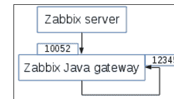

# 监控 Java 应用

在 Zabbix 可以直接查询的所有其他功能中，使用 Java Management Extensions (JMX) 协议监控 Java 应用服务器也是一种功能。实际上，不仅仅是应用服务器——用 Java 编写的其他服务器软件也可以被监控。甚至独立的 Java 应用也可以被监控，因为 JMX 框架不需要由应用开发者实现——它随 Java 提供。主要的 Zabbix 守护进程是用 C 编写的，但 JMX 协议相当复杂，尤其是所有授权和加密方法。因此，使用了单独的组件进行 JMX 监控：Zabbix Java 网关。该网关作为单独的进程运行，并代表 Zabbix Server 查询 JMX 接口。在本章中，我们将设置 Java 网关并在其上监控一个简单的属性。

# 设置 Zabbix Java 网关

让我们先把网关运行起来。如果你是从软件包安装的，很可能有 Java 网关软件包可用——只需安装它即可。如果你是从源码安装，Java 网关可以通过在 Zabbix 源码目录下运行以下命令进行编译和安装：

```
$ ./configure --enable-java && make install
```

> 如果编译失败，因为找不到 javac，你可能缺少 Java 开发包。软件包名称可能类似于 java-1_7_0-openjdk-devel。请查阅发行版的文档以获取确切的软件包名称。

默认情况下，从源码编译时，Zabbix Java 网关文件会被放置在 /usr/local/sbin/zabbix_java 目录中。从现在开始，我们将使用该目录中的文件。如果你是从软件包安装，请查阅软件包配置信息以定位这些文件。

让我们先做点简单的：启动网关。进入 Java 网关目录并运行以下命令：

```
# ./startup.sh
```

Zabbix Java 网关附带一个方便的启动脚本，我们在这里使用了它。如果一切顺利，你应该看不到任何输出，并且进程列表中会出现一个 Java 进程。此外，网关应监听端口 10052。虽然该端口不是 Zabbix Java 网关的官方注册端口，但它只是 Zabbix trapper 端口之上的一端口，似乎没有其他应用在使用该端口。网关运行后，我们仍需要告诉 Zabbix Server 网关的位置。打开 zabbix_server.conf 并查找 JavaGateway 参数。默认情况下它未设置，我们需要在此处配置网关的 IP 或主机名。由于我们可以指向远程系统，我们并不要求 Java 网关与 Zabbix Server 位于同一系统——在某些情况下，我们可能希望将网关放置在更靠近 Java 应用服务器的位置，例如。将此参数设置为 localhost IP 地址：

```
JavaGateway=127.0.0.1
```

紧随其后的是一个名为 JavaGatewayPort 的参数。默认情况下，它设置为 10052——与我们正在运行的网关已在监听的未注册端口相同——因此我们不会更改它。下一个参数是 StartJavaPollers。与 IPMI pollers 相同，默认情况下不会启动任何 Java pollers。我们不会对 Java 网关造成太大压力，因此启用一个 Java poller：

```
StartJavaPollers=1
```

这样，Zabbix Server 的配置就足够了。重新启动它以应用 Java 网关配置更改。很好，我们已经运行了网关，并且 Zabbix Server 知道它的位置。现在，我们只需要一些可监控的东西。如果你有一个可用于测试的 Java 应用服务器，请尝试监控它。如果没有，或者为了更简单地开始，你可以监控网关本身。它是一个 Java 应用，因此 JMX 基础设施可用。在为网关启用 JMX 之前，我们应该更改一件事。Java 对 DNS 和名称解析总体上非常挑剔。如果启用了 JMX 功能并且本地系统主机名无法解析，Java 应用很可能无法启动。对于本地 Java 网关，请检查 /etc/hosts 文件。如果当前主机名没有条目，请添加如下一行：

```
127.0.0.1 testhost
```

我们现在准备为网关启用 JMX 功能；默认情况下它未启用。要在 Zabbix Java 网关上启用 JMX，请编辑我们之前使用的 `startup.sh` 脚本，并查找以下行：

```
```sh
# uncomment to enable remote monitoring of the standard JMX objects on
the Zabbix Java Gateway itself
```
```

取消注释其后跟着的两行。


> 那里有一个变量被分配到了两行上。

其中一个参数值得特别注意：

```
```sh
-Dcom.sun.management.jmxremote.port=12345
```
```

这设置了 JMX 端口——网关本身将查询的端口。是的，在这种情况下，我们将启动一个进程，使其连接到自身上的该端口以查询 JMX 数据。该端口肯定不是标准端口——如你所猜，它只是 1-2-3-4-5 的序列。其他 Java 应用很可能会使用不同的端口，你需要查明。

如果你是从软件包安装的，近期软件包应已在 init 脚本中包含相同的行。如果没有，请考虑向软件包维护者报告，并除了前一个代码中的端口参数外，还使用以下参数：

```
```sh
-Dcom.sun.management.jmxremote
-Dcom.sun.management.jmxremote.authenticate=false
-Dcom.sun.management.jmxremote.ssl=false
```
```

第一个参数告诉 Java 启用 JMX，最后两个参数指示 Java 不使用任何身份验证或加密。


> 在撰写本书时，Zabbix 网关中的 JMX 功能与 Java 1.9 不兼容。解决方案是降级到 Java 1.8。

完成此更改后，运行关闭和启动脚本：

```
```sh
# ./shutdown.sh
# ./startup.sh
```
```

我们终于准备好添加实际的主机和 JMX 项了。

> 目前，Zabbix 仅支持 JMX 监控的硬编码远程方法调用 (RMI) 端点。使用其他协议的 Java 应用服务器不受支持——这包括 JBoss 6 及更高版本。不要使用 RMI 参数在 JBoss 上启用 JMX——它们可能阻止 JBoss 启动。

# 监控 JMX 项

让我们为 JMX 监控创建一个单独的主机。导航到 Configuration | Hosts，然后点击 Create host。在 Host name 字段中输入 Zabbix Java gateway，清除 In groups 列表框中的所有内容，并在 New group 字段中输入 Java。我们需要在该主机上使用 JMX 项：删除默认的 agent 接口并点击 JMX interfaces 旁边的 Add。在我们的例子中，网关运行在本地主机上，因此我们可以将 IP 地址保留为默认值 127.0.0.1。但端口呢？我们让 Java 网关监听 10052，但 startup.sh 脚本中还有 12345 端口。如果产生混淆，我们应该思考每个端口上可用的功能。在端口 10052 上，我们有网关本身，这是 Zabbix server 连接到的端口。我们已经在服务器配置文件中看到了该端口的设置。通常，网关随后会连接到某个其他 Java 应用以查询 JMX 信息。


12345 端口是我们取消注释的网关 startup.sh 脚本中的行，并且那是网关的 JMX 接口。这也是我们想要监控的：我们的 Java 应用。在 Zabbix server 连接到端口 10052 上的 Java 网关后，我们期望网关连接到自身，端口为 12345：



因此，在主机接口中，我们希望使用端口 12345——令人惊讶的是，这也是默认值：


> JMX 系统实际上可以返回 JMX 查询客户端应连接到的不同 IP 地址和端口。Zabbix 使用 Java 功能自动遵守此信息，但在某些情况下，它可能是错误的。如果看到错误消息并且 Zabbix Java 网关似乎连接到与主机属性中配置的不同地址或端口，请检查目标 Java 应用的配置，特别是 `Djava.rmi.server.hostname` 和 `Dcom.sun.management.jmxremote.rmi.port` 参数。

其余的主机配置应足以满足我们的需求——点击底部的 **Add** 按钮。现在，确保在 **Group** 下拉菜单中选择了 **Java**，点击 **Zabbix Java gateway** 旁边的 **Items**，然后点击 **Create item**。输入以下数据：

+   - **Name:** Used heap memory
+   - **Type:** JMX agent
+   - **Key:** `jmx[java.lang:type=Memory,HeapMemoryUsage.used]`
+   - **Units:** B

完成后，点击底部的 **Add** 按钮。几分钟后在最新数据部分检查此项——它应该成功收集值。

# 手动查询 JMX 项

在不知道确切参数之前，在服务器上创建项然后等待它们通过网关更新可能相当麻烦。我们可以使用 `netcat` 和类似工具手动查询网关，但这也不容易。有一种更简单的方法，使用 `zabbix_get`，由 Zabbix 社区成员 Bunjiboys 提供。以下简单脚本充当包装器：

```
```bash
#!/bin/bash
ZBXGET="/usr/bin/zabbix_get"
# accepts positional parameters:
# 1 - JAVA_GW_HOST
# 2 - JAVA_GW_PORT
# 3 - JMX_SERVER
```


# 4 - JMX_PORT
# 5 - ITEM_KEY
# 6 - USERNAME
# 7 - PASSWORD
QUERY="{\"request\": \"java gateway jmx\", \"conn\": \"$3\", \"port\": $4,\"username\": \"$6\", \"password\": \"$7\", \"keys\": [\"$5\"]}"
$ZBXGET -s $1 -p $2 -k "$QUERY"

如果你将其保存为 `zabbix_get_jmx` 并赋予其可执行权限，那么通过网关查询一个 item key 可以这样做：

```
$ ./zabbix_get_jmx localhost 10052 java-application-server.local.net 9999
'jmx["java.lang:type=Threading","PeakThreadCount"]'
```

在此示例中，JMX 实例正在监听 9999 端口。请注意 item key 中双引号的转义。返回结果将是来自 Zabbix Java 网关协议的原始 JSON：

```
{"response":"success","data":[{"value":"745"}]}
```

当 Zabbix server 查询网关时，它会从该 JSON 中解析出数字值——本例中为 745。

> 💡 这个示例脚本没有进行任何错误检查——请查阅 https://www.zabbix.org/wiki/Docs/howto/zabbix_get_jmx 了解任何潜在的后续改进。

## 监控什么？

对于 Java 应用服务器，监控往往不是由实际的 Java 应用程序开发人员发起的，而且通常不清楚首先监控哪些内容才是好的选择。一般来说，与其他任何系统一样，同样的建议也适用——应该由了解被监控应用程序的人来决定监控什么。如果可用的 Java 开发人员通情达理，并实际实现额外的 JMX 监控项来监控特定于应用程序的逻辑，那就更好了。如果这不太容易实现，我们总是可以先从内存使用量、线程数、垃圾回收器和其他通用指标这一基本集合开始。一些可能有用的参数如下：

- `jmx["java.lang:type=ClassLoading","LoadedClassCount"]`：已加载的类数量
- `jmx["java.lang:type=Memory","NonHeapMemoryUsage.used"]`：我们已经在网关上监控了堆内存使用情况；这将监控非堆内存使用情况

一般来说，为 JMX 推荐一个静态的监控项列表是相当困难的——有几种垃圾回收器，而垃圾回收监控的确切键会根据正在使用哪一种而有所不同。Zabbix 还提供了一些开箱即用的模板，用于通用和 Tomcat 特定的 JMX 监控，这可能是一个不错的起点。

如果我们想使用多个 Java 网关怎么办——也许每个数据中心一个，甚至每个 Java 应用服务器上一个，这样 JMX 连接就不会通过网络进行？Zabbix server 只支持单个 Zabbix 网关。实际上，使用 Zabbix 代理可以将多个 Java 网关附加到单个服务器上，但我们将在第 19 章 *使用代理监控远程位置* 中讨论这一点。

## 总结

Java 有时被称为“企业之王”。尽管存在常被提及的缺点，如内存占用，但它在大型系统中如此广泛流行，以至于人们可能会想知道是什么让它如此有吸引力。一个原因可能是它降低了维护成本——至少有时有人这样声称，而且在大型、长期存在的系统中这很有道理。与长期维护相比，开发一个系统通常成本较低。鉴于基于 Java 的系统使用广泛，内置的 JMX 支持非常方便——也许除了有限制的端点支持之外。在本章中，我们研究了如何设置一个名为 Zabbix Java gateway 的独立守护进程，并执行初始配置使其与 Zabbix server 配合工作。我们还监控了网关本身的堆内存使用情况，这应该是 JMX 监控的一个良好开端。为了更容易调试，我们使用了一个围绕 `zabbix_get` 的简单包装器，通过网关手动查询 JMX。

最近，我们一直在讨论一些相对小众的产品和协议的监控。下一章将继续这一趋势——我们将讨论内置的 VMware 监控，它使我们能够从 hypervisor 或 vCenter 发现并监控所有虚拟机。

# 18
