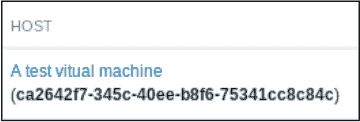
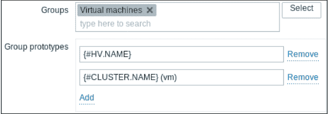
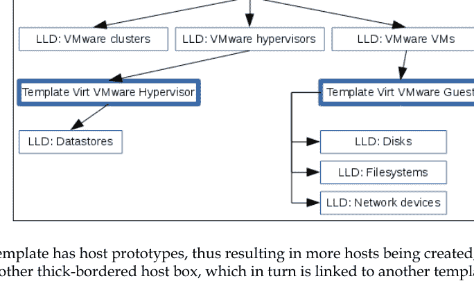

# 监控 VMware

如今有许多虚拟化解决方案可供选择。它们的目标市场和受欢迎程度各不相同，但对于能够负担得起的企业来说，VMware 解决方案相当普遍。Zabbix 提供对监控 VMware 的内置支持。该支持包括：

- 监控 vSphere 和/或 vCenter
- 自动发现所有 hypervisor
- 自动发现所有虚拟机

监控 VMware 不涉及任何自定义层——Zabbix 直接访问 VMware API，而且这种环境的监控非常容易设置。在本章中，你需要访问一个 VMware 实例 API，包括用户名和密码。最好先在较小或非生产环境中进行尝试。

> 如果从 vCenter 发现大型环境，vCenter API 端点可能会过载，因为 Zabbix 会连接到它并请求所有已发现的 vSphere 实例和虚拟机的数据。在这种情况下，将监控分散到各个 vSphere 实例上可能是合理的。

## 为 VMware 监控做准备

要试用 VMware 支持，我们需要：

- 可以访问 VMware API 的 IP 地址或主机名
- 具有检索信息权限的账户的用户名
- 该账户的密码

## 监控 VMware

首先，服务器必须使用 VMware 支持编译。如果你是从软件包安装的，很可能已经包含该支持。如果你是从源码安装的，请检查 Zabbix server 日志文件是否列出了 VMware 监控已启用：

```
VMware monitoring: YES
```

从源码编译时，需要以下选项来支持 VMware：

- `--with-libcurl`
- `--with-libxml2`

与我们目前探索的其他几个功能一样，Zabbix server 默认不会启动任何特定于 VMware 的进程。编辑 `zabbix_server.conf`，查找 `StartVMwareCollectors` 参数。添加新的一行，告诉 Zabbix 启动两个 VMware collector：

```
StartVMwareCollectors=2
```

重新启动服务器。为什么是两个 collector？Zabbix 开发者建议 collector 的数量应基于被监控的 VMware 实例数量。为了获得最佳性能，建议启动的 collector 数量多于被监控实例数，但少于被监控实例数的两倍。或者，如果我们用公式来表示，即 `instances < StartVMwareCollectors < ( instances * 2 )`。我们从小规模开始，目前只监控一个实例，所以我们将有 `1 < StartVMwareCollectors < 2`。还建议始终至少启动两个 VMware collector，所以这里的选择是显而易见的。如果我们有两个 VMware 实例要监控，那就需要三个 collector：`2 < StartVMwareCollectors < 4`。

> VMware 实例是指 vSphere 或 vCenter 实例，而不是单独的虚拟机。也就是说，collector 的数量取决于 Zabbix 实际连接以进行数据收集的端点。

我们将首先对 VMware API 全面启用 Zabbix，并允许它使用 Zabbix 自带的模板自动发现所有内容。一旦我们看到它按预期工作，我们将了解如何定制和扩展这个监控，并稍微深入了解一下 VMware 监控的机制。

## 自动发现

我们将创建一个单独的主机，作为发现的起点。除了监控通用 VMware 参数和发现所有其他实体之外，这个主机不会为我们做任何其他事情。转到 Configuration | Hosts 并点击 Create host。在 Host name 字段中输入 VMware，清除 In groups 块中已有的组，并在 New group 字段中输入 VMware。切换到 Macros 选项卡，并填写以下三个宏的值：

- {$URL}：形式为 https://server/sdk 的 VMware API/SDK URL
- {$USERNAME}：VMware 账户用户名
- {$PASSWORD}：VMware 账户密码

> API 或 SDK 在 vSphere 或 vCenter 系统上可用。

现在，切换到 Templates 选项卡，开始输入 vmware，选择 Template Virt VMware，然后在 Link new templates 部分点击 Add 控件。完成后，点击底部的 Add 按钮。

接下来做什么？嗯，什么都不用做。如果一切正确完成，所有内容都应该被自动监控。Hypervisor 应该被发现并监控，虚拟机被发现并根据 hypervisor 分组，同时也被监控。不过，这可能不会立即发生。与默认模板中的其他 LLD 规则一样，VMware 发现也有 1 小时的间隔——等等，LLD 规则？是的，VMware 发现也使用 LLD 功能。我们在第 12 章自动化配置中详细讨论过它。然而，VMware 支持更进一步：除了监控项、触发器和图形原型之外，它还使用主机原型。我们稍后会介绍主机原型。现在，我们可以让发现继续进行，也可以转到 Configuration | Templates，点击 Template Virt VMware 旁边的 Discovery，并减少所有三个发现规则的更新间隔。只是要确保稍后将其设置回来。

等一段时间后——或者减少间隔后——检查 Configuration | Host groups。你应该会看到几个以 Discover VMware VMs 为前缀的新主机组。根据被监控的 VMware 实例的大小，新组数量可能从两个到很多不等。会有一个名为 Hypervisors 的组，以及一个针对每个集群的虚拟机的组。如果存在集群，还会有一个针对每个集群的 hypervisor 的组。

> 如果没有配置集群，虚拟机的组将直接称为 (vm)。


## 可用指标

在自动创建了一些组和主机后，让我们看看它们收集了哪些数据。导航到 Monitoring | Latest data 并在 Host groups 字段中选择 Hypervisors。然后，点击 Filter：

| NAME ▲ | LAST CHECK | LAST VALUE |
|---|---|---|
| CPU (5 Items) |  |  |
| CPU cores | 2015-11-02 10:49:58 | 4 |
| CPU frequency | 2015-11-02 10:49:56 | 2.53 GHz |
| CPU model | 2015-11-02 10:49:57 | Intel(R) Xeon(R) CPU |
| CPU threads | 2015-11-02 10:49:59 | 8 |
| CPU usage | 2015-11-02 10:59:51 | 61 MHz |
| Datastore (2 Items) |  |  |
| Average read latency of the datastore datastore1 | 2015-11-02 10:59:44 | 0 |
| Average write latency of the datastore datastore1 | 2015-11-02 10:59:45 | 0 |

每个超visor 都会有更多项目。其中一些可能暂时没有数据，但稍等片刻应该就能显示出所有细节。

> Datastore 项目可能会稍后出现——它们是由 Template Virt VMware Hypervisor 中的 datastore discovery LLD 规则发现的，默认间隔为 1 小时。

现在，在 Host groups 字段中筛选超visor 虚拟机组，或在 Hosts 字段中按单个发现的虚拟机筛选：

| NAME ▲ | LAST CHECK | LAST VALUE |
|---|---|---|
| **CPU (2 Items)** | | |
| CPU usage | 2015-11-02 11:17:14 | 10 MHz |
| Number of virtual CPUs | 2015-11-02 11:17:13 | 1 |
| **Disks (4 Items)** | | |
| Average number of kilobytes read from the disk Hard disk 1 | 2015-11-02 11:16:50 | 0 Bps |
| Average number of kilobytes written to the disk Hard disk 1 | 2015-11-02 11:16:52 | 1 KBps |
| Average number of reads from the disk Hard disk 1 | 2015-11-02 11:16:51 | 0 |
| Average number of writes to the disk Hard disk 1 | 2015-11-02 11:16:53 | 0 |
| **Filesystems (4 Items)** | | |
| Free disk space on / | 2015-11-02 11:16:54 | 2.64 GB |
| Free disk space on / (percentage) | 2015-11-02 11:16:55 | 68.03 % |
| Total disk space on / | | |
| Used disk space on / | 2015-11-02 11:16:57 | 1.24 GB |

同样，应该会有更多项目，其中一些可能仍缺少值。但最终它们都应该会被填充。

> Disks、filesystems 和 interface 项目可能会稍后出现——它们是由 **Template Virt VMware Guest** 模板中的 **disk device discovery**、**mounted filesystem discovery** 和 **network device discovery** LLD 规则发现的，默认间隔为 1 小时。

一旦主机级别的所有 LLD 规则都运行完毕，我们会看到默认模板覆盖了相当多的项目。在很多情况下，这些模板甚至已经足够。有时，你可能想扩展它们。与其他默认模板一样，强烈建议先克隆模板，然后再对新模板进行修改。

此模板中的 Discover VMware VMs LLD 规则类似：它包含一个主机原型，用于所有发现的虚拟机。就像超visor 一样，UUID 用于主机名，并且它也会出现在服务器日志文件中：


在前端，我们可以同时按 **Host name** 和 **Visible name** 进行搜索。如果按主机名搜索——并且这很常见，因为我们会在日志文件中看到它——可见名称会像往常一样显示，主机名会显示在其下方并加粗，以表明它匹配了搜索：



在 **Templates** 选项卡中，我们可以看到创建的主机将被链接到 **Template Virt VMware Guest**。查看此主机原型的 **Groups** 选项卡是值得的。除了将所有发现的虚拟机添加到现有的 **Virtual machines** 组外，这里还使用了两个组原型：



正如我们在主机组页面中看到的那样，会为每个超visor 和每个集群创建一个组，其中包含该超visor 或该集群上的所有虚拟机。

## 总结默认模板交互

我们已经了解了默认的 VMware 模板集的作用，但要理解它们如何交互以及什么配置实体创建了什么内容可能会有点令人困惑。让我们尝试以示意图的形式总结它们的交互和目的。在这里，接收到所列模板的主机用粗边框表示，而各种 LLD 规则用细边框表示：



如果一个模板具有主机原型，从而导致创建更多主机，它会指向另一个粗边框的主机框，而该主机框又链接到另一个模板。

但请记住，要使这棵树开始工作，我们只需要创建一个主机并将其链接到一个模板，即 Template Virt VMware。

## 服务器操作和配置细节

我们知道 Zabbix 在收到信息后如何处理信息，但获取信息的过程本身也很复杂。那一过程本身就很有趣，但除了我们之前讨论过的 StartVMwareCollectors 之外，还有一些参数需要调整。首先，让我们看看值是如何最终进入项目的。以下示意图显示了从 VMware 开始到 Zabbix history cache 结束的数据流：


## 总结

要监控 VMware，只需要一个模板就足够了。好吧，这并不完全正确；超visor 和虚拟机的另外两个模板也必须存在，但除此之外，Zabbix 可以自动发现所有超visor 和虚拟机，就像我们在本章开头所做的那样。

我们详细研究了默认模板——它们的工作方式、交互方式以及各自提供的功能。主模板发现了一切，然后创建主机并根据需要链接超visor 和虚拟机模板。

最后，我们研究了更低级别的细节，包括数据如何通过 VMware 缓存传递、发生的频率以及我们如何调整所有这些。

在下一章中，我们将讨论一个新的 Zabbix 进程：Zabbix proxy。Zabbix proxies 是远程数据收集器，非常出色。类似于代理，它们可以以被动或主动模式运行，并支持 Zabbix server 支持的几乎所有功能，包括监控 Zabbix agents、SNMP 设备、VMware 等等。我们将设置主动和被动代理，并讨论在代理不可用时处理它的最佳方式。

## ## 19