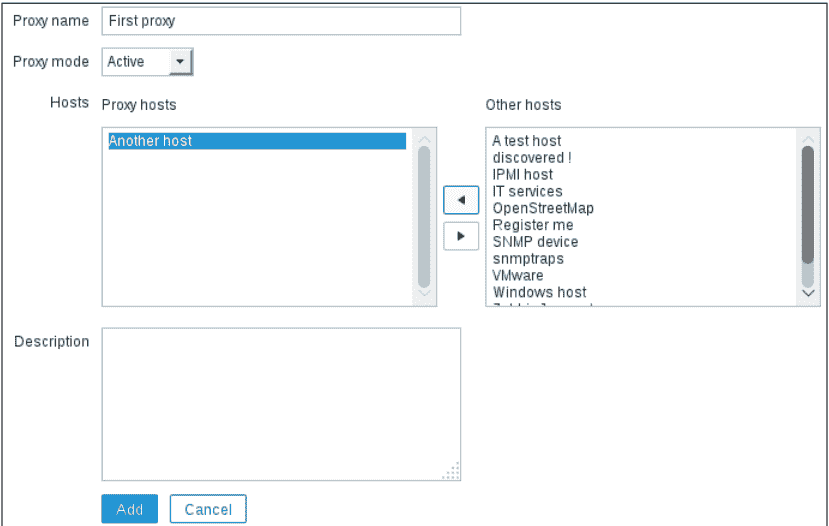
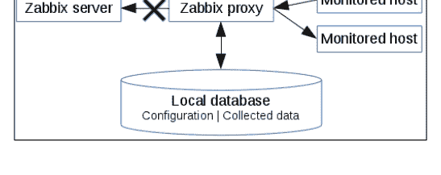
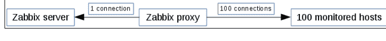
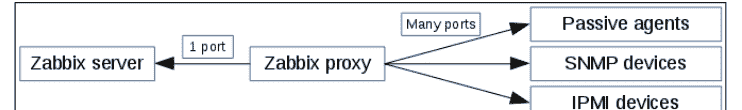
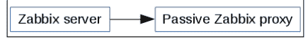
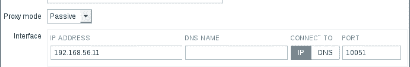

## 使用代理监控远程位置

Zabbix server 可以使用多种不同的方法进行监控——它可以与 Zabbix agents、SNMP 设备和 IPMI 设备通信；运行命令；以及做很多其他事情。当需要监控的设备数量增加时就会出现问题——一个端点（我们的 Zabbix server）需要与大量其他设备通信，大量的连接会在 Zabbix server 和 Zabbix server 与被监控设备之间的网络组件上造成问题。

如果我们需要监控远程环境，情况会更糟——无论是分支机构、另一个数据中心还是客户现场。Zabbix agents？端口 10050 必须对所有服务器开放。SNMP？端口 161 必须对所有设备开放。很快就会变得难以管理。

解决方案是使用 Zabbix proxies。Zabbix proxy 是一个远程数据收集进程，能够使用 Zabbix server 支持的所有方法收集数据。在本章中，我们将设置一个 Zabbix proxy，用它进行数据收集，并讨论确定代理本身是否可用的最佳方法。

> > Zabbix proxies 不适用于 Windows。

为 Zabbix proxy 选择哪种数据库？如果代理将监控小型环境，SQLite 可能是一个不错的选择。使用 SQLite 作为 Zabbix server 后端是不受支持的，因为它可能会出现锁定和性能问题。在 Zabbix proxy 上问题应该会少得多。如果设置大型代理，MySQL 或 PostgreSQL 会是更好的选择。在本章中，我们将使用 SQLite 数据库的代理，因为这样设置起来非常容易。

> 如果从源代码编译，需要 SQLite 开发头文件。在大多数发行版中，它们将由名为 sqlite-devel 或类似名称的包提供。

编辑 zabbix_proxy.conf。我们将更改三个参数：

- DBName
- Hostname
- Server

将它们更改为：

```
DBName=/tmp/zabbix_proxy.db
Hostname=First proxy
Server=<Zabbix server IP address>
```

第一个参数 DBName 与 Zabbix server 相同，只是我们在这里不仅仅指定数据库名称。对于 SQLite，这里指定数据库文件的路径。虽然可以使用相对路径，但在大多数情况下启动代理会变得更加复杂，因此强烈建议使用绝对路径。我们使用 /tmp 中的文件来简化我们第一个代理的设置——无需担心文件系统权限。数据库用户名和密码呢？正如配置文件中的注释所指出的，当使用 SQLite 时，它们都被忽略了。

> 在生产系统上，建议将数据库文件放在 /tmp 以外的其他位置。在某些发行版中，/tmp 可能在重启时被清除。另一方面，出于性能原因，可以选择将数据库放在 tmpfs 卷中，从而获得一些性能提升，但每次系统重启后代理数据库都会丢失。

第二个参数 Hostname 将由代理用于向 Zabbix server 标识自己。原理与主动 agent 相同——这里指定的值必须与服务器端配置的代理名称匹配，并且区分大小写。


第三个参数 Server 的作用与在 active agents 中时相同。active proxy 会连接到 Zabbix 服务器，我们在此处指定服务器 IP 地址。

> 如果你在与 Zabbix 服务器相同的机器上运行 proxy，还需更改 proxy 监听的端口——将 ListenPort 设置为 11051。默认端口会与 Zabbix 服务器冲突。
> 
> 与 Zabbix 服务器一样，你必须确保配置了适当的 pollers 以启动。例如，如果你想通过 proxy 监控 IPMI 设备，请确保在 proxy 配置文件中将 StartIPMIPollers 参数设置为默认值 0 以外的数值。

现在启动 Zabbix proxy。等等，我们并没有为 proxy 创建数据库。它会做什么？让我们查看 proxy 日志文件——检查 /tmp/zabbix_proxy.log，或 proxy 配置文件中设置的位置。仔细查看，我们可以找到一些有趣的日志记录：

```
20988:20151120:064740.867 cannot open database file "/tmp/zabbix_proxy.db": [2] No such file or directory
20988:20151120:064740.867 creating database ...
```

它首先未能打开现有数据库文件，然后继续创建数据库。Zabbix proxy 可以自动创建所需的 SQLite 数据库并填充它。注意，这仅适用于 SQLite——如果使用其他数据库，我们就必须手动创建数据库并插入 schema。这对于 SQLite 也是可能的——使用 sqlite3 工具，我们会这样做：

```
$ sqlite3 /tmp/zabbix_proxy.db < schema.sql
```

但仅限 schema！不仅对于 SQLite——对于所有数据库——proxy 只需要 schema。不要使用数据，也不要使用 image SQL 文件。如果 Zabbix proxy 检测到数据库中存在额外数据，它会退出，并抱怨无法使用服务器数据库。旧版本的 proxy 在这种情况下可能会崩溃甚至损坏服务器数据库。

> 不要创建空文件。要么允许 proxy 创建数据库文件，要么自行创建并使用 sqlite3 工具填充它。空文件会被视为空数据库，proxy 将无法启动。
> 如果 proxy 抱怨无法使用服务器数据库，它就会在 users 表中发现条目。

## 使用 Proxies 监控远程位置

在下面的部分中，Hosts 允许我们指定哪些主机将由此 proxy 监控。要使一台主机由 proxy 监控，请在 Other hosts 列表框中选择 Another host 并点击 ◄ 按钮：



完成后，点击 Add。下次 proxy 连接到服务器时，名称应匹配，proxy 应该获取它应该监控的信息。但下次是什么时候？默认情况下，Zabbix proxy 每小时连接到 Zabbix 服务器一次。第一次连接尝试发生在 proxy 启动时，此后每隔一小时进行一次。如果你启动 proxy 后不久就配置了前端部分，proxy 获取配置数据并开始工作可能需要长达一小时。有两种方法可以强制重新读取 Zabbix 服务器上的配置数据：

- 重启 proxy
- 强制重新加载其配置缓存

第一种方法在我们的测试 proxy 上是可以接受的，但在已经积极收集数据的较大生产 proxy 上就不太理想了。让我们看看如何强制重新加载配置缓存。首先运行：

```
# zabbix_proxy --help
```

在输出中，注意 runtime control 部分及其中的第一个参数：

```
```text
-R --runtime-control runtime-option    Perform administrative functions

    Runtime control options:

        config_cache_reload              Reload configuration cache
```
```

当 active proxy 被告知重新加载其配置缓存时，它会连接到服务器，获取新的配置数据，然后更新本地缓存。现在让我们发出该命令：

```
```bash
# zabbix_proxy --runtime-control config_cache_reload
```
```

> 运行时命令依赖于 PID 文件被正确配置。当你运行之前的命令时，它会在默认的 proxy 配置文件中查找 PidFile 选项，从 PID 文件中查找 PID，并向该进程发送信号。如果系统上运行多个 active proxies，可以通过使用 -c 选项指定其配置文件来向特定 proxy 发送信号。

重载命令应成功处理：

```
```text
zabbix_proxy [19293]: command sent successfully
```
```

现在检查 proxy 日志文件：

```
```text
    forced reloading of the configuration cache
    received configuration data from server at "192.168.56.10", datalen
    6545
```
```

首先，proxy 记录它已收到重新加载配置缓存的指令。然后它连接到服务器并成功从服务器检索配置数据。

> 我们将在 *Appendix A, Troubleshooting* 中更详细地讨论配置缓存的重新加载。

你可以通过再次打开 **Administration | Proxies** 来验证 proxy 是否可以成功连接到服务器。查看新 proxy 的 **LAST SEEN (AGE)** 列。不要再显示 **never**，它应该显示某个时间段。如果没有，请检查 Zabbix 服务器和 proxy 是否都在运行，并且你可以从 proxy 主机打开到 Zabbix 服务器 10051 端口的连接。

但如果你查看 **HOSTS** 列，你会发现它现在是空的。发生了什么？我们显然已将 **Another host** 添加为由此 proxy 监控——为什么它消失了？这可能是一个具有挑战性的任务来弄清楚，而且在生产环境中也很容易出现这种情况。主机从 proxy 配置中消失的原因是 `active-agent auto-registration`。我们在 *Chapter 12, Automating Configuration* 中配置了它，此后 agent 一直在某种程度上反复自动注册。但为什么这会影响主机分配给 proxy？当 active agent 连接且 `auto-registration` 处于活动状态时，连接的位置很重要。Zabbix 服务器不会创建新主机，而是将该主机重新分配给 Zabbix 服务器或某个 proxy，即接收到 agent 连接的那个。它认为该 agent 已从服务器迁移到某个 proxy 或反之，或从一个 proxy 迁移到另一个 proxy。我们将一台主机分配给新的 proxy，agent 仍在连接到服务器，服务器又将该主机重新分配回由服务器直接监控。如何解决？我们有两个选择：

- 禁用 active agent `auto-registration` 动作并手动重新配置主机
- 配置 agent 连接到 proxy 而不是服务器

让我们尝试第二种更高级的方法。在 **Another host** 上，编辑 `zabbix_agentd.conf` 并将 `ServerActive` 更改为 proxy IP 地址，然后重启 agent。

> 如果你将 Zabbix proxy 安装在与 Zabbix 服务器相同的系统上，请确保在此参数中也指定 proxy 端口。
> 不要在服务器地址之外再设置 proxy 地址——在这种情况下 agent 将尝试同时与服务器和 proxy 并行工作。有关将 agent 指向多个服务器或 proxy 的更多详细信息，请参阅 *Chapter 3, Monitoring with Zabbix Agents and Basic Protocols*。

再次检查 proxy 列表。**HOSTS** 列中现在应该有 **Another host**，并且它不再消失。让我们在 **Monitoring | Latest data** 中检查此主机的數據。不幸的是，看起来大多数项都停止工作了。虽然我们更改了 agent 守护进程配置文件中的 active server 参数并且 active agent 项现在可以工作，但仍有更多项类别可能已失败：

- Passive agent 项无法工作，因为 agent 不接受来自 proxy 的连接
- ICMP 项可能无法工作，因为 `fping` 缺失或没有适当的权限


- 虽然 **Another host** 没有 SNMP、IPMI 和其他类型的监控项，但这些监控项可能已经开始失败，因为代理中没有编译相应的支持，或者相应的轮询器没有启动。
- 如果你在 Zabbix server 系统上配置了代理，被动监控项将正常工作，因为 agent 获取连接的 IP 地址保持不变。

下面至少修复被动 agent 监控项。在 **Another host** 上编辑 `zabbix_agentd.conf`，然后修改 Server 参数。用代理地址替换其中的 IP 地址，或者将代理地址添加进去，然后重启 agent。几分钟后，大多数被动 agent 监控项应该会重新开始接收数据。

至于 ICMP 监控项，请参阅*第 3 章，使用 Zabbix agent 和基础协议进行监控*中的 `fping` 配置。这与服务器端的配置相同；只不过现在需要在代理系统上进行更改。

一般来说，当主机由代理监控时，与该主机之间的所有连接都必须并且将由代理完成。对于被动监控项，agent 必须允许来自代理的连接；对于主动监控项，agent 必须连接到代理。甚至对于 Zabbix trapper 监控项，Zabbix sender 也必须将数据发送给代理，而不再是 Zabbix server。

现在主机由代理监控，让我们检查一下前端是否有任何相关迹象。打开 **配置 | 主机**，确保在 **组** 下拉框中选择了 **Linux servers**，然后查看 **名称** 列。可以看到，**Another host** 现在以代理名称为前缀，显示为 **First proxy:Another host**：

| 名称 |
|---|
| First proxy: Another host |
| A test host |
| IPMI host |


> 当有多个代理时，通常按位置名称命名，例如 proxy-London 或 Paris-proxy。

但是，每当我们想要让主机由代理监控时，是否都必须转到 **管理 | 代理**？点击 **名称** 列中的 **Another host**，观察可用属性。有一个可用的下拉框，名为 **由代理监控**。使用这个下拉框，我们可以轻松地将主机指定为由所选代理监控（记得更改 agent 守护进程配置文件中的服务器 IP 地址）：


> 如果你决定通过代理监控 **A test host**，请务必小心其地址。如果地址保留为 `127.0.0.1`，代理将连接到本地 agent 获取被动监控项，然后向服务器报告这些数据，并声称数据来自 **A test host**。这也不容易被发现，因为数据会正常到来；只不过那是错误的数据。

## 代理的优势

配置好第一个代理后，让我们更详细地讨论它的操作和带来的好处。先从主要优势开始：

- 代理可以在服务器不可用时收集数据
- 代理减少与远程环境之间的连接数量
- 代理允许我们对轮询监控项使用传入连接

我们讨论过代理从服务器获取配置数据，也讨论过它有本地数据库。Zabbix 代理总是需要一个本地数据库，这个数据库保存着代理需要监控的主机信息。同一个数据库还保存着代理收集的所有数据，如果无法连接服务器，这些数据不会丢失。能保存多久？默认情况下，数据保留一小时。可以在 `zabbix_proxy.conf` 文件的 `ProxyOfflineBuffer` 参数中配置。最长可设置为 30 天，但要注意磁盘空间不足的风险，以及连接恢复后可能导致 Zabbix server 过载的风险——我们稍后会更详细地讨论这个风险：



> 还有更多代理特有的配置参数可用；本章后面会列出它们。

减少与远程环境的连接也非常重要。使用被动监控项进行监控意味着每个值都需要一个连接。使用主动监控项会好一些；多个值通常会在一个连接中发送。但代理会在一个连接中汇集多达 1000 个值。即使这些值来自不同的类型，例如 agent、SNMP、IPMI 和 SSH 监控项，也会这样做。连接更少意味着防火墙和其他网络设备更健康，同时总延迟更小、Zabbix server 处理传入连接的工作量更少，从而带来更好的性能：



第三个主要优势是，在服务器端可以接收传入连接，同时仍然能够通过轮询设备来收集数据。例如，在监控客户环境时，Zabbix server 可能无法访问网络设备。Zabbix 代理可以连接到这些设备，使用 SNMP 收集数据，然后连接到服务器发送数据。另外，请记住，如果不使用代理，则需要在防火墙中为所有被监控设备打开许多端口；而使用代理时，只需为单个地址打开单个端口：



Zabbix 代理还提供了一些其他优势：

- 在 Zabbix server 上对所有代理进行单点控制
- 能够使用多个 Java 网关

默认情况下，代理每小时同步一次配置，这个周期可以在 zabbix_proxy.conf 配置文件中设置。查找名为 ConfigFrequency 的参数，其默认值如下所示：

```
# ConfigFrequency=3600
```

这意味着 Zabbix 代理的配置可能滞后长达一小时，这听起来可能有点吓人，但一旦生产环境安装稳定下来，配置通常不会那么频繁地变化。在测试时，你可能希望缩短这个周期，但在稳定的生产环境中，实际上建议增大这个值。

> 如果必须立即将配置更改推送到代理，请强制重新加载配置。

默认情况下，收集到的数据每秒钟发送到服务器一次。这可以在 zabbix_proxy.conf 文件中通过 DataSenderFrequency 参数进行自定义。

> 主动代理在没有值可发送时不会每秒都连接服务器——只有有数据要发送时才会使用 1 秒的间隔。另一方面，如果它有大量值要发送，并且无法在单个连接中全部推送（即 1000 个值），那么下一个连接将尽快建立，而无需等待那一秒。

关于主机和主机组的维护，当主机处于不收集数据的维护状态时，数据仍然会由代理发送，但服务器会丢弃这些数据。这样，维护状态的变更就不会受到默认一小时的配置同步延迟的影响。

## 代理与可用性监控

代理带来了这么多好处，人们会倾向于大量使用它们——这也是一个好主意。代理确实很棒。但还有一个问题，即如何监控代理后面的主机的可用性。如果代理宕机或无法与 Zabbix server 通信，我们就会丢失该代理后面所有主机的数据。如果我们使用 nodata() 触发器函数来检测不可用的主机（我们可以将这些触发器称为可用性触发器），那可能意味着成千上万台主机被声明为不可用。这不是一种理想的情况。代理后面的主机没有内置的依赖关系，但我们可以监控代理的可用性，并为该代理后面的所有主机设置触发器依赖。但我们应该将这些依赖设置为什么呢？让我们讨论一下监控代理可用性的现有方法及其潜在缺点。

## 方法 1 – 最后访问监控项

在 **管理 | 代理** 中有一个“最后访问”列。当然，一直盯着它看是不可行的，因此它也可以作为内部监控项添加。要创建这样的监控项，让我们转到 **配置 | 主机**，点击运行代理的主机旁边的“监控项”，然后点击“创建监控项”。填写以下值：

- 名称：$2: 最后访问
- 类型：Zabbix 内部
- 键：zabbix[proxy,First proxy,lastaccess]
- 单位：unixtime

> 这个监控项可以在任何主机上创建，但通常创建在 Zabbix proxy 主机或 Zabbix server 主机上。

此处的键中，第二个参数是代理名称。因此，如果你的代理名为 kermit，则键将变为 zabbix[proxy,kermit,lastaccess]。

> 如果此类监控项创建在代表代理系统且与代理同名的主机上，则模板可以使用 {HOST.HOST} 宏作为此监控项键中的第二个参数。我们在第 8 章“使用模板简化复杂配置”中讨论过模板。

完成后，点击底部的“添加”按钮。注意我们在这里使用了特殊的单位——unixtime。现在它会做什么呢？要找到答案，请导航到 **监测 | 最新数据**，展开筛选器，选择你创建了最后访问监控项的主机，并在“名称”字段中输入 proxy，然后点击“筛选”按钮。看一下这里数据的呈现方式——我们可以非常清楚、易读地看到代理最后一次联系 Zabbix server 的时间：

| 名称 ▲ | 最后检查 | 最后值 |
|---|---|---|
| - 其他 -（1 个监控项） | | |
| First proxy: 最后访问 | 2015-11-24 17:14:59 | 2015-11-20 17:27:53 |


所以这个项目将记录代理上次联系 Zabbix 服务器的时间。这很好，但不足以在日常工作中注意到问题——我们已经很清楚触发器绝对是必需的。这里，熟悉的 fuzzytime() 函数就派上用场了。导航到 Configuration | Hosts，点击你在其上创建了代理最后访问项目的那个主机旁边的 Triggers，然后点击 Create trigger 按钮。

假设我们有一个负载较重且关键的代理——我们希望知道代理在三分钟内没有回传时。 在这种情况下，可以使用如下的触发器表达式：

```
{host:zabbix[proxy,proxy name,lastaccess].fuzzytime(180)}=0
```

> 可以考虑对最后访问项目使用 delta Store value，当代理未通信时它会返回 0。 针对此类项目的触发器更晦涩，因此 fuzzytime() 是此用途最常见的触发器函数。


正如我们可能回忆的那样，代理在两种情况下连接到服务器——它要么同步配置，要么发送收集到的数据。 如果由于某种原因，这两种事件的所有发生都相隔超过三分钟怎么办？ 幸运的是，Zabbix 代理有一个心跳进程，它会定期向服务器报告。 更妙的是，这个时间是可以配置的。 再看一下 zabbix_proxy.conf，这次查找 HeartbeatFrequency 变量，默认如下：

```
# HeartbeatFrequency=60
```

以秒为单位，这个值意味着代理每分钟都会向服务器报告，即使没有新的值需要发送。 lastaccess 项目是判断代理很可能已宕机或至少无法访问的相当可靠的方法，即使它在较长时间内不会发送数据。

对于我们的触发器，填写以下值：

- Name: Proxy "First proxy" not connected for 3 minutes
- Expression: {Another host:zabbix[proxy,First proxy,lastaccess].fuzzytime(3m)}=0
- Severity: High

> 用代理最后访问项目创建的主机名替换代理名称。 如果最后访问项目使用了 {HOST.HOST} 宏，也在触发器名称和表达式中使用相同的宏。


我们本可以使用 `180` 代替 `3m`，但带时间后缀的版本更易读。 时间后缀在 *Chapter 6, Detecting Problems with Triggers* 中有讨论。 完成后，点击底部的 **Add** 按钮。

这种项目和触发器的组合将很好地在代理不可用时提醒我们。 现在我们只需要为该代理后面的所有可用性触发器设置触发器依赖关系，使其依赖于此代理最后访问触发器。

不幸的是，有一个常见的问题情况。 当代理-服务器通信中断时，代理最后访问触发器会触发并因依赖关系而掩盖所有其他触发器。 虽然代理在一段时间内无法连接到服务器，但它仍在收集值。 一旦通信恢复，代理就会将所有值发送到服务器，*先发送旧值*。 第一个值发送的瞬间，最后访问项目会被更新并且触发器恢复。 不幸的是，在这一点上，代理仍在发送收集了 5、30 或 60 分钟前的值。 任何检查较短周期的 `nodata()` 触发器都会触发。 这使得代理触发器依赖关系仅在代理恢复之前有效，并在其恢复时导致巨大的事件风暴。 我们如何解决它？ 我们可以尝试找出代理有多少未发送的值，如果太多，就忽略代理后面的所有触发器——本质上，将具有大量值缓冲区的代理视为与无法到达的代理相同。

## Method 2 – Internal proxy buffer item

我们可以转向 Zabbix 内部项目来确定代理缓冲区的大小——即它有多少值需要发送到 Zabbix 服务器。 让我们前往 **Configuration | Hosts**，点击 **Another host** 旁边的 **Items**，然后点击 **Create item**。 填写以下值：

- **Name:** `First proxy: buffer size`
- **Type:** **Zabbix internal**
- **Key:** `zabbix[proxy_history]`

> 此项目必须在通过要监控缓冲区大小的代理监控的主机上创建。 如果分配给主机并由 Zabbix 服务器监控，此项目将变为不支持。

完成后，点击底部的 **Add** 按钮。 在默认的代理配置更新间隔为一小时的情况下，在我们可以看到此项目的结果之前可能需要相当长的时间。 为加快配置更新，在代理主机上运行以下命令：

```bash
zabbix_proxy --runtime-control config_cache_reload
```

代理将从服务器请求项目配置并更新其自己的缓存。 过一会儿，我们应该能在最新数据页面中看到结果：

| NAME | LAST CHECK | LAST VALUE |
|---|---|---|
| **- other -** (1 Item) |  |  |
| First proxy: buffer size | 2015-11-26 14:44:59 | 0 |

那是什么值呢？ 它很简单，就是仍在代理缓冲区中且必须发送到服务器的值的数量。 这可能允许我们针对此项目创建触发器。 每当缓冲区大于一百、二百或一千个值时，我们就会认为代理数据不是最新的，并使所有主机触发器依赖于缓冲区大小。 除了仍然存在一个重要问题。 此项目的数值保存在它所监控的同一代理缓冲区中，并受相同的顺序发送影响，先发送旧值。 使用此项目，我们仍会遭受与之前相同的问题——代理不可用时，代理缓冲区项目会保持 0 或其他较小值。 随着值的开始流入，各个主机触发器会触发，只有在一段时间后我们才会看到缓冲区实际上非常大。 这对以后的调试可能有用，但无助于屏蔽代理后面的主机。 那么有解决方案吗？

### Method 3 – Custom proxy buffer item

一种解决方案可能是某种绕过缓冲区本身向我们发送代理缓冲区大小的方法。 Zabbix 没有提供这样的方法，因此我们必须自己实现。 在此之前，让我们弄清楚如何获取缓冲区大小的信息。 为此，我们将深入代理数据库。


## Using Proxies to Monitor Remote Locations

在代理主机上运行：

```bash
$ sqlite3 /tmp/zabbix_proxy.db
```

代理将所有收集的值保存在一个表 `proxy_history` 中。 让我们获取最后三个收集的值：

```text
sqlite> select * from proxy_history order by id desc limit 3;
1850|24659|1448547689|0|0|0|0|0|749846420|0|0|0|0
1849|23872|1448547664|0|0|0.000050|0|655990544|0|0|0|0
1848|24659|1448547659|0|0|0|0|0|744712272|0|0|0|0
```

我们将在 *Chapter 21, Working Closely with Data* 中更详细地讨论其他字段，但现在知道第一个字段是顺序 ID 就足够了。 尽管如此，代理如何知道哪些值已发送到服务器？ 让我们查看 IDs 表：

```text
sqlite> select * from ids where table_name='proxy_history';
proxy_history|history_lastid|1850
```

这里的 `history_lastid` 值是已同步到服务器的最后一个 ID。 在繁忙的代理上，你可能需要非常快速地运行这些语句才能看到真实情况，因为新值会不断添加并发送到服务器。 我们可以用以下方法获取当前缓冲区（未发送值）大小：

```sql
sqlite> select (select max(proxy_history.id) from proxy_history)-nextid
from ids where field_name='history_lastid';
```

它将计算最大 ID 与 `history_lastid` 值之间的差值。 在我们的代理上，这很可能一直返回 0。

> 尝试停止 Zabbix 服务器并查看此值如何增加。
> 不要忘记再次启动 Zabbix 服务器。

现在我们应该将其放入一个项目中。 最重要的是确保此项目直接由服务器处理，而不涉及 Zabbix 代理。 我们有几个选项：

- Passive agent item
- Active agent item
- Zabbix trapper item that is populated by `zabbix_sender`


对于被动代理，服务器应直接查询它。对于主动代理，它应指向 Zabbix 服务器。对于 trapper 项目，应使用 zabbix_sender 连接到 Zabbix 服务器。在这三种情况下，主机的分配都应由 Zabbix 服务器进行监控。如果我们使用内部监控在专用主机中收集代理值，则需要一个单独的主机来收集缓冲区数据。这样，我们就可以避免这些值卡在代理缓冲区中。

对于代理项目，我们可以使用如下 UserParameter：

```
UserParameter=proxy.buffer,sqlite3 /tmp/zabbix_proxy.db "select (select max(proxy_history.id) from proxy_history)-nextid from ids where field_name='history_lastid';"
```

> 你可能需要使用 sqlite3 二进制文件的完整路径。

至于 Zabbix trapper 方法，它可以从 crontab 运行或使用其他任何方法。命令将类似于这样：

```
zabbix_sender -z zabbix_server -s target_host -k item_key -o $(sqlite3 /tmp/zabbix_proxy.db "select (select max(proxy_history.id) from proxy_history)-nextid from ids where field_name='history_lastid';")
```

这里我们使用基本的 zabbix_sender 语法，但值是从 SQLite 查询中获取的。有关 UserParameters 和 zabbix_sender 的更多信息，请参阅第 11 章《高级项目监控》。Zabbix trapper 项目将接收与内部缓冲区监控相同的数据——缓冲区大小。触发器将检查此缓冲区是否超过某个阈值。

请注意，这三种方法都可能导致缓冲区项目的一些值丢失——在服务器与代理之间的连接中断时，这些值将不可用。主动代理项目方法会因其具有内存缓冲区而受影响较小，但仍可能存在缺失值。如果在通信中断期间了解缓冲区如何变化是有价值的；此项目可用于触发器，而如前所述的内部项目则可用于更完整的缓冲区统计。

关于触发器和依赖关系，建议使缓冲区触发器依赖于最后访问触发器。这样，如果代理完全消失，则代理后面的主机将被静音，而当代理带着大量缓冲区返回时，缓冲区触发器将使这些主机保持静音。

## 设置被动代理

到目前为止，我们仅配置并讨论了一种代理的工作方式，即主动代理。代理也可以配置为接受来自服务器的传入连接，并且与代理类似；在这种情况下称为被动代理：



与 Zabbix 代理不同，后者的模式是在项目级别设置的，并且单个代理可以在主动和被动模式下同时工作，Zabbix 代理一次只能在一个模式下工作。

让我们将我们的主动代理切换到被动模式。首先，编辑 zabbix_proxy.conf 并将 ProxyMode 参数设置为 1。切换代理到被动模式所需的全部就是这样——现在重启代理进程。

> 与被动代理不同，Server 参数目前会被被动代理忽略。

在前端中，导航到 Administration | Proxies 并点击 NAME 列中的 First proxy。选择 Proxy mode 下拉菜单中的 Passive，并注意 Interface 部分如何出现。在那里，设置你的代理的 IP 地址和端口：



## 调整代理配置

虽然代理的许多配置参数与服务器相同（要启动的轮询器、监听端口等），并且有些与代理守护进程相同（主机名），但也有一些代理特定的参数。了解这些参数在诊断代理相关问题时或代理必须部署在特定环境中时可能很有帮助。对于主动代理，以下参数会影响它：

| 选项 | 描述 |
|---|---|
| ProxyLocalBuffer | 代理将在本地数据库中保留此小时数的数据。默认情况下，同步到 Zabbix 服务器的所有数据都会被删除。如果我们想提取一些未永久存储在 Zabbix 服务器上的数据，例如网络发现值，这可能很有用。 |
| ProxyOfflineBuffer | 如果 Zabbix 服务器不可用，代理将保留此小时数的数据。默认情况下，超过一小时的数据将被丢弃。 |
| HeartbeatFrequency | 默认情况下，Zabbix 代理每分钟向 Zabbix 服务器发送一次心跳消息。此参数允许我们自定义该设置。 |
| ConfigFrequency | 默认情况下，Zabbix 代理每小时从服务器检索一次新配置。对于大型、相对静态的设置，你可能希望增加此值，或者对于小型、更动态的安装，你可能希望减小此值。可以通过重新加载主动代理配置缓存来强制配置数据检索。 |
| DataSenderFrequency | 此参数指定代理多久将收集的数据推送到 Zabbix 服务器一次。默认情况下为一秒。由于所有触发器和警报处理都由服务器完成，因此建议保持此值较低。如果没有值需要发送，除心跳连接外，主动代理将不会连接到服务器。 |

## 使用代理监控远程位置

必须记住，代理不会处理事件，不会生成趋势，也不会发送警报——它们是远程数据收集器，只有当数据传递到 Zabbix 服务器时才会发生警报。此外，代理不支持远程命令。虽然计划在 Zabbix 3.2 中实现，但我们必须等待该版本发布才能知道开发是否成功。

代理接管主机监控后，重要的是要知道它们是否可用，并且如果代理本身不可用，也应使代理后面的主机保持静音。我们讨论了几种可以实现的方法，包括代理缓冲区监控，以避免在代理在连接问题期间收集了大量数据且值发送滞后时发出警报。

Zabbix 代理易于设置，易于维护，并提供许多好处，因此对于大型环境强烈推荐。

在下一章中，我们将最终讨论你在配置部分在所有主机和代理旁边可能注意到的那个绿色 NONE。它指的是加密配置——Zabbix 3.0 中的一项新功能。Zabbix 支持基于预共享密钥和证书（TLS）的身份验证和加密。加密支持所有组件——服务器、代理、代理、zabbix_get 和 zabbix_sender。我们将设置基于预共享密钥和基于 TLS 的加密。

## 20
