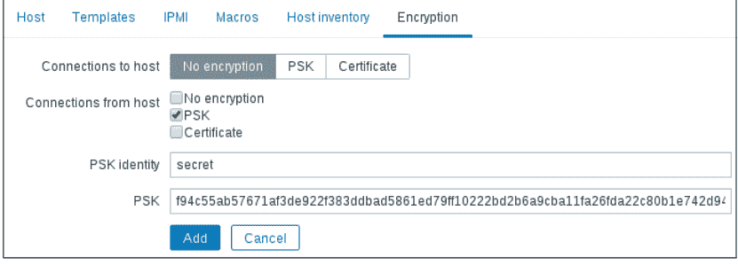
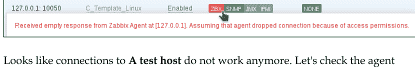

## 加密 Zabbix 流量

Zabbix 组件之间的通信默认以明文进行。在许多环境中，这不是一个重要问题，但在互联网上以明文进行监控可能不是一个好方法——传输的数据可能被恶意方读取或篡改。在之前的 Zabbix 版本中，没有内置解决方案，并且使用了各种 VPN、stunnel 和 SSH 端口转发解决方案。这样的解决方案仍然可以使用，但 3.0 是 Zabbix 第一个提供内置加密的版本。在本章中，我们将设置多个组件以使用不同类型的加密。

### 概述

对于 Zabbix 通信加密，支持两种类型：

+   - 预共享密钥
+   - 基于证书的加密

**预共享密钥 (PSK)** 类型非常容易设置，但可能更难扩展。基于证书的加密设置可能更复杂，但在更大规模上更容易管理并且可能更安全。

此加密支持所有 Zabbix 组件之间的通信——服务器、代理、代理，甚至 `zabbix_sender` 和 `zabbix_get`。

对于传出连接（例如服务器到代理或代理到服务器），只能使用一种类型（无加密，以及 PSK 或基于证书的）。对于传入连接，可以接受多种类型。这样，代理就可以默认使用加密与服务器进行主动或被动项目的通信，然后在调试时使用 `zabbix_get` 无需加密进行工作。


# 后端库

在幕后，Zabbix 加密可以使用三种不同的库之一：OpenSSL、GnuTLS 或 mbedTLS。应该选择哪一个？如果使用软件包，最简单和最安全的方法是使用软件包编译时所使用的库。如果从源码编译，选择最容易编译的库即可。在这两种情况下，这很可能就是打包者推荐并且维护良好的库。Zabbix 团队已做出重大努力，以尽可能相似的方式从用户角度为所有三个库实现支持。关于某些特定功能的支持可能存在差异，但那些很可能更偏门——如果以后真的出现此类问题，从一个库切换到另一个库应该只需重新编译守护进程即可。虽然在大多数情况下使用哪个库可能差别不大，但了解这一点是个好主意——支持这三种不同库的一个好理由也是，如果当前使用的库存在安全漏洞，可以切换到另一个库。

> 这些库以通用方式使用，并不要求为不同的 Zabbix 组件使用相同的库——完全可以为 Zabbix 服务器使用一个库，为 Zabbix 代理使用另一个库，为 zabbix_sender 再使用另一个库。

在本章中，我们将首先尝试使用 Zabbix 服务器和 zabbix_sender 进行加密，然后再使用 PSK 和基于证书的加密对代理流量进行加密。如果您是从软件包安装，您的服务器很可能已经支持加密。通过查看服务器和代理启动消息来验证：

```
TLS support:          YES
```

> 要了解二进制文件是针对哪个库编译的，可以运行 ldd zabbix_server | egrep -i "ssl|tls"——根据需要替换二进制文件名称。

如果您是从源码编译且没有 TLS 支持，请通过添加以下其中一个参数重新编译服务器和代理：--with-openssl、--with-gnutls 或 --with-mbedtls。

## 预共享密钥加密

让我们从一个简单的情况开始——一个新主机，Zabbix 服务器将仅接受 PSK 加密的传入连接，而我们将使用 `zabbix_sender` 向其发送一些值。为此，Zabbix 服务器和 `zabbix_sender` 必须使用 TLS 支持编译。PSK 配置由 PSK 标识和密钥组成。标识是一些不被视为秘密的字符串——它在通信过程中不会被加密；不要在标识字符串中放置敏感信息。密钥是一个十六进制字符串。

> Zabbix 要求密钥至少为 32 个字符（十六进制数字）长。Zabbix 中的最大长度为 512 个字符，但这可能取决于您使用的后端库的具体版本。

我们可以直接手动输入密钥，但使用 `openssl` 命令可能稍微容易一些：

```
$ openssl rand -hex 64
```

这将生成一个 512 位密钥，我们稍后会使用它。导航到 **Configuration | Hosts**，点击 **Create host**，并填写以下值：

- **Hostname:** `Encrypted host`
- **Groups:** 在 **In groups** 块中仅保留 **Linux servers**

切换到 **Encryption** 选项卡，在 **Connections from host** 部分，仅保留 **PSK** 标记。在 **PSK identity** 字段中输入 `secret`，并将我们之前生成的密钥粘贴到 **PSK** 字段中：



完成后，点击底部的 Add 按钮。查看此主机的 AGENT ENCRYPTION 列：


第一个块只有一个字段，目前显示为 NONE。对于到代理的连接，只可能有一种类型，因此此列必须显示从服务器角度来看当前选择的传出连接类型。第二个块有三个字段。我们可以选择可接受的传入连接类型的组合，因此此列必须显示从服务器角度来看为此主机接受的传入连接类型。

现在，点击 Encrypted host 旁边的 Items，然后点击 Create item。填写以下值：

- Name: Beers in the fridge
- Type: Zabbix trapper
- Key: fridge.beers

点击底部的 Add 按钮。让我们现在尝试发送一个值，就像我们在第 11 章《Advanced Item Monitoring》中所做的那样：

```
$ zabbix_sender -z 127.0.0.1 -s "Encrypted host" -k fridge.beers -o 1
```

这应该会失败：

```
info from server: "processed: 0; failed: 1; total: 1; seconds spent: 0.000193"
```

注意 processed 计数为 0，failed 计数为 1。让我们检查 Zabbix 服务器日志文件：

```
12254:20160122:231030.702 connection of type "unencrypted" is not allowed for host "Encrypted host" item "fridge.beers" (not every rejected item might be reported)
```

这实际上是一个非常有用的消息——我们没有为 zabbix_sender 指定任何加密，但我们确实要求我们的主机使用加密连接。注意括号中的文字——如果同一主机上的多个项目因此原因失败，我们可能只会看到其中一些，并且仅通过项目键搜索日志文件可能无法揭示原因。

现在是让 zabbix_sender 的 PSK 正常工作的时候了。运行它并带上 --help 参数，查看 TLS 连接选项部分。哦，是的，有很多。幸运的是，对于 PSK 加密，我们只需要其中三个：--tls-connect、--tls-psk-identity 和 --tls-psk-file。在运行命令之前，在当前目录中创建一个名为 zabbix_encrypted_host_psk.txt 的文件，并将我们之前生成的十六进制密钥粘贴其中。

> 更安全的做法是先创建一个空文件，将其权限更改为 400 或 600，然后再将密钥粘贴到文件中——这样其他用户就不会有机会从文件中窃取密钥。如果有特定用户应该调用 zabbix_sender，请确保将该用户设为文件的所有者。

再次运行 zabbix_sender，但带上三个额外的加密参数：

```
$ zabbix_sender -z 127.0.0.1 -s "Encrypted host" -k fridge.beers -o 1 --tls-connect psk --tls-psk-identity secret --tls-psk-file zabbix_encrypted_host_psk.txt
```

我们使用 --tls-connect 标志将连接类型设置为 psk，并现在指定了 PSK 标识和密钥文件。

> 出于安全原因，Zabbix 不支持在命令行上指定 PSK 密钥——它必须从文件中传递。

这次，值应该成功发送：

```
info from server: "processed: 1; failed: 0; total: 1; seconds spent: 0.000070"
```

为了确认，验证此项目现在在前端是否有数据。

## 基于证书的加密

在 PSK 基于的加密保护了我们的敏感 Zabbix trapper 项目后，让我们转向证书。我们将为 Zabbix 服务器和代理生成证书，并在 Zabbix 代理端对被动项目要求加密连接。证书颁发机构签署证书，Zabbix 组件可以信任一个或多个颁发机构。通过扩展，它们信任由这些颁发机构签署的证书。

## 加密 Zabbix 流量

您可能在组织中拥有证书基础设施，但对于我们的首次测试，我们将自行生成所有必需的证书。我们需要一个新的 **证书颁发机构 (CA)** 来签署我们的证书。Zabbix 不支持自签名证书。

> 强烈建议使用中间证书颁发机构来签署客户端和服务器证书——在下面的简单示例中我们不会使用它们。

## 成为自己的颁发机构

我们将开始在一个单独的目录中创建证书。为简单起见，让我们在 `A test host` 上执行此操作——选择任何进行证书签名的目录。

以下内容并不旨在成为良好实践。它实际上为了更快地获取证书而做了相当多的不安全和糟糕的事情。请不要将这些步骤用于任何生产环境。

```
```bash
$ mkdir zabbix_ca
$ chmod 700 zabbix_ca
$ cd zabbix_ca
```
```

生成根 CA 密钥：

```
```bash
$ openssl genrsa -aes256 -out zabbix_ca.key 4096
```
```

提示时，输入密码两次以保护密钥。生成并自签名根证书：

```
```bash
$ openssl req -x509 -new -key zabbix_ca.key -sha256 -days 3560 -out
zabbix_ca.crt
```
```

提示时，输入您之前为密钥使用的密码。按提示填写值——最简单的方法可能是为除国家代码和常用名称外的多数项提供空值。常用名称对于我们的测试不需要太有意义，因此使用简单的字符串如 zabbix_ca 就足够了。

现在，开始创建我们将用于 Zabbix 服务器的证书——首先，让我们生成服务器密钥和 **证书签名请求 (CSR)**：

```
```bash
$ openssl genrsa -out zabbix_server.key 2048
$ openssl req -new -key zabbix_server.key -out zabbix_server.csr
```
```


当提示时，输入国家代码和通用名称字符串，与之前一样。通用名称不必匹配服务器、代理名称或其他任何内容，因此使用一个简单的字符串（如 `zabbix_server`）就足够了。现在让我们签署这个请求：

```
$ openssl x509 -req -in zabbix_server.csr -CA zabbix_ca.crt -CAkey zabbix_ca.key -CAcreateserial -out zabbix_server.crt -days 1460 -sha256
```

当提示时，输入 CA 密码。让我们继续为 Zabbix agent 生成证书。生成 agent 密钥和证书签名请求：

```
$ openssl genrsa -out zabbix_agent.key 2048
$ openssl req -new -key zabbix_agent.key -out zabbix_agent.csr
```

当提示时，输入国家代码和通用名称字符串，与之前一样。通用名称不必匹配服务器、代理名称或其他任何内容，因此使用一个简单的字符串（如 `zabbix_agent`）就足够了。现在，让我们签署这个请求：

```
$ openssl x509 -req -in zabbix_agent.csr -CA zabbix_ca.crt -CAkey zabbix_ca.key -CAcreateserial -out zabbix_agent.crt -days 1460 -sha256
```

当提示时，输入 CA 密码。

我们已经完成了测试证书的创建。两个密钥都是未加密创建的——Zabbix 目前不支持提示输入密钥密码。

## 使用证书设置 Zabbix

现在，让 A test host 上的被动监控项使用我们刚刚生成的证书。我们必须将证书提供给 Zabbix agent。在 Zabbix agent 配置文件所在的目录中，创建一个名为 zabbix_agent_certs 的新目录。限制对它的访问，如下所示：

```
# chown zabbix zabbix_agent_certs
# chmod 500 zabbix_agent_certs
```

从我们生成证书的目录，将相关的证书文件复制到新目录：

```
# cp zabbix_ca.crt /path/to/zabbix_agent_certs/
# cp zabbix_agent.crt /path/to/zabbix_agent_certs/
# cp zabbix_agent.key /path/to/zabbix_agent_certs/
```

编辑 zabbix_agentd.conf，修改以下参数：

```
TLSAccept=cert
TLSConnect=unencrypted
TLSCAFile=/path/to/zabbix_agent_certs/zabbix_ca.crt
TLSCertFile=/path/to/zabbix_agent_certs/zabbix_agent.crt
TLSKeyFile=/path/to/zabbix_agent_certs/zabbix_agent.key
```

这将使 agent 只接受加密连接，并要求使用由该 CA（直接或通过中间证书）签名的证书。对于主动监控项，我们仍然使用未加密的连接。用户可能会提供证书并期望所有通信现在都已加密，但事实并非如此，除非 TLSAccept 或 TLSConnect 参数中有一个要求加密。为了防止静默忽略证书文件，Zabbix 在提供证书时会强制要求设置 TLSAccept 或 TLSConnect 之一。重新启动 Zabbix agent。

> 如果某个证书被泄露，证书颁发机构可以通过在证书吊销列表（CRL）中列出该证书来吊销它。Zabbix 通过 TLSCRLFile 参数支持 CRL。

让我们看一下 Zabbix 前端的主机配置列表：



看起来与 A test host 的连接不再工作了。让我们检查 agent 日志文件：

```
failed to accept an incoming connection: from 127.0.0.1: unencrypted connections are not allowed
```

看起来我们把它弄坏了。我们确实在 agent 上设置了加密，但没有来得及配置服务器端。如果我们想向所有 agent 推广加密，并稍后再处理服务器，该怎么办？在这种情况下，最好设置 TLSAccept=cert,unencrypted——这样，agent 仍然会接受来自我们服务器的未加密连接。一旦证书在 Zabbix 服务器上部署并配置完成，我们只需从该参数中移除 unencrypted，然后重新启动 Zabbix agents。让我们试试——再次修改 zabbix_agentd.conf：

```
TLSAccept=cert,unencrypted
```

重启 agent 守护进程，观察监控从 Zabbix 服务器恢复。现在，让服务器使用它的证书。我们将把证书放在 Zabbix 服务器可以使用的地方。在 Zabbix 服务器配置文件所在的目录中，创建一个名为 zabbix_server_certs 的新目录。限制对它的访问，如下所示：

```
# chown zabbix zabbix_server_certs
# chmod 500 zabbix_server_certs
```

> 如果使用的软件包以不同的用户名（如 zabbixs 或 zabbixsrv）运行 Zabbix 服务器，请在两条命令中将用户名替换为正确的用户名。

从我们生成证书的目录，将证书复制到新目录：

```
# cp zabbix_ca.crt /path/to/zabbix_server_certs/
# cp zabbix_server.crt /path/to/zabbix_server_certs/
# cp zabbix_server.key /path/to/zabbix_server_certs/
```

编辑 zabbix_server.conf，修改以下参数：

```
TLSCAFile=/path/to/zabbix_server_certs/zabbix_ca.crt
TLSCertFile=/path/to/zabbix_server_certs/zabbix_server.crt
TLSKeyFile=/path/to/zabbix_server_certs/zabbix_server.key
```

现在，重启 Zabbix 服务器。虽然我们已经在 agent 和服务器上都指定了证书，但被动监控项仍然以未加密模式工作。让我们继续把它们改成加密的。在 Zabbix 前端中，导航到“配置 | 主机”，点击 A test host，并切换到“加密”标签页。在“与主机的连接”选择中，选择“证书”，然后点击“更新”按钮。服务器配置缓存更新后，它将为主机切换到基于证书的加密。

> 我们正在更改 A test host 的配置，而不是 Encrypted host。

回到我们之前缓慢向 agent 部署基于证书的配置、稍后再添加到服务器的场景，我们现在可以在 agent 端禁用未加密连接。修改 zabbix_agentd.conf：

```
TLSAccept=cert
```

## 加密 Zabbix 流量

重启 agent。如果我们从一开始就遵循这个过程，监控将不会中断。让我们尝试使用 zabbix_get：

```
```bash
$ zabbix_get -s 127.0.0.1 -k system.cpu.load
zabbix_get [5746]: Check access restrictions in Zabbix agent configuration
```
```

这会失败，因为 agent 现在只接受加密连接。就像我们对 `zabbix_sender` 所做的那样，我们可以指定证书——但我们现在必须使用 Zabbix 服务器证书。

此命令需要访问 Zabbix 服务器证书：

```
```bash
$ zabbix_get -s 127.0.0.1 -k system.cpu.load --tls-connect cert --tls-ca-file /path/to/zabbix_server_certs/zabbix_ca.crt --tls-cert-file /path/to/zabbix_server_certs/zabbix_server.crt --tls-key-file /path/to/zabbix_server_certs/zabbix_server.key
0.030000
```
```

当然，这带来了更安全的环境。仅仅伪造 IP 地址不足以访问这个 agent。仅仅在 Zabbix 服务器上拥有一个账户也不足以访问所有 agent——还需要访问服务器证书。另一方面，这也使调试变得稍微复杂一些，因为我们无法轻易查询 agent，嗅探流量也更加困难。

我们使用了 PSK 和基于证书的加密，配合 `zabbix_sender`、`zabbix_get` 和被动 agent，但同样的原理也适用于主动 agent。作为练习，尝试让主动 agent 监控项也使用加密工作。

## 关注点与进一步阅读

目前，加密是 Zabbix 中一个非常新的功能。尽管它已经经过极其仔细和严密的开发和测试，但仍可能获得进一步的改进。请务必阅读官方加密文档以获取更多细节，并关注可能的更改。现在，让我们讨论一些基本的关注点和缺失的功能。

到目前为止，本章涵盖了 Zabbix 服务器、agents、zabbix_get 和 zabbix_sender——那么 Zabbix 代理（proxies）呢？Zabbix 代理完全支持加密。代理端的配置与 agent 配置非常相似，前端中的配置方式也与 agent 加密配置类似。请记住，所有涉及的组件都必须使用 TLS 支持编译——你拥有的任何代理可能都需要重新编译。在考虑加密时，想想最需要它的地方——也许你的 Zabbix 服务器和代理通过互联网通信，而所有其他连接都在本地网络中。在这种情况下，可能先只为服务器与代理之间的通信设置加密是合理的。注意，与 Zabbix Java gateway 通信时不支持加密，但可以很容易地让 gateway 与 localhost 上的 Zabbix 代理通信，而该代理再为与 Zabbix 服务器的通道提供加密。

我们已经了解了如何在不中断数据收集的情况下无缝升级和过渡到加密——所有组件能够接受各种连接类型，这使我们能够按顺序逐步推行更改。

可能有人只想部分实施加密的一个重要原因是性能。目前，Zabbix 不重用连接，不实现 TLS 会话缓存，也不使用任何其他机制来避免每次都从头建立加密连接。如果你有很多被动 agent 监控项，这尤其致命。在重新配置之前，请务必了解潜在的影响。

加密目前不用于身份验证目的。也就是说，我们不能省略主动 agent 的主机名，并仅根据证书来确定它是哪个主机。同样，我们也不能将加密连接用于主动 agent 的自动注册。

对于基于证书的加密，我们只指定了证书和 CA 信息。如果所使用的 CA 覆盖范围很大，那就不太安全——只要是由该 CA 签名的任何证书都会被接受。Zabbix 还允许验证远程证书的签发者和主题。除非你使用的是仅用于 Zabbix 的内部 CA，否则强烈建议限制签发者和主题。这可以通过前端的主机或代理属性，以及使用 agent 或代理配置文件中的 `TLS ServerCertIssuer` 和 `TLS ServerCertSubject` 参数来完成。


## 总结

在本章中，我们探讨了所有组件之间支持的内置 Zabbix 加密——server、proxy、agent、zabbix_sender 和 zabbix_get。虽然 Java gateway 不支持加密，但可以轻松地在 gateway 前放置一个 Zabbix proxy，以提供返回 Zabbix server 的加密通信。

Zabbix 支持预共享密钥和基于 TLS 证书的加密，并且可以使用三种不同的后端库之一——OpenSSL、GnuTLS 或 mbedTLS。如果某个库存在安全或其他问题，用户可以选择切换到另一个库。

升级和加密部署可以分步完成。所有 Zabbix 组件都可以同时接受多种连接类型。在我们的示例中，agent 会被设置为同时接受加密和非加密连接；当我们完成所有 agent 的加密配置后，我们将在 server 端切换到加密连接。一旦验证其按预期工作，就可以在 agent 上禁用非加密连接。

由于加密是内置且易于设置的，值得记住的是，加密连接需要更多资源，而且 Zabbix 不支持连接池或其他可以降低负载的方法。或许值得先保护最重要的通道，将终端节点留到以后处理。例如，加密 Zabbix server 与 proxy 之间的通信可能会优先于与各个 agent 的连接。

在下一章中，我们将更深入地接触 Zabbix 数据。这将包括直接从数据库检索监控数据，以及在紧急情况下（例如丢失所有管理员密码）修改数据库。我们还将讨论 XML 导出和导入功能以及 Zabbix API。

## 21
