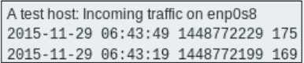
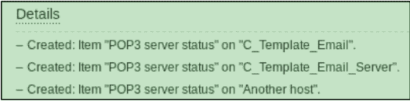
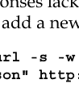
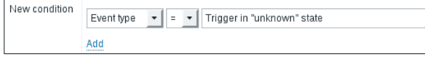
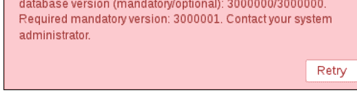
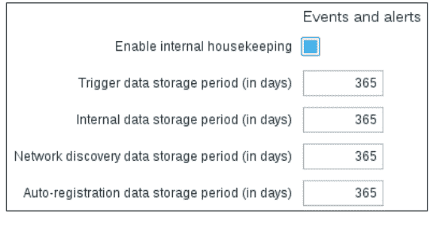
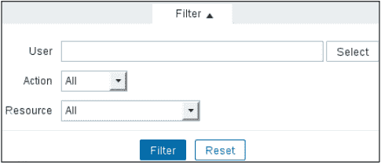

## 深入处理数据

使用 Web 前端和内置图表既美观又简单，但有时你可能想在外部电子表格应用程序中制作一些漂亮的图表，或者将数据输入另一个系统。有时，你可能想进行某些无法通过 Web 界面完成，或者通过 Web 界面操作很繁琐的配置更改。虽然这不是大多数 Zabbix 用户首先需要的东西，但当需要出现时，了解这些方法会很有用。因此，在本章中，我们将了解如何：

-   从 Web 前端或数据库获取原始监控指标数据
-   执行一些简单、直接的数据库修改
-   使用 XML 导出和导入来实现更复杂的配置
-   开始使用 Zabbix API

### 获取原始数据

原始数据是按原样存储在 Zabbix 数据库中的数据，可能只进行了少量（如果有的话）转换。检索此类数据主要用于在其他应用程序中进行分析。

### 从前端提取数据

在某些情况下，你可能只是需要将某些数据与另一个 Zabbix 未监控的数据（当然，你计划很快将其加入监控）快速绘制在一张图表中；这时，用电子表格快速拼凑一下或许就是解决办法。让数据在前端之外使用的最简单方式其实就是前端本身。

让我们了解如何轻松获取某个监控项的历史数据。转到“监控 | 最新数据”，在“主机”筛选字段中选择 A test host，然后点击“筛选”。点击 CPU load 旁边的“图形”。这会显示标准的 Zabbix 图形。这并不是我们想要的，对吧？但这个界面允许我们通过右上角的下拉框轻松访问原始数据——在其中选择“值”。

如果监控项在不久前已停止收集数据，而你只想快速查看最新值，可以选择“最近 500 个值”来代替。这样点击次数更少，就能获得数据。

值得注意的一点是顶部的时间段控件，它们与图形、屏幕等其他地方可用的控件相同。通过滚动条、缩放、移动和日历控件，我们可以显示任意时间段的数据。对于该监控项，默认的 1 小时时间段就足够了。对于某些轮询频率较低的监控项，我们通常需要使用更长的时间段：

| 时间戳 | 值 |
|---|---:|
| 2016-06-03 19:19:55 | 0.02 |
| 2016-06-03 19:19:25 | 0.03 |
| 2016-06-03 19:18:55 | 0.05 |

虽然我们可以使用支持 HTML 复制的浏览器从该表格中复制数据，然后粘贴到能够解析 HTML 的软件中，但这并不总是可行的。一个快速简便的解决方案就在右上角——只需点击 **以纯文本显示** 按钮。

这会为我们提供完全相同的数据集，只是去掉了所有类似 HTML 的周边内容，例如 Zabbix 前端部分和表格本身。我们可以轻松地将此表示形式保存为文件，或从中复制数据并在电子表格软件或任何其他应用程序中重复使用。这些数据还提供了一个额外的好处——所有条目都列出了相应的 Unix 时间戳。

> 严格来说，这个页面仍然是一个 HTML 页面。Zabbix 用户曾要求提供一个真正的纯文本版本。

### 查询数据库

从前端抓取数据既快捷又简单，但这种方法不适合大量数据，且难以自动化——解析前端页面虽然可行，但不是获取数据的最有效方式。另一种获取数据的方法是直接查询数据库。

> 💡 稍后我们将介绍 Zabbix API。除非存在性能问题，否则建议使用 API。

让我们了解历史数据是如何存储的。启动 MySQL 命令行客户端（通常简称为 mysql，通常位于 PATH 变量中），并以 zabbix 用户身份连接到 zabbix 数据库：

```
$ mysql -u zabbix -p zabbix
```

出现提示时，输入 zabbix 用户的密码（你可以通过查看 zabbix_server.conf 的内容来记起密码），然后在 MySQL 客户端中执行以下命令：

```
mysql> show tables;
```

这将列出 zabbix 数据库中的所有表——在 Zabbix 3.0 中正好是 113 张。要弄清楚这么多表是一项繁重的任务，但就我们当前的需求（获取一些历史数据）而言，只需要其中几张。首先，最有趣的是包含已采集数据的表。所有历史数据都存储在名称以 history 开头的表中。如你所见，有很多带有不同后缀的表——这是为什么呢？Zabbix 根据数据类型将检索到的数据存储在不同的表中。Zabbix 前端中的类型与数据库中的表之间的对应关系如下：

-   `history`：**数字（浮点）**
-   `history_log`：**日志**
-   `history_str`：**字符**
-   `history_text`：**文本**
-   `history_uint`：**数字（无符号）**

要获取数据，我们首先必须找出该特定监控项的数据类型。最简单的方法是打开监控项属性，查看**信息类型**字段。我们可以尝试检索三条记录的所有字段，查看 history 表的内容：

```
mysql> select * from history limit 3;
```

输出将告诉我们，该表中的每条记录包含四个字段（你的输出会有不同的值）：

```text
+--------+------------+--------+----------+
| itemid | clock      | value  | ns       |
+--------+------------+--------+----------+
|  23668 | 1430700808 | 0.0000 | 644043321 |
|  23669 | 1430700809 | 0.0000 | 644477514 |
|  23668 | 1430700838 | 0.0000 | 651484815 |
+--------+------------+--------+----------+
```

倒数第二个字段 value 很直观——它包含采集到的值。clock 字段包含 Unix 时间戳——即自所谓的 Unix 纪元（1970 年 1 月 1 日 00:00:00 UTC）以来的秒数。ns 列包含该秒内的纳秒数。

> 将 Unix 时间戳转换为可读形式且无需互联网连接的一个简单方法是使用 GNU date 命令：`date -d@<timestamp>`。例如，`date -d@1234567890` 将返回 `Sat Feb 14 01:31:30 EET 2009.`

第一个字段 itemid 是最神秘的。我们如何确定哪个 ID 对应哪个监控项？同样，最简单的方法是使用前端。你应该已经在浏览器中打开了监控项属性页面，所以看一下地址栏。除了其他变量，你会看到类似 `itemid=23668` 的字符串片段。很好，这样我们就已经拿到了 itemid 值。让我们尝试从数据库中获取该监控项的一些值：

```
mysql> select * from history where itemid=23668 limit 3;
```

使用你从页面 URL 中获得的 itemid 值：

```text
+--------+------------+--------+----------+
| itemid | clock      | value  | ns       |
+--------+------------+--------+----------+
|  23668 | 1430700808 | 0.0000 | 644043321 |
|  23668 | 1430700838 | 0.0000 | 651484815 |
|  23668 | 1430700868 | 0.0000 | 657907318 |
+--------+------------+--------+----------+
```

结果集只包含该监控项的值，正如输出中的 itemid 字段所示。


通常我们会想要从特定时间段检索值。猜测 Unix 时间戳并不有趣，所以我们同样可以使用 `date` 命令来计算相反的值——从人类可读形式的一个日期得到 Unix 时间戳：

```
```bash
$ date -d "2016-01-13 13:13:13" "+%s"

1452683593
```
```

`-d` 标志告诉 `date` 命令显示指定的时间而不是当前时间，而 `%s` 格式序列指示它以 Unix 时间戳格式输出。这个精巧的小命令还接受更自由形式的输入，例如 `last Sunday` 或 `next Monday`。

作为练习，找出两个相隔半小时的最近时间戳，然后从数据库中检索该项目的这些值。提示——SQL 查询看起来会类似这样：

```
```sql
mysql> select * from history where itemid=23668 and clock >= 1250158393
and clock < 1250159593;
```
```

你应该能得到一些值。为了验证时间段，将返回的 clock 值转换回人类可读格式。现在获得的信息可以传递给任何外部应用程序进行分析、绘图或比较。

有了包含原始数据的 `history*` 表，我们可以从中获取大量信息。但有时，我们可能只想要一个更大的概览，这时趋势表就能帮上忙。让我们找出这个表到底保存了什么。在 MySQL 客户端中执行以下操作：

```
```sql
mysql> select * from trends limit 2;
```
```

我们现在从 trends 表中选择两条记录：

```text
+--------+------------+-----+------------+-----------+-----------+
| itemid | clock      | num | value_min  | value_avg | value_max |
+--------+------------+-----+------------+-----------+-----------+
|  23668 | 1422871200 |  63 |     0.0000 |    1.0192 |    1.4300 |
|  23668 | 1422874800 | 120 |     1.0000 |    1.0660 |    1.6300 |
+--------+------------+-----+------------+-----------+-----------+
```


> 就像 history 表有 `history` 和 `history_uint` 一样，对于 **Numeric (float)** 和 **Numeric (unsigned)** 类型的信息，存在 `trends` 和 `trends_uint` 表。没有对应的 `_log`、`_str` 或 `_text` 表，因为趋势信息只能针对数值数据计算。

## 与数据紧密协作

在这里，我们找到了两个熟悉的朋友，`itemid` 和 `clock`，其用途和用法我们刚刚讨论过。最后三个值相当不言自明——`value_min`、`value_avg` 和 `value_max` 包含数据的最小值、平均值和最大值。但对应什么时间段？`trends` 表包含按小时划分的周期信息。因此，如果我们想在外部应用程序中绘制某一天每小时的最小值、平均值或最大值，而不是重新计算这些信息，我们可以直接从数据库中获取这些预先计算好的数据。但我们遗漏了一个字段：`num`。该字段存储此记录所覆盖的那个小时内值的数量。如果你在一天中每小时有数百条记录，大多都比较一致，但某个小时的数据缺失，只剩下一个极高或极低的值，那么在计算日、周、月或年数据时，我们就可以更正确地计算最终值，而不是给每个小时的值赋予相同的权重。

如果你想从数据库中访问数据以在外部应用程序中重用，请注意保留期——数据会在达到特定项目的 `History storage period` 和 `Trend storage period` 字段指定的天数后，从 `history*` 和 `trends*` 表中删除。

## 在远程站点使用数据

我们已经介绍了在 Zabbix 服务器上检索数据。但如果我们有一个远程站点、一个 Zabbix 代理、一个功能强大的代理机器和一个缓慢的链路呢？在这种情况下，我们可能会想提取代理数据以便重用它。然而，代理以不同于 Zabbix 服务器的方式存储数据。

就像上一章一样，运行以下命令：

```
```bash
$ sqlite3 /tmp/zabbix_proxy.db
```
```

这将打开指定的数据库。我们可以通过使用 `.tables` 命令来查看有哪些表：

```
```text
sqlite> .tables
```
```

注意，尽管我们已经知道代理不使用它们而是使用 `proxy_history`，但仍然存在所有的 `history*` 表。数据库模式在服务器和代理上是相同的，即使代理根本不使用其中的大多数表。让我们看看 `proxy_history` 表的字段。

> 💡 要在 SQLite 中检查表定义，可以使用 `.schema proxy_history` 命令。

下表说明了项目字段及其用途：

| Field | Usage |
|---|---|
| `id` | 记录 ID，用于确定哪些记录已同步回服务器 |
| `itemid` | 如 Zabbix 服务器上所示的项目 ID |
| `clock` | 记录的 Unix 时间，使用代理主机时间 |
| `timestamp` | 与时间相关，通过日志文件时间格式字段解析，或对于 Windows 事件日志监控——监控机器上显示的时间戳 |
| `source` | 仅与 Windows 事件日志监控相关——事件日志源 |
| `severity` | 仅与 Windows 事件日志监控相关——事件日志严重性 |
| `value` | 监控项目的实际值 |
| `logeventid` | 仅与 Windows 事件日志监控相关——事件 ID |
| `ns` | 该条目的纳秒数 |
| `state` | 该项目是否正常工作或处于不支持状态 |
| `lastlogsize` | 已解析的日志文件的大小 |
| `mtime` | 已解析的已轮转日志文件的修改时间 |
| `meta` | 如果设置为 1，则表示该条目不包含实际日志数据，只有 `lastlogsize` 和 `mtime` |


> 代理对项目配置的信息不多；如果你要进行远程处理，需要从 Zabbix 服务器获取。例如，代理有项目键和间隔，但项目名称在代理数据库中不可用。

正如可以看到的，几个字段将用于日志文件监控，而其他一些仅用于 Windows 事件日志监控。

## 更深入地探索数据库

有了从表中提取历史和趋势数据的知识，我们也可以继续查看其他有趣且相对简单的东西，我们可以在数据库中直接找到甚至更改它们。

## 管理用户

我们看到使用前端管理用户是一件轻松的事。但如果忘记了密码怎么办？如果 Zabbix 的某个远程安装由本地员工管理，而唯一的 Zabbix 超级管理员已外出度假一个月且无人知道密码怎么办？如果你有数据库访问权限，可以尝试解决此类问题。让我们找出 Zabbix 关于用户存储了什么以及如何存储。在 MySQL 控制台中执行以下操作：

```
mysql> select * from users limit 2;
```

这样，我们最多列出两个用户的所有数据：

| MariaDB [zabbix]> select * from users limit 2; |
|---|---|---|---|---|
| userid | alias | name | surname | passwd |
| 1 | Admin | Zabbix | Administrator | 5fce1b3e34b520afeffb37ce08c7cd66 |
| 2 | guest |  |  | d41d8cd98f00b204e9800998ecf8427e |
| 2 rows in set (0.00 sec) |

> 示例输出在右侧被截断，这里显示的列不到原始列数的一半。你也可以将 SQL 查询中的分号替换为 \G 以获得垂直输出，如下所示：select * from users limit 2 \G。

字段很多。我们最好弄清楚每个字段的含义：

| Field | Usage |
|---|---|
| userid | 很简单，这是一个唯一的数字 ID。 |
| alias | 更常被称为用户名或登录名。 |
| name | 用户的名字，通常是其 given name。 |
| surname | 这肯定无非是姓氏。 |
| passwd | 密码哈希存储在此处。Zabbix 为身份验证存储 MD5 哈希。 |
| url | 登录后的 URL 存储在此字段中。 |
| autologout | 该用户是否启用自动注销。非零值表示超时。 |
| lang | 前端的语言。 |
| refresh | 页面刷新间隔，单位为秒。如果为零，则禁用页面刷新。 |
| theme | 使用的前端主题。 |
| attempt_failed | 连续失败的登录尝试次数。 |


| 字段 | 用法 |
|---|---|
| `attempt_ip` | 最后一次登录失败尝试的 IP 地址。 |
| `attempt_clock` | 最后一次登录失败尝试的时间。 |
| `rows_per_page` | 长列表中每页显示的行数。 |

正如我们所见，许多字段都是可以从用户配置文件或属性页面访问的选项，尽管其中一些并非直接可用。我们之前提到过密码重置；让我们看一个简单的方法来执行此操作。如果密码以 MD5 哈希形式存储，我们必须先获取这些哈希值。一种常见的方法是命令行实用程序 md5sum。向其传递某个字符串会输出所需的结果，因此我们可以尝试执行以下操作：

```bash
$ echo "somepassword" | md5sum
531cee37d369e8db7b054040e7a943d3d  -
```

MD5 哈希被打印出来，后面跟着一个减号，表示标准输入。如果我们对文件运行 md5sum，则文件名将改在那里打印。

> 命令行实用程序提供了一种很方便的方式来检查各种序列。例如，尝试弄清楚默认访客密码哈希 `d41d8cd98f00b204e9800998ecf8427e` 代表什么。

现在，问题是如果我们尝试将此字符串用作密码哈希，它将失败。在这种情况下，哈希是基于传递的字符串计算的，包括末尾的换行符。对于正确版本，我们必须向 echo 传递 -n 标志，该标志会抑制尾随换行符：

```bash
$ echo -n "somepassword" | md5sum
9c42a1346e333a770904b2a2b37fa7d3  -
```

注意生成字符串的巨大差异。很好，现在我们只需要重置密码。

以下语句会更改 Zabbix 管理员用户密码。除非紧急情况，否则请勿在生产系统上执行此操作：

```sql
mysql> update users set passwd='9c42a1346e333a770904b2a2b37fa7d3' where userid=1;
Query OK, 1 row affected (0.01 sec)

Rows matched: 1  Changed: 1  Warnings: 0
```

从这里开始，您应该能够以 Admin / somepassword 登录 Zabbix 前端——试试看。之后请随意将密码改回。

实际上有一种更简单的方法。MySQL 有一个内置函数用于计算 MD5 哈希，因此所有这些技巧都可以用更简单的方法替代：

```
mysql> update users set passwd=MD5('somepassword') where alias='Admin';
```

> 在此时，Zabbix 不使用密码加盐。虽然这使得重置密码变得更简单，但也使得在 MD5 表中查找实际密码变得更容易。

我们还提到让某个用户成为 Zabbix 超级管理员。此更改相当简单——我们只需要更改一个数字：

```
mysql> update users set type=3 where alias='wannabe_admin';
```

就这样，用户 wannabe_admin 将成为 Zabbix 超级管理员。

## 更改现有数据

虽然一旦监控数据收集完毕，通常您不会需要更改它，但在某些罕见情况下可能需要这样做。在第 3 章《使用 Zabbix 代理和基本协议进行监控》中，我们为网络流量监控创建了项目，并以字节为单位收集数据，但在网络管理中，通常使用每秒比特数。而如果您只是重新配置项目并清除旧数据，通常是可行的，如果您需要保留已收集的值怎么办？直接编辑数据库可能是唯一的解决方案。

在执行此操作之前，您必须修改相关项目。如果数据以字节为单位传入，但我们想要比特，怎么办？对，配置该项目的乘数并将乘数设置为 8。此外，在进行更改的同时将单位更改为 b（比特）。

在更改项目时，快速看一下时钟。

虽然这将处理所有未来的传入值，但它会使该时刻之前的数据不一致。由于我们不想删除它，我们必须找到某种方法来修复它。我们的难题有两个方面：

- 数据库中存在不正确的数据
- 数据库中同时存在不正确和正确的数据（旧值和新值）

这意味着我们不能简单地转换所有值，因为那样会破坏新的、正确的值。

> 如果您已根据流量设置了任何触发器，请不要忘记同时更改它们。

## 弄清何时

弄清何时开始流入正确信息最简单的方法是查看前端。导航到 **Monitoring | Latest data**，点击该项目的 **History**，然后选择 **Values** 或 **500 latest values**。查看您更改项目乘数的时间前后一分钟左右，并检查规模是否有明显变化。虽然很难准确确定两次检查之间的确切间隔（网络流量在两次检查之间的值很容易波动八倍以上），但值应该有相当恒定的增长。查看值左侧的时间，并在第一个正确值和最后一个错误值之间选择一个时刻。

## 计算机语言中的“何时”

但正如我们现在所知，Zabbix 数据库中所有与时间相关信息都以 Unix 时间戳存储。对于此，GNU date 命令可以再次提供帮助。在 Zabbix 服务器上执行以下操作，将确切时间替换为您从最新值中推断出的时间：

```bash
$ date -d "2016-03-13 13:13:13" "+%s"
```

这将输出该时刻的 Unix 时间戳，在本例中为 1457867593。

请注意时区差异——在前端显示的值通常会应用本地时区。检查您获得的时间戳值是否与数据库中该相同时间戳的值匹配。实际上有一种更简单、更安全的方法来获取时间戳值。在前端查看该项目的历史值时，点击右上角的 **As plain text** 按钮：



注意第三列正是我们想要的：Unix 时间戳。在这种情况下，我们也不必担心时区。

## 弄清是什么

现在我们知道了限制更改的确切时间，我们还必须知道要为其修改哪个项目。等等，但我们已经知道了，不是吗？几乎是。我们的需要是项目 ID，以便对数据库进行更改。最简单的方法是打开配置部分中的项目属性并从 URL 中复制 ID，就像我们之前所做的那样。

## 执行更改

到目前为止，我们应该有两个看起来很神秘的值：

- Unix 时间戳格式的时间
- 项目 ID

我们现在要做什么？将该时间戳之前项目 ID 的所有值乘以八。有了我们的数据，这实际上非常简单——在 MySQL 控制台中，我们必须执行以下操作：

```
mysql> update history_uint set value=value*8 where
itemid=<our ID>  and clock<'our timestamp'>;
```

> 为了安全起见，您可能希望在事务中执行修改，并在事务仍处于打开状态时检查结果。如果结果令人满意，则提交更改。如果不满意，则回滚。

我们正在更新 history_uint，因为尽管网络流量的数据由于 Store as 项目选项而是十进制数，但我们通过将数据存储为整数丢弃了小数部分。请参阅第 3 章《使用 Zabbix 代理和基本协议进行监控》，以提醒自己我们为何这样做。此单个查询足以将所有旧数据转换为比特。

> 如果您总共有大量历史数据，并且该项目也有大量历史数据，此类查询可能需要相当长时间才能完成。在远程系统上运行此类命令时，请使用 screen 等工具。

> 我们在这里只修改历史表。如果项目已收集数据更长时间，我们还必须修改相应的 trends 或 trends_uint 表。

## 使用 XML 导入/导出进行配置

除非您必须进行大量修改，而这些修改在前端使用诸如批量更新之类的方法并不更容易，否则 Web 前端是可以接受的用于对 Zabbix 服务器进行配置更改的工具。一种简单的方法是将配置导出到 XML 文件，进行一些更改，然后再导入回来。

XML 导入/导出经常用于共享模板——您可以在 https://zabbix.org 和 http://share.zabbix.com 上找到大量此类模板。

> 我们稍后会查看 Zabbix API。建议使用 API 修改 Zabbix 配置，因为它还提供了比 XML 导入/导出更完整的功能——尽管在某些情况下 XML 方法可能更简单。

让我们看看简单的往返是如何工作的。

## 导出初始配置

在前端，打开 Configuration | Templates 并在 Group 下拉菜单中选择 Custom Templates。标记 C_Template_Email 旁边的复选框，然后点击底部的 Export 按钮。您的浏览器将提供保存名为 zbx_export_templates.xml 的文件——将其保存在本地机器上的某个位置。

## 修改配置

现在，手头有文件，我们可以修改配置。此方法让我们可以自由操作主机和主机附属信息，因此修改仅受 Zabbix 功能和我们想象力的限制。此时，以下实体可用于 XML 导出和导入：

- 主机
- 模板
- 主机组
- 网络地图
- 地图图像（图标和背景）
- 屏幕
- 值映射


在这些实体中，主机组和图片仅被间接导出。对于主机而言，其所有属性和子实体都会被导出和导入，但Web场景除外（此功能可能在Zabbix 3.2中可用）。主机组会与主机或模板一起导出，而在导出地图时，其中使用的图片也会在同一文件中导出。可以只导入单一类型的实体，也可以在同一个XML文件中导入任意数量和组合的实体。

## XML导出格式

打开保存的XML导出文件（在你喜欢的编辑器中）。在这个文件中，你会看到该主机所拥有的所有数据，文件的开头如下：

```
<?xml version="1.0" encoding="UTF-8"?>
<zabbix_export>
    <version>3.0</version>
    <date>2015-11-29T05:08:14Z</date>
    <groups>
        <group>
            <name>Custom templates</name>
        </group>
    </groups>
    <templates>
        <template>
            <template>C_Template_Email</template>
```

在这种情况下，每个模板都包含在一个`<template>`块中，而该块又包含了所有与该模板关联的事物的块。格式很简单，大多数内容只需快速浏览一下XML就能理解，有时还可以将XML中的值与前端配置部分的值进行比较。一个例外可能是每个字段可用的值。这些值通常可以从API文档中获取，我们稍后会介绍。

在查看导出的模板时，我们可以看到与导出主机相同的信息，包括模板链接——这就是第二个嵌套的`<templates>`块所表示的。

## 围绕导出编写脚本

虽然手动对导出文件进行单一修改可能很方便，但正是大规模修改最能体现这种方法的好处。作为创建XML文件的最简单方法，我们可以使用shell脚本。

例如，如果需要添加大量类似的监控项，我们可以编写一个包含所有这些项的XML文件，然后一次性导入。最简单的方法是先在前端创建一些监控项，导出该主机，然后编写一个快速脚本，循环遍历这些监控项定义并创建其余监控项。触发器（triggers）和自定义图形（custom graphs）也可以这样做。同样，最好为单个元素创建所有数据，导出它，并检查以弄清如何将其重新组合起来。

> 除非需要对单个实体进行修改，否则请考虑使用自定义LLD规则，如第12章“自动化配置”所述。

可以通过XML往返解决的其他更大规模的问题包括：

- **添加大量设备**：如果你拿到一大串带有IP地址的交换机列表，通过界面逐一添加将是一项艰巨的任务。而使用XML，这反而会变得非常容易和快捷。为此，只需创建一个主机，将其链接到之前创建的一个或多个模板，然后导出它，从而获得某种模板。在这个导出文件中，你基本上只需更改几个值——特别是`<interfaces>`元素中的连接详情。然后，继续创建一个循环，用相应的IP和主机名数据创建新的`<host>`条目。请注意，只在此文件中指定主机信息就足够了——所有监控项、触发器、图形和其他实体都将根据`<templates>`块中指定的一个或多个模板所包含的信息自动关联。

- **创建包含大量任意监控项的多张图形**：有时，可能不仅需要为每个端口创建一张图形，还需要创建将多个设备上的监控项以及其他任意集合的监控项分组在一起的图形。导出一个示例主机，并在循环中编写图形监控项的脚本——这些监控项位于`<graph_elements>`块中。

> 包含大量监控项的图形很快就会变得难以阅读。不要在一张图形上添加过多监控项。

## 导入修改过的配置

对于我们的第一次XML导出/导入，我们不会进行大规模脚本编写。相反，让我们做一个简单的修改。在保存的`zbx_export_templates.xml`文件中，找到键为`net.tcp.service[smtp]`的监控项块。一个监控项块以`<item>`标签开始，以`</item>`标签结束。复制这个监控项块，插入到现有块的下方，然后将监控项名称改为`POP3 server status`，键改为`net.tcp.service[pop3]`。

将其保存为一个新文件。现在开始实际的导入过程。回到前端，在**配置 | 模板**部分，点击右上角的**导入**。在此表单中，点击**导入文件**字段旁边的**选择**，然后选择保存的文件。可以随意探索**规则**部分，虽然默认设置对我们来说已经足够。我们唯一感兴趣的实体类型是缺失的监控项，而**创建新**列中**监控项**旁边的相应复选框已经被勾选。

点击**导入**继续。这应该会成功完成，然后点击左上角的**详细信息**。虽然所有其他记录都将涉及更新，但应该有两个条目是关于正在创建的监控项。这些将是唯一会带来更改的条目，因为所有更新都不会产生任何效果——XML文件中的数据与数据库中的数据相同。由于我们是为模板添加此监控项，它也会被添加到所有链接到此模板的其他主机和模板中：



让我们验证一下这个监控项是否使用我们在XML文件中使用的键来添加。导航到**配置 | 主机**，确保**分组**下拉列表中选择了**Linux服务器**，然后点击**另一台主机**条目旁边的**监控项**链接。我们的新监控项应该会出现在监控项列表中，表明它已正确添加到链接的主机。请记住，在导入过程中我们只将它添加到了上游模板：


## 生成主机

使用XML导入可以解决的潜在问题之一就是创建大量主机。我们可以使用一个像下面这样的临时脚本，从CSV文件生成Zabbix主机XML：

```bash
#!/bin/bash

split="%"
agent_port=10050
useip=1

[[ -s "$1" ]] || {
        echo "Usage: pass an input CSV file as the first parameter
```

```
File should contain data in the following format: hostname,dns,ip,host group,linked_template,agent_port
agent_port is optional
For groups and templates multiple entries are separated with %
First line is ignored (assuming a header)"
    exit 1
}
echo "<?xml version=\"1.0\" encoding=\"UTF-8\"?>"
<zabbix_export>
    <version>3.0</version>
    <date>$(date "+%Y-%m-%dT%H:%M:%SZ")</date>
    <hosts>"
while read line; do
    hostname=$(echo $line | cut -d, -f1)
    dns=$(echo $line | cut -d, -f2)
    ip=$(echo $line | cut -d, -f3)
    group=$(echo $line | cut -d, -f4)
    template=$(echo $line | cut -d, -f5)
    port=$(echo $line | cut -d, -f6)

    hostname1=${hostname%"}
    dns1=${dns%"}
    ip1=${ip%"}
    group1=${group%"}
    template1=${template%"}
    port1=${port%"}

    hostgroups=$(echo $group1 | tr "$split" "\n")
    templates=$(echo $template1 | tr "$split" "\n")

    echo "        <host>
            <host>$(echo ${hostname1#"})</host>
            <name>$(echo ${hostname1#"})</name>
            <status>0</status>
            <description/>
            <proxy/>
            <ipmi_auth_type>-1</ipmi_auth_type>
            <ipmi_privilege>2</ipmi_privilege>
            <ipmi_username/>
            <ipmi_password/>
            <tls_connect>1</tls_connect>
            <tls_accept>1</tls_accept>
            <tls_issuer/>
```

```
<tls_subject/>
<tls_psk_identity/>
<tls_psk/>
<interfaces>
    <interface>
        <default>1</default>
        <type>1</type>
        <useip>$useip</useip>
        <ip>${ip1#"}</ip>
        <dns>${dns1#"}</dns>
        <port>${port1:-$agent_port}</port>
        <bulk>1</bulk>
        <interface_ref>if1</interface_ref>
    </interface>
</interfaces>
echo "    <groups>"
while read hostgroup; do
    echo "        <group>
            <name>${hostgroup#"}</name>
        </group>"
done < <(echo "$hostgroups")
echo "    </groups>"
    <templates>"
while read hosttemplate; do
    echo "        <template>
            <name>${hosttemplate#"}</name>
        </template>"
done < <(echo "$templates")
echo "    </templates>"
echo "    </host>"
done < <(tail -n +2 $1)

echo "  </hosts>
</zabbix_export>"
```

保存这个脚本为 csv_to_zabbix_xml.sh 并使其可执行：

```
$ chmod 755 csv_to_zabbix_xml.sh
```

> 有些人说shell不是处理XML文件的合适工具。但shell是处理任何事情的好工具，并且完全适合我们这种简单、快速的主机生成。


此脚本以 CSV 文件作为输入，忽略第一行，并将所有其他行用作主机条目。我们必须指定主机名、DNS、IP 和 agent 端口。此外，对于每台主机，我们可以通过用百分号分隔多个条目来指定该主机应关联的多个主机组和模板。`useip` 参数默认为 1；将其设置为 0 则将改用 DNS。注意我们是如何生成目前我们并不关心的各种字段——所有 IPMI 和 TLS 字段，以及为 agent 接口设置 bulk 参数。不幸的是，Zabbix XML 导出的内容过于冗长，并且它期望导入时同样冗长。对于大量主机，这将显著增加 XML 文件的大小。

> 在 CSV 文件中加引号，可以让我们在主机组名中使用逗号。

要使用此文件，让我们创建一个名为 `test.csv` 的简单 CSV 文件：

```
"Host name","Host DNS","Host IP","Host groups","Templates","port"
"test-xml-import","dns.name","1.2.3.4","Linux servers%Zabbix servers","Template ICMP Ping"
```

我们在这里使用了一个标题行，因为第一行总是被排除——如果文件中只有一行，将不会产生任何作用。现在，让我们运行脚本：

```
$ ./csv_to_zabbix_xml.sh test.csv > zabbix_generated_hosts.xml
```

在前端中，导航到**配置 | 主机**，点击右上角的**导入**，在**导入文件**字段中选择 `zabbix_generated_hosts.xml` 文件，然后点击**导入**。导入应该会成功——返回**配置 | 主机**页面确认一下。由于该主机目前不是很有用，可以随意删除它。

## 导入图片

在配置网络地图时，我们有机会上传自己的图标。逐张上传大量图片效率非常低。我们可以使用诸如 `curl` 之类的工具编写脚本来完成该过程，但这需要为每张图片建立一个新的前端连接，并且如果未来版本的 Zabbix 界面发生变化，脚本可能会失效。不过，XML 导入支持图片，我们也可以只使用一个包含图片的文件。我们可以为此编写自己的脚本，但 Zabbix 已经附带了一个脚本——在 `misc/images` 目录中查找 `png_to_xml.sh` 脚本。该脚本接受两个参数：图片所在的目录和输出文件名。例如，如果我们的图片位于名为 `map_icons` 的目录中，我们可以按如下方式运行该脚本：

```
./png_to_xml.sh map_icons zabbix_images.xml
```

要导入图片，我们可以进入任意带有**导入**按钮的页面（例如**配置 | 地图**），点击**导入**按钮，并勾选**图片**行旁边的复选框。只有超级管理员才能导入图片。图片以 base64 格式导出和导入，因此 XML 文件中没有二进制数据。导出的图片示例是这样的：

```
```xml
<encodedImage>iVBORw0KGgoAAAANSUhEUgAAADAAAAAwCAYAAABXAvmHAAAABm
JLRQOA/wD/AP+gvaeTAAAM701EQVR42u2ZeXBV13HP+cub9NDSGIR
...
</encodedImage>
```
```

此输出被大幅截断——真正的 base64 值会占据好几页篇幅。

## Zabbix API 入门

我们之前讨论的方法——直接编辑数据库和 XML 导入/导出——要么有风险，要么能力有限。编辑数据库是有风险的，因为几乎没有校验机制，而且升级到较新版本的 Zabbix 可能会改变数据库模式，从而使我们的工具和方法失效。XML 导入/导出很不错，但非常有限——它不允许修改用户、网络发现规则、动作，以及 Zabbix 配置中的很多东西。

这正是 Zabbix API 能够发挥作用的地方。它是基于 JSON 的 Zabbix 配置和数据接口。它提供的功能远比 XML 导入/导出要多，尽管仍有一些配置细节无法通过它来控制。

Zabbix API 目前是基于前端的：它由 PHP 实现。要使用它，我们需要连接到运行前端的 Web 服务器并发出请求。实现该目标的方法有很多，但在这里，我们将尝试以与语言无关的方式来进行——我们将使用 curl，并从 shell 发出请求。

## 简单操作

Zabbix API 基于请求-响应模式。我们发送一个请求，然后得到一个响应——要么是请求的数据，要么是成功/失败指示。让我们看一些使用该 API 可以完成的简单实用示例。我们将使用简单的 curl 请求来访问 API。让我们在 Zabbix 服务器上尝试一下：

```
```bash
$ curl -s -X POST -H 'Content-Type: application/json-rpc' -d ''
http://127.0.0.1/zabbix/api_jsonrpc.php
```
```

在这个请求中，我们使用 POST 方法，并通过 -d 参数发送 JSON 字符串（目前为空）。我们还指定了 -s 参数，它启用静默或安静模式，并抑制进度和错误消息。URL 是 Zabbix API 端点 api_jsonrpc.php。所有 API 请求都将使用相同的端点。此外，我们将内容类型指定为 application/json-rpc。这是必需的。如果省略，Zabbix API 将返回一个空响应，这没有什么帮助。我们发出的请求应返回如下响应：

```
{"jsonrpc":"2.0","error":{"code":-32600,"message":"Invalid Request.","data":"JSON-rpc version is not specified."},"id":null}
```

这没有成功，但至少有一个错误消息。现在让我们继续尝试更有效的请求。

## 获取 API 版本

我们能做到的最简单的事情之一就是向 API 查询 Zabbix 版本。这将返回前端版本，它被认为与 API 版本相同。除了登录请求本身之外，这是唯一不需要登录的请求。

为了更容易编辑和发出请求，让我们将 JSON 赋值给一个变量，然后在 curl 命令中使用该变量。



> 或者，你可以将 JSON 字符串放入文件中，并使用 -d @file_name 将文件内容传给 curl。

```
$ json='{"jsonrpc":"2.0","method":"apiinfo.version","id":1}'
```

我们正在使用一个名为 apiinfo.version 的方法。如何知道哪些方法可用以及它们的名称是什么？该信息可以在 Zabbix 手册中找到，我们稍后会探讨。现在让我们将这个请求发送到 API。API 响应没有尾部换行符，这可能会使它们难以阅读——让我们也在 curl 命令中添加一个换行符：

```
$ curl -s -w '\n' -X POST -H 'Content-Type: application/json-rpc' -d "$json" http://localhost/zabbix/api_jsonrpc.php
```

注意在 -d 参数的双引号中使用了 $json 变量，以及使用 -w 参数来添加换行。此命令应返回 API 版本：

```
{"jsonrpc":"2.0","result":"3.0.0","id":1}
```

这个实例的版本是 3.0.0。那么 jsonrpc 和 id 值呢？jsonrpc 值指定的是 JSON-RPC 版本本身。Zabbix API 使用 2.0 版本，因此在所有请求和响应中它都是相同的。id 值是我们自己在请求中指定的，响应中具有相同的值。如果我们使用一个支持异步请求和响应的框架，这会很有用——这样我们就可以将响应与请求对应起来。JSON 还支持批处理，即可以在单个连接中发送多个请求，并通过 ID 匹配响应，但该功能目前在 Zabbix 3.0 中不可用。

## 登录

在通过 API 执行任何有用的操作之前，必须先登录。我们的 JSON 字符串如下所示：

```
$ json='{"jsonrpc":"2.0","method":"user.login","id":2,"params":{"user":"Admin","password":"zabbix"}}'
```

现在，运行我们用来获取 API 版本的同一个 curl 命令。在之后的所有 API 请求中，我们将只更改 json 变量，然后重用同一个 curl 命令。在这种情况下，假设用户名和密码正确，它应该返回以下内容：

```
{"jsonrpc":"2.0","result":"df83119ab78bbeb2065049412309f9b4","id":2}
```

> 我们将请求 ID 增加到了 2。这其实并不是必须的——我们本可以使用 3、5 或 1013。我们也可以再次使用 1——按照我们使用 API 的方式，所有请求的响应都非常明确，所以我们根本不关心 ID。不过，响应中确实还是带有与我们请求相同的 ID，即 2。

此响应在 result 属性中还有一个字母数字字符串，这对于以后所有 API 工作都非常重要。这是一个身份验证令牌或会话 ID，我们必须在所有后续请求中提交它。对于我们的测试，只需复制该字符串，然后在后面的 json 变量中使用它。


## 启用和禁用主机

主机可以通过设置单个值来启用或禁用。让我们禁用我们的 IPMI 主机，并在稍后重新启用它。为此，我们需要主机 ID。通常，使用 API 时，我们会查询 API 本身以获取 ID。在本例中，让我们保持简单，并在主机属性中查找 ID——与之前的项目一样，打开主机属性并从 URL 中复制 hostid 参数的值。获得该数字后，让我们设置 JSON 变量：

```
$ json='{"jsonrpc":"2.0","method":"host.update","params": {"hostid":"10132","status":1},"auth":"df83119ab78bbeb2065049412309f9b4","id":1}'
```

> 我们又回到了使用 ID 为 1 的情况。使用 curl 这样操作时，这真的无关紧要。

运行 curl 命令：

```
{"jsonrpc":"2.0","result":{"hostids":["10132"]},"id":1}
```

这应该表示成功，并且主机应被禁用——在前端检查主机状态。重新启用它也很简单：

```
$ json='{"jsonrpc":"2.0","method":"host.update","params": {"hostid":"10132","status":0},"auth":"df83119ab78bbeb2065049412309f9b4","id":1}'
```

再次运行 curl 命令以重新启用此主机。

## 创建主机

现在让我们使用 API 创建主机。让我们设置 JSON 变量：

```
$ json='{"jsonrpc":"2.0","method":"host.create","params":{"host":"API created host","interfaces":[{"type":1,"main":1,"useip":1,"ip":"127.0.0.2","dns":"","port":"10050"}],"groups":[{"groupid":"2"}],"templates":[{"templateid":"10104"}]},"auth":"df83119ab78bbeb2065049412309f9b4","id":1}'
```

在默认的 Zabbix 数据库中，组 ID 为 2 应对应 Linux 服务器组，而模板 ID 为 10104 应对应 Template ICMP Ping 模板。如果你的系统上的 ID 不同，请在此 JSON 字符串中更改它们。现在运行 curl 命令，主机应该成功创建：

```
{"jsonrpc":"2.0","result":{"hostids":["10148"]},"id":1}
```

## 获取历史记录和趋势

我们迄今为止讨论的方法大多涉及配置。我们也可以查询一些历史数据。例如，要获取项目历史数据，我们需要知道以下几件事：

- **项目 ID**
- 该项目的**信息类型**设置

这两者都可以通过在配置部分打开项目属性来找到——ID 将在 URL 中，信息类型将在该下拉菜单中。为什么我们必须指定信息类型？不幸的是，Zabbix API 不会为我们查找它，而是只在特定的表中查找值。默认情况下，会查询 history_uint（整数值）表。要获取 **A test host** 上的 CPU 负载项目的数值，JSON 字符串应如下所示：

```
$ json='{"jsonrpc":"2.0","method":"history.get","params":{"history":0,"itemids":"23668","limit":3},"auth":"df83119ab78bbeb2065049412309f9b4","id":1}'
```

> 请记住为此查询替换 auth 和 itemid。

这里有几个额外的参数值得讨论：

- `history` 参数告诉 API 查询哪个表。使用 0 时查询 `history` 表。使用 1 时查询 `history_str` 表。使用 2 时查询 `history_log` 表。使用 3 时查询 `history_int` 表（这是默认值）。使用 4 时查询 `history_text` 表。我们必须手动将此值与项目属性中的设置匹配。
- `limit` 参数限制返回的条目数。在这里非常有用，因为一个项目可能有大量值。顺便说一下，`limit` 也支持所有其他方法——我们可以限制检索主机、项目和所有其他实体时的条目数。

现在，运行 curl 命令：

```
{"jsonrpc":"2.0","result":[{"itemid":"23668","clock":"1430988898","value":"0.0000","ns":"215287328"},{"itemid":"23668","clock":"1430988928","value":"0.0000","ns":"229668635"}],"id":1}
```

我们得到了三个值，但输出有点难以阅读。有很多方法可以格式化 JSON 字符串，但在 shell 中，最简单的方法是使用 Perl 或 Python 命令。重新运行 curl 命令并附加到它 | json_pp：

```
$ curl ... | json_pp
```

> 你可能还拥有 json_xs，它性能更好，但目前对我们来说性能完全不是问题。

这将调用 Perl JSON 工具，其中 pp 代表 pure Perl，输出会更易读：

```
{
  "jsonrpc" : "2.0",
  "id" : 1,
  "result" : [
    {
      "clock" : "1430988898",
      "itemid" : "23668",
      "value" : "0.0000",
      "ns" : "215287328"
    },
    {
      "ns" : "221534597",
      "value" : "0.0000",
      "itemid" : "23668",
      "clock" : "1430988928"
    },
    {
      "value" : "0.0000",
      "ns" : "229668635",
      "clock" : "1430988958",
      "itemid" : "23668"
    }
  ]
}
```

> 注意输出其实并没有排序。JSON 数据的顺序无关紧要，因此工具通常不会对输出进行排序。

或者，使用 `python -mjson.tool`，这将调用 Python 的 JSON 工具模块。输入会稍微多一点。

在 `history.get` 方法的输出中，每个值都附带项目 ID、UNIX 时间戳和纳秒信息，与我们之前查看的历史表相同。这并不奇怪，因为 API 输出来自这些表。如果我们通过运行 `date -d@<UNIX timestamp>` 将这些值转换为人类可读格式，如前所述，我们会发现它们并不新鲜——实际上，它们是最旧的值。我们可以通过添加 `sortfield` 和 `sortorder` 参数来获取最新值：

```
$ json='{"jsonrpc":"2.0","method":"history.get","params":{"history":0,"itemids":"23668","limit":3,"sortfield":"clock","sortorder":"DESC"},"auth":"df83119ab78bbeb2065049412309f9b4","id":1}'
```

这些将按 clock 值以降序排序输出，然后获取三个最新值——检查返回的 Unix 时间戳以确认。如果有多个值具有相同的 clock 值，其他字段将不会用于二级排序。

我们还可以检索趋势数据——这是 Zabbix 3.0 中的一项新功能：

```
$ json='{"jsonrpc":"2.0","method":"trend.get","params":{"itemids":"23668","limit":3},"auth":"df83119ab78bbeb2065049412309f9b4","id":1}'
```

> Zabbix API 不允许提交历史数据——所有项目值都必须通过 `zabbix_sender` 实用程序通过 Zabbix 服务器，这在 *第 11 章 高级项目监控* 中讨论过。有传言称 API 可能会移至服务器端，这可能会允许在主 API 中合并数据提交。

## Zabbix API 的问题

Zabbix API 非常出色，但有一些问题值得了解：

- **审计：** 许多 Zabbix API 操作未在 Zabbix 审计日志中注册，该日志可通过 **Administration | Audit** 访问。这使得很难查明谁在何时进行了特定更改。
- **验证：** 不幸的是，API 验证还有很多不足。例如，使用 API，可以将主机更改为代理或反之，甚至可以将 `host status` 值设置为完全错误的数值，使该主机从前端消失，尽管无法创建同名的新主机。请非常、非常小心发送不正确的数据到 Zabbix API。它可能会抱怨该数据，也可能只是静默接受并做出一些愚蠢的更改。
- **错误消息：** 同样，即使在验证输入数据时，错误消息也不总是那么有帮助。有时它们会准确告诉你出了什么问题，但你也可能对长 JSON 输入字符串收到 `incorrect parameters`。
- **性能：** Zabbix API 的性能对于某些操作来说可能极差。例如，修改链接到大量主机的模板的项目或将许多主机链接到模板可能无法执行。虽然其中一些操作可以拆分，例如一次将模板链接到几百个主机，但在某些情况下，可能不得不退回到执行直接 SQL 查询。
- **缺少功能：** 尽管 Zabbix API 允许我们控制大部分 Zabbix 配置，但仍有一些缺失的区域。到目前为止，这主要涉及 **Administration | General** 部分中的内容。一旦实现此类功能，Zabbix 前端最终就可以停止执行直接数据库查询，并且 API 将允许在不诉诸直接数据库访问的情况下编写自定义前端。

## 使用 API 库

虽然我们查看了低级 API 示例，但你不太可能使用 shell 脚本来处理 Zabbix API。即使使用额外工具，shell 也不是处理 JSON 数据的理想选择，因此另一种编程或脚本语言可能是更好的选择。对于许多这些语言，无需实现完整的原始 JSON 处理，因为有库可用。截至撰写本文时，可用库的列表维护在 http://zabbix.org/wiki/Docs/api/libraries。或者，只需访问 http://zabbix.org 并查找 **Zabbix API libraries** 链接。

所有这些库都是社区提供的。没有质量保证，任何错误都应报告给库维护者，而不是 Zabbix。

例如，一个名为 `Zabbix::Tiny` 的 Perl 库旨在成为 Zabbix API 的非常简单的抽象层，解决身份验证和请求 ID 问题以及使用 API 时的其他重复任务。它可以从 **Comprehensive Perl Archive Network (CPAN)** 轻松安装：

```
# cpan Zabbix::Tiny
```


要创建新用户，我们会将以下内容保存到文件中：

```
use strict;
use warnings;
use Zabbix::Tiny;
my $zabbix = Zabbix::Tiny->new(
    server => http://localhost/zabbix/api_jsonrpc.php,
    password => 'zabbix',
    user => 'Admin',
);
$zabbix->do(
    'user.create',
    alias    => 'new_user',
    passwd => 'secure_password',
    usrgrps => [ '13' ],
    name => 'New',
    surname => 'User',
    type => 3,
);
```

这将创建一个新用户。大多数参数不言自明，其中类型参数告诉 API 该用户是普通用户、管理员还是超级管理员。值为 3 表示超级管理员用户类型。组 ID 被硬编码为 13——这是需要自定义的地方。如果我们把这个文件保存为 `zabbix_tiny-add_user.pl`，可以这样调用它：

```
$ perl zabbix_tiny-add_user.pl
```

虽然这看起来可能比我们原始的 JSON 字符串更长，但它还处理了登录，并且比原始 JSON 更容易编写。关于这个特定 Zabbix API 库的更多信息，请参阅 http://zabbix.org/wiki/Docs/howto/Perl_Zabbix::Tiny_API。

有很多针对不同语言的 Zabbix API 库——仅 Python 在撰写本文时就有七个不同的库。要选出最好的一个可能有点挑战性。

如果你不喜欢围绕库进行编程，还有一个基于 Python 的项目，用于创建 API 操作的命令行工具，名为 **Zabbix Gnomes**。可以在 https://github.com/q1x/zabbix-gnomes 找到它。

## 延伸阅读

本章只介绍了 Zabbix API 的一小部分；还有很多很多内容。如果你想使用它，请查阅官方 Zabbix 手册，以了解所有方法、它们的参数和对象属性。在撰写本文时，Zabbix API 手册可以在 `https://www.zabbix.com/documentation/3.0/manual/api` 找到——但即使它变了，只需访问 `https://www.zabbix.com`，查找文档即可。

## 总结

在本章中，我们深入探讨了 Zabbix 使用的内部数据结构。虽然这只是大量数据库、XML 导入/导出、API 和其他信息中的一小部分，但它应该有助于解决用户最初遇到的一些常见问题。

我们弄清楚了如何从前端获取原始数据，这是小型数据集最简单的方法。对于更多数据，我们学会了根据数据类型从不同的历史表获取数据。我们还了解了 Zabbix 代理如何将数据保存在本地数据库中。对于需要较低精度的情况，我们学习了趋势表以及存储在那里的每小时最小值、最大值和平均值的计算。我们还介绍了直接在数据库中重置用户密码，以及在监控项配置最初不正确时修复监控项历史值。

我们探索了 Zabbix 的 XML 导入/导出功能，它允许我们添加和部分更新主机、模板、网络地图、聚合图形、主机组、图片和值映射。我们简要了解了 XML 格式，并创建了一个简单的脚本，用于从 CSV 文件生成主机。

最后，我们了解了 Zabbix API，它允许我们控制几乎所有的 Zabbix 配置。我们登录、控制主机状态、添加和删除主机、创建值映射并检索一些历史监控项值，并使用 `json_pp` 工具对输出进行了一些格式化。尽管 API 非常棒，但我们也讨论了它的各种问题，包括缺乏审计、适当的验证和错误消息。虽然这里只能介绍 Zabbix API 的一小部分，但我们知道了如何在 Zabbix 手册中查找更多信息，并通过使用 Perl 库提升了 API 的使用。我们还在 `http://zabbix.org/wiki/Docs/api/libraries` 发现了各种语言的 API 库列表。

我们将在下一章继续深入探讨 Zabbix。将涵盖各种与维护相关的主题，包括通过内部监控来了解缓存使用情况和进程繁忙率、备份 Zabbix 配置，以及在新版本发布时升级 Zabbix。我们还将探讨守护进程配置文件中的所有参数。

## 22

## Zabbix 维护

当 Zabbix 平稳运行时，一切都很棒——我们能获得所有数据、漂亮的图形和告警。为了让它保持这种状态，我们应该关注 Zabbix 自身的健康状况，准备好从灾难性事件中恢复，并时不时升级到最新版本。在本章中，我们将涵盖以下主题：

- **监控 Zabbix 内部**：缓存、繁忙率、性能监控项以及其他能反映 Zabbix 运行状况的数据
- **进行备份**：关于如何执行备份和潜在恢复策略的建议
- **升级 Zabbix**：如何了解新版本会带来哪些变化，不同版本中哪些组件相互兼容，以及如何执行升级本身

我们还将回顾有关 Zabbix 设置以降低性能问题的一般性建议，并查看审计日志——这是一种查看谁在何时对 Zabbix 配置进行了更改的方法，尽管此功能存在一些问题，我们一定会找出这些问题。在本章末尾，我们将查看服务器、代理和 agent 配置文件中的所有配置参数，重点关注到目前为止尚未讨论过的参数。

## 内部监控

Zabbix 可以监控其他系统的许多方面，但我们对 Zabbix 自身了解多少呢？我们可以立即在 Zabbix 前端看到一些基本指标。在前端中，转到 **报表 | Zabbix 状态**。在这里，我们可以观察到高级信息，例如 Zabbix 服务器是否正在运行，以及诸如主机、监控项、触发器和在线用户数量等值。

此信息在仪表板中也以小部件的形式可见。该小部件和报表都仅对超级管理员用户可用。

让我们看一下 **所需服务器性能，每秒新值** 旁边的值。这是确定 Zabbix 安装规模时的主要值：

| Zabbix 状态 |
|---|---|
| 参数 | 值 | 详细信息 |
| Zabbix 服务器正在运行 | 是 | localhost:10051 |
| 主机数量（启用/停用/模板） | 59 | 16 / 2 / 41 |
| 监控项数量（启用/停用/不支持） | 318 | 250 / 1 / 67 |
| 触发器数量（启用/停用 [问题/正常]） | 36 | 36 / 0 [13 / 23] |
| 用户数量（在线） | 4 | 2 |
| 所需服务器性能，每秒新值 | 8.1 |  |

## 每秒新值

为什么“每秒新值”设置如此重要？虽然了解一个系统有多少台主机甚至多少个监控项很重要，但底层负载可能差异很大。例如，我们可能有一个系统包含 1,000 台主机，每台 100 个监控项，但这些监控项每 15 分钟轮询一次。在这种情况下，近似预期的 **每秒新值 (NVPS)** 将是 111。或者我们可能只有 10 台主机，每台 100 个监控项，但如果间隔是 10 秒（这是一个非常低的间隔；如果可能，永远不要使用这么低的间隔），则总预期 NVPS 将是 100。正如我们所见，主机和监控项数量有影响，平均间隔也有影响。NVPS 是一个通用值，可以更容易地与其他系统进行比较。在我们的安装中，基于当前的主机和监控项配置，预期 NVPS 可能在 7 到 9 之间。这意味着每秒，Zabbix 服务器预计会接收并处理这么多历史值——这还包括计算任何触发器表达式、计算数值监控项的趋势信息，以及将任何生成的事件和这些历史值存储到数据库中。每个值都涉及大量看似无形的工作。

我们可以在 Zabbix 状态报告中看到当前配置的值，但是如何在不添加所有主机和监控项的情况下，为我们正在构建的更大系统计算预期 NVPS 呢？如果我们在单个主机上有 60 个监控项，每个监控项每分钟轮询一次，则 NVPS 可以这样计算：

```
<item count> / <item interval>
```


因此，每分钟 60 个监控项将产生 1 NVPS。顺便说一句，每分钟一个监控项就是 1/60，即 0.01557。要获得预计环境中的总 NVPS，我们只需将其乘以主机数量：

```
<average item count per host> / <average item interval> * <total host count>
```

代入不同的值，看看当其中一个值改变时，预期 NVPS 如何变化。你拥有的主机越多，平均间隔和每台主机的平均监控项数量的影响就越大。

前端提供给我们的值是确定当前预期 NVPS 的好方法，但不太容易看出它如何随时间变化以及配置更改如何影响它。我们可以添加一个内部监控项来存储该值，以便我们能够看到长期变化并将其绘制成图表。导航到“配置 | 主机”，点击“A test host”的“监控项”，然后点击“创建监控项”按钮。在此表单中，首先点击“键”字段旁边的“选择”，并在监控项助手中将“类型”下拉框更改为“Zabbix 内部”。这会给我们呈现一个可用的内部监控项列表。我们将设置其中几个，但不会讨论里面的每一个监控项。如果你在我们结束这个主题后对某些监控项感到好奇，请查阅 Zabbix 手册，了解每个内部监控项的详细信息。还记得我们如何创建一个监控项来监视代理上次联系服务器的时间吗？那也是一个内部监控项。

在此列表中，点击 `zabbix[requiredperformance]`。填写以下内容：

- **名称：** Expected NVPS
- **类型：** Zabbix 内部
- **信息类型：** 数值（浮点）
- **单位：** NVPS
- **新建应用：** Zabbix performance

完成后，点击底部的“添加”按钮。在“最新数据”页面检查此监控项。不久之后，它应该会有值，与我们在 Zabbix 状态报告中看到的有些相似：

| Zabbix performance（1 个监控项） |
| Expected NVPS | 2015-12-09 11:36:46  8.13 NVPS |

这个值很可能与我们在报告中看到的不同。我们刚刚添加了一个监控项来监视预期 NVPS，它本身也提供值，因此这一操作已经影响了 NVPS。

配置好这个监控项后，我们谈谈它到底是什么。你可能已经注意到之前多次强调这是预期 NVPS。它基于我们的主机和监控项配置，并不实际反映我们正在接收多少值。如果我们的所有监控项都是主动代理类型，并且所有代理都已停止，即使我们完全收不到任何信息，预期 NVPS 也不会改变。撇开这类技术问题不谈，这个数字也可能因其他原因与我们正常处理的值不同。日志监控项始终按其间隔进行计数。如果我们有一个间隔为 1 秒的日志监控项，即使日志文件本身没有值——或者每秒接收 10 个值——它也被计为 1 NVPS。灵活间隔和监控项调度会被忽略，而 trapper 监控项完全不包括在预期 NVPS 估算中。如果我们向 trapper 监控项发送大量值，我们实际处理的 NVPS 将高于预期 NVPS，有时甚至高出数倍。

由于预期或估算的 NVPS 可能不准确，我们也有办法计算出真实的 NVPS 值——还有另一个内部监控项可用于此目的。让我们回到“配置 | 主机”，然后再次点击“A test host”的“监控项”，并点击“创建监控项”。填写以下值：

- **名称：** Real NVPS
- **类型：** Zabbix 内部
- **键：** `zabbix[wcache,values]`
- **信息类型：** 数值（浮点）
- **单位：** NVPS
- **存储值：** Delta（每秒速度）
- **应用：** Zabbix performance

完成后，点击底部的“添加”按钮。在键中，我们使用了关键字 wcache 和 values。第一个关键字代表写缓存（write cache），或者我们可以将其视为要写入数据库的值的缓存。values 参数让它报告通过该缓存的值数量。稍后我们将了解其他可能的参数。

> 我们还可以通过将第三个参数指定为 float、uint、str、log 或 text 来获得每种类型已处理值的数量。第三个参数默认为 all，报告所有值类型。

另一件值得注意的事情是 **存储值** ——这个内部监控项报告所有值的计数器，这样我们就能得到每秒的值的数量。我们既获得了一个容易与预期 NVPS 比较的值，又避免了山形图。人们如何知道哪些内部监控项返回最终值，哪些是计数器监控项？像往常一样，查阅 Zabbix 手册。

监控项配置好后，让我们在“最新数据”页面比较预期值和实际值：

| Zabbix performance（2 个监控项） |
| Expected NVPS | 2015-12-09 13:17:46  8.17 NVPS |
| Real NVPS | 2015-12-09 13:17:47  1.29 NVPS |

注意添加另一个监控项后，预期 NVPS 值如何再次增加。

在这个系统上，部分监控基础设施已关闭，因此实际 NVPS 值明显低于预期值。你可能希望勾选这两个监控项旁边的复选框，并显示一个临时图表，以直观地比较这些值并查看它们如何随时间变化。预期 NVPS 很可能相当稳定，只有在配置更改时才会改变。实际 NVPS 则会随着值的检索和处理随时间变化而上下波动。

## Zabbix 服务器运行时间

让我们尝试监控另一个 Zabbix 内部监控项。转到 **配置 | 主机**，点击 **A test host** 旁边的 **监控项**，然后点击 **创建监控项**。让我们监控 Zabbix 服务器的运行时间——不是整个系统，而是 Zabbix 服务器守护进程。填写以下值：

- **名称：** `Zabbix server uptime`
- **类型：** **Zabbix 内部**
- **键：** `zabbix[uptime]`
- **单位：** `uptime`

完成后，点击底部的 **添加**，然后在 **最新数据** 页面检查此监控项。请注意，我们使用 `uptime` 单位后，原始运行时间值（以秒为单位）被转换为人类可读的格式，显示 Zabbix 服务器进程已经运行了多长时间：

| 名称 | 最后检查 | 最后值 |
|---|---|---|
| - 其他 -（1 个监控项） |  |  |
| Zabbix server uptime | 2015-12-09 20:04:49 | 00:34:27 |

我们可以将此监控项显示在展示屏上，并为其设置一个触发器，以便在 Zabbix 服务器重启时通知我们。

## 缓存使用

我们已经讨论了 Zabbix 中的几个缓存及其用途。随着这些缓存被填满，它们可能会对 Zabbix 产生不同的影响。让我们看看如何监控其中一些缓存的空闲或使用量。我们可以监控我们了解到的第一个缓存的空闲空间：配置缓存。让我们转到 **配置 | 主机**，然后点击 **A test host** 旁边的 **监控项**，并点击 **创建监控项**。填写以下值：

- **名称：** `Zabbix configuration cache, % free`
- **类型：** **Zabbix 内部**
- **键：** `zabbix[rcache,buffer,pfree]`
- **信息类型：** **数值（浮点）**
- **单位：** `%`

完成后，点击底部的 **添加** 按钮。对于此监控项键，我们使用了 `rcache` 关键字，它代表 **读缓存**。与 `buffer` 结合使用时，它指的是配置缓存。使用 `pfree`，我们请求此缓存的空闲空间百分比。请注意，我们将 **信息类型** 设置为 **数值（浮点）** ——我们本可以将其保留为 **数值（无符号）**，那样的话，Zabbix 会截断小数部分，但本场景下不建议这样做。在 **最新数据** 页面检查此监控项：

| 名称 | 最后检查 | 最后值 |
|---|---|---|
| - 其他 -（1 个监控项） |  |  |
| Zabbix configuration cache, % free | 2015-12-09 20:45:20 | 95.92 % |

在我们的系统上，使用默认设置时，空闲配置缓存大小降至 90% 以下的可能性极小。

服务器上还有其他我们可以监控的内部缓存。稍后当我们查看守护进程配置参数时，会更详细地讨论它们包含的内容和建议的大小，但现在让我们先快速列一下：

- **配置缓存**：我们已经监控了它。它保存主机、监控项、触发器和其他配置信息
- **值缓存**：它保存历史值以加速触发器、计算监控项、聚合监控项和其他操作
- **VMware 缓存**：它保存相当原始的 VMware 数据
- **历史缓存和历史缓存索引**：这两个在历史值被处理用于触发器并写入数据库之前保存它们
- **趋势缓存**：它保存当前小时内所有正在接收值的监控项的趋势信息

> 监控所有这些参数是一个非常非常好的主意。

请注意，大多数缓存也可以针对 Zabbix 代理进行监控。具体做法是，将带有这些监控项的主机分配给特定的 Zabbix 代理进行监控。此时，这些内部监控项将返回有关该代理的信息。只有相关的监控项才会起作用——例如，监控代理上的趋势缓存是不可能的，因为代理上根本没有趋势缓存。将此类主机分配给代理的相同方法也适用于内部进程繁忙率下的监控项，我们接下来将讨论这些监控项。

## 内部进程繁忙率

Zabbix 内部有一堆进程，我们已经介绍了一些——我们启用了 IPMI 和 VMware 轮询器以及 SNMP trapper。对于其中几个进程，我们还可以配置要启动的进程数量。我们如何知道一个进程是否足够，或者也许我们应该有一百个进程？稍后我们将讨论每种类型的一般准则，但非常重要的一点是要知道当前运行的进程有多繁忙。也有用于此目的的内部监控项。对于这些监控项，一般语法如下：

```
zabbix[process,<type>,<mode>,<state>]
```


这里，`process` 是一个固定关键字。第二个参数 `type` 是进程类型，如 poller、trapper 等。第三个参数 `mode` 可以是以下之一：

- avg：指定类型所有进程的平均速率。
- count：指定类型进程的数量。
- max：指定类型进程的最大速率。
- min：指定类型进程的最小速率。
- 一个数字：指定类型单个进程的速率。例如，默认情况下运行着五个 poller。通过在此处指定进程编号，我们可以监控 poller 1 或 poller 3。请注意，这是指内部进程编号，而不是系统 PID。

我们在这里谈论速率——这是目标进程或进程花费在某种状态上的时间，由第四个参数指定。它可以是 busy 或 idle。

我们应该监控 busy 速率还是 idle 速率？在大多数情况下，会监控特定类型所有进程的平均 busy 时间。为什么是 busy？只是按惯例，当此监控被实现时，第一个模板监控的就是 busy 速率。此外，在调试特定问题时，监控单个进程的 busy 速率可能会有所帮助。不幸的是，无法直接从服务器查询此类值——我们必须在前端添加一个 item，然后等待它开始工作。没有内置的 LLD 用于进程类型或其数量——我们必须手动创建此类 item 或使用 XML 导入或 Zabbix API 来自动化。

为了了解其工作原理，让我们监控所有 poller 进程的平均 busy 速率。前往 Configuration | Hosts，点击 A test host 旁边的 Items，然后点击 Create item。填写以下值：

- **Name:** `Zabbix $4 process $2 rate`
- **Type:** Zabbix internal
- **Key:** `zabbix[process,poller,avg,busy]`
- **Type of information:** Numeric (float)
- **Units:** %
- **New application:** `Zabbix process busy rates`

> 在通过 Zabbix proxy 监控的主机上创建此类 item 将报告该 proxy 的数据，而不是 Zabbix 服务器的数据。

我们再次在 item 名称中使用了位置变量——如果我们想监控另一个进程，只需克隆此 item 并仅更改 item key 中的进程名称即可。

完成后，点击底部的 **Add** 按钮。在 **Latest data** 页面检查此 item：

| NAME | LAST CHECK | LAST VALUE |
|---|---|---|
| **Zabbix process busy rates** (1 Item) |  |  |
| Zabbix busy process poller rate | 2015-12-11 08:52:51 | 0.69 % |

很可能，我们的小型 Zabbix 实例在轮询值时并不繁忙。默认情况下，启动了 5 个 poller，它们在处理当前负载时没有任何问题。

作为练习，监控更多进程类型——也许是 trapper 和 unreachable pollers。查阅 Zabbix 手册中关于内部 item 的部分，以了解在此 item 中应使用的确切进程名称。

添加几个 item 后，你可能会发现内部进程有很多。我们讨论过使用 XML 导入或 API 自动创建此类 item，但随后还有我们可以并且应该监控的所有缓存。Zabbix 在这里提供了一些帮助，并附带了默认的内部监控模板。在右上角的搜索框中输入 `app zabbix` 并按 *Enter* 键。查看 **Templates** 块：

**Templates**

| TEMPLATE | APPLICATIONS | ITEMS | TRIGGERS | GRAPHS | SCREENS | DISCOVERY | WEB |
|---|---|---|---|---|---|---|---|
| Template App Zabbix Agent | Applications 1 | Items 3 | Triggers 3 | Graphs | Screens | Discovery | Web |
| Template App Zabbix Proxy | Applications 1 | Items 21 | Triggers 19 | Graphs 4 | Screens 1 | Discovery | Web |
| Template App Zabbix Server | Applications 1 | Items 30 | Triggers 26 | Graphs 5 | Screens 1 | Discovery | Web |

Displaying 3 of 3 found

虽然 agent 模板相当简单，目前不怎么有趣，但 server 和 proxy 模板涵盖了很多内容，分别有 31 和 21 个 item。这些模板将允许开箱即用地监控内部进程 busy 速率、缓存使用、队列、处理的值以及其他一些内容。强烈建议在所有 Zabbix 安装中使用这些模板。

这些模板可能仍然缺少一些有趣的 item，例如我们之前创建的 expected NVPS item。建议创建一个单独的模板来包含此类缺失内容，而不是修改默认模板。这种方法将允许更轻松地升级，因为新版本可能会添加更多进程、缓存，并对默认模板进行其他改进。如果我们保持默认模板不变，我们可以导入新的 XML 文件，告诉 Zabbix 添加所有缺失内容、更新现有内容，并删除 XML 中不存在的内容，我们就会拥有最新的默认模板。如果我们对其进行了修改……更新它可能需要大量手动工作。

## Unsupported items and more problems

我们现在对 Zabbix 的内部监控有了相当多的了解，但仍有更多可能性。Unsupported items 不好用，所以让我们讨论一下我们可以监控它们情况的方法。

### Counting unsupported items

与缓存使用和进程 busy 速率类似，我们也可以使用内部 item 监控 unsupported item 的数量。要创建此类 item，让我们前往 Configuration | Hosts，点击 A test host 旁边的 Items，然后点击 Create item。填写以下值：

- **Name:** Amount of unsupported items
- **Type:** Zabbix internal
- **Key:** zabbix[items_unsupported]

完成后，点击底部的 Add 按钮。过一会儿，在 Latest data 页面检查此 item：

Amount of unsupported items 2015-12-11 17:02:52 58

58？对于这样一个小型安装来说，这是一个极高的值，尽管在这种情况下这是由 VMware 监控宕机引起的。此时，VMware 超时会导致所有 VMware item 变得 unsupported。在完美的环境中，不会有 unsupported item，因此我们可以创建一个触发器，当此 item 的值大于 0 时提醒我们。然而，这在除了非常小的环境之外的任何地方都不会太有用——通常，这里或那里会出现问题，unsupported item 计数永远不会为 0。因此，更有用的触发器将是关于 unsupported item 数量大幅增加的警报。change() 触发器函数可以帮助做到这一点：

```
{A test host:zabbix[items_unsupported].change()} >5
```

每当 unsupported item 计数在 30 秒内增加超过 5 时，即默认的 item 间隔，此触发器就会触发。阈值应根据特定环境进行调整以获得最佳效果。

这种全局警报将很有用，但在更大、职责更分散的环境中，我们可能只想提醒负责方。一种方法是按主机监控 unsupported item 计数。对于此 item，最有意义的做法可能是将其创建在某个基础模板中，以便将其应用于需要它的所有主机。让我们创建这样一个 item：导航到 **Configuration | Templates**，点击 **C_Template_Linux** 旁边的 **Items**，然后点击 **Create item**。填写以下值：

- **Name:** `Unsupported item count`
- **Type:** **Zabbix internal**
- **Key:** `zabbix[host,,items_unsupported]`

完成后，点击底部的 **Add** 按钮。在 **Latest data** 页面检查此 item：


显然，在此安装中，测试主机有两个 unsupported item。我们现在将在同一模板上创建一个触发器，当主机有非零的 unsupported item 计数时发出警报。这种组合效果相当不错，尽管在大型安装中，如果模板中的 item 配置错误或分发了损坏的 userparameter 脚本，可能会导致大量触发器触发。不幸的是，没有内置的 item 来确定按主机组划分的 unsupported item 计数。一个变通方法是在 *第 11 章 高级 Item 监控* 中讨论的 aggregate item。例如，要获取名为 **Linux servers** 的组的 unsupported item 计数，aggregate item key 可能是这样的：

```
grpsum[Linux servers,"zabbix[host,,items_unsupported]",last]
```

我们应该避免为单个主机创建 unsupported item 计数触发器，而应为 aggregate item 创建触发器。虽然单个 item 会继续收集数据，这会给 Zabbix 服务器带来一些负载并增加数据库大小，但至少警报数量会是合理的。


> 如果某个监控项变为不支持状态，所有引用它的触发器都会停止工作，即使它们使用 `nodata()` 函数查找缺失数据也是如此。这使得很难就此类问题向某人发出告警，除非使用了像这样的内部监控项——它本身极不可能变为不支持状态。

还有其他内部监控项。建议在在线手册中查看最新版本 Zabbix 的完整可用监控项列表。

## 审查不支持的监控项

那些告诉我们整个 Zabbix 安装或特定主机上不支持监控项数量的监控项非常有用，能让我们知道何时出了问题。但究竟哪里出了问题？在前端有一个非常简单的方法可以审查不支持监控项列表。导航到**配置 | 主机**，点击任意**监控项**链接，然后展开监控项过滤器。清除其中的任何主机、主机组或其他过滤选项，然后查看过滤器的右侧。在**状态**下拉框中选择**不支持**，然后点击**过滤**。这将显示该 Zabbix 实例中所有不支持的监控项。请注意，我们可能无法像这样显示所有状态下的所有监控项——过滤器要求至少设置一个条件，而状态条件也算作一个条件。

强烈建议时常查看此视图，并尽可能修复更多不支持的监控项。不支持的监控项是有害的。请注意，默认情况下最多显示 1,000 条记录。如果你有超过 1,000 个不支持的监控项，那就相当糟糕了，应该加以修复。

> 如果你在模板中看到不支持的监控项，这很可能是从旧版本升级而来的 Zabbix 实例。监控项状态异常是旧版本 Zabbix 中的一个 Bug。要解决此问题，需要在数据库中手动更改这些监控项的状态。查找监控项 ID，并将其**状态**值设为 0。和往常一样，直接更新数据库时要非常小心。

## 内部事件和未知触发器

我们刚才讨论过的针对不支持监控项的告警可能是最佳方法，因为它允许我们使用少数触发器，并以相对简单的方式拆分关于这些监控项的告警。还有另一种内置方法，可以针对不支持的监控项和处于未知状态的触发器发出告警——Zabbix 具有内部事件的概念。要基于这些内部事件配置告警，请转到“配置 | 动作”，在“事件源”下拉框中选择“内部”，然后点击“创建动作”。在“动作”选项卡中，勾选“恢复消息”复选框，并输入以下值：

- **名称**：触发器状态变为未知
- **默认主题**：{TRIGGER.STATE}: {TRIGGER.NAME}
- **恢复主题**：{TRIGGER.STATE}: {TRIGGER.NAME}

切换到“条件”选项卡；在“新条件”块中，在第一个下拉框中选择“事件类型”，并在最后一个下拉框中选择“触发器处于‘未知’状态”：



点击“新条件”块中的小“添加”链接，然后切换到“操作”选项卡。点击“动作操作”块中的“新建”，然后点击“发送给用户”部分中的“新建”。

> 在第二章“获取你的第一条通知”中，我们为 monitoring_user 设置了电子邮件——如果你的 Zabbix 实例中其他用户已正确设置电子邮件，请改为选择该用户。

在弹出窗口中点击 monitoring_user，然后点击“操作详细信息”块中的小“添加”链接——最后一个，就在最底部按钮的上方。要小心；这个表单很容易令人困惑。完成后，点击底部的“添加”按钮。

我们在第七章“针对所监控条件采取行动”中更详细地讨论了动作。

现在，只要触发器变为未知状态，就会发送告警。

虽然我们可以通过应用、主机、模板或主机组来限制这些动作，但我们无法在与触发器事件相同的动作中响应内部事件。如果我们已经有许多动作，按照主机组、应用和其他条件仔细拆分通知，那么为了获得相同的粒度，我们必须为内部事件复制所有这些动作。这非常不切实际，因此目前最好有一些通用动作，例如通知关键负责人，由他们进行调查，并将问题转交给分配给该主机组、应用或其他单元的团队。

## 备份

当出现问题时，有备份是件好事。在设置监控系统时，最好花些时间弄清楚如何进行备份，以免好事变坏事。对于 Zabbix，需要考虑以下组件和数据：

- **Zabbix 二进制文件**：例如服务器和代理。它们可能不值得备份。希望它们可以通过软件包或重新编译轻松获得。
- **Zabbix 前端文件**：希望它们也很容易获得。如果进行了任何更改，这些更改大概会以补丁形式存储在版本控制系统中。
- **Zabbix 配置文件**：希望这些文件存储在版本控制系统或系统配置工具中。
- **Zabbix 服务器数据库**：它包含所有与监控相关的配置数据，例如主机和监控项，也保存所有采集到的值。这才是值得备份的！

## 备份数据库

Zabbix 后端可以使用多种不同的数据库。我们不会花太多时间讨论特定于数据库的信息，只简要介绍一种使用最广泛的后端——MySQL——或其分支之一创建备份的简单方法。使用 MySQL 备份数据库并同时进行压缩的一个非常简单的方法如下：

```
```bash
$ mysqldump zabbix --add-drop-table --add-locks --extended-insert \
  --single-transaction --quick -u zabbix -p | bzip2 > zabbix_database_
backup.db.bz2
```
```

请注意，在 Zabbix 中，配置和数据表的区别有点模糊，而且一些配置表仍然保存着运行时信息。

## 升级 Zabbix

尽管 Zabbix 已经是一款拥有 15 年以上历史的成熟产品，但它仍然在积极开发中。缺陷被修复，新功能不断加入。在某个时候，累积的改进使得升级变得值得。在本节中，我们将了解以下内容：

- **通用版本策略**：哪些版本是稳定的，哪些版本支持时间更长
- **升级流程**：什么可以升级到什么，以及应该如何升级
- **Zabbix 组件之间的兼容性**：哪些服务器版本可以与哪些代理版本一起使用，等等

## 通用版本策略

多年来，Zabbix 的版本命名方案几经变更。一般来说，前两个数字表示主版本，例如 2.4 和 3.0，而第三个数字表示次版本号。以前，第二个数字为偶数表示稳定分支，第二个数字为奇数表示开发分支。因此，2.3 是 2.4 的开发分支，而 2.4 是最终形成的稳定分支。从 3.0 开始，这种情况略有变化。开发版本不再使用奇数编号，即不再使用 2.5 这样的编号。它们现在被称为 3.0.0alpha1、3.0.0beta2 等。这被认为更加用户友好，尽管在多个地方内部编号仍然基于 2.5——例如数据库版本，我们稍后会更详细地讨论。

Zabbix 3.0 以来的新版本编号规则可以总结如下：

- 仅包含数字（和点）的版本号表示稳定版本
- 带有 alpha、beta 或 rc（候选发布版）关键字的版本号不是稳定版本

## 长期支持和短期支持

对于稳定分支，还有更多差异。发布和支持策略也发生了变化，当前策略规定有两种类型的稳定分支：

- **长期支持（Long-term support，LTS）分支**：这些分支在 3 年内提供一般 Bug 修复支持，另外 2 年仅提供关键和安全修复支持
- **短期支持分支**：此类分支在下一个稳定分支（LTS 或非 LTS）中的首个版本发布后，大约获得 1 个月的支持

从历史上看，2.2 分支被指定为 LTS 分支，并计划将 2.4 和 2.6 作为短期支持分支发布。计划往往会改变，2.6 分支后来被取消了。3.0 是当前的 LTS 分支，3.2 和 3.4 计划为短期支持分支，4.0 作为下一个 LTS 分支，此后所有 LTS 分支都遵循 N.0 版本编号。这种情况会持续下去吗？这很难预测，因此你最好查看 http://www.zabbix.com/life_cycle_and_release_policy.php 上的当前策略。

> 这种支持主要涉及商业服务，尽管它也强烈影响所有用户。我们将在附录 B“成为社区的一员”中讨论支持选项。

如何决定使用哪个分支？请考虑可用的功能以及你能多快进行升级。最新的 LTS 版本是否让你满意，并且你多年内都不计划升级？那么坚持使用它。是否真的想要非 LTS 分支中的某个功能，并计划在下个稳定分支发布时升级？选择非 LTS 分支。如果处于两者之间，则需要根据当时生效的支持策略做出决定。下面是一个快速查询表，可帮助你决定：

| 在以下情况下使用非 LTS 分支... | 在以下情况下使用 LTS 分支... |
|---|---|
| 你需要非 LTS 分支中的新功能 | LTS 分支的功能让你满意 |
| 你计划快速升级到每个新版本 | 你更愿意尽可能长时间地使用一个版本 |
| 你能容忍轻微不稳定 | 你更喜欢更稳定的版本 |

请注意，表中提到的**轻微不稳定**并不意味着非 LTS 版本存在严重问题。在某些情况下，**更稳定**可能意味着这个 Bug 相当稳定，但长期未被修复。


## 升级流程

阅读升级说明。

那是什么？是的，在执行任何升级之前，花一点时间去 Zabbix 手册，阅读升级说明。如果你跨越了几个主要版本，请务必阅读中间所有的升级说明。即使你一直关注 Zabbix 的开发，你也可能错过了某些可能导致问题的变更——移除或新增的配置参数、内存需求变化、API 变更……升级说明应列出所有重大变更。

同时也强烈建议阅读名为 **What's new** 的新功能和改进页面。虽然错过其中一些变更的风险要小得多，但了解它们可以帮助你更高效地使用 Zabbix。

现在让我们谈谈升级流程本身。此流程和兼容性会根据你执行的版本变更而有所不同：

- 在同一主版本内的次要版本升级简单且易于撤销
- 主版本升级更复杂，难以或无法撤销

## 次要版本升级

这是最简单的情况。例如，从 3.0.0 升级到 3.0.1 或从 3.0.1 升级到 3.0.5 都被视为次要版本升级。

> Zabbix 使用第三个数字来表示次要版本。

执行次要版本升级时，我们可以升级任意组合的组件——服务器、代理、代理服务器、Java 网关等。虽然建议保持主要组件版本一致以减少混淆，但 3.0.0 服务器完全可以与 3.0.1 前端、3.0.2 代理服务器和 3.0.3 代理一起工作。在一个主版本内，所有组件彼此兼容。

跳过次要版本进行升级也是完全可以的——正如前面提到的，从 3.0.1 直接升级到 3.0.5 是完全没问题的。

虽然次要版本很少会有升级说明，但请务必检查是否有。并且阅读那些 **What's new** 页面。

只要它们都是同一主版本，你就可以并行保留和使用多个版本的 Zabbix 前端。虽然通常不需要，但在需要进行某些调试或比较时，这会非常有帮助。

## 主版本升级

主版本升级与次要版本升级略有不同。作为快速提醒，务必去阅读升级说明——主版本总会有升级说明。别忘了 What's new 页面。

回到主版本升级本身，与次要版本升级相比，最显著的差异如下：

- 数据库模式变更
- 兼容性
- 阅读升级说明

> 从源码执行主版本升级时，建议避免将新的前端文件覆盖旧文件。旧版本残留的文件可能会导致问题。

现在就让我们谈谈数据库模式变更，稍后详细讨论兼容性，并始终记住阅读升级说明。

虽然 Zabbix 团队努力保持次要版本升级不涉及数据库变更，但对于主要版本发布，则是开放的季节。为了适应新功能、提高性能和增加灵活性，会对数据库模式及其内容进行更改。用户不会欣赏在追求新伟大的名义下无法保留收集的数据和创建的配置，因此每个新版本都会提供数据库升级补丁。这可能包括添加新表和列、移除表和列，以及更改数据布局。

鉴于主版本升级会更改数据库，请确保你有最近的备份。虽然升级经过了广泛测试，但开发人员不可能测试所有场景。对一千人有效的事情可能在你这里以某种晦涩的方式失效。此外，由于硬件或电力故障中断升级过程，很可能会使数据库处于损坏状态。你已被警告，所以请准备好备份。

强烈建议你在测试安装上测试升级，最好使用生产数据集（如果可用硬件不允许使用完整副本，可以修剪历史和趋势数据）。

在创建了新的备份后，我们就可以开始主版本升级了。Zabbix 2.2 版本的数据库升级流程发生了重大变化。在旧版本中，我们必须手动应用数据库补丁。如果你碰巧有一个旧的 Zabbix 安装——旧是指 2.0 之前——你将必须手动将其数据库模式修补到 2.0。对于参考，数据库补丁位于源码树中的 upgrades/dbpatches 目录，但如果你真的想走这条路，请务必通过附录 B《成为社区的一员》中讨论的渠道与 Zabbix 社区进行咨询。

对于升级到 Zabbix 2.0 或更新版本，不需要手动修补。启动新服务器将自动升级数据库模式。请注意，此数据库升级是无需确认的。注意不要在不打算更改数据库的情况下启动比旧数据库版本更新的服务器二进制文件。

关于升级说明的最后一点提示：承诺。虽然最新的 Zabbix 升级即使在大规模安装中也非常快，但旧版本有时会升级历史数据表，而这需要很长时间——真的很长。在某些报告案例中，需要几天时间。如果未来版本需要此类更改，它将在升级说明中提及，你会庆幸自己阅读了它们。

## 数据库版本控制

说了这么多关于数据库版本和模式变更的话题，让我们更仔细地看看版本信息是如何存储的，以及我们如何检查升级状态。检查你的 Zabbix 数据库中的 dbversion 表：

```
mysql> select * from dbversion;
+----------------+-------------+
| mandatory | optional |
+----------------+-------------+
| 3000000 | 3000000 |
+----------------+-------------+
1 row in set (0.00 sec)
```

此表是 Zabbix 组件确定它们处理的数据库模式版本的方式。其中有两个数字：mandatory 和 optional。关于版本号，以下规则很重要：

- 在一个主版本内，mandatory 版本号始终相同
- 如果启动了更新的服务器，它会将数据库升级到最新的 mandatory 和 optional 版本
- 只要其 mandatory 版本与它们完全匹配，服务器和前端就可以使用数据库——optional 版本不影响兼容性

mandatory 版本编码了诸如表变更、列变更以及其他破坏兼容性的重大变更等内容。optional 版本通常表示索引变更——这有助于但不禁止旧版本与更新的数据库一起工作。

> Zabbix server 可以从 2.0 及以上所有版本升级到最新的数据库模式版本。要将数据库从 2.0 升级到 3.2，不需要依次使用服务器版本——启动服务器版本 3.2 就足够了。

当启动 Zabbix Server 的新主版本时，可以在服务器日志文件中观察当前状态和数据库升级进度：

```
10852:20151209:094918.686 Starting Zabbix Server. Zabbix 3.0.0
(revision {ZABBIX_REVISION}).
10852:20151209:094918.729 ***** Enabled features *****
...
10852:20151209:094918.730 TLS support:                    NO
10852:20151209:094918.730 *******************************
10852:20151209:094918.730 using configuration file: /usr/local/etc/
zabbix_server.conf
10852:20151209:094918.820 current database version (mandatory/
optional): 3000000/ 3000000
10852:20151209:094918.820 required mandatory version:  3000000
10852:20151209:094918.820 starting automatic database upgrade
...
10852:20151209:094918.866 completed 20% of database upgrade
...
10852:20151209:094918.937 completed 100% of database upgrade
10852:20151209:094918.937 database upgrade fully completed
```

注意它如何打印出我们在数据库中刚检查的当前 mandatory 和 optional 数据库版本以及所需的 mandatory 版本。如果 mandatory 或 optional 数据库版本号低于所需版本，服务器将升级数据库。如果数据库 mandatory 版本高于服务器版本，服务器将拒绝启动。在数据库模式升级期间，不会进行监控。数据库升级完成后，监控才会重新开始。


如果在升级并启动服务器以处理数据库升级之前就先升级前端，会发生什么？你很可能会在前端看到类似这样的消息：



如果在升级时看到此类消息，请启动新服务器并确保数据库升级成功。如果这样仍无帮助，请确保你没有启动某个旧的 Zabbix 服务器二进制文件，或 Zabbix 服务器指向了不同的数据库。如果在未升级 Zabbix 时看到类似的消息，你很可能存在相当严重的错误配置。在 Zabbix 的正常运行或小版本升级期间，这种情况绝不应该发生。请注意，Zabbix 前端会在 `defines.inc.php` 文件中的 `ZABBIX_DB_VERSION` 常量中存储其兼容的主版本号。

## 升级期间收集数据

数据库升级过程可能非常快，但在某些情况下也可能需要相当长的时间。在 Zabbix 升级期间可能需要继续收集数据，但如果监控要等到升级完成才恢复，我们该如何实现呢？

还记得额外的 Zabbix 进程，代理吗？它能够收集数据并将其缓冲以发送到 Zabbix 服务器，因此即使服务器宕机一段时间也不会丢失数据，这听起来与我们的情况非常相似。如果你的所有实际监控工作都已由 Zabbix 代理完成，那么你已经走在正确的道路上了。

如果你有由服务器直接轮询的监控项，你可能希望设置一个临时的代理安装，甚至可以在同一台服务器上运行，在 Zabbix 服务器升级期间运行，之后再移除。要轻松实现这一点，请在前端的 配置 | 主机 部分使用批量更新功能并设置 由代理监控 选项。确保代理确实能够收集数据，先用单个主机进行测试。

> 如果你使用的是主动监控项，设置临时代理安装会明显更困难。因为需要重新配置所有 Zabbix 代理，它们会连接到 `ServerActive` 参数中指定的地址。另一方面，主动代理本身也会在短时间内缓冲数据，因此快速的服务器升级可能根本不会丢失这些数据。

代理方法听起来很棒，但比直接升级服务器要复杂一些。官方上，仅支持相同主版本之间的服务器-代理兼容性。这意味着我们不应使用旧版本的代理与升级后的服务器配合使用。代理如果使用 MySQL 或 PostgreSQL 后端，也可以升级其数据库。建议使用代理在主版本升级期间继续收集数据的路径如下：

1. 阻止所有代理-服务器通信（可能使用本地防火墙如 `iptables`）。
2. 停止旧的 Zabbix 服务器，升级它并启动新服务器。
3. 停止其中一个旧的 Zabbix 代理，升级它并启动新版本以升级本地数据库。
4. 恢复代理与新服务器之间的通信。
5. 以同样的方式处理所有剩余的代理。

这应该能确保升级过程中的数据丢失最小，特别是如果单个代理升级的步骤已脚本化并且没有延迟。

> 如果使用 SQLite，则不支持代理数据库升级。在这种情况下，前一种方法将不起作用，升级代理时应直接删除代理数据库文件。

## 前端配置文件

虽然数据库升级是从一个主版本迁移到另一个主版本时最重要的一步，但也值得花一点时间关注 Zabbix 前端配置文件。建议将旧配置文件与新配置文件进行比较，看看是否有新的参数或现有参数的重大更改。最简单的方法可能是与 `conf/` 子目录中的 `zabbix.conf.php.example` 文件进行比较。该配置文件非常小，因此发现差异应该很容易。

- 当使用 Zabbix 代理时，使用主动监控项。主动监控项会减少网络连接数量并降低 Zabbix 服务器的负载。有些功能在主动监控项下不受支持，因此有时你必须使用被动监控项。我们在第 3 章《使用 Zabbix 代理和基本协议进行监控》中讨论了主动监控项可以做什么和不能做什么。
- 使用 Zabbix 代理。它们会将批量数据提供给 Zabbix Server，进一步减少服务器的工作量。我们在第 19 章《使用代理监控远程位置》中讨论了代理。

我们已经了解了监控项的历史和趋势保留周期——但 Zabbix 将事件、警报、确认消息和其他数据存储多长时间呢？这可以通过进入 管理 | 通用 并在右上角的下拉菜单中选择  housekeeping 来配置：



> 此页面过长，因此前面的截图仅显示了顶部的很小一部分。

在这里，我们可以配置以下数据的保留时间：

- **事件**：我们可以为触发器、内部、网络发现和主动代理自动注册事件选择单独的存储周期。请注意，删除一个事件也会删除所有相关的警报和确认消息。
- **IT 服务数据**：IT 服务的正常和异常状态与触发器事件分开记录，其保留周期也可以单独配置。
- **审计数据**：这指定了审计数据应存储多长时间。我们稍后会讨论它到底是什么。
- **用户会话**：已关闭的用户会话会被更频繁地删除，但活动用户会话默认会在 1 年后被删除。这意味着一个人可能不会登录超过一年。

这些值应保持在合理较低的水平。长时间保留数据会增加数据库大小，这会极大地影响性能。

这里的历史和趋势设置怎么办？虽然它们通常可以按监控项配置，但我们可以在这里覆盖它们。此外，对于每个条目，内部 housekeeping 也可以被禁用。这些选项面向需要管理大型 Zabbix 安装的用户。当数据库变得非常大时，其性能会显著下降，可以通过分区最大的表来改善——按某些标准将其拆分。对于 Zabbix 来说，通常会分区历史和趋势表，有时还会添加事件和警报表。如果使用分区，则会删除表的部分（分区），并且应禁用这些表的内部 housekeeping。Zabbix 社区中的很多人会在第一个机会就热烈建议分区。除非你计划拥有一个非常大的安装或非常了解数据库分区，否则最好暂缓。尚无官方支持或内置的分区方案，未来可能会出现。如果出现，并且你的分区方案不同，则需要你自己将其与官方方案同步。

## 谁干的？

“现在是谁干的？”——这个问题在许多地方偶尔会听到，包括 IT 工作场所。奇怪的配置更改、未经请求的重启——问责制和操作痕迹有助于确定提问者是否就是做出更改的人然后忘记了。对于 Zabbix 配置更改，内部审计日志可用。就像大多数功能一样，它可以方便地从 Web 前端访问。在我们的配置之旅中，我们做了相当多的更改——让我们看看我们留下了什么足迹。导航到 **报表 | 审计**，并将筛选时间条设置为大致匹配此 Zabbix 实例初始安装的时期。我们会看到一个我们所做事情的列表，虽然你也可以只在审计记录的第一页看到登录和注销：

| TIME | USER | IP | RESOURCE | ACTION | ID | DESCRIPTION | DETAILS |
|---|---|---|---|---|---|---|---|
| 2015-12-12 14:06:12 | Admin | 127.0.0.1 | User | Login | 1 |  |  |
| 2015-12-12 14:06:12 | Admin | 127.0.0.1 | User | Logout | 1 |  | Manual Logout |
| 2015-12-12 14:05:11 | Admin | 127.0.0.1 | User | Login | 1 |  |  |
| 2015-12-12 14:05:11 | Admin | 127.0.0.1 | User | Logout | 1 |  | Manual Logout |
| 2015-12-12 14:04:10 | Admin | 127.0.0.1 | User | Login | 1 |  |  |
| 2015-12-12 14:04:10 | Admin | 127.0.0.1 | User | Logout | 1 |  | Manual Logout |


假如你像我们在第13章*监控网页*中那样设置了Zabbix前端监控，会怎么样？你很可能会只看到这样的记录，因为我们的Web场景每分钟都会登录和注销。但请注意过滤器——我们还可以按用户、操作和资源进行过滤：



展开**操作**和**资源**下拉菜单——注意它们相当细致，尤其是**资源**下拉菜单。

在本书的Zabbix 1.8版本中，有这样的描述：

> > 在最初的几个Zabbix 1.8版本中，某些操作不会记录在审计日志中。  
> > 预计这些问题将在不久的将来得到修复。

唉，不幸的是，这个问题在后续的1.8版本、2.0、2.2或2.4中都没有修复，3.0中也没有。Zabbix审计日志仍然缺少许多执行的操作，尤其是在使用API时。虽然审计日志非常有用，但它很容易遗漏你感兴趣的特定操作。请针对你使用的版本进行测试以确认——未记录的操作列表很容易在次要版本中发生变化。

抛开采审计日志不完整这一令人遗憾的事实，作为一个练习，试着找出你添加**重启Apache**操作的时间。

在查看本节内容时，让我们提醒自己另一个日志领域——我们之前简要看过的操作日志。转到**报表 | 操作日志**。这里记录了Zabbix服务器执行的所有操作，包括发送电子邮件、执行远程命令、发送短信和执行自定义脚本。此视图提供了发送了什么内容、发送给谁、是否成功以及错误消息（如果有）的信息。它对于验证Zabbix是否已发送或未发送特定消息，以及判断配置的操作是否按预期工作非常有用。

操作日志和审计日志部分共同提供了对Zabbix内部配置更改的良好概览，并有助于调试以确定已执行了哪些操作。

## 探索配置文件参数

让我们通过深入探讨Zabbix agent和服务器的配置文件并检查其中的每个参数来结束本章。我们将从agent配置文件开始，并讨论常见参数如何应用于其他守护进程。我们将跳过proxy配置文件，因为届时将讨论常见参数，而proxy特有的参数已在第19章*使用代理监控远程位置*中讨论过。我们还将跳过所有以TLS开头的参数，因为这些参数与Zabbix守护进程流量加密有关，我们已在第20章*加密守护进程流量*中讨论过。

我们将按照默认示例配置文件中出现的顺序来查看参数——这里的顺序没有其他含义。

在阅读以下描述时，建议打开相应的配置文件。这样可以让你验证参数在你自己使用的Zabbix版本中是否相同。请务必阅读每个参数旁边的注释——它们可能会显示自本书编写以来某些参数已发生变化。一般来说，如有疑问，请阅读配置文件中的注释。Zabbix团队非常努力地使这些注释既简短又具有最大的相关性和帮助性。

### Zabbix agent守护进程及通用参数

让我们从agent守护进程参数开始。对于其他守护进程也可用的参数，我们将在这里讨论它们对所有守护进程的相关性：

- PidFile：此参数对所有守护进程通用。它们将主进程的PID写入此文件。默认配置文件出于简单考虑使用/tmp。在生产系统中，应将其设置为发行版推荐的位置。

- LogType：此参数对所有守护进程通用，可以是file、syslog或console之一。默认值为file，在这种情况下，LogFile参数决定日志写入的位置。syslog值指示守护进程将日志写入syslog，console参数指示它将消息记录到stdout。

- LogFile：此参数对所有守护进程通用。当LogType设置为file时，日志数据写入此文件。默认配置文件出于简单考虑使用/tmp。在生产系统中，应将其设置为发行版推荐的位置。

- LogFileSize：此参数对所有守护进程通用。当记录到文件时，如果文件大小超过此兆字节数，则将其移动为file.0（例如zabbix_agentd.log.0），并记录到新文件。只执行一次这样的移动（也就是说，永远不会有zabbix_agentd.log.1）。

- DebugLevel：此参数对所有守护进程通用，指定提供多少日志信息，从0（几乎没有）到5（很多）。通常最好在DebugLevel 3下运行，调试时使用更高的级别。例如，从DebugLevel 4开始，所有服务器和代理数据库查询都会记录。在DebugLevel 5下，当前还会额外记录两件事：
  - Web监控收到的页面
  - VMware监控收到的原始数据

- SourceIP：此参数对所有守护进程通用。如果系统有多个接口，传出连接将使用指定的地址。请注意，并非所有连接都会遵循此参数——例如，服务器或代理上的后端数据库连接就不会。

- EnableRemoteCommands：此参数决定system.run监控项是否允许运行命令。默认禁用。

- LogRemoteCommands：如果启用了EnableRemoteCommands，此参数允许我们记录所有收到的命令。除非使用system.run来检索数据，否则启用远程命令日志记录可能是个好主意。

- Server：此参数也可用于Zabbix proxy，但不适用于Zabbix server。它是一个逗号分隔的IP地址或主机名列表，agent应接受来自这些地址的连接。它仅与被动监控项、zabbix_get和其他传入连接相关。

- ListenPort：此参数对所有守护进程通用，指定监听的端口。

- ListenIP：此参数对所有守护进程通用，指定监听的IP地址——也可以是逗号分隔的地址列表。

> 我们将在*附录A，故障排查*中查看如何更改运行中守护进程的日志级别。

### Zabbix维护

- StartAgents：这是启动的负责处理传入连接的进程数。如果系统资源非常紧张，减少此值可能是个好主意。如果此agent预计会收到大量被动监控项查询，则增加此数字。请注意，这与采集器或主动检查进程无关；它们的数量无法直接更改。如果设置为0，agent将停止监听传入连接。这样可能更安全，但也可能使调试变得困难得多。

- ServerActive：这是用于主动检查的连接服务器和端口列表。语法为server:port，多个条目用逗号分隔。如果未设置，则不处理主动检查。我们在第3章*使用Zabbix agent和基本协议进行监控*中讨论过此功能。

- Hostname：此参数也可用于Zabbix proxy，但不适用于Zabbix server。如果指定，确切的字符串将作为此系统的主机名发送到Zabbix服务器。

- HostnameItem：如果未指定Hostname但指定了HostnameItem，则此参数中的值将被解释为监控项键，评估结果将作为此系统的主机名发送到服务器。

- HostMetadata：这是一个要发送到服务器的精确字符串——用于主动agent自动注册。

- HostMetadataItem：如果未指定HostMetadata但指定了HostMetadataItem，则此参数中的值将被解释为监控项键，评估结果将作为主机元数据发送到服务器，用于主动agent自动注册。

- RefreshActiveChecks：此参数指定agent应多久连接一次服务器并请求主动监控项。默认设置为2分钟。如果根本不使用主动检查，则意味着每个agent每2分钟就会进行一次无用的连接——在这种情况下最好不要设置ServerActive。

- BufferSend：主动agent将每隔BufferSend秒发送值——默认每5秒一次。这允许我们减少网络连接数，如果在5秒窗口内收集了多个值。

- BufferSize：这是一个用于保存主动监控项值的缓冲区。默认设置为100个值。这是一个内存缓冲区——如果担心内存使用，不要设置得太大。如果至少有一个日志监控项，缓冲区实际上会被分成两半——一半用于“普通”值，另一半用于日志条目。如果缓冲区已满，新的“普通”值将导致较旧的“普通”值被丢弃，但不会影响日志条目。如果缓冲区的日志条目部分已满，日志文件处理将停止，但不会丢弃任何条目。如果只有日志监控项而没有“普通”监控项，缓冲区的一半仍会保留给“普通”条目。如果只有“普通”监控项，则整个缓冲区都用于它们，直到添加至少一个日志监控项。


- MaxLinesPerSecond：这是默认情况下每秒应发送到服务器的日志项最大行数。我们在第11章“高级监控项管理”中讨论过这一点。
- Alias：这是为监控项键设置别名的一种方式。虽然它在所有平台上都可用，但我们在第14章“监控Windows”中讨论过它。该参数也可以用于创建两个具有相同键的LLD规则，即使键本身不接受参数。一个规则可以使用原始键，另一个规则可以使用被设置别名的键。
- Timeout：这对所有守护进程都是通用的。它指定了运行命令、建立连接等的超时时间。从Zabbix 3.0开始，代理端默认为3秒，服务器端和代理服务器端默认为4秒。这可能会影响用户参数，例如——一个需要超过几秒才能运行的脚本可能会超时。强烈建议不要增加服务器端的超时时间——如果我们必须每秒处理大量值，让服务器进程在一个脚本上等待那么久是不好的。如果你有这样的脚本需要很长时间才能返回值，可以考虑改用`zabbix_sender`，如第11章“高级监控项管理”中所述。
- AllowRoot：默认情况下，Zabbix守护进程如果以root身份启动，会尝试将权限降级为User参数中指定的用户（参考下一点）。如果未指定User参数，结果取决于此参数。如果设为0，启动失败。如果设为1，守护进程以root用户启动。
- User：这对所有守护进程都是通用的。如果守护进程以root用户启动且AllowRoot设为0，则会尝试切换到此参数中指定的用户。默认设置为zabbix。
- Include：这对所有守护进程都是通用的。它允许你包含单个或多个配置文件。我们在第11章“高级监控项管理”中讨论过此功能。请注意，文件是按顺序包含的，就像字面上“包含”在Include指令出现的位置一样。还要记住，如果多次指定，大多数参数会覆盖之前的所有出现——也就是说，具有相同名称的最后一个选项生效。
- UnsafeUserParameters：默认情况下，某些字符子集不允许作为参数传递给用户参数键。如果启用此选项，则允许传递任何内容，这基本上等同于EnableRemoteCommands——原本被禁止的符号使得获取shell访问权变得简单。有关此参数允许的符号完整列表，请参阅默认配置文件。

- **StartPollers**：轮询器（Pollers）是内部进程，负责以各种方式收集数据。默认情况下会启动5个轮询器，对于像我们测试环境这样的小型安装来说这已经足够了。在较大的安装中，通常会有数百个轮询器。请注意，没有单独的SNMP轮询器——同一个进程负责被动代理和SNMP设备的轮询。如何知道是否足够？使用内部监控来查找平均繁忙率。如果超过70%，只需增加更多轮询器。轮询器负责：
  - 连接到被动代理
  - 连接到SNMP设备
  - 执行简单检查，例如服务/端口检查
  - 检索内部监控数据
  - 从VMware缓存中检索VMware数据
  - 运行外部检查脚本

- **StartIPMIPollers**：这指定应启动多少进程来轮询IPMI设备。我们在第16章“监控IPMI设备”中配置过此参数。

- **StartPollersUnreachable**：如果主机不可达，它不再由普通轮询器轮询——现在由称为**不可达轮询器**的特殊类型处理该主机，包括IPMI监控项。这样做是为了避免少数超时主机占用大部分轮询器时间的情况。如果不可达轮询器数量不足，最糟糕的情况是，被声明为不可达的主机不会很快被注意到已恢复。默认情况下，只启动一个不可达轮询器。要判断是否足够，观察它们的繁忙率，尤其是在被监控环境中存在系统宕机时。

- **StartTrappers**：默认情况下有5个trappers。与轮询器一样，监控它们的繁忙率，并按需添加更多。Trappers负责接收来自以下方面的传入连接：
  - 主动代理
  - 主动代理服务器（proxies）
  - `zabbix_sender`
  - Zabbix前端，包括服务器可用性检查、全局脚本和队列数据

- `StartPingers`：这些进程创建临时文件，然后对这些文件调用`fping`来执行ICMP ping检查。如果有大量ICMP ping监控项，请确保检查这些进程的繁忙率，并按需添加更多。
- `StartDiscoverers`：发现器（Discoverers）执行网络发现。每个规则的发现是顺序进行的。即使有许多可用的发现器，一次也只能有一个处理单个发现规则。请注意，发现器会拆分它们所服务的规则——例如，如果有两个发现规则和两个发现器，一个发现器将始终处理某个特定规则。我们在第12章“自动化配置”中讨论过网络发现。
- `StartHTTPPollers`：这些进程负责处理Web场景。与发现器类似，HTTP轮询器会拆分它们所服务的Web场景。我们在第13章“监控Web页面”中讨论过Web监控。
- `StartTimers`：定时器进程可能非常耗费资源，尤其是当大量触发器使用基于时间的函数如`now()`时。我们在第6章“使用触发器检测问题”中讨论过基于时间的触发器函数。这些进程负责：
  - 在每分钟的第0秒将主机放入或移出维护状态——如果启动了多个定时器进程，这仅由第一个定时器进程完成
  - 在每分钟的第0秒和第30秒评估所有包含至少一个基于时间的触发器函数的触发器
- `StartEscalators`：这些进程按步骤推进升级（escalations），如第7章“对监控条件采取行动”中所述。如果动作操作指示，它们还执行远程命令。
- `JavaGateway, JavaGatewayPort, 和 StartJavaPollers`：这些参数指向Java网关及其端口，并告诉服务器或代理服务器应该有多少进程连接到该网关。请注意，它们都连接到同一个网关，因此如果增加Java轮询器的数量，网关应该能够处理负载。我们在第17章“监控Java应用”中讨论过Java监控。
- `StartVMwareCollectors, VMwareFrequency, VMwarePerfFrequency, VMwareCacheSize, 和 VMwareTimeout`：这些控制VMware监控的工作方式。我们在第18章“监控VMware”中详细讨论过这些参数。

- `SNMPTrapperFile` 和 `StartSNMPTrapper`：当接收SNMP陷阱时，我们必须指定临时陷阱文件以及是否应启动SNMP trap接收器。请注意，只能启动一个SNMP trap接收器进程。我们在第4章“监控SNMP设备”中配置过这些参数。
- `HousekeepingFrequency`：这指定内部清理进程（housekeeper）运行的频率——或者更具体地说，上一次运行结束后多久开始下一次运行。不建议更改默认的一小时间隔——如本章前面所述，可以根据需要通过管理 | 常规中针对特定数据禁用清理进程。清理进程的第一次运行发生在服务器或代理服务器启动后30分钟。可以使用运行时控制选项手动调用清理进程。
- `MaxHousekeeperDelete`：对于已删除的监控项，这指定单次运行中每个监控项应删除多少值，默认值为5000。例如，如果我们删除了10个监控项，每个有10000个值，那么需要两次清理进程运行才能删除所有监控项的所有值。如果某个监控项有大量值，一次全部删除可能会导致数据库性能问题。请注意，此参数不影响现有监控项的值清理。
- `SenderFrequency`：这指定未发送的告警多久发送一次。请注意，更改此值将同时影响从触发器触发到第一条消息的时间以及重试时间。默认值为30秒，触发器触发后可能需要最多30秒才能发送消息。这也意味着两次尝试之间会有30秒的间隔——Zabbix在声明发送失败前会尝试发送3次。如果将此参数减小以使第一条消息发送得更快，那么重复尝试之间的时间也会减少。默认值为30秒时，邮件服务器宕机稍超过一分钟仍能在第三次尝试时发送消息。如果将此参数减小为10秒，邮件服务器宕机30秒就可能足以导致消息丢失。
- `CacheSize`：这是主配置缓存的大小，用于保存主机、监控项、触发器以及许多其他信息。此缓存的使用取决于配置数据的大小——这受主机、监控项和其他实体数量的影响。对此参数要非常主动——如果缓存使用量显著增加，或者你计划为大量新主机添加监控，请增加配置缓存。如果配置缓存已满，Zabbix服务器将停止。
- `CacheUpdateFrequency`：这指定配置缓存多久更新一次。默认的1分钟对于大多数安装来说相当合适，尽管在大型环境中，增加此参数可能是个好主意，因为配置缓存更新本身可能会增加数据库负载。


- **StartDBSyncers**：该参数指定应启动多少个数据库同步器或历史同步器（在 Zabbix 的不同位置，这两个名称可互换使用）。这些进程负责计算引用监控项的触发器、接收新值，并将由此产生的事件及历史值存储到数据库中——它们可能是 Zabbix 中对数据库负载最大的进程。默认的四个数据库同步器/历史同步器通常足以应对大多数环境，不过在大型安装中，增加该数值可能会有所帮助。不过增加此数值时请务必谨慎——这类进程过多反而会对性能产生负面影响；尽管你可能会发现，如果它们的平均繁忙率下降，处理的值数量也可能会减少。
- **HistoryCacheSize**：当值被收集后，它们首先存储于历史缓存中。历史同步器或数据库同步器会从该缓存取出值，处理触发器，并将这些值存储到数据库中。历史缓存被占满通常意味着存在性能问题——增加缓存大小可能无济于事。若此缓存已满，新的值将无法插入其中，但 Zabbix 服务器会继续运行。
- **HistoryIndexSize**：该缓存保存历史缓存中所有监控项最新值和最旧值的相关信息。它用于避免扫描历史缓存，因为历史缓存可能会变得相当庞大。此缓存的使用量取决于收集数据的监控项数量。与主配置缓存和趋势缓存一样，请确保该缓存有足够的空间——若它被写满，Zabbix 服务器将会关闭。
- **TrendCacheSize**：该缓存保存每个监控项当前小时的趋势数据——这里的“当前小时”并非按时钟时间计算，而是根据传入的值来确定。也就是说，监控项最后到达的值决定了“当前小时”的归属。例如，如果使用 `zabbix_sender` 发送的是昨天 09:00–10:00 这个小时的值，那么该小时就是“当前小时”，其趋势数据就存放在趋势缓存中。一旦收到 10:00–11:00 这个小时的第一个值，该监控项在趋势缓存中的数据就会被写入数据库，而 10:00–11:00 便成为新的“当前小时”。此缓存的使用量取决于收集数据的监控项数量。与主配置缓存一样，请确保该缓存有足够的空间——若它被写满，Zabbix 服务器将会关闭。

- `ValueCacheSize`：该参数控制保存历史值缓存的大小——但不同于历史缓存，它保存的是预计将来会有用的值。这里的值并非用于写入数据库，恰恰相反，这些值常常是从数据库读入此缓存的。当触发器计算（例如，计算最近 10 分钟的平均值）、计算型或聚合型监控项、包含在通知中以及其他用途需要监控项值时，便会使用该值缓存。服务器首次启动时，填充值缓存可能需要一些时间。如果值缓存已满，Zabbix 服务器会继续运行，但其性能可能会下降。请监控此缓存，并根据需要增大其大小。
- `TrapperTimeout`：该参数控制 trapper 进程与主动模式代理、主动模式 proxy 以及 zabbix_sender 通信时的超时时间。它默认设置为最大值 5 分钟，因此极不可能达到此超时上限。
- `UnreachablePeriod`、`UnavailableDelay` 和 `UnreachableDelay`：这些参数共同决定如何处理取值失败的情况。如果因网络错误导致取值失败，该主机将被视为不可达（unreachable），并每隔 `UnreachableDelay` 秒（默认 15 秒）检查一次。此过程持续 `UnreachablePeriod` 秒（默认 45 秒），如果所有检查均失败（在默认设置下，相当于 4 次检查），该主机将被标记为不可用（unavailable），并每隔 `UnavailableDelay` 秒检查一次。请注意，自 Zabbix 3.0 起，如果一个监控项连续两次失败，但同一主机上同类型的另一个监控项却成功了，则该失败的监控项会被标记为不支持（unsupported）。最好将这些值保留为默认值，因为更改它们可能会导致相当令人困惑的结果。
- `AlertScriptsPath`：要从动作中调用的自定义脚本必须放置在此参数指定的目录中。我们在*第7章，对监控到的状况采取行动*中配置了这样一个脚本。
- `ExternalScripts`：用于外部检查监控项的脚本必须放置在此参数指定的目录中。我们在*第11章，高级监控项监控*中配置了这样一个监控项。
- `FpingLocation` 和 `Fping6Location`：如果 IPv4 和 IPv6 的 fping 二进制文件路径不同，这些参数应指向它们。ICMP 检查需要 fping 工具，我们在*第3章，使用 Zabbix 代理和基础协议进行监控*中配置了 ICMP 检查。
- `SSHKeyLocation`：如果使用带密钥的 SSH 监控项，则密钥必须放置在此参数指定的目录中。我们在*第11章，高级监控项监控*中配置了 SSH 监控项。

- `LogSlowQueries`：通常，SQL 查询在 `DebugLevel 4` 之前不会记录日志。该参数允许我们在 `DebugLevel 3` 下记录所有执行时间超过此处指定的毫秒数的查询。默认情况下，自 Zabbix 3.0 起，任何执行时间超过 3 秒的查询都会被记录。它们会以如下形式出现在日志文件中：

`13890:20151223:152504.421 slow query: 3.005859 sec, "commit;"`

- `TmpDir`：这是 Zabbix 服务器或代理需要存储任何文件的临时目录。目前，仅用于传递给 `fping` 的文件。

- `SSLCertLocation`、`SSLKeyLocation` 和 `SSLCALocation`：当 Web 监控使用 SSL 功能时，这些参数指定了证书、密钥和证书颁发机构文件的查找位置。

再次提醒，所有以 TLS 开头的参数都与守护进程通信加密相关，此处不进行讨论。

如果你使用的是较新版本的 Zabbix，可用的参数可能会略有不同。要列出你现有配置文件中所支持的参数，以下命令可能会有所帮助：

```
$ grep "### Option" zabbix_agentd.conf
```

现在，如果你对某个参数感到困惑，应该首先查阅哪里？如果你说或想到“当然是配置文件中的注释了”，那很好。如果不是，请去看看那些注释，并记住 Zabbix 团队确实非常非常努力地让这些注释更有用，并且希望你去阅读它们。这样你会节省自己的时间。

## 总结

在 Zabbix 安装和配置完成后，维护任务就变得重要起来。在本最后一章中，我们了解了三项重要任务：

- **监控 Zabbix 自身**：我们涵盖了内部监控项，这些监控项可以用于了解 Zabbix 服务器或代理接收了多少数据、监控缓存使用情况、验证内部进程的繁忙程度、我们有多少不支持的监控项，以及其他一些事项。
- **进行备份**：我们讨论了针对 Zabbix 最重要的部分——其数据库——既定且常用的备份方法（以及从中恢复的方法）。
- **升级 Zabbix**：我们了解了次要版本和主要版本升级之间的区别，以及数据库如何被 Zabbix 服务器自动修补。我们还了解了 LTS 版本，这些版本支持 3 年，并额外支持 2 年的关键和安全修复，而其他版本则在下一个版本发布后大约支持 1 个月。

在讨论升级的同时，我们还弄清楚了不同 Zabbix 组件之间的兼容性是如何工作的。对于次要级别的升级来说非常简单——包括服务器、代理和 agent 在内的所有组件都是相互兼容的。让我们尝试可视化主要升级级别的兼容性矩阵：

|  | 更新 | Agent | Proxy | 服务器 |
|---|---|---|---|---|
| 更旧 |  |  |  |  |
| Agent |  |  | Y | Y |
| Proxy |  | N |  | N |
| 服务器 |  | N | N |  |

需要提醒的是，从支持角度来看，服务器和代理应该是相同的主要版本，并且它们支持所有较旧版本的 agent。关于 Zabbix Java 网关，它应该与服务器或代理来自相同的主要版本——尽管协议没有改变，但没有官方的测试，也不为不同主要版本提供支持。

> 在执行 Zabbix 主要版本升级之前，请确保有数据库备份。

在处理完这三个主要主题后，我们讨论了保持 Zabbix 性能可接受的一般建议，并特别关注了 housekeeper 配置。

我们还找到了一种查看 Zabbix 配置更改的方法——审计日志。它允许我们看到谁对主机、监控项和其他实体做了哪些更改。我们有点失望地发现，这个日志实际上并没有记录所有操作，尤其是那些通过 API 执行的操作。

最后，我们相当详细地查看了服务器、代理和 agent 配置文件中的参数。是否有必要提醒你密切关注配置文件本身的注释呢？

我们将用两个附录来结束本书，其中我们将讨论 Zabbix 故障排除的步骤和方法，以及如何与 Zabbix 社区互动并加入其中。


