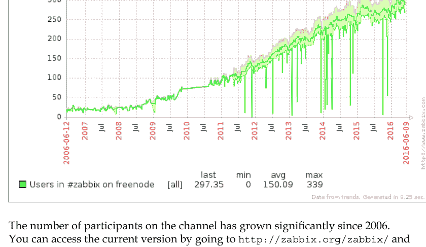

## 成为社区的一员

Zabbix 的一个重要方面是其开源特性。Zabbix 是一个真正的开源解决方案——它不是“开放核心”，也没有企业版或某些专有插件。这类方法可被贴上“假开源”的标签。Zabbix 的所有组件都是完全开源的；没有封闭或隐藏的组件。其开发者已承诺让 Zabbix 保持这种状态——欢迎查看 Zabbix 2013 年会议视频，了解这一点：参见 Zabbix 创建者 Alexei Vladishev 的开场演讲，大约在 27 分 30 秒处。

除了开源之外，Zabbix 的很多开发也是公开进行的。这使得人们可以轻松地密切关注开发进展并获得社区支持。但每个开源项目的运作方式和指导方针各不相同，所以让我们看看在 Zabbix 的这一方面，人们可以期待什么：

- 社区支持是解决问题的一个很好的途径，可以通过在 IRC 频道聊天、查看 wiki、在官方论坛讨论，或使用开放的错误跟踪器来实现
- 通过获取最新源代码来更紧密地跟进开发，可以让人们尽快尝试问题的修复方案，提供早期反馈，并更加熟悉 Zabbix 的内部机制
- 对于产品开发、支持合同或其他服务，商业支持可能会很方便

Zabbix 的开发是公开进行的，但通常不接受外部贡献，只有一个领域例外：翻译。欢迎为 Zabbix 的所有翻译作出贡献，我们还将了解如何参与其中。


## 在 IRC 上聊天

IRC，即 Internet Relay Chat，是一种相当古老的通信方式，在开源项目社区中尤其流行。Zabbix 用户也喜欢在专门的频道上聚集进行与 Zabbix 相关的讨论。位于 Freenode 网络 freenode.net 上的频道 #zabbix 是你可以期望从其他 Zabbix 用户那里获得帮助并与之交流的地方。这里聚集了最先进且最有知识的社区成员。你可以使用许多网络 IRC 网关，例如 http://webchat.freenode.net/，或使用一个名为 IRC 客户端的专用程序连接到任何 Freenode IRC 服务器。针对不同的操作系统有许多不同的选项可供选择，你可以自由选择任何一个——这不会影响你与使用不同客户端的人交流的能力。除了一般的沟通准则外，还有一些 IRC 特有的准则：

- 重申基本建议——要有耐心。太多的情况下，人们进来，问完问题后几分钟就离开了。频道中的其他成员可能在睡觉、吃饭或暂时离开电脑。因此请提出你的问题并在附近停留一段时间。如果碰巧是周末，一段时间甚至可能长达数天。
- 不要问能否提问。如果你的问题是关于 Zabbix 的，并且经过深思熟虑，那就直接问吧。以“嘿，我可以问一个关于 Zabbix 的问题吗？”开头会需要有人确认“可以”，然后你再输入问题，只有这样帮助过程才能开始。最终，这会花费更长的时间。
- 不要太频繁地重复你的问题；这只会惹恼他人。虽然在新成员加入时反复提问可能很诱人，但他们不太可能是你等待的专家，所以再次强调，要有耐心。另一方面，如果长时间没有出现答案——例如一天——通常重复问题是可以的。
- 不要输入在场人员的姓名，希望能获得帮助。那会不必要地分散他们的注意力。最好等待有人回应。

关于礼貌，请记住所有通信都被记录并公开可用。如果你表现得难以沟通，不仅会留在人们的记忆中，也会留在日志中。

Zabbix IRC 频道还有几个自动助手，称为机器人。所有新的错误报告和功能请求都会由它们在频道中宣布，并且它们还有其他功能。目前，当前机器人功能描述在 http://zabbix.org/wiki/Getting_help#IRC_bots。

不仅最有知识的用户在 Zabbix IRC 频道上可用。该频道也很受欢迎。截至撰写本文时，参与者平均人数约为 300 人。它实际上是关于监控的最受欢迎的 IRC 频道。位于 http://zabbix.org/zabbix/ 的演示 Zabbix 实例监控频道上的用户数量，从 2006 年到 2016 年中期的图表如下所示：



自 2006 年以来，频道上的参与者数量显著增长。你可以通过访问 http://zabbix.org/zabbix/ 并查找主机 Zabbix.org 上的简单图表 Users in #zabbix on freenode 来访问当前版本。

## 使用 Zabbix wiki

我们刚刚发现的主机演示实例的系统也充当社区平台。主要是一个 MediaWiki 实例，包含大量有用的信息，我们之前也多次引用过它。目前感兴趣的几件事是：

- Zabbix 模板
- Zabbix 技术文档，包括 Zabbix 协议文档
- 各种 Zabbix 指南，包括错误报告指南和 IRC 礼仪
- Zabbix API 库列表
- 各种如何操作指南，包括高可用性设置和安装过程的说明

内容是灵活的，建议不时查看 `http://zabbix.org/wiki/Main_Page` 上有什么可用内容。

> 本书本应还介绍 Zabbix 网站上提供新功能规范是多么好，但不幸的是，Zabbix 团队决定撤回它们。人们仍可在 `http://zabbix.org/wiki/Category:Specifications` 找到旧规范。

作为一个 wiki，每个人都欢迎参与。看到错误或缺少内容？直接去改进它。想为你发现的某个不平凡的过程编写说明？直接创建一个新页面。如果你不确定，只需在 IRC 上提问，一定会有人帮助。

> 还有一个 Zabbix 相关资源目录位于 `http://share.zabbix.com`。它并不托管大部分内容；相反，它通常链接到 GitHub 或 Zabbix 网站页面上的模板或脚本。我们目前不会详细研究它，因为其功能有点有限，但建议不时访问以查看是否有所改进。

## 使用 Zabbix 论坛

Zabbix 论坛位于 `http://www.zabbix.com/forum`。你可以无需注册即可阅读，但要发帖，你需要经过身份验证的访问权限，因此请注册用户账户。论坛提供大量已解决问题的集合，也有机会获得对新问题的帮助。

虽然我们已经查看了高效且令人满意的沟通的一般建议，但也有一些论坛特定的建议：

- 为你的问题选择合适的论坛。如果你的问题与 Zabbix 的开发版本有关，不应在关于 Zabbix 网站的论坛中提出。
- 在创建新主题和在现有主题上评论时要明智选择。强烈不建议在现有主题上提出不同的问题。另一方面，在创建重复主题关于现有问题之前，最好先搜索论坛。
- 启用新消息通知，以便在需要额外信息时能够及时回复。这将有助于更快地解决问题。

## 在跟踪器上提交问题

如果你发现了一个错误或对如何改进 Zabbix 有一个好主意？Zabbix 使用问题跟踪器来记录这些事项并跟踪解决过程。要访问 Zabbix 问题跟踪器，请导航到 `https://support.zabbix.com`。在这里，你可以注册并登录以搜索现有报告以及提交新报告。

在报告新问题时，选择正确的项目——项目 ZBX 用于错误报告，项目 ZBXNEXT 用于新功能请求。强烈建议在提交新报告前搜索跟踪器——也许问题已被报告，无需创建重复报告。

如果你已自行解决了问题并有一个修复某些错误或实现功能的补丁？只需将其附加到相应的报告即可。你应该在编码之前与 Zabbix 开发者讨论你的方法，除非是最简单的情况——也许他们已经在处理它，或者你的方法可能会与正在开发的其他功能冲突。确保也熟悉编码指南——它们可在 `http://zabbix.org/wiki/Main_Page` 获取。

> 还有一个补丁仓库位于 `https://github.com/zabbix/zabbix-patches`，但它是否会变得流行还有待观察。


## 面对面会面

所有讨论过的渠道对于与其他 Zabbix 用户沟通、获得帮助和帮助他人都很棒。但也有各种面对面会面的方式。一个非常受欢迎且很棒的年度活动是 **官方 Zabbix 大会**，但也有当地社区组织的各种非正式活动。

## Zabbix 大会

官方 Zabbix 大会是一个很棒的活动。它首次于 2011 年组织，通常在九月举行。这是了解 Zabbix 最新动态、向许多非常有创意的 Zabbix 用户学习并获得一些乐趣的机会。它在 Zabbix 的诞生地和家乡举行——拉脱维亚的里加。有两天充满有趣的演讲，Zabbix 团队努力让每个人都感到受欢迎。如果你有机会，务必尝试参加此活动。


## 本地社区

你所在的本地社区或许也会组织起来。请查看 `http://zabbix.org/wiki/Usergroups` 上列出的各种沟通渠道。加入用户组，关注新闻，甚至可能帮忙组织活动。也请不要犹豫，将新的国家添加到列表中。

## 跟进开发进度

你是否在IRC上看到某个有趣的新功能并想尝试一下？也许你想查看某个具体更改是如何实现的，或者了解其设计方式上的评论。又或者，你想生成一个补丁，该补丁依赖于开发版本中正在进行的一些更改。Zabbix的许多开发工作都是公开进行的，人们可能感兴趣的主要阶段有：

- 规范正在制定中
- 开发在独立的功能分支中启动
- 功能被合并到主分支

> 之前，规范在 `http://zabbix.org/wiki/Main_Page` 上是公开的；现在，它们已经不再可用了。

尽早提供反馈最有可能有帮助，并且更有可能影响设计。如果你对某个特定功能感兴趣，以前可以在 `http://zabbix.org/wiki/Main_Page` 上跟进规范，但现在这个阶段已经关闭了。Zabbix使用SVN进行代码版本管理。SVN中的功能分支可以让你非常早地接触到代码，这是试用和测试功能的好时机。

我们讨论了测试的事情；接下来让我们了解如何获取尚未作为版本发布的代码。

## 获取源代码

要获取Zabbix开发版本，有两种方式，每种方式都有其优缺点。

## 每日快照

在Zabbix开发下载页面 `http://www.zabbix.com/developers.php` 上，提供了开发版本的每日快照。这些快照通常与发布版本具有相同的安装步骤。使用每日快照的好处包括：

- 只需简单下载即可获取
- 源代码归档已为你生成

缺点包括：

- 无法只更新开发版本中实际更改的部分
- 无法轻松查看实际更改的内容
- 你无法访问功能分支
- 无法获取任意较旧的版本

如果你只想简单、一次性了解Zabbix开发的进展，建议使用每日快照。

## 访问版本控制系统

如果你计划长期跟进Zabbix开发，或者想查看某个具体更改是如何实现的，每日快照很快就会变得不便使用。功能分支没有快照，因此如果功能尚未合并到主分支，我们必须使用SVN。

> 你也可以通过 `https://www.zabbix.org/websvn/wsvn/zabbix.com` 上的WebSVN实例浏览官方SVN仓库。它不允许你进行本地检出，但若要快速查看几个文件，可能更方便。

要访问SVN仓库，需要特定的软件——客户端。针对不同平台有许多不同的SVN客户端，你可以选择最方便的那一个。在这里，我们将使用官方的命令行客户端。由于这个客户端几乎在所有Linux发行版上都可用，我们可能希望在Zabbix测试服务器上使用它。但在开始使用之前，我们必须知道Zabbix源代码仓库位于https://svn.zabbix.com/。在SVN中，开发通常分为主干和分支。主干代表最新的开发工作，而分支通常用于稳定版本的维护。Zabbix采用相同的模式，有用于稳定版本维护的分支（如3.0），而下一个稳定版本的开发则发生在开发部分，即主干中。不过，更改不会立即出现在版本分支或主干中——它们首先在开发分支中实现，这些开发分支通常位于svn://svn.zabbix.com/branches/dev/ZBX-1，末尾带有正确的ZBX或ZBXNEXT问题编号。

假设我们对最新功能感兴趣，想要获取主干。为此，请运行以下命令：

```
$ svn checkout svn://svn.zabbix.com/trunk zabbix-trunk
```

这将检索主干中的所有文件，并将它们放入名为zabbix-trunk的目录中。在撰写本文时，Zabbix主干的检出在磁盘上占用约118 MB，但通过网络传输的数据量将小于此值。一旦该过程完成，你可能会想继续进行编译，但这并不容易，因为根本没有配置脚本。有一个方便的脚本可以用来生成配置：

```
$ ./bootstrap.sh
```

此操作完成后，我们应该就有了配置脚本。现在，我们可以编译这个Zabbix开发版本了，对吗？还不行。开发仓库只包含通用的数据库模式和内容描述，因此我们无法创建数据库。我们必须自己生成实际的模式和数据文件。对于Zabbix前端，也需要生成特定的CSS文件。还建议创建一个包，就像可以从Zabbix网站下载的那些包一样，所以让我们这样做。不过，在生成数据库模式和包之前，我们必须使用配置脚本。但我们可以通过省略任何不需要的功能来加快速度并减少依赖。这还使得可以在另一台没有安装所需功能（如SNMP或IPMI监控）的全部依赖的机器上创建Zabbix包。在最简单的情况下，运行：

```
$ ./configure
```

这将生成数据库模式和包生成所需的文件。现在，我们可以继续生成模式和CSS：

```
$ make dbschema
```

```
$ make css
```

> 我们在第1章“Zabbix入门”中讨论了编译所需的包。对于make css步骤，你还需要Sass Ruby gem。

生成数据库模式和CSS文件后，我们就可以创建包了：

```
$ make dist
```

此命令完成后，源代码目录中应该会有一个新的归档文件，名为zabbix-<version>.tar.gz。这里的version就是开发部分所获得的名称。从现在开始，我们又回到了熟悉的路径，因为这个包与你可以从发布版本区域或每日快照区域下载的包几乎相同。

但为了获得我们本可以直接下载的东西，这做了很多工作——到底为什么要这么做呢？确实，如果你只想获取一次开发版本，每日快照应该是你的选择。但SVN检出还有其他好处。让我们来了解一下这些好处。

## 查看变更集

对仓库的一组更改称为变更集。已经放入仓库的变更集被称为已提交。我们可以列出已提交的变更集。例如，如果我们想知道提交到仓库此部分的最后一个变更集是什么，可以运行以下命令：

```
$ svn log -r PREV:HEAD
```

-r Subversion选项允许我们指定修订版本——每个更改的数值表示。PREV和HEAD是特殊的引用，分别表示上一个版本和最新版本。有时，我们可能会被指示测试或使用特定版本，称为修订版本。在这种情况下，可以通过运行以下命令来获取它：

```
$ svn up -r 1234
```

将1234替换为你被告知使用的修订版本号。这会将整个检出更新到该修订版本，你现在应该再次运行前面讨论过的命令，重复刚检出后所执行的相同过程。但有时，我们可能只需要将一个或几个文件更新到特定修订版本——这可以通过指定路径来完成，例如：

```
$ svn up -r 1234 frontends/php/history.php
```

你可以同时指定目录和文件，获取不同的修订版本，以测试行为变化或找到导致问题出现的具体更改。

因此，你已经试用过开发版本，可能还有几个修订版本。一段时间后，你决定查看主干中做了哪些更改。首先，应该确定当前修订版本。在检出目录中，运行以下命令：

```
$ svn info
```

查找类似这样的行：

```
Revision: 60013
```

有了这个编号，现在是时候将本地副本更新到最新版本了。在本地副本目录中，运行：

```
$ svn up
```

这将更新所有相对于你现有副本已发生变化的内容。由于只拉取更改，与反复下载每日快照相比，下载的数据量要少得多。现在，你可以像之前讨论的那样继续构建Zabbix，也可以选择查看开发人员提交的确切更改：

```
$ svn log -r 60000:HEAD
```

该命令将显示推送到代码仓库的确切更改，以及开发人员决定添加的任何评论。这可以用来确定具体更改了什么。但以上所有内容都是关于面向未来的开发版本（主干）——如果你想查看针对稳定版本中某个问题的特定错误修复应用到那个特定分支的情况，该怎么办？就像我们从代码仓库获取主干一样，我们也可以获取分支：

```
$ svn checkout svn://svn.zabbix.com/branches/3.0
```

我们现在指定的是分支部分，而不是主干。其后是特定的分支，可以是任何有效的分支。有哪些分支？我们可以列出它们：

```
svn ls svn://svn.zabbix.com/branches
```


参与翻译工作的具体步骤和流程可能会发生变化，因此我在此不予复述。请前往 http://zabbix.org/wiki/Translating_Zabbix 并按照其中的步骤操作。这很可能包括在 http://zabbix.org/wiki/Main_Page wiki 上注册，将自己添加到译者表中，订阅译者邮件列表，并在 Pootle 上申请权限。后者最好在 Zabbix IRC 频道上完成，那也是询问如何参与以及翻译流程问题的最佳去处。

## 商用支持选项

社区支持很棒。它通常迅速、正确且友好。然而，即使一直如此，也可能出现需要更正式方式的情况。寻求正式协议的常见情况包括以下内容：

- 公司政策要求所有投入生产系统的系统都必须有支持协议
- 你希望在实施 Zabbix 时获得合格的帮助
- Zabbix 安装将由并非深度参与且对它没有很好专业知识的人员管理
- 你需要开发或改进某些功能

在这种情况下，联系商业支持提供商通常是最好的解决方案，并且可以从 Zabbix 软件背后的公司获得此类支持。访问 Zabbix 网站 http://www.zabbix.com/support.php 以获取更多信息。如果你准备更详细地讨论商业支持，只需发送电子邮件至 sales@zabbix.com 即可。在撰写本文时，销售团队非常专业、乐于助人且友好——而且通常回复速度也极快。我没有任何利益冲突或个人利益；这是完全真实和诚实的推荐。

在某些情况下，公司采购要求可能强制你使用本地公司作为支持协议——http://www.zabbix.com/partners.php 上的合作伙伴和经销商列表应有助于你选择一个地理位置更近的公司。
