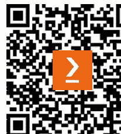

# 零信任概览与攻略书介绍：企业、安全和技术领导者的指导

我将这本书献给我美妙而美丽的妻子和孩子们。感谢你们的耐心、支持和爱——没有你们我无法完成。谢谢！

— 马克·西莫斯

献给我妻子 Peelu 和孩子们 Nitin 和 Laya，你们无量的爱、耐心和支持帮助我度过了完成这本书的漫长旅程。

— 尼基尔·库马尔

## 前言

随着全球威胁持续叠加、加速并呈指数级增长，从未有比现在更需要改变网络安全思维的时候。作为自2000年起的网络安全从业者，我见证了不断变化的威胁态势以及行业解决方案的演进——伟大的创新试图跟上资金充足、有组织且复杂的攻击。随着数字业务的发展，安全已成为贯穿业务和技术的全方位关切。我们见证了这一态势的变化，行业也认识到需要演进和改变。随着对变革的认识得到充分理解，采用零信任理念、架构和战略成为网络专业人士的号召口号。

在为日益增长的网络威胁寻找更好解决方案的竞赛中，丢失的是对在组织环境中成功实施零信任所需的统一定义和能力集。通过他们的书籍系列，《零信任手册系列》的作者尼基尔·库马尔和马克·西莫斯试图回答围绕零信任的问题——包括核心定义能力、特征以及如何成功实施零信任架构。

尼基尔和马克在网络防御前线拥有丰富的专业经验，为全球组织提供架构和最佳实践方面的建议。他们深入探讨零信任主题时，不仅定义了该主题，还提供了为什么以及如何的详细指导。

从未有比现在更需要改变网络安全防御方法的时候，零信任将使行业在成熟度方面取得长足进步。将这一主题扎根于务实指导，同时阐明其目的的价值，我赞扬尼基尔和马克踏上这段旅程。

Ann Johnson

*企业副总裁 – Microsoft*

## 贡献者

## 关于作者

**马克·西莫斯** 帮助个人和组织实现网络安全、云和数字化转型目标。马克是微软的首席网络安全架构师，负责网络安全参考架构、战略、规范性规划路线图、最佳实践和其他指导的开发。马克积极参与 The Open Group，为零信任标准和其他出版物做出贡献。

马克不断收集、分析和完善见解、经验教训和最佳实践，以帮助在数字时代快速保护组织。

马克曾在多场会议上发表演讲，包括 Black Hat、RSA Conference、Gartner Security & Risk Management、Microsoft Ignite 和 BlueHat，以及 Financial Executives International。

你可以在 LinkedIn 上找到马克（https://www.linkedin.com/in/marksimos）。

**尼基尔·库马尔** 是 ApTSi 的创始人，曾在普华永道等公司担任领导职务。他领导了从初创企业到财富五强公司数字转型、企业架构、零信任、安全和安全架构计划的战略和实施，将愿景转化为执行。

尼基尔是一名工程师和计算机科学家，对生物学充满热情，以与董事会沟通并与工程师和架构师一起实施而闻名。

尼基尔是 MIT 导师、董事会成员、创新者和先驱，已撰写大量书籍、标准和文章，并在全球会议上发表演讲。他共同主持 The Open Group 的零信任工作组，这是一项全球标准倡议。

你可以在 LinkedIn 上找到尼基尔（https://www.linkedin.com/in/nikhilkumar/）。

*感谢多年来指导和教导我们的众多导师和老师。*

*特别感谢 Jon Shectman、Elizabeth Stephens、John Flores、Tom Quinn、Carmichael Patton、Steve White、Wes Malaby、Brent Holliman、Michele Simos、Neb Brankovic、Dinakar Sosale 和 Paul Weisman 对早期草稿提供的出色而深思熟虑的反馈。你们让它变得更好！*

*我们还要感谢在前线为保护我们的组织、社会和经济安全而做出牺牲的安全和 IT 专业人员。你们的工作深受赞赏，我们希望这本书能在你们的旅程中帮助到你们！*

## 关于审阅者

Thomas Plunkett 于 1981 年编写了他的第一个计算机程序。他在 Oracle 和 IBM 拥有行业经验。他是多本书的作者，也是经常的公众演讲者。Thomas 拥有尼科西亚大学区块链和数字货币理学硕士学位。他还拥有弗吉尼亚理工大学计算机科学与应用理学硕士学位。他曾在斯坦福大学修读区块链和加密货币、计算机安全、密码学等领域的研究生课程。他拥有乔治梅森大学政府与政治文学学士学位。他拥有乔治梅森大学 Antonin Scalia 法学院法学博士学位。

## 索引

## 您可能喜欢的其他书籍

# 前言

这是系列中的第一本书，它将网络安全这一复杂主题尽可能简单、清晰且可操作地呈现出来（希望也能更有趣一些 ☺）。

在当今持续变化的世界中，人们在试图保护业务资产免受网络安全攻击时面临着压倒性的复杂性。

**Zero Trust** 使业务、技术和安全团队能够携手合作，在面对不断演变的攻击者与威胁、业务模式、云技术平台、**人工智能（AI）** 创新等情况下降低风险。

*Zero Trust Playbook 系列通过将网络安全和 Zero Trust 拆分为离散、可操作的组件来帮助澄清概念，指导您完成 Zero Trust 转型的战略、规划和执行。*

这些书籍为从董事会成员和首席执行官到技术和安全从业人员的每个人提供 *清晰且可操作* 的角色特定指导。它们将帮助您理解 Zero Trust、它为何重要、对每个角色意味着什么以及如何成功执行。系列整合了最佳实践和指导，以避免常见的错误（反模式），这些错误会拖慢进度并增加风险。

*这些书籍使个人和组织能够做到以下几点：*

- **现代化安全计划** 以提高有效性并减少因传统安全方法而产生的日常繁琐、痛苦和浪费的努力
- **安全地实现数字业务模式** 以提高敏捷性并降低摩擦和业务风险
- **成功执行** 个别角色任务以提升您的技能、知识和职业生涯

这些书籍旨在帮助您在角色（和职业）的安全方面蓬勃发展，同时帮助您的组织在当今世界中繁荣并保持安全。

## 本书面向谁

*这本第一本书既可作为任何人对 Zero Trust 的独立概览，也可作为 Zero Trust 概览与 Playbook 介绍中 Playbook 的介绍，供任何参与 Zero Trust 的人了解 Zero Trust 是什么、为何对您重要以及成功是什么样子。*

本表提供了将从本书中受益的角色列表：

| 角色类型 | 角色 |
|---|---|
| 组织高级领导者 | 董事会成员 |
|  | 首席执行官 (CEO) |
|  | 首席财务官 (CFO) |
|  | 首席运营官 (COO) |
|  | 首席法务官 (CLO) |
|  | 首席隐私官 (CPO) |
|  | 首席风险官 (CRO) |
|  | 首席合规官 (CCO) |
|  | 产品和业务线领导者 |
|  | 通信/公共关系总监 |
| 相邻/辅助角色 | 人力资源 |
|  | 业务分析师 |
|  | 内部准备/培训 |
|  | 内部和外部沟通 |
| 风险与合规角色 | 风险团队 |
|  | 合规与审计团队 |
| 技术高级领导者 | 首席数字官 (CDO) |
|  | 首席信息官 (CIO) |
|  | 首席技术官 (CTO) |
|  | 首席信息安全官 (CISO) |
|  | 企业安全整合（副 CISO 及员工、安全[业务]分析师） |
|  | 技术总监 |
|  | 软件交付副总裁 (VP) |
|  | 安全总监 |
| 架构师 | 企业架构师 安全架构师 基础设施架构师 业务架构师 信息架构师 访问架构师 解决方案架构师 软件/应用架构师 |
| 管理者 | 技术经理 安全经理 安全运营 (SecOps) 经理 产品线经理/总监 产品负责人 软件开发总监 技术交付经理 软件测试/质量经理 |
| 安全态势管理 | 安全态势管理 安全治理与合规管理 人员安全（用户教育和内部风险） |
| 技术工程与运营 | 云工程与运营 端点/生产力 身份 基础设施 CI/CD 基础设施 网络 数据安全 运营技术 (OT) 安全 安全态势工程与运营 |
| 应用与产品安全 | 软件安全工程师 软件开发者 软件测试员 供应链安全 物联网 (IoT) 安全 |
| 安全运营 | 分诊分析师 调查分析师 威胁狩猎 检测工程 攻击模拟（红队和紫队演练） 事件管理 威胁情报 |

图 前言.1 - 使能零信任的角色说明性列表

本书面向目前担任这些角色（以及类似角色）的人，以及那些渴望从事这些角色、与这些角色中的人员合作、并为这些角色提供咨询和建议的人。

## 本书涵盖内容

本书首册以零信任概述和对系列手册的介绍开启 *零信任手册系列*。本书为后续内容设定了背景，并介绍了每个人都应了解的共同背景。

本书中的章节如下：

- *第 1 章，零信任 – 这就是方法*，通过介绍零信任和 *零信任手册系列* 并回答关于零信任的常见问题来开启我们的旅程。
- *第 2 章，阅读零信任手册系列*，向我们介绍了手册系列的结构和布局，以及快速从这些书籍中获得所需内容的建议策略。
- *第 3 章，零信任是当今世界的安全*，向我们展示了零信任是如何为我们所处的持续变化的数字时代设计的，以及为什么正确实施它至关重要。本章还澄清了安全和零信任周围的一些常见混淆点。
- *第 4 章，标准零信任能力*，描述了在手册中引用的来自 The Open Group 的 *零信任参考模型* 中的标准零信任能力。这些是我们在不断改进零信任时将保持不变的关键要素。
- *第 5 章，人工智能 (AI) 与零信任*，向我们介绍 AI 以及这项技术如何颠覆商业、技术、安全和整个社会。它描述了 AI 的影响、局限性以及与零信任的关系，这些都将通过手册中针对每个角色的指导来管理。
- *第 6 章，如何规划、规模化和启动零信任*，回答了关于规划和开始零信任转型的主要问题。这还描述了关键术语的变化以及不同团队在组织中对术语使用不同的常见混淆点。
- *第 7 章，零信任成功的样子*，涵盖了嵌入手册中的零信任的三个关键成功因素：拥有明确的战略和计划、管理思维和文化转变，以及整合人性化关怀。
- *第 8 章，采用三支柱模型*，阐述了手册的三个支柱（战略、运营和运营模型），并展示了该模型中的元素如何协同工作，将业务、技术和安全整合以创建零信任。
- *第 9 章，零信任六阶段计划*，描述了手册使用的六个阶段，包括“谁做什么”的详细总结。这向我们展示了手册如何将每个人聚集在一起，使零信任成为现实。
- *第 10 章，零信任手册角色*，描述了手册中的基于角色的方法和按角色的指导。这为我们继续进入我们角色的手册做好了成功准备。

系列中剩余的手册为每个受影响的角色提供可操作的按角色指导。

## 如何充分利用本书

您不需要任何东西，除了学习的愿望，就能从本书中获得对零信任及其执行方式的清晰认识。

如果您有在组织中从事业务、技术或安全工作的经验（或有此志向），您将从本书中获得更多收获。*这种经验不是必需的*，因为我们在全书中解释这些概念以确保清晰易懂。

请遵循 *第 2 章，阅读零信任手册系列* 中的指导，以确定最适合您需求的阅读策略。

## 使用的约定

本书通用的文本约定包括：

**提示或重要说明**

如下所示。

## 联系我们

我们始终欢迎读者的反馈。

**总体反馈**：如果您对本书的任何方面有疑问，请发送电子邮件至 `customercare@packtpub.com`，并在邮件主题中提及书名。

**联系作者**：如果您希望联系作者，您可以通过 LinkedIn 联系：`https://www.linkedin.com/in/marksimos` | `https://www.linkedin.com/in/nikhilkumar/`

**勘误**：尽管我们已尽一切努力确保内容的准确性，但错误难免。如果您在本書中发现错误，我们将不胜感激您向我们报告。请访问 `www.packtpub.com/support/errata` 并填写表格。

**盗版**：如果您在互联网上发现我们作品的任何形式的非法复制，我们将不胜感激您提供位置地址或网站名称。请通过 `copyright@packt.com` 联系我们并附上材料链接。

**如果您有兴趣成为作者**：如果您在某个主题上有专业知识，并且有兴趣撰写或为一本书做出贡献，请访问 `authors.packtpub.com`。

## 分享您的想法

阅读完 *零信任概述和手册介绍* 后，我们很想听听您的想法！请点击此处直接前往本书在亚马逊的评论页面并分享您的反馈。

您的评论对我们和技术社区都很重要，并将帮助我们确保提供优质的内容。

## 下载本书的免费 PDF 副本

感谢您购买本书！

您喜欢随时阅读但无法随身携带印刷书籍吗？

您的电子书购买与您选择的设备不兼容吗？

不用担心，现在每本 Packt 书籍都免费提供无 DRM 的 PDF 版本。

随时随地在任何设备上阅读。直接从您喜爱的专业书籍中搜索、复制和粘贴代码到您的应用程序中。

福利还不止于此，您可以每天通过电子邮件独家获取折扣、新闻通讯和优质免费内容

按照以下简单步骤获取福利：

- 1. 扫描二维码或访问下方链接
- 2. 提交您的购买证明
- 3. 就这样！我们会直接将您的免费 PDF 和其他福利发送到您的电子邮件

https://packt.link/free-ebook/978-1-80056-866-2

