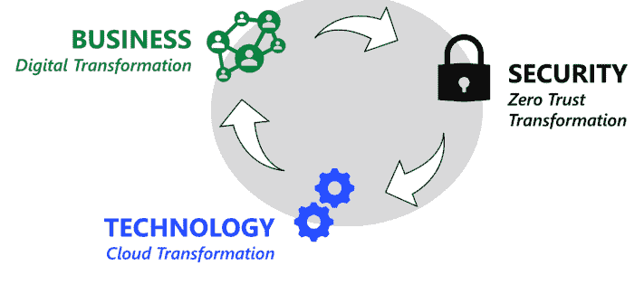
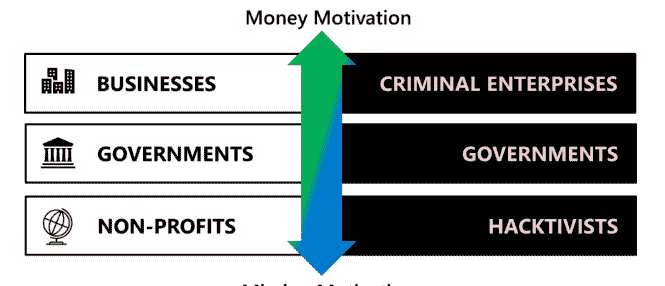

## Zero Trust 是当今世界的安全

*Zero Trust 使安全战略和团队与当今世界保持一致。*

在本章中，您将了解 **Zero Trust** 以及为什么这种敏捷安全方法在当今高速、高复杂度的世界中至关重要。您将对塑造业务、技术和网络安全的有力力量有一个基线理解，以及 Zero Trust 如何设计来应对它们。

本章将涵盖以下主题：

- 持续变化以及我们为何需要 Zero Trust
- 数字时代变化来得更快
- 数字时代的成功定义
- 技术加速变化和复杂性
- Zero Trust 的影响和必要条件
- 消除混淆——关于 Zero Trust 的常见问题

## 持续变化以及我们为何需要 Zero Trust

*我们生活在一个个人生活和工作持续变化的时代。*

每个人的生活都因我们这个时代的技术突破而改变。互联网和计算机技术改变了我们社会中的沟通、工作和娱乐。*这些变化不会放缓，变化的速度正在加速，承诺在可预见的未来持续改变我们的生活。*

一个最近的例子是 COVID-19 大流行，许多人很快发现自己在家工作而不是通勤到办公室。这种转变推动了新的商业模式、支持这些模式的新技术、新社会规范，以及对业务资产威胁的新演变。Zero Trust 安全专为这种持续变化的世界而设计。

## 数字时代变化来得更快

*大规模变化并非新鲜事，但今天变化的速度和规模是新的。* 对于这种程度的变化，有很多历史先例——印刷机传播了挑战长期建立的权力结构和宗教的新思想，科学方法的出现改变了我们看待（和控制）我们周围物理世界的方式，民主的兴起改变了世界各地政府的角色，以及工业革命和装配线改变了商业模式、产品、城市、生活方式、职业等。数字时代是一个类似的破坏性趋势，它引入了即时全球信息访问以及在数周、数天，有时甚至数小时内在全球范围内改变商业模式（并创建新模式）的能力。*持续变化定义了数字时代。*

我们现在生活在一个很多工作可以在任何地方完成的世界，我们面临的顶级挑战是信息过载和错误信息，而不是我们人类历史上一直面临的信息缺乏。*这给了那些拥抱这种新世界数据中心方面的组织的优势——* 如果组织使用数据和分析来生成业务洞察并支持决策，采用 **机器学习 (ML)** 和 **人工智能 (AI)** 技术来自动化数据分析和例行任务，并从 **物联网 (IoT)** 设备和其他来源寻求新的数据源，他们就能获得强大的竞争优势。

*这种技术和数据中心思维的扩散创造了机会，这些机会正在迅速成为组织保持相关性的强制性要求。* 虽然这最初是提高敏捷性和成本效益的锦上添花的好处，但新一代客户和公民现在要求这种敏捷性，如果得不到，他们就会另寻他处。

**重要说明**
变化的速度无处不在，世界对 COVID-19 大流行的反应最为明显。例如，一些药物发现过程在两天内完成，而以前需要四到五年（Richard et al.）。这得益于生物学、数学、计算等边界的新技术和新科学，以及数据中心方法推动。

## 定义数字时代的成功

**数字时代的成功是什么样的？** 成功转化为现代数据中心组织及其数字资产的信息系统和安全的新要求。这些要求包括满足以下标准：

- **敏捷且响应迅速**：修改系统或建立新系统需要永远的时间。它们可以快速轻松地改变以满足市场需求（既有市场，也扩展到新市场）。
- **弹性**：业务必须在客户和公民要求的地方运营，即使那是公共或开放网络。*业务必须假设控制措施会失败并建立故障安全机制，以提供纵深防御（DoD）方法。*
- **数据驱动**：可量化的数据被寻求并用于技术和安全决策，而不是依赖纯定性数据和一贯的做法。
- **赋能**：技术和信息安全专注于使业务成为可能并识别机会，而不仅仅是管理/减轻下行风险。

Zero Trust 帮助组织满足这些要求，并使他们对客户 *更具竞争力且更具吸引力*。采用 Zero Trust 的组织还将体验到 *更少的内部摩擦*。

## 技术加速变化和复杂性

虽然企业和市场一直是不断变化和创新的世界，但技术极大地加速了商业变化的步伐和规模。*商业模式正在迅速演变，以跟上技术变化的快速增长和正常化*——无论是互联网接入、移动设备、云服务、AI、流程和能力的数字化；清单还在继续。作为例证，今天修改网站或移动应用程序可以在数小时内改变每个客户与组织互动的方式——覆盖数千、数百万甚至数十亿人。

不断变化的商业模式推动了人员、流程和底层技术的变化。它也可能立即使几代机构知识失效。商业模式变化通常会导致新的威胁和组织敏捷性的极端需求，以在机会流失前抓住它。时间和金钱通常都很短缺，因此清晰的战略来推动正确的重点和无情的优先排序对于成功至关重要。

云技术和 AI 是当今最大的技术变革推动者。云技术的规模和速度使商业模式的快速变化成为可能并推动其发展，并创造新模式。这随后为技术变化创造了新的要求，创造了一个反馈循环，使一切移动得更快。AI 建立在云技术的基础之上（包括 **大型语言模型 (LLMs)** 例如 **ChatGPT**）以破坏数据和技术被发现和使用的方式。有关更多信息，请参阅 *第10章：Zero Trust Playbook Roles*。

增加诸如 COVID-19 大流行、9/11、2008 年金融危机、世界政治格局变化以及勒索软件和勒索攻击兴起等破坏性事件，这一变化速率变得更加具有破坏性。

这些永不停歇的高速变化正在重塑企业高管、技术高管、IT 从业者、安全从业者以及普通公民的根本假设。

作为专业人士，我们有责任把握这些变化带来的机遇，并应对其带来的风险和威胁。零信任方法通过采取一种务实的安全观来帮助我们，这种安全观不受传统安全假设的束缚（我们必须将业务资产限制在自己的网络中以保持安全）。

## 一个更黑暗的趋势 – 网络犯罪的增长

总体而言，这些技术变革对社会是有益的，但同时也存在一个平行的黑暗趋势。罪犯、活动人士和间谍（即情报机构）在实现目标的方式上也经历了转变。

组织和个人现在面临着一波不断上涨的浪潮，其中包括罪犯、国家行为体、黑客活动人士和其他利用这一技术变革为己谋利的行动者，而代价是私人公民、企业、政府机构和其他组织。

在这个世界取得成功需要学会如何在世界中成长、适应并提高生产力，同时管理不断增长的威胁，这些威胁在数量和复杂性上都在不断增加。零信任安全方法提供了跟上这些威胁所需的敏捷性。

> **重要说明**
> 
> 随着网络犯罪的盈利性和规模不断增长，它也在不断演进，变得更有效、更具创造性、更具渗透性。许多罪犯将利润再投资于改进其运营和工具，推动了对合法组织潜在风险的持续增加。

威胁清单不断增长——攻击者经常从我们组织内部的受损资产中运作，复杂的社会工程攻击经常欺骗人们，还有更多威胁不断出现，例如供应链攻击和内部威胁。暗网市场也被坏行为者用来买卖被盗数据、被盗密码、攻击工具、访问特定组织等。

我们还看到使用复杂的附属业务模式推动了攻击量和影响的上升。附属模式在勒索软件/勒索攻击中很常见，例如 Colonial Pipeline 攻击中，攻击工具包的作者与使用这些工具包进行攻击的独立攻击运营商分享利润。

零信任方法通过将持久的安全基础与敏捷的安全方法相结合，帮助安全团队跟上这些威胁，使团队能够快速适应不断增长的威胁。

## 保持平衡 – 假设失败并假设成功

需要一种新的方法，假设攻击者有时会成功，并专注于你可以对此采取的措施。**假设失败**这一理念通常表述为 *assume breach or assume compromise*。攻击者通常在被检测到之前已经访问受损网络数周或数月。

在这个假设被攻破的世界中，你必须专注于 **保护组织的重要资产并减少** 任何一次攻击的 **爆炸半径**，类似于船上的防水隔舱容纳泄漏，从而防止船沉没。

> **什么是爆炸半径？**
> 爆炸半径是指攻击造成的损害的参考。这类似于物理爆炸造成的损坏区域。

假设失败有时看起来令人难以承受，但它只是一个需要管理的风险。就像人们不会因为有时会发生飓风就放弃在热带岛屿生活一样，我们也不会因为互联网存在一些固有风险就放弃其带来的好处。*我们将学会适应这些风险并管理它们*，使组织恢复正常运营。这就是我们所说的 **假设成功**。

这种假设成功与失败的零信任务实方法将使你的组织能够更好地在当今充满不断变化的混乱世界中管理风险。

虽然每个组织都运行类似的技术架构，但每个组织在某些方面也是独特的。与其他任何事物一样，零信任应从坚实、一致的基础（本书中概述）开始，然后根据组织的规模、行业、IT 和安全流程成熟度以及其他因素（本书中提到）进行定制。

## 网络安全还是信息安全？

虽然有些人对哪个术语更好有强烈看法，但本系列书籍将“cybersecurity”和“information security”互换使用。我们将其定义为“*managing risk to the organization from abuse of technical systems by either external actors or insiders.*”

## 零信任的影响和必要条件

现在我们了解了零信任的战略重要性，让我们探讨一些最普遍的影响以及更多背景信息。

## 这是一项团队运动

*成功的最关键要求之一是组织内部的不同利益相关者作为一个团队共同工作。* 业务、IT 和安全团队正在经历他们版本的转型，进入持续变化的新常态。团队不能依赖静态流程和追责来成功完成这一转型。团队必须共同工作，利用其他团队的知识、专业知识和创造力，成功应对他们面临的动态挑战。

这张图表捕捉了共同工作的这一必要性：

图 3.1 – 同时进行的数字化、云和零信任转型

数字化转型、云转型和零信任并不是一次性开发、传达下来并永远严格遵循的象牙塔解决方案。这些是不断演进的、活的战略，必须协同工作以管理不断涌现的市场需求和攻击者演变。任何或所有利益相关者都可能提供见解，影响其他方的架构、计划和战略，因为组织在快速发展并从环境中学习。

本零信任手册包含每个团队和利益相关者的详细内容，以便与业务、技术和安全团队的同事快速协作。

## 安全必须敏捷

安全团队感受到的第一个影响将是变化的节奏以及适应变化情况的需求。虽然许多信息安全团队最看重一致性和风险降低，但这往往导致对变化的极端抵制，使安全成为障碍。

**安全团队必须敏捷。** 安全团队必须适应数字业务战略的持续变化、快速发展的云平台以及威胁。安全必须将自己视为在保护组织免受威胁的同时赋能和支持数字执行。

在今天保护组织及其客户安全需要你在构建新的现代零信任安全战略时重新审视长期以来的假设。与许多组织过去的信息安全实践的根本区别在于，零信任 *both addresses risk and enables business opportunity*。传统安全模型首先关注合规制度和网络边界模型，这些模型现在已不再有效。关键业务资源现在位于传统网络边界之外，而攻击者经常通过钓鱼邮件、凭证窃取和其他攻击进入企业网络。安全必须适应当今世界。

安全必须保护业务资产无论它们身在何处以及它们去向何处，假设攻击者有时会成功并适应这种情况。这种假设的转变要求安全以许多依赖于“安全网络”范式的安全团队可能不熟悉的方式变得敏捷和灵活。

这种零信任的敏捷方法帮助你快速发现并在问题很小时修复问题，使团队能够快速学习、适应并重新回到正轨。手册包含具体指导，帮助团队转变为敏捷安全方法并拥抱持续变化。

## 失败不是选项

**我们必须不失败。** 很难夸大保护计算机系统不善的后果。过去几十年里，我们比大多数人意识到的更依赖数字技术。就像我们只有在电力或水基础设施失效时才注意到其重要性一样，我们通常只有在计算机宕机时才注意到我们对计算机的依赖程度。

数字技术驱动我们生活的方方面面——从应急响应人员的通信，到种植、收获和烹饪我们食物的机器，到医院里维持我们生命的机器；清单还在继续。

正因为数字技术如此普遍和重要，*我们需要它按预期工作，而不是按某些罪犯或外国政府希望它工作（或停止工作）的方式工作*。窃取机密、篡改这些系统中的官方数据和记录，或使这些系统离线，远不止是一个小麻烦。攻击会导致数百万美元的业务损失，引发社会失灵，造成人员死亡等等。应对这些攻击的成本会侵蚀组织价值并负面影响普通公民的日常生活。

坚持目前的被动方法就像玩一场 *whack-a-mole* 游戏，而攻击者拥有优势。攻击者通常有数百万美元的先前攻击利润可再投资于下一代攻击。组织必须转向零信任的主动方法，努力领先于这些攻击。

正如电网和自来水对我们日常生活来说既 *不可见又必不可少*，计算机技术现在已成为社会几乎每个部分的组成部分。我们可能不知道如何在没有它生活。

这使得零信任转型至关重要，因为经典的安全方法（将其视为解决技术问题的独立“孤岛”）已不再奏效。我们需要一种将安全融入技术和业务的方法——零信任。

零信任自然与业务优先事项和风险保持一致，有助于避免对最重要的资产保护失败。经典的安全方法通常采用技术“自下而上”的方法，这往往使安全资源分散，导致业务关键资产的保护相对薄弱。

此外，零信任是一种完整的战略方法，包含通过流程、人员和多种不同技术应用的多种安全策略。这种广泛的方法与狭窄的经典安全方法形成对比，后者依赖单一策略（边界保护）通过单一技术（网络）实施。狭窄的经典方法导致许多安全失败，因为它们造成了防御者的盲点，而攻击者会利用这些盲点。零信任仍然包括网络和边界，但也包括其他技术和策略，以便您可以针对正确的问题应用正确的工具（而不是对每个问题都一视同仁）。

为了进一步帮助您避免失败，剧本系列整合了许多成功完成零信任转型的组织所学到的经验教训和亮点。

接下来，让我们澄清一些经常出现的常见混淆点。

## 消除混淆 – 关于零信任的常见问题解答

这些问题旨在解决网络安全和零信任周围的一些常见混淆点。

### 攻击者不只是躲在地下室玩电脑的孩子吗？

简短的回答是否定的。网络安全攻击已远远超出了业余实验的起源。它们已成为高利润的犯罪产业，也是进行国家间间谍活动的首选方法。

最容易看到安全攻击影响的方式就是简单浏览过去十几年左右的网络安全头条。攻击者在追求其非法目标（通常是刑事、间谍和/或行动主义目标）时，对组织造成了数百万美元的损失。这让组织花费金钱清理攻击者造成的后果、支付赎金（我们在大多数情况下不建议这样做）、核销因业务生产力损失而造成的损失，并恢复声誉损害。

既然我们明白这是一个严重的问题，我们可能会问为什么它尚未得到解决。

### 安全不应该到现在已经解决了这个简单的技术问题吗？

不幸的是，这是不可能的。这些不是我们可以一次性解决然后继续前进的简单或静态问题。攻击者或恶意行为者是聪明的个体，他们在攻击高度复杂的计算机环境时不断适应和进化，而这些环境在数十年间有机且不一致地发展起来。

当今组织依赖的技术是在过去30-50年间在不同时间开发和实施的。大多数组织的 technology estate 是不同世代技术的拼凑，以无人完全记得或理解的方式连接在一起。此外，技术决策反映了当时对技术和安全的看法。安全通常是低优先级，我们对安全的理解也远不如今天。这意味着我们目前依赖的复杂技术环境是攻击者快速找到可利用漏洞的丰富狩猎场。

> **注意**
> **Technology estate** 指组织为完成工作而使用的所有技术的总和。我们在 *第6章，如何规划、规模化和启动零信任* 中更深入地讨论了我们使用该术语的原因。

术语 **technical debt** 有时用来描述这些不符合当今标准的过去技术决策的累积。这是因为修复问题需要大量资金，如果问题得不到解决，问题会变得更糟（就像财务债务的利息一样）。

所有这些导致组织拥有大量的复杂性，其中通常包括攻击者可以发现和利用的差距、裂缝和重叠。*应用半吊子措施和层层安全创可贴往往不会带来更多安全，反而会因增加更多复杂性而使这些问题恶化。*

解决这个问题需要人们作为团队一起工作，发挥他们的技能、观点和想法。因为它是一个不断变化的目标（技术不断发展）且极其复杂，所以需要新的方法。这就是零信任发挥作用的地方。

虽然零信任不是你挥一挥就能解决所有安全问题的魔杖，但它将安全与业务和使命紧密结合，以便您可以优先修复重要的安全问题。零信任方法让组织中的每个人保持一致，确保新资产以现代安全方式创建，并按优先级偿还技术债务。

既然我们了解了解决安全问题的复杂性，让我们专注于其根本原因——攻击者。

### 攻击者是谁？

今天的攻击者是聪明的个体，他们不断调整攻击方式以及从攻击中获利的方式，使得防御技术系统变得具有挑战性。他们通常作为组织的一部分工作，并且非常擅长找到利用现代技术进行攻击的新方法。明天的攻击者很可能会使用人工智能和其他尖端技术，不断进化以规避新防御，形成恶性循环。

我们面临的攻击者的动机（令人不安地）与合法组织相似，这在图3.2中有所说明：

图3.2 – 攻击团体是合法组织的镜像

罪犯通过攻击这些系统并利用被盗数据为自己谋利、将其出售给他人、出售对您系统的访问权限，或通过勒索您支付费用以重新获得对系统和数据的访问权限（例如勒索软件）来赚钱。

政府攻击计算机系统以实现其军事和经济发展目标，范围从间谍技术到主动破坏数据和系统。

最后，偶尔会出现行动主义团体（黑客行动主义者），他们使用一些相同的技术来推进他们相信的事业。

既然我们知道了这些攻击者是谁，人们可能会想知道为什么他们还没有被关进监狱。

### 我们不能直接逮捕这些罪犯并把他们关进监狱吗？

逮捕确实偶尔会发生，但与攻击和攻击者的数量相比，它们是罕见的。跨国界对高科技犯罪的刑事起诉仍然非常困难，因此不是可靠的威慑。此外，高科技犯罪在任何情况下都很难起诉，因为起诉需要警察、法官和系统中的其他人员具备技能并了解这些攻击。

不断变化的地缘政治和互联网的本质使问题更加困难——罪犯可以在世界上有互联网连接的任何地方活动，而且确实如此。这意味着有效遏制这种犯罪行为需要所有政府都同意该问题足够重要以至于需要解决（通过自愿共识或外交压力、制裁等）并共同努力解决。在某些情况下，国家没有能力调查和起诉大量此类犯罪；有些缺乏动力或资金不足以解决它们；在某些情况下，政府参与了犯罪。

虽然法律在不断发展，但要对我们的防御产生有意义的影响还需要很长时间。就目前而言，我们需要专注于我们可以做的事情，那就是使用零信任策略来保护组织。

### 这只是花更多钱的问题吗？

简单地把钱砸向问题并不能解决问题。就像朝错误的方向快速奔跑不会让你到达想去的地方一样，购买错误的东西同样会毫无成效。记住——没有灵丹妙药！

对安全的更多投资几乎总是必要的，但必须指向主动、明确和连贯的结果。我们经常看到资源浪费在过时的安全模型上，这些模型试图将一切强行置于受信任的内部网络上（这不可行）、仅技术解决方案（不考虑人员和流程）以及与业务优先事项不一致的努力上。这不是明智的支出。

太多时候，我们还看到事件发生后出现大规模的危机后支出，组织的精力和资源在恐慌中被浪费。发生重大事件后，通常会出现本能反应，花大量钱购买安全产品只是为了“做点什么”（这通常会产生不切实际的期望，即花费的钱 somehow 神奇地解决了问题）。

不幸的是，这种支出几乎普遍无效，因为它经常指向使内部网络完全安全和可信的徒劳努力。这种模式最令人心痛的部分是，在许多情况下，安全技术从未真正实施或投入运营，而创造风险的业务流程也没有得到修复。这通常是因为组织在当时没有考虑资源可用性、时间表、依赖关系和其他尽职调查。

零信任通过专注于主动方法来帮助我们避免这些陷阱，既解决已知的过去攻击，又建立防御措施以减轻适应性攻击者带来的未来风险。这自然引出了下一个常见问题。

## 如果我有零信任策略和资金，能否迅速解决这个问题？

策略和资金是关键要素，但耐心同样重要——*这是一段需要时间和坚持的旅程。*

在这段旅程中我们会看到快速成效和逐步进展，但必须认识到这将是一场长期之旅。我们将持续执行变更并不断改进应对方式。我们必须预期新的模式、技术和其他驱动因素会不断改变运营环境，并据此更新我们的计划。

正如数字业务战略需要清晰的愿景、高层赞助、跨业务部门的协调以及持续关注，零信任也需要同样的条件。组织必须致力于改变技术、人员、文化和流程，如果它们想在这个新世界中保持竞争力并取得成功。

安全必须主动融入业务流程和数字化转型，而非作为临时或事后的任务集合。零信任与数字演进战略密不可分（名称可能会改变——数字化转型、遗留系统现代化等等），因为它是保护这些新资产的唯一可行方式。在某些罕见情况下，安全威胁可能是为数字化转型战略投资提供理由的驱动因素，但在本书撰写之时这种情况极为罕见。

既然我们明白这段旅程需要时间和坚持，我们可能会想知道它是否会结束。

## 我们是否能完全安全？我该怎么办？

*无法保证完全安全。* 我们应努力的目标是使系统对安全风险具有韧性。我们可以并且应该擅长限制坏事发生的可能性和影响（信息安全人员称之为*减少爆炸半径*），减少必须保护之物的暴露面（以免在不必要的任务上浪费精力），并接受坏事可能发生并且最终会发生。我们应通过将安全风险和攻击的持续管理常态化，把安全风险降至可接受水平。

我们应确保成功的攻击能尽快被阻止，将其遏制以免恶化，并尽快使业务运营恢复正常。我们应始终从攻击中学习，以便下次能更好地应对（因为攻击者总会再次尝试）。

我们永远无法在计算机上获得完全安全，正如我们永远无法在物理世界中完全安全。我们可以防范重大且常见的风险，但永远无法保证某人在现实世界（或互联网上的计算机）中的安全。

零信任以一种实用且具有韧性的方法，为我们提供了让人员和系统保持安全的最佳机会，该方法整合了组织各方的资源、视角和人才。

现在，让我们花点时间来讨论一个关于网络安全与战争关系的常见问题。

## 这是网络战吗？

不——在几乎所有情况下，网络战都不是准确的说法。虽然网络战一词常被用来迅速吸引关注和头条，但我们看到的现象涵盖了以数字方式上演的人类冲突的全部类型。

它并不局限于战争，更常包括犯罪活动，例如盗窃和勒索（包括勒索软件）、企业间谍活动、行动主义、欺凌/骚扰，以及几乎无穷无尽的其他人类冲突类型。确实存在一些有记录的案例，其中网络攻击被用于支持明显的符合战争定义的物理入侵，但在本书撰写之时，这些事件仍然相对罕见。

虽然大多数活动并非战争，但国家是作为防御者和攻击者都积极参与其中。大多数国家发起的攻击活动符合间谍活动的定义，攻击者专注于窃取敏感信息、影响选举或进行有限的定向破坏行动。

由于互联网几乎实时连接了各类系统（民用、政府、军事等等），国家冲突可能波及平民（无论是有意还是无意）。Stuxnet蠕虫感染了许多非目标的民用系统就是一个例子。Petya/NotPetya破坏性蠕虫也影响了世界各地许多系统，这些系统超出了（假设的）最初目标乌克兰之外。

## 备注

国家政府对其境内发起的攻击所承担的责任程度存在广泛的差异。

政府可能会做以下事情：

- 直接对政府雇员发动攻击（并选择承认或不承认）
- 直接雇佣或要求私人个人发动攻击（其中一些人可能是已从政府服务退休或以私人身份行动的现役员工）
- 出于经济利益而有书面或非书面政策不对当地罪犯进行打击（例如，赎金支付为当地经济带来资金）
- 只是不了解或无力调查和起诉本国罪犯

既然我们知道这真的与战争无关，值得问问我们应关注哪些类型的攻击。

## 最具破坏性的攻击是什么？

勒索软件/勒索是需要担忧的。虽然组织面临多种攻击类型（包括国家间谍活动），但最具破坏性的攻击无疑基于勒索变现模式，通常被称为**勒索软件**。

这些勒索软件攻击最初只是简单的勒索要求（付钱给我否则你无法访问数据），但近年来已发展成为一种完整且灵活的勒索模式，罪犯以任何方式榨取付款（威胁披露数据、威胁你的客户或医疗患者等等）。

这些团伙在研究受害者方面变得极其老练。他们会了解你的财务记录、网络保险政策、你可能需要支付的潜在监管罚款、你的商业模式等等，以确定你愿意支付多少以及如何利用你的弱点。他们可以成功地从组织勒索数千万美元，在付钱前完全关闭关键基础设施运营，然后将这些利润再投资于更新更大规模攻击的研究与开发。

我们预计这种令人担忧的勒索软件/勒索趋势在数量、破坏性和复杂性方面将继续增长。到你阅读本文时，问题很可能比我们撰写时更严重。

*但等等——还有更多。* 不幸的是，勒索软件/勒索并不是现代组织面临的唯一攻击。攻击者还通过被盗数据获利，这些数据可以出售给你的竞争对手、国家或其他任何愿意购买的人。攻击者还通过使用你的计算机和系统攻击信任你的其他组织（供应商、厂商、客户等等）来获利，或简单地利用你的资源挖掘加密货币或发送钓鱼邮件。这些攻击者愿意并能够通过向个人（包括企业高管及其家庭成员）发送个性化信息来提高付款的可能性。我们甚至看到勒索软件的破坏性变种出现，其唯一目的是破坏你的业务运营（通常假装成勒索软件并使用类似的攻击者工具）。

## 专注于勒索软件/勒索有助于应对其他攻击

专注于勒索软件/勒索防御也能很好地为其他攻击做好准备，因为攻击者无论目标如何都使用类似的攻击技术。

针对破坏性攻击的防御与勒索软件攻击的防御完全相同，而针对定向数据窃取的防御也极其相似。例如，保护你的特权账户是首要任务，无论你的目标是防止攻击者擦除所有系统，还是防止他们窃取所有系统的敏感数据。

我们按攻击者的商业模式而非技术对攻击进行分类，因为大多数攻击者具有灵活性，愿意使用任何能实现其目标的技术攻击手段。新技术似乎不断涌现，一旦出现，就会加入攻击者的攻击手册。大多数攻击者组织已开发出技能和自动化手段，可发送钓鱼邮件诱骗他人交付恶意程序以控制计算机（恶意软件）。他们可以直接攻击网站或在线应用，并研究或购买零日漏洞（软件中未公开的漏洞），以及许多其他技术攻击手段。

*Zero Trust 可帮助应对所有攻击。* 最终，Zero Trust 提供了一种弹性且灵活的安全方法，可应对多种类型的攻击，并在新攻击出现时进行适应。采用 Zero Trust 可使您的组织抵御勒索软件以及其他可能出现的问题。

您可能会想知道这何时结束，以及成功是什么样的。

## 安全和 Zero Trust 的成功是什么样的？

安全成功的本质就是攻击者的失败。虽然这是一个简单的陈述，但做到并衡量它却相当具有挑战性。攻击者是聪明的、富有创造力且善于适应的人类，他们有动机攻击你并从中获益。攻击手册详细描述了组织中各个角色的成功，但以下是一些应指导您的思考和安全投资的关键主题：

- **提高攻击者成本和摩擦**：提高攻击者为运营和成功所需付出的成本和摩擦（尤其是在过去有效的方法上）。
- **限制攻击者回报**：通过限制他们对您资产的访问（在时间、数量、资产价值等方面）来限制或完全阻止攻击者从攻击中获益的能力。

**网络安全成功是一项团队运动**，需要*组织中的每个人*提供帮助。攻击者有许多机会攻击组织的人员、流程和技术。正因如此，每个人都必须保持警惕，网络安全基础应像食品安全或消防安全的基础一样正常。

**Zero Trust 最终会成为新的常态。** Zero Trust 的表现会随着转型的进行而改变，因为它被规范化为“这就是我们做安全的方式”。虽然 Zero Trust 起初是一个新概念，但最终它会变得正常且不可见，就像我们周围空气中的氧气一样。旧的安全方式最终会淡入过去，就像马车客运或帆船货运一样。

## 为什么 Zero Trust 这么令人困惑？

当人们学习 Zero Trust 时，我们经常看到常见的困惑点。其中一些是因为信息安全学科仍处于早期阶段。与商业、物理安全和战争、建筑设计、心理学和其他人类学科几个世纪或数千年的研究相比，该学科仅存在了几十年。

我们将在后续章节中更详细地介绍这些内容（特别是*第 7 章，Zero Trust 成功是什么样的*），但以下是导致最多困惑的常见误解的快速总结：

- **不仅仅是网络**：技术专家经常认为信息安全的工作是“保护网络”，而不是 Zero Trust *在任何网络中保护业务资产*的方法。虽然这一转变在概念上极其简单，但它要求人们改变多年来或数十年来职业生涯中建立的许多本能和习惯。
- **是一种风险，而非技术问题**：另一个常见的困惑点来自于将信息安全视为应简单“解决”的技术问题。正如没有单一的简单解决方案来解决犯罪或间谍活动一样，计算机版本的这些问题也没有单一解决方案。*必须将安全视为来自实时、智能的人类策划和执行攻击的持续风险，而不是简单的错误或缺陷。*
- **安全不是孤岛**：虽然安全和业务专业人士经常使用不同的语言并作为互动极少的独立单元运作，但这种方法已不再可行。要在安全方面取得成功，组织中的各个角色必须共同工作并相互影响工作。业务、IT 和安全领导者及专业人员必须共同合作，以应对来自业务和市场动态、技术平台以及攻击者演进的持续变化。如果这些角色不持续沟通并相互提供反馈，他们在努力跟上时就会相互对立。

最后一个误解在澄清困惑方面非常关键。将安全置于业务优先事项和风险的背景下，很快就会转变视角并帮助澄清其他困惑点。这些手册提供了实现这一目标的蓝图。

> **重要说明**
> Zero Trust 不是静态解决方案，也不是制定一次、传达下去并永远严格遵循的单一总体计划。Zero Trust 必须是一种适应现实世界流动性并不断调整的动态策略。每个人都应期望任何或所有利益相关者都可能积极影响架构、计划，有时甚至是策略，因为组织学习从静态方法转向动态方法。

## 我如何知道某物是否是 Zero Trust？

关于什么是 Zero Trust、什么不是 Zero Trust，最清晰的信息来源是来自 The Open Group 的 *Zero Trust 戒律*。如果某物实现了一个或多个戒律，那么它就支持 Zero Trust。如果它违反了任何一条，就不是 Zero Trust。

完整的详细戒律可在 https://pubs.opengroup.org/security/zero-trust-commandments/ 获取。

*表 3.1 包含 Zero Trust 戒律的摘要：*

| 实践审慎安全 |  |
|---|---|
| **根据组织风险保护资产** | 安全控制应设计为保护与所需安全态势、业务价值和相关风险相适应的业务资产。 |
| **明确验证信任** | 安全保障应依赖于使用所有相关可用信息和遥测数据明确验证信任决策。 |
| **支持业务目标** |  |
| **实现现代工作** | 安全学科应随着组织能力、目标、环境和基础设施的持续演变而实现生产力并管理风险。 |
| **实施以资产为中心的控制** | 应在可用时实施特定资产的安全控制，以最大限度地减少对生产力的干扰，提高安全/业务可见性的精确度，并改善用于驱动安全合规指标的数据。 |
| **实现可持续安全** | 安全控制应贯穿业务资产的整个生命周期保持可持续性。 |
| **发展以安全为中心的文化** |  |
| **实践问责制** | 负责访问和处理资产的实体应在其整个生命周期内对其保护和存续负责。 |
| **实现无处不在的安全** | 安全学科应明确纳入整个组织的文化、规范和流程中。 |
| **利用最小权限** | 对系统和数据的访问应仅在需要时提供，并在不再需要时移除访问权限。 |
| **部署简单安全** | 安全机制应尽可能简单，同时保留功能并保持无处不在、可行和可扩展。 |

**实践审慎安全**

**部署敏捷和自适应安全**

| 做出知情决策 | 安全团队应基于最佳可用信息做出决策 |
|---|---|
| 改进和演进安全控制 | 安全团队应持续演进和改进，以在不断变化的环境中保持成功。 |
| 利用纵深防御 | 安全机制和控制应分层以增强弹性并保持完整性。 |
| 启用弹性 | 安全系统应确保组织在不利条件下仍能正常运行。 |

表 3.1 – Zero Trust 戒律

## 总结

在本章中，我们学习了如何思考 Zero Trust 以及它如何融入当今的数字时代。我们讨论了 Zero Trust 是什么，它解决什么问题，以及为什么在业务模式、技术环境和安全威胁持续变化带来的风险和机遇管理中至关重要。我们澄清了一些常见的困惑点，驳斥了一些常见的神话，现在可以将网络安全和 Zero Trust 问题与其现实世界影响联系起来。

在下一章中，我们将通过定义成功标准和 Zero Trust 参考模型使其变得现实。

