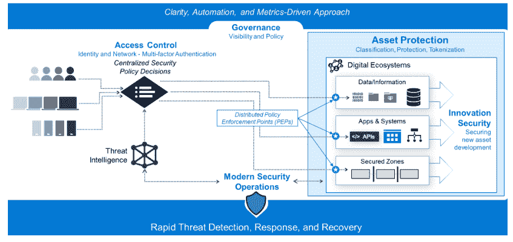
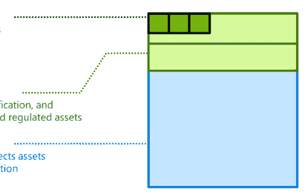
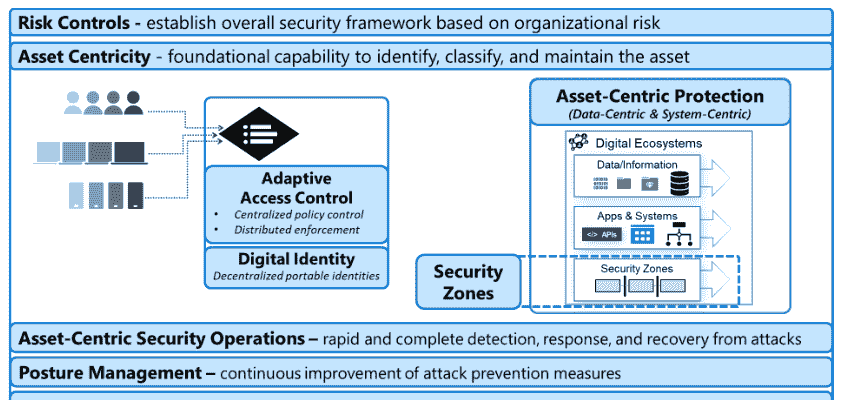
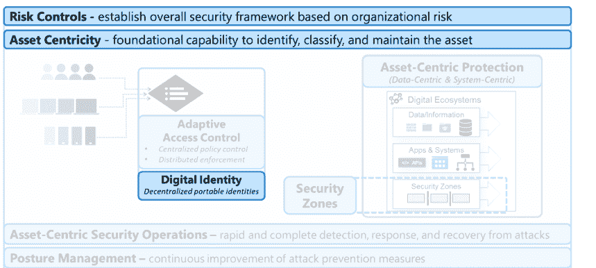
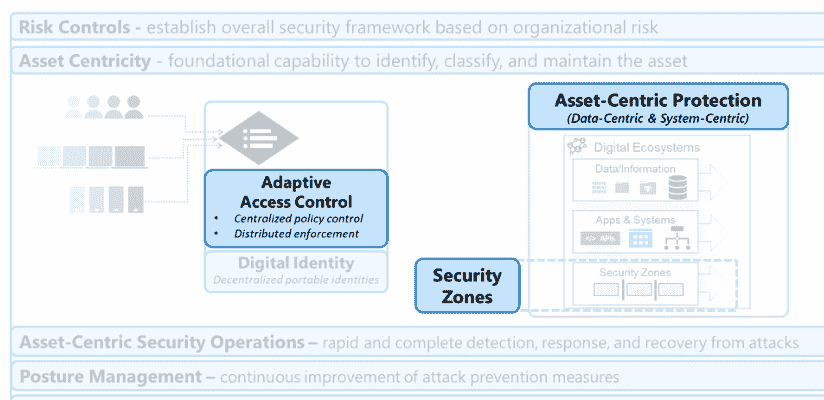
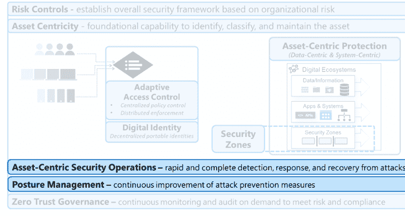
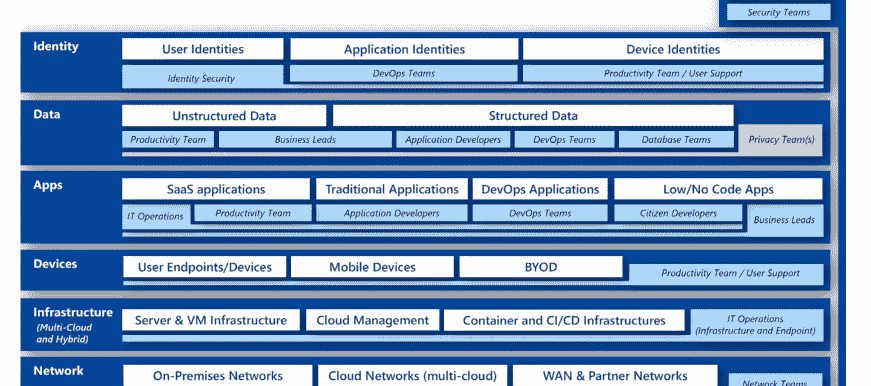
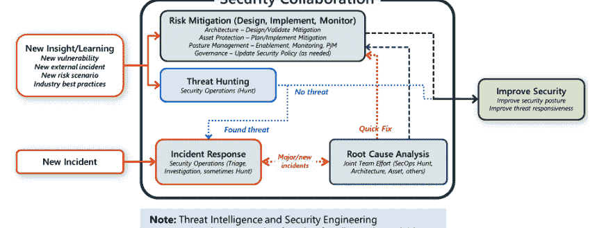
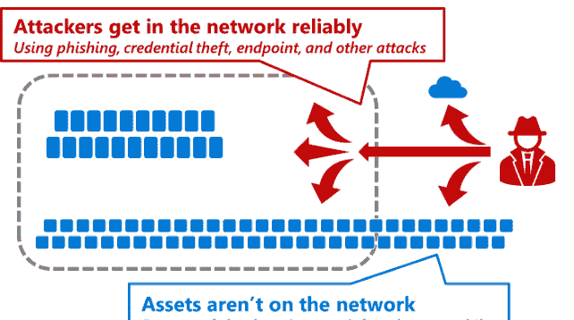

## 标准零信任能力

*我们都需要站在同一乐谱上。*

现在我们理解了零信任为何如此重要以及它与之前安全方法有何不同，让我们更深入地了解零信任包含的内容。本章使用 The Open Group 的参考模型以简单清晰的方式定义零信任。它还介绍了该模型所支持的关键零信任能力。

本章涵盖以下主题：

- *通过简单模型和持久能力实现一致性*
- *The Open Group 零信任参考模型*，包括对该中心图表中每个关键元素的解释
- *参考模型中定义的安全学科*
- *关键零信任能力*，包括每个能力的重要背景
- *零信任是否包含网络安全？*（剧透：是的！）

在深入模型本身之前，让我们先花点时间讨论为什么定义一个简单模型及其能力很重要。

### 通过简单模型和持久能力实现一致性

现代组织复杂且由许多不同的专业角色组成——业务战略、技术部署和运营、财务绩效、监管要求等等。为了让每个人朝着同一方向努力，提供一个每个人都能快速理解的简单模型至关重要，其中包括一套我们可以在一段时间内保持一致的持久能力。

尽早建立这种一致性可以加速零信任的采用及其带来的价值——提高业务敏捷性和抵御网络攻击的韧性。这种一致性减少了团队之间的内部摩擦，而内部摩擦会阻碍业务敏捷性和安全集成。

由于零信任转型影响安全的各个方面，重新审视安全并回顾该学科的核心基本成果是值得的。信息安全与其它安全和安全学科非常相似，因为它们都侧重于以下关键成果：

- *尽可能 防止*坏事发生
- *响应*：在坏事发生时进行管理，以最大程度减少损害并迅速恢复正常
- *从*这些经验中*学习*以改进预防和响应

对于信息安全，这些成果在 *国家标准与技术研究所 (NIST)* 网络安全框架中扩展为更详细的生命周期，即 *识别、保护、检测、响应、恢复* 和 *治理*。该生命周期为安全成果提供了极佳的指导，但仍需要转化为安全团队用来实现这些成果的能力。建立一套清晰的持久安全能力，使其在技术和其他变化中保持一致，对于指导安全团队以及创建一种通用语言以使技术、业务和安全团队能够共同工作都很重要。

我们选择使用 *The Open Group* 的初始 *零信任参考模型*，因为它是一种经过充分验证、以行业标准为驱动的方法，能够满足这一需求。该模型既简单又全面，为每个人提供了清晰的预期图景，从业务领导者到技术人员和安全从业者都易于理解。

### Operations – 一个含义多样的词

你可能会注意到，在本系列中，*operations* 一词及其变体以不同的方式使用。这是因为这些相似术语在业务、技术和安全团队中以这些不同的方式使用。有关这些术语的完整参考及其使用方式，请参阅 *《第 6 章，如何规划、规模化和启动零信任》* 中的 *术语消歧 — operations、operational、operating model 等* 部分。

现在我们理解了拥有一个在整个组织中被理解的简单模型是多么至关重要，让我们讨论这个零信任模型。

### The Open Group 零信任参考模型

为了让人们共同工作，每个人都需要对 *他们* 正在构建、运营和评估的内容有共同的理解。这不是一套完整的技术细节（稍后会介绍），但一个简单的图表和通俗的语言可以让每个人清楚地了解他们将要去向——即零信任的清晰图景是必需的。这种共同的参考点通常被称为技术人员和技术领导者所说的 *参考模型*。

以下图表来自 *The Open Group* 的零信任参考模型。该模型提供了将在整个手册中使用的定义的一致视图。在本章中，我们将快速总结零信任参考模型的每个部分并定义所有词语的含义，以便我们对理解保持一致：

### 零信任组件

为数字化世界实现灵活的业务工作流程

图 4.1 – The Open Group 零信任图表

我们将在整个手册中多次重访此模型，以从不同角色的角度展示它以及每个角色将如何使用它。

了解每个人并不对参考模型的每个元素都深感兴趣或参与其中也很重要，这没关系。即使你不直接与之交互，每个元素对于实现零信任成果（敏捷性、适应性等）都是必不可少的，因此我们将简要定义所有元素。每个角色的指导将突出并解释该模型中对该角色重要的方面。

参考模型说明了三种类型的元素：

- *安全学科*：这些构成了完整的安全计划和战略的组成部分（图表中粗体蓝色文字）
- *数字生态系统*：我们生活和运营的环境，包括 *业务资产* 和有价值的资源
- *安全能力*：这些能力在这些环境中保护业务资产的安全

### 安全学科

最简单地说，零信任安全确保合适的人在合适的时间访问合适的资产（访问控制），在事情出错时做出响应（安全运营），确保有明确且受监控的安全标准（治理），并将这些标准应用于组织的资产（资产保护）。由于数字时代的新能力建设速度如此之快，将安全集成到设计过程中也至关重要（创新安全）。

所有这些都与物理情况直接类似，例如保护仓库时你会设置围栏和大门（资产保护），在门卫处安装门禁读卡器并检查 ID 徽章（访问控制），监控安全摄像头并对异常行为做出响应（安全运营），并定期检查以确保流程得到遵循并找出改进领域（治理）。在新建建筑时，引入安全专家将安全集成到设计中也能减少未来的安全问题（创新安全）。

决策应以经常发生在你和其他组织上的攻击类型的背景为依据（威胁情报，或 TI）。它们还应反映出对所要保护的技术环境的当前准确图景，而该图景在不断演变。

由于这些学科对业务领导者、技术领导者或技术从业者意味着不同的东西，我们将在特定角色的指导中更深入地探讨其含义和影响。

> **零信任不仅仅是访问控制**
> 访问控制现代化通常是零信任的首个也是最可见的举措，这可能导致人们认为零信任只是关于访问控制。访问控制可能先行，但推动访问控制现代化的相同力量也在推动所有安全学科的变化。

现在我们了解了安全的学科，让我们看看我们正在保护什么。

### 数字生态系统和业务资产

数字生态系统托管数字业务资产，由数据、应用程序和安全区域组成。让我们更深入地了解这些各自的含义：

- 数据（信息）是对大多数组织而言最重要的技术资产。数据是现代企业的生命线。如果攻击者切断对其的访问、销毁它或分享它，他们可能会给企业造成（往往无法估量）损失。

*应用程序* (*系统*) 和 *应用程序编程接口* (*API，亦称为微服务*) 是组织提供商品和服务时经常需要的其他关键业务资产。应用程序和 API 会转换、修改、创建和删除组织每天处理的数据。例如，零售网站进行交易并创建财务记录。制造商可以提供产品订购 API，供分销商和零售商使用以自动订购更多商品，无需人工操作。

- *安全区域* 是围绕相似资产组群的边界和界限。这使组织能够对具有相似特征的资产（高价值、高风险暴露等）应用类似的控制措施，以实现规模化和一致性。

把这三者结合起来，就形成了我们所处的数字生态系统。

## 业务资产

“资产”一词对组织中的不同利益相关者意味着不同的东西。就像卡车运送货物一样，卡车也是一种需要库存跟踪、维护、停车位等的机械设备。

对业务领导者而言，资产是组织拥有并可用于创造更多价值的具有内在价值的东西。对技术从业者而言，资产通常是指在其生命周期内需要被发现和管理的项目（例如，笔记本电脑、服务器、应用程序、网站、文件、数据库条目等）。

你应该从 *两者* 的角度思考资产。如果这些卡车没有得到妥善维护并经常出现故障，企业、民用机构或军事力量将无法从一支配送车队中获得预期价值。

除非另有说明，术语 *asset* 指的是业务资产——具有内在业务价值的东西。

> **注意**
> 业务资产的性质可能差异很大，包括货币和金融工具、*知识产权（IP）*、有形物理设备和建筑物、面向客户的零售或银行网站、独特的业务流程、在市场上运营的监管许可、品牌认知，以及许多其他有形和无形资产类型。

为了规划和应用技术保护，高层业务资产需要被翻译成或映射到技术制品（文档、文件、数据库、应用程序、网站、服务器等）。

这导致了两个当务之急：

- 确保所有利益相关者都清楚哪些资产提供关键业务价值（竞争差异化、进入新市场的使能等）。
  *如果团队不知道什么重要（敏感分类），他们就无法提供适当级别的保护和监控。*
- 确保资产在其整个生命周期内得到良好管理和维护。
  *如果您不安排和预算关键资产的停机时间以执行安全维护（例如，应用补丁/更新），这些关键资产在网络攻击中被入侵的可能性会大得多。*

我们将在整个手册中详细讨论如何应用这两个当务之急。

## 数据（信息）

让我们从 *数据* 构建块开始。从安全角度来看，我们关心数据从创建的那一刻起直到被销毁的那一刻，在其生命周期中以任何形式存在。也就是说，当数据存储在某处（例如，数字形式或纸片）、在应用程序中时，以及当它被发送到某处（例如，发送给您的业务合作伙伴）时，我们都关心数据。

现在，思考一下在我们使用和共享数据以完成业务时，保护这些数据需要什么？如果您的交易合作伙伴遭到入侵会怎样？如果您遭到入侵会怎样？您能保护所有数据吗？

从安全角度来看，我们必须始终 *假设遭到入侵*，以保持警惕并像攻击者一样思考。您应该始终假设在某个时间点您的系统上会出现恶意行为者。问问自己这对低价值数据（例如，员工餐厅菜单）与高价值数据（未发布产品公告或收益报告）意味着什么。

*入侵会如何影响您的业务流程？您应该在寻找和保护重要数据上投入多少？*

专注于数据本身（*数据中心化*）使您能够务实地使用时间和资源。这使您能够密切关注少数包含高价值数据的应用程序和系统，更好地保护业务关键数据，而不会在不太重要的事情上浪费时间和精力。

这种务实性还延伸到删除高价值数据的不必要副本，以减少任何事件的影响。就像您不希望机密项目文档的数百份复印件到处流传一样，您也不应让敏感且受监管数据的多余副本随意散布在环境中。

图 4.2 说明了数据生命周期及其所经历的变化：

图 4.2 – 数据生命周期

## 在生命周期中保护数据

随着数据在其生命周期中发展，它将以多种形式存在，并且可能会被多次移动和使用。您需要确保在数据的整个存在生命周期中得到适当保护——通过创建、修改、共享、退役和删除。

您还需要确保数据得到保护，尤其是高价值数据，无论其位置或当前状态如何（通常通过某种形式的加密）。这通常被称为在 *使用中*（当应用程序打开它时）、*静止*（存储在计算机、USB“拇指驱动器”、云服务等上）或 *传输中*（当它从一个地方发送到另一个地方时）保护它。

此外，组织的数据最近价值迅速增加（对组织和潜在攻击者而言），因为 *人工智能（AI）* 模型和应用程序在很大程度上依赖于高质量数据。有关此内容的更多讨论见 *第 5 章，人工智能（AI）与零信任*。

## 应用程序和系统

第二个构建块，*应用程序和系统*，使数据和其他服务可供员工、合作伙伴、客户等使用。应用程序和系统的停机可能对组织产生重大影响。想象一下银行或零售网站离线、管道因计算机控制（或计费系统）离线而无法输送石油、天然气或汽油，或工厂因控制系统离线而无法生产商品的影响。

在当今以云为中心、面向服务的世界中，我们增加了一个第三个模块——API（又名微服务、Web 服务等），这是应用程序相互连接的方式。从能力角度来看，这些与应用程序类似（在高层面上），我们将主要将它们一起讨论（尽管它们在技术团队中会分开说明）。

应用程序和 API 还通过对其进行操作、更新和跨不同系统连接来使数据变得有用。将这些系统（或应用程序）作为单个离散资产（而不是作为网络的一部分）进行保护可以使我们更具敏捷性。例如，我们可以快速允许合作伙伴访问单个系统或 API，而不是在网络范围内共享对所有内部系统的访问权限。虽然这似乎是常识，但经典架构无法实现这一点，这代表了实现零信任业务敏捷性的根本转变。

## 安全区域

安全区域是具有相似安全要求的相似资产的分组。这种方式对资产进行分组使我们能够根据所需保护程度来集中资源，在最有价值的资产（即 *皇冠上的宝石*）上花费最多的时间和精力，而不是在员工餐厅菜单上。这种概念对安全来说并不新鲜，但已随着零信任而更新。

安全区域还通过使业务决策更简单来为业务提供敏捷性。相反于为每个业务流程处理冗长而令人困惑的技术资产列表，您只需引用区域名称即可。

您可以将安全区域想象成零售银行中的物理空间：

- 银行外是完全公共的，对物理空间的控制有限，但可以安装灯光和摄像头以提高可见性并记录可疑行为
- 银行大厅对公众开放，但是一个受控程度更高的空间（通过门锁等），允许进行更多监控
- 柜台后面是仅限员工的受限区域，社会和物理屏障（包括防弹玻璃）可保护员工和资金
- 金库是一个高度警戒和受保护的区域，只有选定的员工才能与最高价值的物品（以及价值密度最高的物品）交互

经典计算机安全通常侧重于试图将整个银行大楼作为金库来保护。这种简化尝试避免了识别和分析单个业务资产及其众多（通常未记录的）相互依赖关系，但不切实际且通常会增加安全风险。所有东西都在这个单一金库中（有时称为 *扁平网络*），因此所有员工和合作伙伴都必须进入其中，这意味着任何一次失误都会使金库中的所有东西面临风险。

手册中的策略侧重于安全区域策略，建立所有资产的通用基线，然后为最高影响资产（即 *皇冠上的宝石*）建立更高级别的安全区域。

下图说明了这一概念：

图 4.3 – 资产保护级别

高度受限的安全区域成本高昂，对大多数资产来说并不实用，但对于正确的特殊情况而言非常有价值。以下内容将在后面更详细地讨论，但此方法适用的一些示例包括以下内容：

- *业务资源*：某些（通常规模较小）的受控数据和系统通常需要最高级别的安全限制，例如制药研究数据、未专利的商业秘密，以及畅销产品的开发，例如未来每年可能价值数十亿美元的视频游戏。
- *脆弱资源*：在无法使用现代安全控制和工具保护的脆弱资源周围设置保护区域。这通常出现在使用可追溯到 30-50 年前的电子设备（在计算机技术中属于上古历史）来控制物理机器和流程的 *操作技术* (*OT*) 中。
- *保护生命和安全*：隔离控制可能导致生命或安全损失的物理流程的设备和系统。
- *隔离低信任资源*：隔离难以保护的设备和系统，以降低这些设备感染环境中其他资源的风险。这种动态与脆弱资源类似，但通常反映的是其功能依赖于网络或互联网的设备（会议室电话、打印机等），因此无法隔离。
- *重叠可能发生*：请注意，其中几种可能重叠，需要进行一些设计工作来协调它们。例如，一些系统既会影响生命/安全又脆弱；虽然不是理想的组合，但在现实世界中这种情况相当常见。

## 关于安全区域的经验教训

这些是关于安全区域使用的一些关键经验教训：

- *了解你拥有什么*：正如你可能想象的那样，创建这些区域需要了解数据和系统的敏感性。这需要业务和技术利益相关者之间的共同努力，这在整个手册指导中都有涉及。
- *专注于简洁*：限制需要管理的区域数量。每次分离资产时，都会为公司各地的许多人员和系统创建开销，以维护和支持该资产。必要时使用它们，但始终考虑增加复杂性的高成本（该成本会持续资产的整个生命周期，通常为数十年）。
- *不仅仅是网络控制*：安全区域的控制应包括所有类型的访问控制，包括网络、身份、应用、数据等。这在工程和运营的手册中会更详细地介绍。
- *人员至关重要*：虽然安全区域通常涉及许多控制措施，但其中最重要的一项是确保你信任有权访问资产的人员（背景调查、审计等）。
- *不要防火墙后就忘记！*：必须避免一种常见的反模式，即安全区域边界仅使用防火墙等网络控制措施配置一次，然后基本被忽略。举例来说，一家具有全球影响力的组织经历了一起重大的安全事件，导致关键业务线的多个工厂被迫关闭，因为缺乏安全处理安全区域例外情况的控制措施。

必须对安全区域采取完整的人员/流程/技术方法。你必须为例外情况（例如必须连接维护笔记本电脑以维护设备的 OT 供应商）定义政策和安全流程，你必须监控安全区域的攻击和配置更改，并且必须定期测试和验证所有这些内容。

因此，现在我们已经定义了安全学科和我们运营的数字生态系统，让我们使用商业领导者熟悉的概念——*能力*——将零信任模型与业务流程连接起来。

## 关键零信任能力

为了使零信任能够整合到业务流程中，我们将描述该参考模型所支持的零信任 *能力*。这些能力通过定义零信任在未来几年内为组织提供的稳定成果，使该模型变得真实。

### 什么是能力？

大多数组织提供对其客户（或客户、公民、选民、社区等）有价值的商品或服务。为了在一段时间内持续提供这些商品或服务，它们需要定义持久的 _能力_。能力的示例包括能够为产品定价、交付产品或服务、安全地登录人员，或响应网络安全攻击。

能力捕捉了我们正在做的事情 _什么_，并抽象掉了事情是如何完成的（这会随时间变化并在组织之间有所不同）。随着新思想的出现和新组件和技术的可用，零信任实施的许多细节将随着时间的推移而演变。然而，零信任的核心能力不太可能发生变化，因为它们代表了期望的成果，而与实现它们的技术的不同无关。

这些能力成为你可以在业务和技术流程中使用的构建块集合。

## 能力作为安全的通用语言

这些关键能力必须成为描述安全的通用词汇，供业务、技术和安全团队的领导者和团队成员使用。这种通用语言对于所有团队有效沟通安全并规划如何将安全整合到业务和技术团队的模型和详细流程中至关重要。这些能力通常也涉及来自业务、技术和安全的利益相关者，不同程度地参与其中。

> **了解其他团队是双向的**
> 
> 这与技术和安全利益相关者必须熟悉业务术语的基础词汇类似。
> 
> 例如，制造组织中的安全和技术团队必须熟悉业务团队用来描述获取原材料、将其加工和组装成产品、包装产品并将其运送给零售商、由零售商付款等业务能力的术语。

本节仅包含介绍概念的高层次描述。手册中的角色特定指导提供了更多细节，说明如何作为零信任路线图的一部分来规划、构建、运营和改进它们。

## 零信任能力参考

下图来自 _开放集团_ 显示了能够实现更好的安全成果同时也实现业务敏捷性的关键零信任能力。这些能力代表了组织中所有角色都应熟悉的安全基本组件：

图 4.4 – 关键零信任能力的描述

这些零信任能力共同实现了组织韧性，采用敏捷的安全方法，通过其生命周期保护资产，持续适应变化，并持续改进。

这些能力增强了组织的敏捷性——增加了添加新合作伙伴、发展到新渠道、创建新的业务线（LOB）和适应新市场或技术条件的便利性。这与传统的阻碍组织创新或适应能力的安全方法形成对比，这会带来竞争对手获得竞争优势的风险。

零信任能力可分为以下三个类别：

- 基础识别和生命周期管理
- 通过其生命周期保护业务资产
- 持续预防和响应攻击的运营功能

让我们先从基础元素开始。

## 基础识别和生命周期管理

与其他学科一样，安全具有基本的基础能力，这些能力是实现更复杂和更高价值能力所必需的。图 4.5 说明了安全的基础能力：

## 图 4.5 – 基础识别和生命周期管理能力

基础安全能力支持基本功能，例如建立风险控制框架，以便团队将安全成果与业务风险和优先级保持一致，持续向组织应用安全策略和最佳实践，并有效优先考虑安全资源。这些能力还支持为人员和资产分配数字身份，以便将它们联系起来、应用策略等。

基础能力如下所述：

- *控制管理*：此能力建立风险控制框架，使组织能够建立、记录和管理监管和安全控制。这使组织能够与业务优先事项和风险保持一致，并持续执行安全工作。

*如果没有控制管理，组织将对安全采取不一致的方法，导致因安全事件和不符合监管要求而对组织造成更大损害的风险。*

- *资产中心性*：此能力提供识别、分类和维护系统资产的能力。此基础能力使组织能够发现、分类、标记系统资产并对其进行关键安全维护。这包括诸如漏洞和配置管理、安全配置基线和基准、保护服务器/*虚拟机* (*VMs*)/容器、保护用户终端和设备、保护应用程序及开发/DevOps、供应链完整性/*软件物料清单* (*SBOM*)、数字身份绑定等活动。

### 备注

虽然资产中心性在表面上看起来似乎纯粹是技术活动，但*业务领导者需要识别业务关键资产*，以便技术和安全团队能够据此识别支持这些资产的具体系统和数据资产并适当地保护它们。

*如果没有资产中心性，组织将依赖于保护任意的技术资产分组，例如“企业网络上的任何内容”，这些分组对现代攻击无效。*

- **数字身份**：此能力支持为人员和技术资产（如应用程序、服务和数据）分配和管理数字身份。人员的身份正变得越来越便携，因为人们带来了自己的身份（在某些情况下是主权身份）。这减轻了组织管理身份和账户的负担，并简化了并购。这提高了业务敏捷性和安全性，但引入了评估和整合外部身份来源的新流程。这需要保护包括身份目录、同步和联合服务、**企业对企业 (B2B)**、**企业对消费者 (B2C)**、去中心化外部身份、身份治理等在内的技术和场景。

*如果没有数字身份能力，组织往往会面临巨大的业务敏捷性障碍（使并购整合的进展复杂化并减慢），以及因不一致或不完整的身份和访问管理 (IAM) 导致的安全问题影响和可能性增加。*

## 安全区域可提供有限的数字身份

一些资产不原生支持或无法分配数字身份，例如旧版 OT 设备、旧版 IT 系统、功能有限的**物联网 (IoT)** 设备、诸如容器等短寿命资产，以及由其他组织管理的一些资产。我们仍然需要保护该资产并保护其他资产免受其影响，以便将其分类到一个组并分配到安全区域。

例如，电力公用事业公司可以为包含监控和控制物理过程的敏感旧版 OT 设备的... 实际上原文为：例如，电力公用事业公司可以为包含监控和控制物理过程的敏感旧版 OT 设备的... 完整译文：例如，电力公用事业公司可以为包含监控和控制物理过程的敏感旧版 OT 设备的... 修正为：例如，电力公用事业公司可以为包含监控和控制物理过程的敏感旧版 OT 设备的... 统一译文：例如，电力公用事业公司可以为包含监控和控制物理过程的敏感旧版 OT 设备的... 最终：例如，电力公用事业公司可以为包含监控和控制物理过程的敏感旧版 OT 设备的... 

例如，电力公用事业公司可以为包含监控和控制物理过程的敏感旧版 OT 设备的... 

例如，电力公用事业公司可以为包含监控和控制物理过程的敏感旧版 OT 设备的... 

- **零信任治理**：此能力提供一个*框架*，用于在人员、流程和转型及持续运营的文化方面建立组织结构、流程和决策权。这为安全和零信任的执行提供了清晰度和一致性。与许多组织中的传统安全治理方法相比，零信任治理能力在多个方面有所不同，包括以下内容：

**零信任治理包括安全情报和 TI 功能**，这些功能以资产为中心驱动组织内明智的安全决策。

*如果没有此项，整个组织中的决策将在不了解组织实际当前威胁的情况下做出，导致更多可预防的事件和更高的潜在影响。*

- **零信任治理持续演进**，以满足业务、安全、监管和技术环境的变化。零信任治理还在推动组织*持续学习*方面发挥关键作用。正如医学、技术、金融服务等许多其他领域一样，持续学习对于使人们的技能和知识与世界的变化保持一致是必需的。

*如果没有此项，满足当今的业务、安全和技术目标将被昨天为旧技术、威胁和业务需求而构建的技能、策略和架构所减慢或停止。*

- **零信任治理定义了一种主动且有意的方法**，用于以共同目标、原则和策略管理安全和风险。除了深思熟虑且有意的安全策略外，零信任还包括组织范围内的*隐私设计 (PbD)*能力，以取代组织通常采用的被动临时性努力。此外，零信任治理还提供持续的*按需审计*能力，将组织审计计划从数月缩短至数天或更短。这种治理方法使组织能够跟上快速变化的监管环境，该环境包括不同的法律在*欧洲联盟 (EU)*、英国、印度、中国以及美国各州。

*如果没有这种有意的方法，满足合规要求将由一系列临时性努力组成，这些努力会减慢业务流程、浪费精力，甚至可能因不合规而导致罚款。*

现在，让我们谈谈零信任如何在此基础上构建，以在资产生命周期的任何地方保护资产。

## 通过生命周期保护业务资产

这些能力在上一节的基础能力之上构建，以在整个生命周期中保护业务资产。*图 4.6 说明了这些关键能力：*

## 图 4.6 – 跨生命周期的业务资产保护能力

*这些能力使用户能够在不“在网络上”的情况下安全地完成工作。* 它们通过无论互联网或地理位置如何单独保护业务资产来支持组织的安全性、敏捷性和生产力。

这些能力包括以下内容：

- *自适应访问控制*：此能力通过执行一致的策略来控制对业务资产的访问，该策略可自动适应实时威胁和动态业务变化（新攻击技术、就业变化、异常地理位置等）。自适应访问确保组织策略基于风险而非技术因素（如用户或资产的网络位置）来执行。此能力在传统*单点登录 (SSO)*的基础上构建，通过集成策略引擎、策略执行点、安全运营工具（如*端点检测与响应 (EDR)*）、TI 上下文以及其他业务和安全上下文。

此能力使所有利益相关者受益，因为它执行以下操作：

- *改善用户体验*：访问资产的用户不再需要进行额外的手动步骤，例如连接到*虚拟专用网络 (VPN)*。
- *提高业务敏捷性*：基于策略的方法允许随着角色变化快速且简单地更改访问权限——例如，一个人先在合作伙伴处开始工作，然后被竞争对手聘用，然后在该竞争对手被收购时成为员工。

- **_加强安全性_**: 自适应访问将实时风险信息 (TI) 集成到访问决策中，并在遭受攻击时可自动减少或撤销对业务资产的访问。这种快速遏制泄露可在无需人工干预的情况下限制对组织的潜在损害（缩小泄露的爆炸半径）。

- **_简化管理与管理_**: 管理自适应访问策略要简单得多，因为它们关注资产、用户和风险因素，而非网络位置等复杂的配置。此举使管理员能够专注于更具生产力和价值的任务，例如管理账户生命周期和特权访问（这些任务常被忽视且经常被攻击者利用）。虽然它不依赖地理位置或网络位置，但自适应访问允许基于这些因素进行限制。例如，一些组织可能拥有不应被某些国家或地区居民或公民访问的资产。

*如果没有自适应访问，组织依赖复杂且僵化的技术要素来控制访问（例如，用户必须连接到网络或 VPN），而不是实际的安全风险因素。这经常导致用户为提高生产力而绕过安全要求，从而产生更多可能影响更大的安全事件。*

- **_资产中心保护_**: 此功能在技术环境中为业务资产建立保护。这些功能是对自适应访问控制的直接补充——*自适应访问提供安全访问和使用资产的方式，而资产中心保护则保护资产本身*。这与通过物理破门保护汽车免遭盗窃（资产中心保护）与保护钥匙不被盗（自适应访问）非常相似。

数字业务资产由以下一种或两种技术组件类型组成：

- **_数据资产_** 是以文档、数据库、电子表格、图片、设计图等形式存在的电子信息。这些资产可能包含商业秘密、知识产权、客户数据或敏感或其他有价值的信息。数据资产需要在其生命周期内保护所有副本，需要不同的控制措施——包括使用中、静止和传输中。

- **_系统资产_** 是执行业务流程的服务、应用程序和其他技术系统。这些可以采取多种形式，例如网站、移动应用程序、*企业资源规划 (ERP)* 系统、控制物理设备的 *客户关系管理 (CRM)* 系统等等。系统资产的保护因系统的性质和设计而异，但一些普遍重要的考虑因素包括以下内容：

  - **_互联网暴露_**: 当今许多系统都具有可通过互联网访问的接口（网站、API、聊天机器人等），必须对其进行保护以抵御攻击。
  - **_完整应用生命周期_**: 攻击者可以在其生命周期的任何阶段利用引入的安全性，包括规划、设计、部署和运营。

- ***系统资产必须相互保护。*** 当今的系统相互连接，攻击者经常利用这一点进行横向遍历攻击。例如，攻击者经常入侵一个系统（如互联网网站或应用程序），以此作为平台攻击组织环境中的其他系统和数据（通过窃取凭证、扫描并利用软件漏洞等）。

资产中心保护包括数据分类及其生命周期内的保护，包括静止、传输和使用期间。它们还包括跟踪数据来源（对 AI 来说至关重要，如下一章所述）以及降低风险的各种技术，例如数据消除、令牌化、混淆和匿名化。资产中心保护还包括 API 网关、针对 ***拒绝服务 (DoS)*** 攻击的技术保护等。

*如果没有资产中心保护，组织将无法识别并保护其最重要的数据（商业秘密、知识产权、客户数据等）免受攻击者的入侵。*

*这导致泄露的频率和影响增加，削弱客户信任、竞争差异化和收入。*

- ***安全区域*** 简化了将控制措施和策略分配给具有相似业务关键性、安全风险或其他共同属性的资产组。此举可以简化安全策略管理，并可改善对不支持现代安全功能的老旧或功能有限技术的保护，如本章前面所述。

虽然这个概念长期以来一直用于描述由防火墙保护的网络段，但必须强调安全区域不仅仅是配置一次的防火墙规则等网络控制。在云和零信任时代，这一概念已扩展到包括身份、应用程序、终端和其他控制措施，以实现资产隔离并对其应用通用策略。

虽然业务和技术领导者可能不参与安全区域的技术设计和实施，但这些利益相关者需要参与流程。业务团队负责确定什么程度的敏感性（对组织的潜在影响）值得投入建设和维护安全区域的成本和精力（以及对这些资产业务敏捷性的任何潜在影响）。

现在我们已经介绍了识别业务资产、访问它们以及在其生命周期内保护它们的能力，让我们介绍在持续的攻击流面前维持和提高安全保证的能力。

## 持续防止和响应攻击的运营功能

运营团队必须持续维持和监控安全，以实时跟上风险和其他变化。图 4.7 说明了与运营安全功能相关的能力：

### 图 4.7 – 与运营安全功能相关的能力

这些能力使安全运营功能能够管理并减轻潜在安全风险（漏洞）和已实现风险（事件或攻击）。

*安全态势管理* 专注于防止攻击的运营方面，而 *安全运营* 则专注于响应和管理发生的事件。这些互补的能力应相互集成，并与 IT 运营和业务运营集成。将这些与组织的业务和技术运营紧密集成，可提供对安全风险的清晰可见性，并确保这些风险得到快速有效缓解。

以下是关键运营安全能力：

- **安全态势管理** 使组织能够监控并减轻敌对行为者攻击组织资产的无数方式，通常被称为组织的“攻击面”。这类似于保护汽车，确保车门锁坚固且无人使用时已锁，钥匙不易伪造且不会被遗留在易于被盗的地方，车主不在时车窗不会被敞开，等等。

*态势管理范围很广！* 当今组织攻击面非常庞大且复杂，需要态势管理与组织内运营和维护不同资源的许多团队协作。图 4.8 说明了构成组织技术攻击面的关键技术领域以及参与态势管理的团队：

## Figure 4.8 – 安全态势管理庞大而复杂

如前图所示，防止潜在攻击需要在广泛的资产类型中监控和缓解风险。获取对技术、流程、人员和政策这一广度的可见性需要大量工作和时间。必须对这项工作的规模设定合理预期，并让各团队参与进来，对他们维护并最熟悉的资产应用安全措施。这项工作永远无法完全完成，但必须稳步快速推进，以消除技术债务积压（类似于偿还高息财务债务）。态势管理应专注于持续的优先级排序和持续改进。

在当今世界，安全威胁和漏洞的演变速度远快于大多数监管要求，因此组织需要关注合规要求和组织安全风险的结合。组织安全风险由安全情报提供信息，该情报考虑了对组织最有价值的资产、关于趋势和可能攻击的 TI、组织安全态势的相对优势和劣势等。

获取安全态势的完整视图需要将组织的外向内视图（外部攻击面管理或 EASM）与内向外视图相结合，以全面了解态势中的强点和弱点。实现内向外视图的技术包括传统的配置管理工具、漏洞管理工具，以及专门的安全态势管理工具，例如云安全态势管理（CSPM）工具、云原生应用保护平台（CNAPP）工具等（这些工具通常会为您融合大量多样化的数据源）。

*如果没有安全态势管理，组织的防止攻击方法将是临时性的、脱节的且无效的。*

*这会导致许多本可通过态势管理预防的事件（或影响会更小）造成更大的业务损害。*

- **以资产为中心的安全运营**（**ACSOs**）使组织能够找到并清除已成功获得组织业务资产未经授权访问的攻击者。**安全运营**（有时称为**SecOps**、**安全运营中心**或**SOC**）通过限制对手访问业务资产的时间来降低组织风险，这有时被称为攻击者的“驻留时间”。

与安全态势管理一样，安全运营是一个庞大而复杂的学科。SecOps 必须在前述态势管理部分描述的技术资产广度范围内检测、响应并帮助从攻击中恢复。ACSOs 包括事件管理（有时分为 *Triage/Tier 1* 和 *Investigation/Tier 2* 能力）、事件管理、威胁狩猎、检测工程、TI、红队和紫队演练等能力。安全运营还与技术运营团队密切合作，持续改进检测并在受影响服务恢复期间迅速将其恢复到满负荷运行（例如，在勒索软件或其他破坏性攻击恢复期间）。

*关注资产，而非网络。* Zero Trust 中以资产为中心的安全运营方法使用资产特定的技术检测，并意识到更高价值的业务资产，以便对这些资产的检测和响应进行优先级排序。这与传统的检测和响应方法形成对比，后者主要（或完全）使用 *network* 技术来防御 *network* 边界。正如 NIST SP 800-207 所说，“*基于边界的网络安全已被证明是不够的，因为一旦攻击者突破边界，后续的横向移动将不受阻碍。*”

一些组织已通过采用先进的身份、云和终端能力超越了这种（在很大程度上无效的）以网络为中心的方法——ACSOs 继续这一转变并在此基础上构建。

ACSOs 优先使用资产特定的威胁检测，例如 EDR 和 *extended detection and response (XDR)* 工具，这些工具可提供高质量（低误报）的常见攻击检测。*Security orchestration automation and response (SOAR)* 技术可自动化常见任务，也是减少浪费性重复工作和错误的关键推动因素。ACSO 包括传统的 *security information and event management (SIEM)* 和相关的安全数据湖能力，但这些能力通过帮助处理海量数据的技术得到增强，包括 *machine learning (ML, a form of AI)* 和行为分析（通常称为 *user and entity behavior analytics* 或 *UEBA*）。

Zero Trust 的安全运营方法还侧重于将安全运营中的 TI 整合到组织的更多流程中，以指导架构、工程、运营、态势管理等。TI 还与 *business intelligence* (*BI*) 融合，形成共享的安全情报上下文，以指导优先级排序和其他决策。安全情报在 playbooks 中有更详细的描述。

*如果没有 ACSOs，组织在应对攻击不断增加的严重性和复杂性方面将有效性大打折扣。*

*每一次使攻击者能够窃取、篡改或破坏数据和系统功能的事件都会削弱组织的收入、客户信任和竞争差异化因素。*

这些关键能力共同使组织变得敏捷、具有弹性且安全。

## Capability integration

这些能力并非孤立存在；它们彼此集成，并与组织中的业务和技术能力集成。

*来自 The Open Group Zero Trust 参考模型的图 4.9 说明了安全能力和团队如何协同工作以持续改进安全：*

**Note:** 威胁情报和安全工程（自动化）是所有安全活动的基础支持功能

Figure 4.9 – 安全持续学习降低风险

在 Zero Trust 方法中，组织在每次事件中学习并变得更强大。无论组织直接经历攻击还是从他人的经验中学习，这些经验都会转化为改进防止攻击、检测攻击、响应攻击或从攻击中恢复的能力。

总之，这些 Zero Trust 安全能力使组织能够以远低于经典安全方法的摩擦、更多安全和风险上下文以及更高的安全保证来追求新的机会和业务模式。

## Zero Trust 是否包括网络安全？

是的——网络安全是 Zero Trust 的一部分，但网络不再像经典安全方法那样定义安全范式。网络安全是安全区域和其他访问控制能力（与身份、应用、数据和其他技术并列）的关键组成部分。

虽然网络安全曾主导安全思维和工具，但其作用将被削减为“众多技术之一”。这是因为需要保护的业务资产越来越多地托管在您无法控制的网络上，需要使用其他技术来实现有效的控制。此外，攻击者正通过网络钓鱼、凭据窃取、供应链和其他攻击技术规避仅网络的保护策略——这增加了对其他控制和技术的需求。

*图 4.10 说明了这一动态：*

**Figure 4.10 – 网络边界安全的局限性**

## Zero Trust 是否要求移除防火墙？

**No!** 现有的防火墙和相关网络控制将保留以保护现有工作负载（在云时代现已成为“遗留”系统），但在维持现有控制之外投资网络安全边界的价值有限。

我们还预计将看到更多面向业务的安全技术出现并成熟（通常称为微分段），这些技术能够通过网络、身份和其他控制类型来启用和强化安全区域。

这种将经典安全方法与新方法相结合的方式使我们能够使用零信任来保护 30 年前的遗留资产，一直到刚刚上线 30 分钟的新资产。

## Summary

本章中，我们使用 *The OSSpen Group Zero Trust Reference Model* 回顾了零信任组件，描述了每个关键零信任能力及其各自的重要背景。

这帮助我们对零信任及其关键能力有了清晰的认识。当每个人都知道我们在构建什么时，每个人都在同一页面上，我们在这项至关重要的旅程中取得成功的可能性就更大。

在下一章中，我们将看到零信任如何帮助我们应对来自人工智能的巨大变化，而人工智能是一种正在颠覆商业、技术、安全和整个社会的全新技术。
