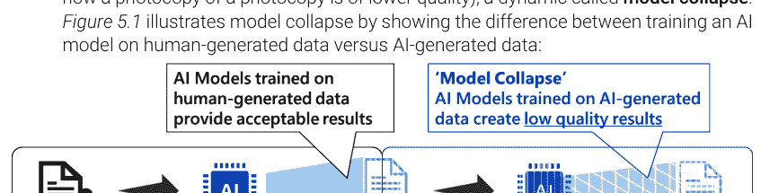
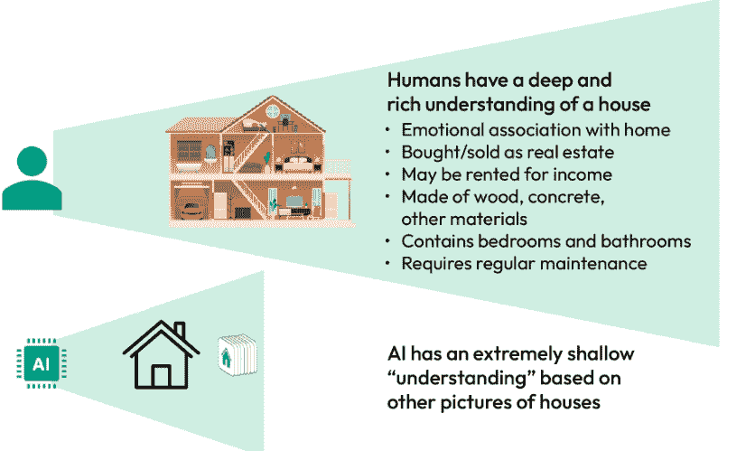

## Artificial Intelligence (AI) and Zero Trust

*变化无论我们是否准备好都会发生！*

**人工智能 (AI)** 是一种强大的技术，正在商业、技术、安全和社会各领域带来颠覆性影响。该技术已经发展了一段时间，但随着新一代生成式人工智能技术的可用性，其发展最近进入了高速阶段。

本章提供了人工智能及其影响、局限性以及与零信任关系的概述。每个手册中都包含了针对每个角色的人工智能和安全详细指导。

本章回答以下重要问题：

- 人工智能是什么？
- 人工智能的影响会是什么样？
- 人工智能的局限性是什么？
- 我们如何利用零信任管理人工智能安全风险？
- 人工智能将如何影响零信任？

让我们从关于人工智能是什么这一基本问题开始。

## What is AI?

人工智能是使用计算机模拟人类智能行为。人工智能内部有很多关注领域，因此本书仅提供人工智能及其对安全和零信任影响的简要概述。

区分两种不同类型的人工智能能力很重要：

- **经典人工智能**：人工智能在安全领域的作用始于利用 **机器学习** (**ML**) 在大型数据集上捕获和扩展专家人类经验。这表现为人类专家提前训练和调整 *监督式 ML* 模型，并让 *无监督式 ML* 模型识别数据中的聚类或模式，然后将这些模式呈现给人类专家进行分析。ML 使人类能够在大量数据中识别模式和异常，这些模式和异常可用于识别现代组织庞大复杂技术环境中的安全弱点、攻击和其他见解。
- **生成式人工智能**：最近，**大型语言模型** (**LLM**) 使人类语言、图像和其他媒体的分析和生成成为可能，这 *极大地改变了人们与计算机和信息交互的方式*。这些模型是在大量人类生成的人工制品上训练的（对话、图片、诗歌、歌曲、新闻文章、计算机代码等），使计算机能够“理解”（分析）并生成类似的人工制品。

迄今为止，这种技术最具影响力的用途是聊天界面的使用（例如 ChatGPT），人们可以让这些模型（以及其他连接的系统）为他们执行任务。与以前的语音界面（如苹果的 Siri 功能）不同，后者仅限于预配置的命令，这些生成式人工智能界面可以继续与用户互动，以进一步澄清请求并完善输出（更新和更改图片、歌词、计算机代码等）。

微软、谷歌和许多其他公司迅速将这项技术投入产品。迄今为止最常见的形式是副驾驶或指导助手，使人们能够快速执行现有任务并开始执行新任务。此外，早期成功案例包括为内部角色（例如客户支持角色）提供聊天助手，助手会建议客户问题的答案，并能够提问以进行快速研究。

由于人们可以快速学习如何使用该界面（与人类聊天非常相似），它很可能成为许多任务的首选计算机界面，甚至可能成为供应商构建某些新功能和能力时的默认方式。

> **Note**
> 生成式人工智能不会取代经典人工智能。生成式人工智能能力通常使用其他系统来执行专业任务，其中许多使用经典人工智能的 ML 模型。

现在，让我们来看看人工智能技术将产生何种影响。

## What will the impact of AI look like?

人工智能的影响将是重大的，细节难以准确预测，但关于它将对组织产生何种影响的清晰主题正在浮现。

生成式人工智能允许任何拥有互联网访问权限的人在几乎无需培训的情况下生成令人印象深刻的内容。人们可以通过简单的聊天界面请求，即可使用生成式人工智能生成逼真的图片、绘画、文章、歌词、诗歌、计算机代码等等。

*由于这种强大技术的易用性和广泛可用性，人工智能将在每个组织中产生巨大、快速且持续的影响。* 人工智能的颠覆性影响可能类似于 PC 和互联网革命，后者改变了业务流程、消费经济和社会许多方面。

## AI adoption will be fast

与 PC 革命不同，人工智能不需要分发新设备就能在社会范围内产生广泛而深远的影响。这代技术使用（并建立在）现有的设备、互联网和云基础设施之上，使每个人都能快速访问。

此外，*大多数人可以在没有任何专业技能的情况下快速学习如何利用人工智能创造价值。* 由于聊天界面与现有的人类互动非常相似，人们开始使用时所需的培训有限或为零。高级技能和场景正在一个名为 **提示工程** 的学科中出现，但这些并非开始使用所必需的。

*人工智能使任何拥有计算机的人都能快速使用以前需要专家技能和高级培训的高级功能。* 虽然人工智能采用的速度取决于许多因素（所需人工智能技能的可用性、组织采用速度等），但人工智能采用面临的固有限制比以前的颠覆性技术（如 PC、互联网、移动设备和云技术）更少。

## AI will have a broad, ongoing, and deep impact

人工智能将在组织的许多角色中产生强大影响，未来数年（甚至数十年）将颠覆假设和规范。

这种颠覆性影响将是持续且强大的，因为 *生成式人工智能从根本上改变了人们与计算机的交互方式。* 人工智能使人们能够在无需技术知识和培训的情况下轻松访问高级计算能力。随着越来越多的人发现人工智能，他们将把自己专门的角色技能和知识与这些高级能力（以及他们的想象力）相结合。随着人们创造出使用人工智能产生业务价值的新方法，其他人会发现它们并在此基础上构建新想法，还有其他人会在此基础上继续构建，等等。

由此产生的 AI 经济增长可能类似于 1980 年代和 1990 年代图形用户界面 (GUI) 出现后应用程序和程序的增长。当人们可以通过点击所需操作而不是记住和输入命令时，他们受到了使用计算机、编写应用程序和创办软件企业的启发。随着越来越多的人发现使用自然语言界面轻松访问、更改和生成文档、图片、歌曲等内容的便捷性，人工智能的自然语言界面也可能产生同样的效果。

*任何创建或处理信息的角色都将受到人工智能的影响，* 包括企业高管、经理、艺术家、科学家、记者、律师、立法者、监管机构、业务分析师、客户服务专业人员、行政专业人员、技术人员、安全专业人员等等。

这正在改变诈骗者和罪犯的工作方式，因为他们已经开始采用这项技术来伪造人们的声音和模仿他们的写作风格。

这种大量的颠覆将导致广泛的兴奋、恐惧和困惑——为组织带来机遇和风险。

## Some AI impacts on security are predictable

虽然没有人能精确预测未来，但人工智能的一些变化极有可能影响安全。这些变化基于人工智能技术的性质、早期观察到的 AI 影响，以及从 PC、互联网、移动设备、云计算和社交媒体等过去颠覆性技术中吸取的经验教训。

人工智能对安全的影响可能遵循以下主题：

- **人工智能无处不在**：人工智能正被引入并将继续被引入到组织、供应商、合作伙伴、客户、攻击组织等各处的业务、技术和安全工作流程中。人们正在使用人工智能根据职位描述生成简历，业务协作工具正在集成 AI 副驾驶和聊天助手，安全厂商正在添加生成式人工智能功能，攻击者正在使用人工智能通过模仿真实声音和写作风格来欺骗人们，等等。
- **安全影响**：安全、技术和业务团队必须快速了解该技术及其对安全风险的影响，以制定既能降低组织风险又能使企业利用该技术把握机遇的政策和控制措施。每个人都必须及早、频繁地分享他们所学到的知识，以确保组织能够跟上人工智能带来的持续变化。

- **AI 将生成大量内容**：AI 可以生成大量内容，因此我们将看到 AI 生成的文本、图片、视频、网站等泛滥。这些内容的质量、实用性和准确性可能差异很大。这类似于电子邮件因发送成本低而爆炸式增长，包括从高价值信息到垃圾（垃圾邮件）邮件以及介于两者之间的一切（新闻通讯、营销、群发邮件等）。
- **安全影响**：这种看似可信且个性化但价值存疑的内容爆炸，需要采取缓解措施，例如用户教育和专门的产品来衡量内容的质量、准确性和实用性。
- **AI 将制造大量混乱**：随着 AI 使用的增长，人们会因 AI 创建的内容而感到困惑，例如视频、语音和电子邮件对话中令人信服的“深度伪造”冒充。此外，许多人会误解 AI 技术能做什么、不能做什么，因为他们缺乏良好的参照点——当前的 AI 技术与几十年来电影和电视节目中对 AI 的描绘非常不同。有些人会过度兴奋和狂热地使用该技术，而另一些人则会过度恐惧和谨慎——每种极端都可能造成不必要的风险。
- **安全影响**：组织应紧急关注教育、管理期望、安全/财务流程和控制措施，并制定明确的政策。
- **AI 增加了对数据中心安全的需求**：AI 模型需要优质数据，极大地增加了对数据安全和数据质量的关注。由于 AI 模型需要人类生成的数据，而互联网已充斥着 AI 生成的内容，每个组织的内部数据价值迅速提升。

AI 模型在 AI 生成的数据上训练会导致非常低质量的结果（类似于复印的复印件质量更低），这种动态被称为 **模型崩溃**。*图 5.1 通过展示在人类生成数据与 AI 生成数据上训练 AI 模型之间的差异来说明模型崩溃：*

图 5.1 – 在 AI 生成数据上训练的模型的模型崩溃说明

由于 AI 模型的价值以及训练它们所需原始人类生成内容，人类生成的数据（如大多数组织内部的数据）对 AI 模型变得极其宝贵。这进一步增加了数据的价值，我们已经看到攻击者出于此原因针对组织窃取其数据。

- **安全影响**：组织必须紧急采用以数据为中心零信任安全方法来保护其数据及其新发现的竞争差异化因素。传统的以网络为中心的安全方法无法有效保护数据免受攻击。
- **AI 成功将激发进一步的颠覆**：生成式 AI 的成功也将鼓励对更多技术创新和颠覆的投资和资金。随着组织拥抱 AI 技术，他们将将其应用于越来越多推动计算机能力边界的场景，例如衡量和理解人们的情感状态（有时称为情感计算）。每一次进步都将产生更多关于指导、政策、教育等方面的讨论和需求。
- **安全影响**：业务、技术和安全团队需要共同努力理解这些变化并建立政策和控制措施，使组织能够负责任地采用这些技术。组织必须不断学习如何管理这些颠覆，以便在降低风险的同时使业务成长和蓬勃发展。零信任的敏捷安全方法将是实现这一目标的关键资产。

正如你所见，AI 将产生广泛影响，需要业务、安全和技术团队采用零信任方法共同合作。每本手册中每个角色的指导都更详细地介绍了 AI 对每个角色的影响。

## AI 转型将类似于数字化转型

您组织中的 AI 转型在许多方面将类似于您的数字化转型。每一次转型都将用基于更先进、更有效率的技术的新流程取代现有的业务流程。两次转型也都将成为来自外部组织和内部创新的持续变化和颠覆的来源。

有关如何思考各种 AI 风险的更多信息，NIST AI 风险管理框架是一个很好的资源：https://www.nist.gov/itl/ai-risk-management-framework.

虽然 AI 将创造许多新的机遇和风险，但关于 AI 技术目前能做什么，存在非常现实的局限性。

## AI 的局限性是什么？

AI 技术将是强大且变革性的，但 AI 并不是安全或其他任何问题的万能银弹解决方案。AI 具有非常现实且重大的局限性，远非我们在电影和电视节目中经常看到的完全独立的人类般的 **通用人工智能（AGI）**。

主要的局限性在于 AI 模型并不像人类那样以复杂和丰富的方式真正理解内容。AI 也会自然地反映和传播其数据中的任何偏见，无论这些偏见是否已知和记录。

让我们快速了解一下这些 AI 的关键局限性。

## AI 模型不“理解”任何东西

虽然生成式 AI 在表面上似乎“理解”事物，但它只是在模仿训练时使用的原始内容。这种极其肤浅的“理解”类似于西部电影布景上的假建筑（立面）——这些立面对精心放置的摄像机看起来像建筑物，但根本不具备建筑物的功能。

*图 5.2 说明了人类与 AI 看待和理解某事物的差异：*

### 人类对房屋有深刻而丰富的理解

- 与家相关的情感联想
- 作为房地产买卖
- 可出租以获取收入
- 由木材、混凝土等材料制成
- 包含卧室和浴室
- 需要定期维护

AI 基于其他房屋图片具有极其肤浅的“理解”

图 5.2 – 人工智能与人类智能

虽然人类可以从房屋图片等内容中自然推断出丰富的含义和事实，但 AI 只能识别并生成与训练数据相似的新内容。内容（文档、图片、视频等）可能看起来逼真，但它们只是底层主题的肤浅表现：

- 视觉模型能够高效分析并生成视觉内容，但它们并不完全理解图片中的物体以及它们如何与周围的 **三维**（**3D**）世界相互作用。
- 语言模型知道如何分析和生成文本，但它们并不原生理解文本中的思想、概念或模型。它们只能预测在特定上下文（文档、文章、诗歌、电影剧本或其他格式）中接下来最有可能出现的词语。

在此过程中，AI 模型还经常犯人类永远不会犯的 AI 特定错误。例如，视觉模型的首批版本在生成图片时经常把手指和手弄错（手指太多或太少、不自然的比例、不自然的位置等）。这是因为视觉模型不像人类那样理解手指和手（手通常有四根手指和一根拇指，手指长度有一定比例，手指只能以特定方式移动，等等）。视觉模型只“理解”其训练数据中模式的视觉表现。

识别和纠正这些错误（或首先防止它们）需要人工进行 **质量保证（QA）** 或使用自动 QA 机制。

## AI 能力和局限性将随时间变化

随着时间的推移，随着用例被识别并被证明是有帮助的、有利可图的或以其他方式有益的，AI 的许多局限性将会演变。

研究人员和开发人员将专注于识别和解决与这些用例相关的 AI 局限性，例如纠正手指和手的描绘、使用现有数据库和文档存储库在文档生成中提供技术或医疗 QA 术语、纠正代码中的软件安全问题等。

**安全影响**：组织需要政策和控制措施来确保质量、准确性、安全、隐私、道德使用和其他所需属性。政策和控制措施应涵盖组织自己的 AI 应用以及组织对外部 AI 应用的使用。

## AI 模型反映其数据中的任何偏见

此外，AI 通常会复制其处理的数据中的偏见，包括原始训练数据和其他连接的数据源，以及聊天对话中的任何偏见

with the user. 这是因为 AI 模型基于数学概率，无法理解道德和文化价值观、隐私、安全等方面的人类因素。

例如，AI 模型可以复制数据中的某些偏见，例如粉色花朵比其他颜色多、特定肤色的人更多、猫的图片比人物图片更多、文本中粗俗用语比例很高，以及源代码中某些函数和 API 的过度使用。

*AI 使用的数据中的任何偏见都会在 AI 生成的内容中体现出来，除非应用质量保证机制将其移除。* 偏见也可能在 AI 模型本身的设计或实现中被引入（有意或无意）。

**安全影响：** 对于 AI 生成的内容和代码，QA 将成为一项日益重要的优先事项，以确保 AI 的输出值得信赖、准确、合乎道德，并满足安全、隐私、合规和其他要求。

QA 可能以执行这些质量的人工或自动化 QA 工具的形式出现。经典 AI 通常需要训练有素的专业人员与其交互（数据科学家和领域专家），这自然会引入一定的 QA 监督。生成式 AI 模型允许任何人通过持续的聊天对话提供输入，使得 QA 的明确纳入对该技术至关重要。

## AI 使用通常需要一个伦理框架

虽然伦理框架超出了本手册系列的范围，但需要注意的是，组织使用 AI 几乎总是需要建立伦理框架（或更新现有框架）。这是因为 QA 流程可能会识别出 AI 使用中的偏见，包括具有安全、伦理、隐私或其他负面影响的偏见。

## Zero Trust 如何帮助管理 AI 安全风险？

需要采用 Zero Trust 方法来有效管理与 AI 相关的安全风险。经典的以网络 perimeter 为中心的方案建立在 20 多年前对静态技术环境的假设之上，无法敏捷地跟上 AI 快速演变的安全要求。

以下 Zero Trust 安全的关键要素使您能够管理 AI 风险：

- **数据中心化**：AI 极大地提升了数据安全的重要性，AI 需要一种数据中心化的方法，能够在任何位置在其整个生命周期内保护数据。

Zero Trust 提供了这种数据中心化的方法，本系列的手册指导您组织中的角色完成此实施。

- **持续动态风险的协同管理**：与现代网络安全攻击类似，AI 不断扰乱业务、技术和安全流程的核心假设。这需要对复杂且不断变化的安全风险进行协同管理。

Zero Trust 使用敏捷的安全策略、政策和架构来管理风险、工具、流程、技能等方面的持续变化，从而解决此类问题。本系列的手册将通过为组织中所有受影响角色提供 AI 安全风险的具体指导，帮助您实现 AI 风险缓解。

让我们看看哪些具体的 Zero Trust 要素对于管理 AI 风险最为重要。

## Zero Trust – 管理 AI 风险的四大优先事项

管理 AI 风险需要优先考虑 Zero Trust 的几个关键领域，以解决 AI 的特定独特方面。每个手册中的具体指导的作用提供了更多细节，说明每个角色如何在日常工作中纳入 AI 考虑。

这些优先事项遵循 **学习它**、**使用它**、**防范它** 和 **团队协作** 的简单主题。这类似于对任何其他类型的竞争或冲突的任何重大颠覆性变化的理性方法（例如，军事组织学习新武器、职业运动员学习新类型的设备或规则变化等）。

管理 AI 风险的四大优先事项如下：

### 1. 学习它 – 教育每个人并设定现实期望

今天可用的 AI 能力非常强大，影响每个人，并且与人们期望的非常不同。*教育组织中的每个角色* 至关重要，从董事会成员和 CEO 到个人贡献者，因为他们都必须了解 AI 是什么、AI 真正能做什么和不能做什么，以及 AI 使用政策和指南。如果没有这些，人们的期望可能会严重不准确，导致本可轻易避免的高度影响性错误。

教育和期望管理对于 AI 来说尤其紧迫，原因如下：

- **攻击中的主动使用**：攻击者已经在使用 AI 来冒充声音、电子邮件写作风格等。

- **业务流程中的主动使用**：AI 可供任何人自由使用。求职者已经为你们的职位提交 AI 生成的简历，这些简历使用你们发布的职位描述，人们正在使用公共 AI 服务执行工作任务（并可能泄露敏感信息），等等。

- **真实性**：结果非常逼真且令人信服，特别是如果你不知道 AI 在创建假图像、视频和文本方面的能力有多好。

- **困惑**：许多人对其没有良好的参照框架，因为 AI 在流行文化中的描绘方式（与 AI 的当前现实非常不同）。

### 2. 使用它 – 将 AI 集成到安全中

立即开始评估并将 AI 集成到你的安全工具和流程中，以利用其提高的有效性和效率。这将使你能够快速利用这一强大的技术更好地管理安全风险。AI 将影响安全的几乎每个部分，包括以下内容：

- 安全风险发现、评估和管理流程
- 威胁检测和事件响应流程
- 架构和工程安全防御
- 将安全集成到系统的设计和运行中
- ...以及更多

### 3. 防范它 – 更新安全策略、政策和控制措施

组织必须紧急更新其策略、政策、架构、控制措施和流程，以考虑 AI 技术的使用（由业务部门、技术团队、安全团队、攻击者等）。这有助于组织充分利用 AI 技术，同时最大限度地降低安全风险。

关键关注领域应包括以下内容：

- **为攻击者使用 AI 做计划**：大多数组织将经历的第一个影响之一是攻击者迅速采用 AI 来欺骗你们的人。攻击者正在使用 AI 来在像你们这样的目标组织上获得优势，因此你们必须更新安全策略、威胁模型、架构、用户教育等，以防御使用 AI 的攻击者或针对你们数据的攻击者。这应改变组织对以下方面的期望和假设：
- **攻击者技术**：大多数攻击者将尝试并将 AI 能力集成到其攻击中，例如在电话中模仿你们同事的声音、在钓鱼邮件中模仿写作风格、创建令人信服的假社交媒体图片和个人资料、创建令人信服的假公司标志和个人资料等。
- **攻击者目标**：攻击者会因其高价值（直接对攻击者有用和/或出售给他人）而针对你们的数据、AI 系统和其他相关资产。你们的人工生成数据是用于训练和 grounding AI 模型的珍贵高价值资产，你们对 AI 的创新使用可能具有潜在有价值的知识产权，等等。

- **确保组织对 AI 的使用**：组织必须更新其安全策略、计划、架构、流程和工具，以执行以下操作：
- **确保外部 AI 的使用**：建立明确的政策以及支持使用外部 AI 系统安全的流程和技术
- **确保组织的 AI 和相关系统**：保护组织的 AI 和相关系统免受攻击者侵害

除了防御传统安全攻击外，组织还需要在防御 AI 特定的攻击技术方面做好准备，这些技术可以提取源数据、使模型生成不安全或非预期结果、窃取 AI 模型本身的设计等。手册包含更多细节，帮助每个角色管理其部分风险。

*采取整体方法*：重要的是确保 AI 模型的完整生命周期和依赖关系，包括模型本身、模型使用的数据源、使用模型的应用、其托管的基础设施、第三方运营商（如 AI 平台）和其他集成组件。这还应从整体角度审视安全生命周期，以考虑识别、保护、检测、响应、恢复和治理。

- **更新采购和审批流程**：必须迅速完成，以确保新的 AI 技术（和其他技术）符合组织的安全、隐私和道德实践。这有助于避免极具破坏性的可避免问题，例如将组织数据的所有权转移给供应商和其他方。你不希望其他组织通过使用你的数据而成长并从你那里夺取市场份额。你还希望避免攻击者利用你的数据对付你而造成的昂贵隐私事件和安全事件。

这应包括供应链风险考虑，以减轻直接供应商和 N 方风险（从其他组织采购的直接供应商的组件）。在流程后期发现和修复问题比在采购前或期间纠正要困难得多且昂贵得多，因此尽早引入这些风险缓解措施至关重要。

### 4. 团队协作 – 建立协调的 AI 方法

建立内部协作社区或正式的 **卓越中心 (CoE)** 团队，以确保洞察、学习和最佳实践能够在团队之间快速共享。AI 是一个快速发展的领域，将推动业务、技术和安全团队的快速持续变化。你必须建立机制，以便在组织中跨这些不同团队进行协调和协作。

每个手册都描述了针对每个受影响角色的具体 AI 影响和职责。

**AI 共享责任模型：** 大多数 AI 技术将与 AI 提供商形成合作伙伴关系，因此管理 AI 和 AI 安全风险将遵循您与 AI 提供商之间的共享责任模型。AI 安全的某些要素将由 AI 提供商处理，而另一些则由您的组织（其客户）负责。

这与当今云责任的管理方式非常相似（许多 AI 提供商也是云提供商）。这也类似于一家企业将其制造、物流、销售（例如渠道销售）或其他业务职能的部分或全部外包。

现在，让我们来看看 AI 如何影响零信任。

## AI 将如何影响零信任？

AI 将加速零信任的许多方面，因为它极大地改善了安全工具以及人们使用它们的能力。AI 承诺减少对重要但繁琐的安全任务的负担和工作量，例如以下内容：

- 帮助安全分析师快速查询多个数据源（无需成为查询语言或工具界面的专家）
- 帮助撰写事件响应报告
- 识别常见的后续行动以防止重复事件

简化人员与他们为安全所需使用的复杂系统之间的界面，将使技能各异的人员更具生产力。技能高超的人员能够在没有重复且分散注意力的任务的情况下，专注于他们最擅长的工作。职业生涯早期的人能够迅速在角色中变得更具生产力，更快地以专家水平执行任务，并通过回答问题和提供解释来帮助他们学习。

*AI 不会取代对安全专家的需求，也不会取代对安全现代化的需求。* AI 将简化许多安全流程，并允许更少的安全人员做更多工作，但它不会取代安全思维或安全专业知识的需求。

即使有了 AI 技术，对于以下方面仍然需要人员和流程：

- 向 AI 系统提出正确的安全问题
- 解释结果并评估其准确性
- 对 AI 结果采取行动并在团队间协调
- 执行 AI 系统目前无法覆盖的分析和任务：
  - 识别、管理和衡量组织的安全风险
  - 制定、执行和监控策略和政策
  - 建立并监控团队之间的关系和流程
  - 整合业务、技术和安全能力
  - 评估合规要求并确保组织在善意中满足这些要求
  - 评估业务和技术流程的安全性
  - 评估安全态势并优先考虑缓解投资
  - 评估安全流程、工具和系统的有效性
  - 为技术系统规划和实施安全
  - 为应用程序和产品规划和实施安全
  - 响应攻击并从攻击中恢复

总之，AI 将迅速改变您面临的攻击以及组织有效管理安全风险的能力。AI 需要零信任方法，它也将帮助您的团队更快、更高效地完成工作。

《零信任手册系列》中的指导将通过指导每个人完成各自的部分，加速您管理 AI 风险的能力。它将帮助您迅速将安全与业务风险和优先事项保持一致，并提供您有效管理 AI 变化所需的 安全敏捷性。

自然会出现的一些问题是该从哪里开始以及首先做什么。

## 摘要

在本章中，我们回顾了 AI 是什么、其影响、当前 AI 技术的局限性、如何通过零信任管理 AI，以及 AI 将如何影响零信任。

在下一章 – 第 6 章，如何规划、规模化和启动零信任 – 我们将讨论敏捷安全并回答有关规划、规模化和启动零信任的最常见问题。
