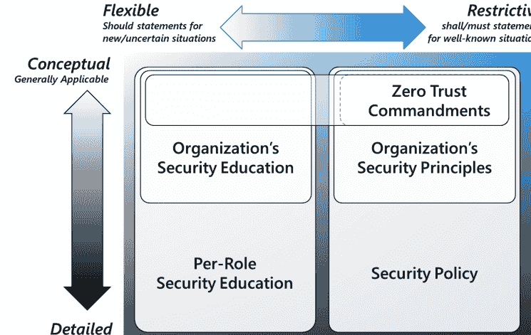
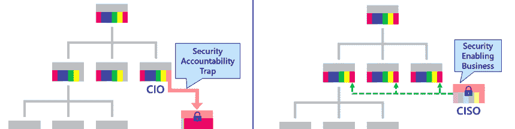
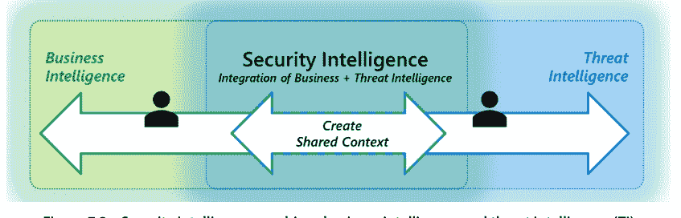
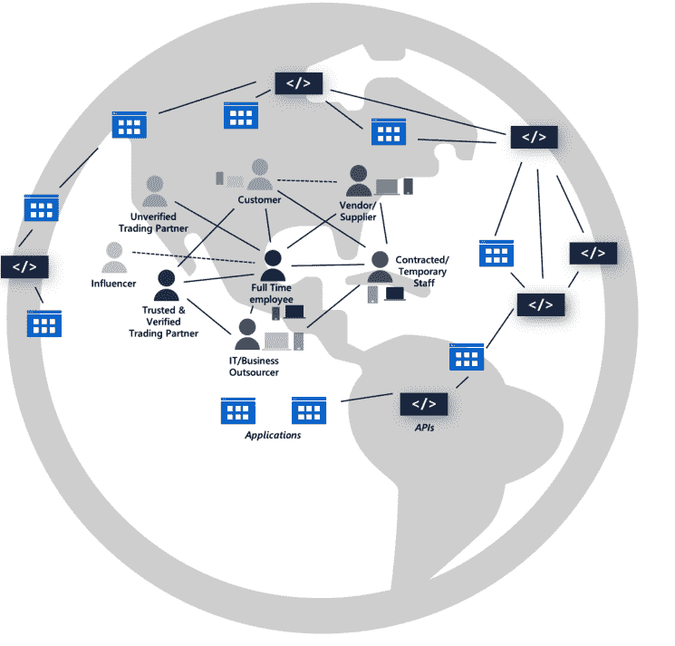
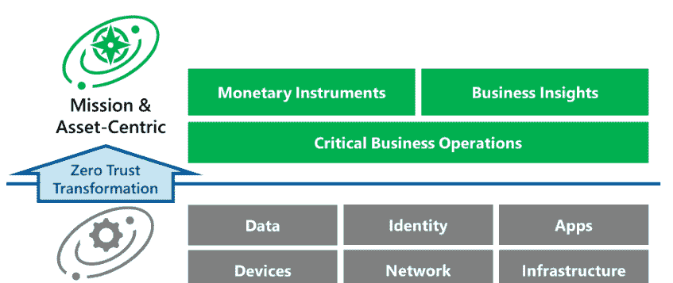

## 零信任成功的样子

> "以终为始。"
> – 史蒂芬·柯维

现在我们了解了零信任为何如此重要以及它涉及的内容，让我们来看看这段（持续的）旅程中成功是什么样子的。

直言不讳地说，世界充斥着失败的技术相关项目。你可以通过快速在网上搜索“IT 项目失败率”来证实这一点，或向组织中的任何有经验的同事请教一个失败技术项目的故事。零信任太重要了，不能出错。我们不能因为本可以轻松避免的事情而冒失败的风险。

本手册系列旨在通过使用经过验证的模型并应用零信任和其他技术项目实际部署中的最佳实践，帮助您避免在实施零信任时失败。这有助于您避免常见的项目失败原因，有时被称为反模式。

本章讨论了三个**零信任成功要素**，它们将成功项目与失败项目区分开来，具体如下：

- **清晰的战略和计划**
- **安全思维和文化转变**
- **人性化同理心**

在推进零信任的过程中关注这些成功要素，将有助于您避免最常见的项目失败和延误来源。

### 关于反模式

反模式是对反复出现的问题的常见回应，通常无效且风险极高，可能适得其反。例如，许多组织将安全优先级降低以优先考虑成本或计划优先级，这会随着时间的推移逐步增加组织风险，并经常导致日后出现重大泄露。

第 2 要素中描述的最佳实践将取代一个或多个常见的反模式，这些反模式经常会增加零信任进展的组织风险。

### 零信任成功要素

> "好的判断来自经验，而经验来自糟糕的判断。"
> — 弗雷德·布鲁克斯

让我们深入探讨如何在零信任之旅中避免常见陷阱。这三个成功要素基于直接的零信任经验以及我们多年来观察到的其他大型技术举措。这三个要素代表了成功举措和项目的标志，而这些要素在失败的项目中通常薄弱或缺失。

这些成功要素已嵌入零信任手册的框架中，以帮助您更轻松地避免常见的摩擦和失败来源。我们将直接或间接地提及这些成功要素的许多方面，以及它们如何适用于业务领导者、技术领导者、技术经理、架构师和技术从业者。

### 工作永无止境

重要的是要认识到，零信任是对动态持续改进状态的转变，而不是一个简单的静态终点，在那里你跨过终点线就完成了。

零信任转型的三个关键成功要素包括以下内容：

- **清晰的战略和计划**：组织需要清晰的愿景和手册来指导不同角色完成这段旅程，以便每个利益相关方都清楚自己的职责。
- **安全思维和文化转变**：您必须引入或强化特定的思维方式、期望和文化要素，以便团队能够成功应对向数字化业务、云技术和零信任安全转型的根本假设转变。
- **人性化同理心**：必须认识到这些转型会影响组织中许多人的生活和职业。您必须有意地解决这些问题，并积极管理变革的人性化方面（期望、情绪、人际关系等）——针对您个人和您的团队。

现在，让我们更详细地了解这些要素。

### 要素一 – 清晰的战略和计划

为了确保每个人都在同一页面上并朝着同一方向前进，必须拥有清晰的战略和计划来协调这些工作。这必须具有敏捷性，必须考虑组织的任何独特方面，并且必须整合到组织的运营模式中以维持并保持其在正轨上。

*好消息！* 您找到了本丛书，它旨在帮助您构建清晰的战略和计划！

本丛书的结构为参考手册，旨在指导每个角色在零信任中发挥的作用。它包括您需要完成此任务的参考模型、架构、模型和策略。手册包括如何将零信任整合到不同行业和组织运营模式中的示例，以及如何构建您的零信任运营模式。

*根据您的组织定制手册并定义清晰的进展指标，将为您的组织创造清晰度和可操作性。*

现在，让我们讨论下一个成功要素。

### 要素二 – 安全思维和文化转变

建立或强化关键思维方式和文化要素对于转变组织各利益相关方和角色的安全期望和习惯至关重要。这些超越了字面上的计划，并创造了一种无形的[content]
> **注意**
> SecOps 并不是唯一的运营安全职能；安全态势管理是一种互补职能，专注于防止攻击。这两个职能将在 *第 8 章，采用三支柱模型* 中得到更详细的描述。

## 摘要

在本章中，我们解答了一些关于范围界定、规模评估和启动零信任的常见问题，这有助于我们思考如何构建方法以满足组织的独特需求。我们看到这些手册与任何规模的组织以及任何风格都兼容，从成熟的组织到数字原生组织。

接下来，在 *第 7 章，零信任成功的样子* 中，我们将探讨技术项目失败的常见原因以及如何在零信任之旅中避免它们。

## 零信任成功的样子

> "以终为始。"
> – 史蒂芬·柯维

现在我们了解了零信任为何如此重要以及它涉及的内容，让我们来看看这段（持续的）旅程中成功是什么样子的。

直言不讳地说，世界充斥着失败的技术相关项目。你可以通过快速在网上搜索“IT 项目失败率”来证实这一点，或向组织中的任何有经验的同事请教一个失败技术项目的故事。零信任太重要了，不能出错。我们不能因为本可以轻松避免的事情而冒失败的风险。

本手册系列旨在通过使用经过验证的模型并应用零信任和其他技术项目实际部署中的最佳实践，帮助您避免在实施零信任时失败。这有助于您避免常见的项目失败原因，有时被称为反模式。

本章讨论了三个**零信任成功要素**，它们将成功项目与失败项目区分开来，具体如下：

- **清晰的战略和计划**
- **安全思维和文化转变**
- **人性化同理心**

在推进零信任的过程中关注这些成功要素，将有助于您避免最常见的项目失败和延误来源。

### 关于反模式

反模式是对反复出现的问题的常见回应，通常无效且风险极高，可能适得其反。例如，许多组织将安全优先级降低以优先考虑成本或计划优先级，这会随着时间的推移逐步增加组织风险，并经常导致日后出现重大泄露。

第 2 要素中描述的最佳实践将取代一个或多个常见的反模式，这些反模式经常会增加零信任进展的组织风险。

### 零信任成功要素

> "好的判断来自经验，而经验来自糟糕的判断。"
> — 弗雷德·布鲁克斯

让我们深入探讨如何在零信任之旅中避免常见陷阱。这三个成功要素基于直接的零信任经验以及我们多年来观察到的其他大型技术举措。这三个要素代表了成功举措和项目的标志，而这些要素在失败的项目中通常薄弱或缺失。

这些成功要素已嵌入零信任手册的框架中，以帮助您更轻松地避免常见的摩擦和失败来源。我们将直接或间接地提及这些成功要素的许多方面，以及它们如何适用于业务领导者、技术领导者、技术经理、架构师和技术从业者。

### 工作永无止境

重要的是要认识到，零信任是对动态持续改进状态的转变，而不是一个简单的静态终点，在那里你跨过终点线就完成了。

零信任转型的三个关键成功要素包括以下内容：

- **清晰的战略和计划**：组织需要清晰的愿景和手册来指导不同角色完成这段旅程，以便每个利益相关方都清楚自己的职责。
- **安全思维和文化转变**：您必须引入或强化特定的思维方式、期望和文化要素，以便团队能够成功应对向数字化业务、云技术和零信任安全转型的根本假设转变。
- **人性化同理心**：必须认识到这些转型会影响组织中许多人的生活和职业。您必须有意地解决这些问题，并积极管理变革的人性化方面（期望、情绪、人际关系等）——针对您个人和您的团队。

现在，让我们更详细地了解这些要素。

### 要素一 – 清晰的战略和计划

为了确保每个人都在同一页面上并朝着同一方向前进，必须拥有清晰的战略和计划来协调这些工作。这必须具有敏捷性，必须考虑组织的任何独特方面，并且必须整合到组织的运营模式中以维持并保持其在正轨上。

*好消息！* 您找到了本丛书，它旨在帮助您构建清晰的战略和计划！

本丛书的结构为参考手册，旨在指导每个角色在零信任中发挥的作用。它包括您需要完成此任务的参考模型、架构、模型和策略。手册包括如何将零信任整合到不同行业和组织运营模式中的示例，以及如何构建您的零信任运营模式。

*根据您的组织定制手册并定义清晰的进展指标，将为您的组织创造清晰度和可操作性。*

现在，让我们讨论下一个成功要素。

### 要素二 – 安全思维和文化转变

建立或强化关键思维方式和文化要素对于转变组织各利益相关方和角色的安全期望和习惯至关重要。这些超越了字面上的计划，并创造了一种无形的[content]
> **注意**
> SecOps 并不是唯一的运营安全职能；安全态势管理是一种互补职能，专注于防止攻击。这两个职能将在 *第 8 章，采用三支柱模型* 中得到更详细的描述。

## 摘要

在本章中，我们解答了一些关于范围界定、规模评估和启动零信任的常见问题，这有助于我们思考如何构建方法以满足组织的独特需求。我们看到这些手册与任何规模的组织以及任何风格都兼容，从成熟的组织到数字原生组织。

接下来，在 *第 7 章，零信任成功的样子* 中，我们将探讨技术项目失败的常见原因以及如何在零信任之旅中避免它们。

## 零信任成功的样子

> "以终为始。"
> – 史蒂芬·柯维

现在我们了解了零信任为何如此重要以及它涉及的内容，让我们来看看这段（持续的）旅程中成功是什么样子的。

直言不讳地说，世界充斥着失败的技术相关项目。你可以通过快速在网上搜索“IT 项目失败率”来证实这一点，或向组织中的任何有经验的同事请教一个失败技术项目的故事。零信任太重要了，不能出错。我们不能因为本可以轻松避免的事情而冒失败的风险。

本手册系列旨在通过使用经过验证的模型并应用零信任和其他技术项目实际部署中的最佳实践，帮助您避免在实施零信任时失败。这有助于您避免常见的项目失败原因，有时被称为反模式。

本章讨论了三个**零信任成功要素**，它们将成功项目与失败项目区分开来，具体如下：

- **清晰的战略和计划**
- **安全思维和文化转变**
- **人性化同理心**

在推进零信任的过程中关注这些成功要素，将有助于您避免最常见的项目失败和延误来源。

### 关于反模式

反模式是对反复出现的问题的常见回应，通常无效且风险极高，可能适得其反。例如，许多组织将安全优先级降低以优先考虑成本或计划优先级，这会随着时间的推移逐步增加组织风险，并经常导致日后出现重大泄露。

第 2 要素中描述的最佳实践将取代一个或多个常见的反模式，这些反模式经常会增加零信任进展的组织风险。

### 零信任成功要素

> "好的判断来自经验，而经验来自糟糕的判断。"
> — 弗雷德·布鲁克斯

让我们深入探讨如何在零信任之旅中避免常见陷阱。这三个成功要素基于直接的零信任经验以及我们多年来观察到的其他大型技术举措。这三个要素代表了成功举措和项目的标志，而这些要素在失败的项目中通常薄弱或缺失。

这些成功要素已嵌入零信任手册的框架中，以帮助您更轻松地避免常见的摩擦和失败来源。我们将直接或间接地提及这些成功要素的许多方面，以及它们如何适用于业务领导者、技术领导者、技术经理、架构师和技术从业者。

### 工作永无止境

重要的是要认识到，零信任是对动态持续改进状态的转变，而不是一个简单的静态终点，在那里你跨过终点线就完成了。

零信任转型的三个关键成功要素包括以下内容：

- **清晰的战略和计划**：组织需要清晰的愿景和手册来指导不同角色完成这段旅程，以便每个利益相关方都清楚自己的职责。
- **安全思维和文化转变**：您必须引入或强化特定的思维方式、期望和文化要素，以便团队能够成功应对向数字化业务、云技术和零信任安全转型的根本假设转变。
- **人性化同理心**：必须认识到这些转型会影响组织中许多人的生活和职业。您必须有意地解决这些问题，并积极管理变革的人性化方面（期望、情绪、人际关系等）——针对您个人和您的团队。

现在，让我们更详细地了解这些要素。

### 要素一 – 清晰的战略和计划

为了确保每个人都在同一页面上并朝着同一方向前进，必须拥有清晰的战略和计划来协调这些工作。这必须具有敏捷性，必须考虑组织的任何独特方面，并且必须整合到组织的运营模式中以维持并保持其在正轨上。

*好消息！* 您找到了本丛书，它旨在帮助您构建清晰的战略和计划！

本丛书的结构为参考手册，旨在指导每个角色在零信任中发挥的作用。它包括您需要完成此任务的参考模型、架构、模型和策略。手册包括如何将零信任整合到不同行业和组织运营模式中的示例，以及如何构建您的零信任运营模式。

*根据您的组织定制手册并定义清晰的进展指标，将为您的组织创造清晰度和可操作性。*

现在，让我们讨论下一个成功要素。

### 要素二 – 安全思维和文化转变

建立或强化关键思维方式和文化要素对于转变组织各利益相关方和角色的安全期望和习惯至关重要。这些超越了字面上的计划，并创造了一种无形的[content]
> **注意**
> SecOps 并不是唯一的运营安全职能；安全态势管理是一种互补职能，专注于防止攻击。这两个职能将在 *第 8 章，采用三支柱模型* 中得到更详细的描述。

## 摘要

在本章中，我们解答了一些关于范围界定、规模评估和启动零信任的常见问题，这有助于我们思考如何构建方法以满足组织的独特需求。我们看到这些手册与任何规模的组织以及任何风格都兼容，从成熟的组织到数字原生组织。

接下来，在 *第 7 章，零信任成功的样子* 中，我们将探讨技术项目失败的常见原因以及如何在零信任之旅中避免它们。

## 零信任成功的样子

> "以终为始。"
> – 史蒂芬·柯维

现在我们了解了零信任为何如此重要以及它涉及的内容，让我们来看看这段（持续的）旅程中成功是什么样子的。

直言不讳地说，世界充斥着失败的技术相关项目。你可以通过快速在网上搜索“IT 项目失败率”来证实这一点，或向组织中的任何有经验的同事请教一个失败技术项目的故事。零信任太重要了，不能出错。我们不能因为本可以轻松避免的事情而冒失败的风险。

本手册系列旨在通过使用经过验证的模型并应用零信任和其他技术项目实际部署中的最佳实践，帮助您避免在实施零信任时失败。这有助于您避免常见的项目失败原因，有时被称为反模式。

本章讨论了三个**零信任成功要素**，它们将成功项目与失败项目区分开来，具体如下：

- **清晰的战略和计划**
- **安全思维和文化转变**
- **人性化同理心**

在推进零信任的过程中关注这些成功要素，将有助于您避免最常见的项目失败和延误来源。

### 关于反模式

反模式是对反复出现的问题的常见回应，通常无效且风险极高，可能适得其反。例如，许多组织将安全优先级降低以优先考虑成本或计划优先级，这会随着时间的推移逐步增加组织风险，并经常导致日后出现重大泄露。

第 2 要素中描述的最佳实践将取代一个或多个常见的反模式，这些反模式经常会增加零信任进展的组织风险。

### 零信任成功要素

> "好的判断来自经验，而经验来自糟糕的判断。"
> — 弗雷德·布鲁克斯

让我们深入探讨如何在零信任之旅中避免常见陷阱。这三个成功要素基于直接的零信任经验以及我们多年来观察到的其他大型技术举措。这三个要素代表了成功举措和项目的标志，而这些要素在失败的项目中通常薄弱或缺失。

这些成功要素已嵌入零信任手册的框架中，以帮助您更轻松地避免常见的摩擦和失败来源。我们将直接或间接地提及这些成功要素的许多方面，以及它们如何适用于业务领导者、技术领导者、技术经理、架构师和技术从业者。

### 工作永无止境

重要的是要认识到，零信任是对动态持续改进状态的转变，而不是一个简单的静态终点，在那里你跨过终点线就完成了。

零信任转型的三个关键成功要素包括以下内容：

- **清晰的战略和计划**：组织需要清晰的愿景和手册来指导不同角色完成这段旅程，以便每个利益相关方都清楚自己的职责。
- **安全思维和文化转变**：您必须引入或强化特定的思维方式、期望和文化要素，以便团队能够成功应对向数字化业务、云技术和零信任安全转型的根本假设转变。
- **人性化同理心**：必须认识到这些转型会影响组织中许多人的生活和职业。您必须有意地解决这些问题，并积极管理变革的人性化方面（期望、情绪、人际关系等）——针对您个人和您的团队。

现在，让我们更详细地了解这些要素。

### 要素一 – 清晰的战略和计划

为了确保每个人都在同一页面上并朝着同一方向前进，必须拥有清晰的战略和计划来协调这些工作。这必须具有敏捷性，必须考虑组织的任何独特方面，并且必须整合到组织的运营模式中以维持并保持其在正轨上。

*好消息！* 您找到了本丛书，它旨在帮助您构建清晰的战略和计划！

本丛书的结构为参考手册，旨在指导每个角色在零信任中发挥的作用。它包括您需要完成此任务的参考模型、架构、模型和策略。手册包括如何将零信任整合到不同行业和组织运营模式中的示例，以及如何构建您的零信任运营模式。

*根据您的组织定制手册并定义清晰的进展指标，将为您的组织创造清晰度和可操作性。*

现在，让我们讨论下一个成功要素。

### 要素二 – 安全思维和文化转变

建立或强化关键思维方式和文化要素对于转变组织各利益相关方和角色的安全期望和习惯至关重要。这些超越了字面上的计划，并创造了一种无形的[content]
> **注意**
> SecOps 并不是唯一的运营安全职能；安全态势管理是一种互补职能，专注于防止攻击。这两个职能将在 *第 8 章，采用三支柱模型* 中得到更详细的描述。

## 摘要

在本章中，我们解答了一些关于范围界定、规模评估和启动零信任的常见问题，这有助于我们思考如何构建方法以满足组织的独特需求。我们看到这些手册与任何规模的组织以及任何风格都兼容，从成熟的组织到数字原生组织。

接下来，在 *第 7 章，零信任成功的样子* 中，我们将探讨技术项目失败的常见原因以及如何在零信任之旅中避免它们。

## 零信任成功的样子

> "以终为始。"
> – 史蒂芬·柯维

现在我们了解了零信任为何如此重要以及它涉及的内容，让我们来看看这段（持续的）旅程中成功是什么样子的。

直言不讳地说，世界充斥着失败的技术相关项目。你可以通过快速在网上搜索“IT 项目失败率”来证实这一点，或向组织中的任何有经验的同事请教一个失败技术项目的故事。零信任太重要了，不能出错。我们不能因为本可以轻松避免的事情而冒失败的风险。

本手册系列旨在通过使用经过验证的模型并应用零信任和其他技术项目实际部署中的最佳实践，帮助您避免在实施零信任时失败。这有助于您避免常见的项目失败原因，有时被称为反模式。

本章讨论了三个**零信任成功要素**，它们将成功项目与失败项目区分开来，具体如下：

- **清晰的战略和计划**
- **安全思维和文化转变**
- **人性化同理心**

在推进零信任的过程中关注这些成功要素，将有助于您避免最常见的项目失败和延误来源。

### 关于反模式

反模式是对反复出现的问题的常见回应，通常无效且风险极高，可能适得其反。例如，许多组织将安全优先级降低以优先考虑成本或计划优先级，这会随着时间的推移逐步增加组织风险，并经常导致日后出现重大泄露。

第 2 要素中描述的最佳实践将取代一个或多个常见的反模式，这些反模式经常会增加零信任进展的组织风险。

### 零信任成功要素

> "好的判断来自经验，而经验来自糟糕的判断。"
> — 弗雷德·布鲁克斯

让我们深入探讨如何在零信任之旅中避免常见陷阱。这三个成功要素基于直接的零信任经验以及我们多年来观察到的其他大型技术举措。这三个要素代表了成功举措和项目的标志，而这些要素在失败的项目中通常薄弱或缺失。

这些成功要素已嵌入零信任手册的框架中，以帮助您更轻松地避免常见的摩擦和失败来源。我们将直接或间接地提及这些成功要素的许多方面，以及它们如何适用于业务领导者、技术领导者、技术经理、架构师和技术从业者。

### 工作永无止境

重要的是要认识到，零信任是对动态持续改进状态的转变，而不是一个简单的静态终点，在那里你跨过终点线就完成了。

零信任转型的三个关键成功要素包括以下内容：

- **清晰的战略和计划**：组织需要清晰的愿景和手册来指导不同角色完成这段旅程，以便每个利益相关方都清楚自己的职责。
- **安全思维和文化转变**：您必须引入或强化特定的思维方式、期望和文化要素，以便团队能够成功应对向数字化业务、云技术和零信任安全转型的根本假设转变。
- **人性化同理心**：必须认识到这些转型会影响组织中许多人的生活和职业。您必须有意地解决这些问题，并积极管理变革的人性化方面（期望、情绪、人际关系等）——针对您个人和您的团队。

现在，让我们更详细地了解这些要素。

### 要素一 – 清晰的战略和计划

为了确保每个人都在同一页面上并朝着同一方向前进，必须拥有清晰的战略和计划来协调这些工作。这必须具有敏捷性，必须考虑组织的任何独特方面，并且必须整合到组织的运营模式中以维持并保持其在正轨上。

*好消息！* 您找到了本丛书，它旨在帮助您构建清晰的战略和计划！

本丛书的结构为参考手册，旨在指导每个角色在零信任中发挥的作用。它包括您需要完成此任务的参考模型、架构、模型和策略。手册包括如何将零信任整合到不同行业和组织运营模式中的示例，以及如何构建您的零信任运营模式。

*根据您的组织定制手册并定义清晰的进展指标，将为您的组织创造清晰度和可操作性。*

现在，让我们讨论下一个成功要素。

### 要素二 – 安全思维和文化转变

建立或强化关键思维方式和文化要素对于转变组织各利益相关方和角色的安全期望和习惯至关重要。这些超越了字面上的计划，并创造了一种无形的[content]
> **注意**
> SecOps 并不是唯一的运营安全职能；安全态势管理是一种互补职能，专注于防止攻击。这两个职能将在 *第 8 章，采用三支柱模型* 中得到更详细的描述。

## 摘要

在本章中，我们解答了一些关于范围界定、规模评估和启动零信任的常见问题，这有助于我们思考如何构建方法以满足组织的独特需求。我们看到这些手册与任何规模的组织以及任何风格都兼容，从成熟的组织到数字原生组织。

接下来，在 *第 7 章，零信任成功的样子* 中，我们将探讨技术项目失败的常见原因以及如何在零信任之旅中避免它们。

## 零信任成功的样子

> "以终为始。"
> – 史蒂芬·柯维

现在我们了解了零信任为何如此重要以及它涉及的内容，让我们来看看这段（持续的）旅程中成功是什么样子的。

直言不讳地说，世界充斥着失败的技术相关项目。你可以通过快速在网上搜索“IT 项目失败率”来证实这一点，或向组织中的任何有经验的同事请教一个失败技术项目的故事。零信任太重要了，不能出错。我们不能因为本可以轻松避免的事情而冒失败的风险。

本手册系列旨在通过使用经过验证的模型并应用零信任和其他技术项目实际部署中的最佳实践，帮助您避免在实施零信任时失败。这有助于您避免常见的项目失败原因，有时被称为反模式。

本章讨论了三个**零信任成功要素**，它们将成功项目与失败项目区分开来，具体如下：

- **清晰的战略和计划**
- **安全思维和文化转变**
- **人性化同理心**

在推进零信任的过程中关注这些成功要素，将有助于您避免最常见的项目失败和延误来源。

### 关于反模式

反模式是对反复出现的问题的常见回应，通常无效且风险极高，可能适得其反。例如，许多组织将安全优先级降低以优先考虑成本或计划优先级，这会随着时间的推移逐步增加组织风险，并经常导致日后出现重大泄露。

第 2 要素中描述的最佳实践将取代一个或多个常见的反模式，这些反模式经常会增加零信任进展的组织风险。

### 零信任成功要素

> "好的判断来自经验，而经验来自糟糕的判断。"
> — 弗雷德·布鲁克斯

让我们深入探讨如何在零信任之旅中避免常见陷阱。这三个成功要素基于直接的零信任经验以及我们多年来观察到的其他大型技术举措。这三个要素代表了成功举措和项目的标志，而这些要素在失败的项目中通常薄弱或缺失。

这些成功要素已嵌入零信任手册的框架中，以帮助您更轻松地避免常见的摩擦和失败来源。我们将直接或间接地提及这些成功要素的许多方面，以及它们如何适用于业务领导者、技术领导者、技术经理、架构师和技术从业者。

### 工作永无止境

重要的是要认识到，零信任是对动态持续改进状态的转变，而不是一个简单的静态终点，在那里你跨过终点线就完成了。

零信任转型的三个关键成功要素包括以下内容：

- **清晰的战略和计划**：组织需要清晰的愿景和手册来指导不同角色完成这段旅程，以便每个利益相关方都清楚自己的职责。
- **安全思维和文化转变**：您必须引入或强化特定的思维方式、期望和文化要素，以便团队能够成功应对向数字化业务、云技术和零信任安全转型的根本假设转变。
- **人性化同理心**：必须认识到这些转型会影响组织中许多人的生活和职业。您必须有意地解决这些问题，并积极管理变革的人性化方面（期望、情绪、人际关系等）——针对您个人和您的团队。

现在，让我们更详细地了解这些要素。

### 要素一 – 清晰的战略和计划

为了确保每个人都在同一页面上并朝着同一方向前进，必须拥有清晰的战略和计划来协调这些工作。这必须具有敏捷性，必须考虑组织的任何独特方面，并且必须整合到组织的运营模式中以维持并保持其在正轨上。

*好消息！* 您找到了本丛书，它旨在帮助您构建清晰的战略和计划！

本丛书的结构为参考手册，旨在指导每个角色在零信任中发挥的作用。它包括您需要完成此任务的参考模型、架构、模型和策略。手册包括如何将零信任整合到不同行业和组织运营模式中的示例，以及如何构建您的零信任运营模式。

*根据您的组织定制手册并定义清晰的进展指标，将为您的组织创造清晰度和可操作性。*

现在，让我们讨论下一个成功要素。

### 要素二 – 安全思维和文化转变

建立或强化关键思维方式和文化要素对于转变组织各利益相关方和角色的安全期望和习惯至关重要。这些超越了字面上的计划，并创造了一种无形的[content]
> **注意**
> SecOps 并不是唯一的运营安全职能；安全态势管理是一种互补职能，专注于防止攻击。这两个职能将在 *第 8 章，采用三支柱模型* 中得到更详细的描述。

## 摘要

在本章中，我们解答了一些关于范围界定、规模评估和启动零信任的常见问题，这有助于我们思考如何构建方法以满足组织的独特需求。我们看到这些手册与任何规模的组织以及任何风格都兼容，从成熟的组织到数字原生组织。

接下来，在 *第 7 章，零信任成功的样子* 中，我们将探讨技术项目失败的常见原因以及如何在零信任之旅中避免它们。

## 零信任成功的样子

> "以终为始。"
> – 史蒂芬·柯维

现在我们了解了零信任为何如此重要以及它涉及的内容，让我们来看看这段（持续的）旅程中成功是什么样子的。

直言不讳地说，世界充斥着失败的技术相关项目。你可以通过快速在网上搜索“IT 项目失败率”来证实这一点，或向组织中的任何有经验的同事请教一个失败技术项目的故事。零信任太重要了，不能出错。我们不能因为本可以轻松避免的事情而冒失败的风险。

本手册系列旨在通过使用经过验证的模型并应用零信任和其他技术项目实际部署中的最佳实践，帮助您避免在实施零信任时失败。这有助于您避免常见的项目失败原因，有时被称为反模式。

本章讨论了三个**零信任成功要素**，它们将成功项目与失败项目区分开来，具体如下：

- **清晰的战略和计划**
- **安全思维和文化转变**
- **人性化同理心**

在推进零信任的过程中关注这些成功要素，将有助于您避免最常见的项目失败和延误来源。

### 关于反模式

反模式是对反复出现的问题的常见回应，通常无效且风险极高，可能适得其反。例如，许多组织将安全优先级降低以优先考虑成本或计划优先级，这会随着时间的推移逐步增加组织风险，并经常导致日后出现重大泄露。

第 2 要素中描述的最佳实践将取代一个或多个常见的反模式，这些反模式经常会增加零信任进展的组织风险。

### 零信任成功要素

> "好的判断来自经验，而经验来自糟糕的判断。"
> — 弗雷德·布鲁克斯

让我们深入探讨如何在零信任之旅中避免常见陷阱。这三个成功要素基于直接的零信任经验以及我们多年来观察到的其他大型技术举措。这三个要素代表了成功举措和项目的标志，而这些要素在失败的项目中通常薄弱或缺失。

这些成功要素已嵌入零信任手册的框架中，以帮助您更轻松地避免常见的摩擦和失败来源。我们将直接或间接地提及这些成功要素的许多方面，以及它们如何适用于业务领导者、技术领导者、技术经理、架构师和技术从业者。

### 工作永无止境

重要的是要认识到，零信任是对动态持续改进状态的转变，而不是一个简单的静态终点，在那里你跨过终点线就完成了。

零信任转型的三个关键成功要素包括以下内容：

- **清晰的战略和计划**：组织需要清晰的愿景和手册来指导不同角色完成这段旅程，以便每个利益相关方都清楚自己的职责。
- **安全思维和文化转变**：您必须引入或强化特定的思维方式、期望和文化要素，以便团队能够成功应对向数字化业务、云技术和零信任安全转型的根本假设转变。
- **人性化同理心**：必须认识到这些转型会影响组织中许多人的生活和职业。您必须有意地解决这些问题，并积极管理变革的人性化方面（期望、情绪、人际关系等）——针对您个人和您的团队。

现在，让我们更详细地了解这些要素。

### 要素一 – 清晰的战略和计划

为了确保每个人都在同一页面上并朝着同一方向前进，必须拥有清晰的战略和计划来协调这些工作。这必须具有敏捷性，必须考虑组织的任何独特方面，并且必须整合到组织的运营模式中以维持并保持其在正轨上。

*好消息！* 您找到了本丛书，它旨在帮助您构建清晰的战略和计划！

本丛书的结构为参考手册，旨在指导每个角色在零信任中发挥的作用。它包括您需要完成此任务的参考模型、架构、模型和策略。手册包括如何将零信任整合到不同行业和组织运营模式中的示例，以及如何构建您的零信任运营模式。

*根据您的组织定制手册并定义清晰的进展指标，将为您的组织创造清晰度和可操作性。*

现在，让我们讨论下一个成功要素。

### 要素二 – 安全思维和文化转变

建立或强化关键思维方式和文化要素对于转变组织各利益相关方和角色的安全期望和习惯至关重要。这些超越了字面上的计划，并创造了一种无形的[content]
> **注意**
> SecOps 并不是唯一的运营安全职能；安全态势管理是一种互补职能，专注于防止攻击。这两个职能将在 *第 8 章，采用三支柱模型* 中得到更详细的描述。

## 摘要

在本章中，我们解答了一些关于范围界定、规模评估和启动零信任的常见问题，这有助于我们思考如何构建方法以满足组织的独特需求。我们看到这些手册与任何规模的组织以及任何风格都兼容，从成熟的组织到数字原生组织。

接下来，在 *第 7 章，零信任成功的样子* 中，我们将探讨技术项目失败的常见原因以及如何在零信任之旅中避免它们。

## 零信任成功的样子

> "以终为始。"
> – 史蒂芬·柯维

现在我们了解了零信任为何如此重要以及它涉及的内容，让我们来看看这段（持续的）旅程中成功是什么样子的。

直言不讳地说，世界充斥着失败的技术相关项目。你可以通过快速在网上搜索“IT 项目失败率”来证实这一点，或向组织中的任何有经验的同事请教一个失败技术项目的故事。零信任太重要了，不能出错。我们不能因为本可以轻松避免的事情而冒失败的风险。

本手册系列旨在通过使用经过验证的模型并应用零信任和其他技术项目实际部署中的最佳实践，帮助您避免在实施零信任时失败。这有助于您避免常见的项目失败原因，有时被称为反模式。

本章讨论了三个**零信任成功要素**，它们将成功项目与失败项目区分开来，具体如下：

- **清晰的战略和计划**
- **安全思维和文化转变**
- **人性化同理心**

在推进零信任的过程中关注这些成功要素，将有助于您避免最常见的项目失败和延误来源。

### 关于反模式

反模式是对反复出现的问题的常见回应，通常无效且风险极高，可能适得其反。例如，许多组织将安全优先级降低以优先考虑成本或计划优先级，这会随着时间的推移逐步增加组织风险，并经常导致日后出现重大泄露。

第 2 要素中描述的最佳实践将取代一个或多个常见的反模式，这些反模式经常会增加零信任进展的组织风险。

### 零信任成功要素

> "好的判断来自经验，而经验来自糟糕的判断。"
> — 弗雷德·布鲁克斯

让我们深入探讨如何在零信任之旅中避免常见陷阱。这三个成功要素基于直接的零信任经验以及我们多年来观察到的其他大型技术举措。这三个要素代表了成功举措和项目的标志，而这些要素在失败的项目中通常薄弱或缺失。

这些成功要素已嵌入零信任手册的框架中，以帮助您更轻松地避免常见的摩擦和失败来源。我们将直接或间接地提及这些成功要素的许多方面，以及它们如何适用于业务领导者、技术领导者、技术经理、架构师和技术从业者。

### 工作永无止境

重要的是要认识到，零信任是对动态持续改进状态的转变，而不是一个简单的静态终点，在那里你跨过终点线就完成了。

零信任转型的三个关键成功要素包括以下内容：

- **清晰的战略和计划**：组织需要清晰的愿景和手册来指导不同角色完成这段旅程，以便每个利益相关方都清楚自己的职责。
- **安全思维和文化转变**：您必须引入或强化特定的思维方式、期望和文化要素，以便团队能够成功应对向数字化业务、云技术和零信任安全转型的根本假设转变。
- **人性化同理心**：必须认识到这些转型会影响组织中许多人的生活和职业。您必须有意地解决这些问题，并积极管理变革的人性化方面（期望、情绪、人际关系等）——针对您个人和您的团队。

现在，让我们更详细地了解这些要素。

### 要素一 – 清晰的战略和计划

为了确保每个人都在同一页面上并朝着同一方向前进，必须拥有清晰的战略和计划来协调这些工作。这必须具有敏捷性，必须考虑组织的任何独特方面，并且必须整合到组织的运营模式中以维持并保持其在正轨上。

*好消息！* 您找到了本丛书，它旨在帮助您构建清晰的战略和计划！

本丛书的结构为参考手册，旨在指导每个角色在零信任中发挥的作用。它包括您需要完成此任务的参考模型、架构、模型和策略。手册包括如何将零信任整合到不同行业和组织运营模式中的示例，以及如何构建您的零信任运营模式。

*根据您的组织定制手册并定义清晰的进展指标，将为您的组织创造清晰度和可操作性。*

现在，让我们讨论下一个成功要素。

### 要素二 – 安全思维和文化转变

建立或强化关键思维方式和文化要素对于转变组织各利益相关方和角色的安全期望和习惯至关重要。这些超越了字面上的计划，并创造了一种无形的[content]
> **注意**
> SecOps 并不是唯一的运营安全职能；安全态势管理是一种互补职能，专注于防止攻击。这两个职能将在 *第 8 章，采用三支柱模型* 中得到更详细的描述。

## 摘要

在本章中，我们解答了一些关于范围界定、规模评估和启动零信任的常见问题，这有助于我们思考如何构建方法以满足组织的独特需求。我们看到这些手册与任何规模的组织以及任何风格都兼容，从成熟的组织到数字原生组织。

接下来，在 *第 7 章，零信任成功的样子* 中，我们将探讨技术项目失败的常见原因以及如何在零信任之旅中避免它们。

## 零信任成功的样子

> "以终为始。"
> – 史蒂芬·柯维

现在我们了解了零信任为何如此重要以及它涉及的内容，让我们来看看这段（持续的）旅程中成功是什么样子的。

直言不讳地说，世界充斥着失败的技术相关项目。你可以通过快速在网上搜索“IT 项目失败率”来证实这一点，或向组织中的任何有经验的同事请教一个失败技术项目的故事。零信任太重要了，不能出错。我们不能因为本可以轻松避免的事情而冒失败的风险。

本手册系列旨在通过使用经过验证的模型并应用零信任和其他技术项目实际部署中的最佳实践，帮助您避免在实施零信任时失败。这有助于您避免常见的项目失败原因，有时被称为反模式。

本章讨论了三个**零信任成功要素**，它们将成功项目与失败项目区分开来，具体如下：

- **清晰的战略和计划**
- **安全思维和文化转变**
- **人性化同理心**

在推进零信任的过程中关注这些成功要素，将有助于您避免最常见的项目失败和延误来源。

### 关于反模式

反模式是对反复出现的问题的常见回应，通常无效且风险极高，可能适得其反。例如，许多组织将安全优先级降低以优先考虑成本或计划优先级，这会随着时间的推移逐步增加组织风险，并经常导致日后出现重大泄露。

第 2 要素中描述的最佳实践将取代一个或多个常见的反模式，这些反模式经常会增加零信任进展的组织风险。

### 零信任成功要素

> "好的判断来自经验，而经验来自糟糕的判断。"
> — 弗雷德·布鲁克斯

让我们深入探讨如何在零信任之旅中避免常见陷阱。这三个成功要素基于直接的零信任经验以及我们多年来观察到的其他大型技术举措。这三个要素代表了成功举措和项目的标志，而这些要素在失败的项目中通常薄弱或缺失。

这些成功要素已嵌入零信任手册的框架中，以帮助您更轻松地避免常见的摩擦和失败来源。我们将直接或间接地提及这些成功要素的许多方面，以及它们如何适用于业务领导者、技术领导者、技术经理、架构师和技术从业者。

### 工作永无止境

重要的是要认识到，零信任是对动态持续改进状态的转变，而不是一个简单的静态终点，在那里你跨过终点线就完成了。

零信任转型的三个关键成功要素包括以下内容：

- **清晰的战略和计划**：组织需要清晰的愿景和手册来指导不同角色完成这段旅程，以便每个利益相关方都清楚自己的职责。
- **安全思维和文化转变**：您必须引入或强化特定的思维方式、期望和文化要素，以便团队能够成功应对向数字化业务、云技术和零信任安全转型的根本假设转变。
- **人性化同理心**：必须认识到这些转型会影响组织中许多人的生活和职业。您必须有意地解决这些问题，并积极管理变革的人性化方面（期望、情绪、人际关系等）——针对您个人和您的团队。

现在，让我们更详细地了解这些要素。

### 要素一 – 清晰的战略和计划

为了确保每个人都在同一页面上并朝着同一方向前进，必须拥有清晰的战略和计划来协调这些工作。这必须具有敏捷性，必须考虑组织的任何独特方面，并且必须整合到组织的运营模式中以维持并保持其在正轨上。

*好消息！* 您找到了本丛书，它旨在帮助您构建清晰的战略和计划！

本丛书的结构为参考手册，旨在指导每个角色在零信任中发挥的作用。它包括您需要完成此任务的参考模型、架构、模型和策略。手册包括如何将零信任整合到不同行业和组织运营模式中的示例，以及如何构建您的零信任运营模式。

*根据您的组织定制手册并定义清晰的进展指标，将为您的组织创造清晰度和可操作性。*

现在，让我们讨论下一个成功要素。

### 要素二 – 安全思维和文化转变

建立或强化关键思维方式和文化要素对于转变组织各利益相关方和角色的安全期望和习惯至关重要。这些超越了字面上的计划，并创造了一种无形的[content]
> **注意**
> SecOps 并不是唯一的运营安全职能；安全态势管理是一种互补职能，专注于防止攻击。这两个职能将在 *第 8 章，采用三支柱模型* 中得到更详细的描述。

## 摘要

在本章中，我们解答了一些关于范围界定、规模评估和启动零信任的常见问题，这有助于我们思考如何构建方法以满足组织的独特需求。我们看到这些手册与任何规模的组织以及任何风格都兼容，从成熟的组织到数字原生组织。

接下来，在 *第 7 章，零信任成功的样子* 中，我们将探讨技术项目失败的常见原因以及如何在零信任之旅中避免它们。

## 零信任成功的样子

> "以终为始。"
> – 史蒂芬·柯维

现在我们了解了零信任为何如此重要以及它涉及的内容，让我们来看看这段（持续的）旅程中成功是什么样子的。

直言不讳地说，世界充斥着失败的技术相关项目。你可以通过快速在网上搜索“IT 项目失败率”来证实这一点，或向组织中的任何有经验的同事请教一个失败技术项目的故事。零信任太重要了，不能出错。我们不能因为本可以轻松避免的事情而冒失败的风险。

本手册系列旨在通过使用经过验证的模型并应用零信任和其他技术项目实际部署中的最佳实践，帮助您避免在实施零信任时失败。这有助于您避免常见的项目失败原因，有时被称为反模式。

本章讨论了三个**零信任成功要素**，它们将成功项目与失败项目区分开来，具体如下：

- **清晰的战略和计划**
- **安全思维和文化转变**
- **人性化同理心**

在推进零信任的过程中关注这些成功要素，将有助于您避免最常见的项目失败和延误来源。

### 关于反模式

反模式是对反复出现的问题的常见回应，通常无效且风险极高，可能适得其反。例如，许多组织将安全优先级降低以优先考虑成本或计划优先级，这会随着时间的推移逐步增加组织风险，并经常导致日后出现重大泄露。

第 2 要素中描述的最佳实践将取代一个或多个常见的反模式，这些反模式经常会增加零信任进展的组织风险。

### 零信任成功要素

> "好的判断来自经验，而经验来自糟糕的判断。"
> — 弗雷德·布鲁克斯

让我们深入探讨如何在零信任之旅中避免常见陷阱。这三个成功要素基于直接的零信任经验以及我们多年来观察到的其他大型技术举措。这三个要素代表了成功举措和项目的标志，而这些要素在失败的项目中通常薄弱或缺失。

这些成功要素已嵌入零信任手册的框架中，以帮助您更轻松地避免常见的摩擦和失败来源。我们将直接或间接地提及这些成功要素的许多方面，以及它们如何适用于业务领导者、技术领导者、技术经理、架构师和技术从业者。

### 工作永无止境

重要的是要认识到，零信任是对动态持续改进状态的转变，而不是一个简单的静态终点，在那里你跨过终点线就完成了。

零信任转型的三个关键成功要素包括以下内容：

- **清晰的战略和计划**：组织需要清晰的愿景和手册来指导不同角色完成这段旅程，以便每个利益相关方都清楚自己的职责。
- **安全思维和文化转变**：您必须引入或强化特定的思维方式、期望和文化要素，以便团队能够成功应对向数字化业务、云技术和零信任安全转型的根本假设转变。
- **人性化同理心**：必须认识到这些转型会影响组织中许多人的生活和职业。您必须有意地解决这些问题，并积极管理变革的人性化方面（期望、情绪、人际关系等）——针对您个人和您的团队。

现在，让我们更详细地了解这些要素。

### 要素一 – 清晰的战略和计划

为了确保每个人都在同一页面上并朝着同一方向前进，必须拥有清晰的战略和计划来协调这些工作。这必须具有敏捷性，必须考虑组织的任何独特方面，并且必须整合到组织的运营模式中以维持并保持其在正轨上。

*好消息！* 您找到了本丛书，它旨在帮助您构建清晰的战略和计划！

本丛书的结构为参考手册，旨在指导每个角色在零信任中发挥的作用。它包括您需要完成此任务的参考模型、架构、模型和策略。手册包括如何将零信任整合到不同行业和组织运营模式中的示例，以及如何构建您的零信任运营模式。

*根据您的组织定制手册并定义清晰的进展指标，将为您的组织创造清晰度和可操作性。*

现在，让我们讨论下一个成功要素。

### 要素二 – 安全思维和文化转变

建立或强化关键思维方式和文化要素对于转变组织各利益相关方和角色的安全期望和习惯至关重要。这些超越了字面上的计划，并创造了一种无形的[content]
> **注意**
> SecOps 并不是唯一的运营安全职能；安全态势管理是一种互补职能，专注于防止攻击。这两个职能将在 *第 8 章，采用三支柱模型* 中得到更详细的描述。

## 摘要

在本章中，我们解答了一些关于范围界定、规模评估和启动零信任的常见问题，这有助于我们思考如何构建方法以满足组织的独特需求。我们看到这些手册与任何规模的组织以及任何风格都兼容，从成熟的组织到数字原生组织。

接下来，在 *第 7 章，零信任成功的样子* 中，我们将探讨技术项目失败的常见原因以及如何在零信任之旅中避免它们。

## 零信任成功的样子

> "以终为始。"
> – 史蒂芬·柯维

现在我们了解了零信任为何如此重要以及它涉及的内容，让我们来看看这段（持续的）旅程中成功是什么样子的。

直言不讳地说，世界充斥着失败的技术相关项目。你可以通过快速在网上搜索“IT 项目失败率”来证实这一点，或向组织中的任何有经验的同事请教一个失败技术项目的故事。零信任太重要了，不能出错。我们不能因为本可以轻松避免的事情而冒失败的风险。

本手册系列旨在通过使用经过验证的模型并应用零信任和其他技术项目实际部署中的最佳实践，帮助您避免在实施零信任时失败。这有助于您避免常见的项目失败原因，有时被称为反模式。

本章讨论了三个**零信任成功要素**，它们将成功项目与失败项目区分开来，具体如下：

- **清晰的战略和计划**
- **安全思维和文化转变**
- **人性化同理心**

在推进零信任的过程中关注这些成功要素，将有助于您避免最常见的项目失败和延误来源。

### 关于反模式

反模式是对反复出现的问题的常见回应，通常无效且风险极高，可能适得其反。例如，许多组织将安全优先级降低以优先考虑成本或计划优先级，这会随着时间的推移逐步增加组织风险，并经常导致日后出现重大泄露。

第 2 要素中描述的最佳实践将取代一个或多个常见的反模式，这些反模式经常会增加零信任进展的组织风险。

### 零信任成功要素

> "好的判断来自经验，而经验来自糟糕的判断。"
> — 弗雷德·布鲁克斯

让我们深入探讨如何在零信任之旅中避免常见陷阱。这三个成功要素基于直接的零信任经验以及我们多年来观察到的其他大型技术举措。这三个要素代表了成功举措和项目的标志，而这些要素在失败的项目中通常薄弱或缺失。

这些成功要素已嵌入零信任手册的框架中，以帮助您更轻松地避免常见的摩擦和失败来源。我们将直接或间接地提及这些成功要素的许多方面，以及它们如何适用于业务领导者、技术领导者、技术经理、架构师和技术从业者。

### 工作永无止境

重要的是要认识到，零信任是对动态持续改进状态的转变，而不是一个简单的静态终点，在那里你跨过终点线就完成了。

零信任转型的三个关键成功要素包括以下内容：

- **清晰的战略和计划**：组织需要清晰的愿景和手册来指导不同角色完成这段旅程，以便每个利益相关方都清楚自己的职责。
- **安全思维和文化转变**：您必须引入或强化特定的思维方式、期望和文化要素，以便团队能够成功应对向数字化业务、云技术和零信任安全转型的根本假设转变。
- **人性化同理心**：必须认识到这些转型会影响组织中许多人的生活和职业。您必须有意地解决这些问题，并积极管理变革的人性化方面（期望、情绪、人际关系等）——针对您个人和您的团队。

现在，让我们更详细地了解这些要素。

### 要素一 – 清晰的战略和计划

为了确保每个人都在同一页面上并朝着同一方向前进，必须拥有清晰的战略和计划来协调这些工作。这必须具有敏捷性，必须考虑组织的任何独特方面，并且必须整合到组织的运营模式中以维持并保持其在正轨上。

*好消息！* 您找到了本丛书，它旨在帮助您构建清晰的战略和计划！

本丛书的结构为参考手册，旨在指导每个角色在零信任中发挥的作用。它包括您需要完成此任务的参考模型、架构、模型和策略。手册包括如何将零信任整合到不同行业和组织运营模式中的示例，以及如何构建您的零信任运营模式。

*根据您的组织定制手册并定义清晰的进展指标，将为您的组织创造清晰度和可操作性。*

现在，让我们讨论下一个成功要素。

### 要素二 – 安全思维和文化转变

建立或强化关键思维方式和文化要素对于转变组织各利益相关方和角色的安全期望和习惯至关重要。这些超越了字面上的计划，并创造了一种无形的[content]
> **注意**
> SecOps 并不是唯一的运营安全职能；安全态势管理是一种互补职能，专注于防止攻击。这两个职能将在 *第 8 章，采用三支柱模型* 中得到更详细的描述。

## 摘要

在本章中，我们解答了一些关于范围界定、规模评估和启动零信任的常见问题，这有助于我们思考如何构建方法以满足组织的独特需求。我们看到这些手册与任何规模的组织以及任何风格都兼容，从成熟的组织到数字原生组织。

接下来，在 *第 7 章，零信任成功的样子* 中，我们将探讨技术项目失败的常见原因以及如何在零信任之旅中避免它们。

## 零信任成功的样子

> "以终为始。"
> – 史蒂芬·柯维

现在我们了解了零信任为何如此重要以及它涉及的内容，让我们来看看这段（持续的）旅程中成功是什么样子的。

直言不讳地说，世界充斥着失败的技术相关项目。你可以通过快速在网上搜索“IT 项目失败率”来证实这一点，或向组织中的任何有经验的同事请教一个失败技术项目的故事。零信任太重要了，不能出错。我们不能因为本可以轻松避免的事情而冒失败的风险。

本手册系列旨在通过使用经过验证的模型并应用零信任和其他技术项目实际部署中的最佳实践，帮助您避免在实施零信任时失败。这有助于您避免常见的项目失败原因，有时被称为反模式。

本章讨论了三个**零信任成功要素**，它们将成功项目与失败项目区分开来，具体如下：

- **清晰的战略和计划**
- **安全思维和文化转变**
- **人性化同理心**

在推进零信任的过程中关注这些成功要素，将有助于您避免最常见的项目失败和延误来源。

### 关于反模式

反模式是对反复出现的问题的常见回应，通常无效且风险极高，可能适得其反。例如，许多组织将安全优先级降低以优先考虑成本或计划优先级，这会随着时间的推移逐步增加组织风险，并经常导致日后出现重大泄露。

第 2 要素中描述的最佳实践将取代一个或多个常见的反模式，这些反模式经常会增加零信任进展的组织风险。

### 零信任成功要素

> "好的判断来自经验，而经验来自糟糕的判断。"
> — 弗雷德·布鲁克斯

让我们深入探讨如何在零信任之旅中避免常见陷阱。这三个成功要素基于直接的零信任经验以及我们多年来观察到的其他大型技术举措。这三个要素代表了成功举措和项目的标志，而这些要素在失败的项目中通常薄弱或缺失。

这些成功要素已嵌入零信任手册的框架中，以帮助您更轻松地避免常见的摩擦和失败来源。我们将直接或间接地提及这些成功要素的许多方面，以及它们如何适用于业务领导者、技术领导者、技术经理、架构师和技术从业者。

### 工作永无止境

重要的是要认识到，零信任是对动态持续改进状态的转变，而不是一个简单的静态终点，在那里你跨过终点线就完成了。

零信任转型的三个关键成功要素包括以下内容：

- **清晰的战略和计划**：组织需要清晰的愿景和手册来指导不同角色完成这段旅程，以便每个利益相关方都清楚自己的职责。
- **安全思维和文化转变**：您必须引入或强化特定的思维方式、期望和文化要素，以便团队能够成功应对向数字化业务、云技术和零信任安全转型的根本假设转变。
- **人性化同理心**：必须认识到这些转型会影响组织中许多人的生活和职业。您必须有意地解决这些问题，并积极管理变革的人性化方面（期望、情绪、人际关系等）——针对您个人和您的团队。

现在，让我们更详细地了解这些要素。

### 要素一 – 清晰的战略和计划

为了确保每个人都在同一页面上并朝着同一方向前进，必须拥有清晰的战略和计划来协调这些工作。这必须具有敏捷性，必须考虑组织的任何独特方面，并且必须整合到组织的运营模式中以维持并保持其在正轨上。

*好消息！* 您找到了本丛书，它旨在帮助您构建清晰的战略和计划！

本丛书的结构为参考手册，旨在指导每个角色在零信任中发挥的作用。它包括您需要完成此任务的参考模型、架构、模型和策略。手册包括如何将零信任整合到不同行业和组织运营模式中的示例，以及如何构建您的零信任运营模式。

*根据您的组织定制手册并定义清晰的进展指标，将为您的组织创造清晰度和可操作性。*

现在，让我们讨论下一个成功要素。

### 要素二 – 安全思维和文化转变

建立或强化关键思维方式和文化要素对于转变组织各利益相关方和角色的安全期望和习惯至关重要。这些超越了字面上的计划，并创造了一种无形的[content]
> **注意**
> SecOps 并不是唯一的运营安全职能；安全态势管理是一种互补职能，专注于防止攻击。这两个职能将在 *第 8 章，采用三支柱模型* 中得到更详细的描述。

## 摘要

在本章中，我们解答了一些关于范围界定、规模评估和启动零信任的常见问题，这有助于我们思考如何构建方法以满足组织的独特需求。我们看到这些手册与任何规模的组织以及任何风格都兼容，从成熟的组织到数字原生组织。

接下来，在 *第 7 章，零信任成功的样子* 中，我们将探讨技术项目失败的常见原因以及如何在零信任之旅中避免它们。

## 零信任成功的样子

> "以终为始。"
> – 史蒂芬·柯维

现在我们了解了零信任为何如此重要以及它涉及的内容，让我们来看看这段（持续的）旅程中成功是什么样子的。

直言不讳地说，世界充斥着失败的技术相关项目。你可以通过快速在网上搜索“IT 项目失败率”来证实这一点，或向组织中的任何有经验的同事请教一个失败技术项目的故事。零信任太重要了，不能出错。我们不能因为本可以轻松避免的事情而冒失败的风险。

本手册系列旨在通过使用经过验证的模型并应用零信任和其他技术项目实际部署中的最佳实践，帮助您避免在实施零信任时失败。这有助于您避免常见的项目失败原因，有时被称为反模式。

本章讨论了三个**零信任成功要素**，它们将成功项目与失败项目区分开来，具体如下：

- **清晰的战略和计划**
- **安全思维和文化转变**
- **人性化同理心**

在推进零信任的过程中关注这些成功要素，将有助于您避免最常见的项目失败和延误来源。

### 关于反模式

反模式是对反复出现的问题的常见回应，通常无效且风险极高，可能适得其反。例如，许多组织将安全优先级降低以优先考虑成本或计划优先级，这会随着时间的推移逐步增加组织风险，并经常导致日后出现重大泄露。

第 2 要素中描述的最佳实践将取代一个或多个常见的反模式，这些反模式经常会增加零信任进展的组织风险。

### 零信任成功要素

> "好的判断来自经验，而经验来自糟糕的判断。"
> — 弗雷德·布鲁克斯

让我们深入探讨如何在零信任之旅中避免常见陷阱。这三个成功要素基于直接的零信任经验以及我们多年来观察到的其他大型技术举措。这三个要素代表了成功举措和项目的标志，而这些要素在失败的项目中通常薄弱或缺失。

这些成功要素已嵌入零信任手册的框架中，以帮助您更轻松地避免常见的摩擦和失败来源。我们将直接或间接地提及这些成功要素的许多方面，以及它们如何适用于业务领导者、技术领导者、技术经理、架构师和技术从业者。

### 工作永无止境

重要的是要认识到，零信任是对动态持续改进状态的转变，而不是一个简单的静态终点，在那里你跨过终点线就完成了。

零信任转型的三个关键成功要素包括以下内容：

- **清晰的战略和计划**：组织需要清晰的愿景和手册来指导不同角色完成这段旅程，以便每个利益相关方都清楚自己的职责。
- **安全思维和文化转变**：您必须引入或强化特定的思维方式、期望和文化要素，以便团队能够成功应对向数字化业务、云技术和零信任安全转型的根本假设转变。
- **人性化同理心**：必须认识到这些转型会影响组织中许多人的生活和职业。您必须有意地解决这些问题，并积极管理变革的人性化方面（期望、情绪、人际关系等）——针对您个人和您的团队。

现在，让我们更详细地了解这些要素。

### 要素一 – 清晰的战略和计划

为了确保每个人都在同一页面上并朝着同一方向前进，必须拥有清晰的战略和计划来协调这些工作。这必须具有敏捷性，必须考虑组织的任何独特方面，并且必须整合到组织的运营模式中以维持并保持其在正轨上。

*好消息！* 您找到了本丛书，它旨在帮助您构建清晰的战略和计划！

本丛书的结构为参考手册，旨在指导每个角色在零信任中发挥的作用。它包括您需要完成此任务的参考模型、架构、模型和策略。手册包括如何将零信任整合到不同行业和组织运营模式中的示例，以及如何构建您的零信任运营模式。

*根据您的组织定制手册并定义清晰的进展指标，将为您的组织创造清晰度和可操作性。*

现在，让我们讨论下一个成功要素。

### 要素二 – 安全思维和文化转变

建立或强化关键思维方式和文化要素对于转变组织各利益相关方和角色的安全期望和习惯至关重要。这些超越了字面上的计划，并创造了一种无形的[content]
> **注意**
> SecOps 并不是唯一的运营安全职能；安全态势管理是一种互补职能，专注于防止攻击。这两个职能将在 *第 8 章，采用三支柱模型* 中得到更详细的描述。

## 摘要

在本章中，我们解答了一些关于范围界定、规模评估和启动零信任的常见问题，这有助于我们思考如何构建方法以满足组织的独特需求。我们看到这些手册与任何规模的组织以及任何风格都兼容，从成熟的组织到数字原生组织。

接下来，在 *第 7 章，零信任成功的样子* 中，我们将探讨技术项目失败的常见原因以及如何在零信任之旅中避免它们。

## 零信任成功的样子

> "以终为始。"
> – 史蒂芬·柯维

现在我们了解了零信任为何如此重要以及它涉及的内容，让我们来看看这段（持续的）旅程中成功是什么样子的。

直言不讳地说，世界充斥着失败的技术相关项目。你可以通过快速在网上搜索“IT 项目失败率”来证实这一点，或向组织中的任何有经验的同事请教一个失败技术项目的故事。零信任太重要了，不能出错。我们不能因为本可以轻松避免的事情而冒失败的风险。

本手册系列旨在通过使用经过验证的模型并应用零信任和其他技术项目实际部署中的最佳实践，帮助您避免在实施零信任时失败。这有助于您避免常见的项目失败原因，有时被称为反模式。

本章讨论了三个**零信任成功要素**，它们将成功项目与失败项目区分开来，具体如下：

- **清晰的战略和计划**
- **安全思维和文化转变**
- **人性化同理心**

在推进零信任的过程中关注这些成功要素，将有助于您避免最常见的项目失败和延误来源。

### 关于反模式

反模式是对反复出现的问题的常见回应，通常无效且风险极高，可能适得其反。例如，许多组织将安全优先级降低以优先考虑成本或计划优先级，这会随着时间的推移逐步增加组织风险，并经常导致日后出现重大泄露。

第 2 要素中描述的最佳实践将取代一个或多个常见的反模式，这些反模式经常会增加零信任进展的组织风险。

### 零信任成功要素

> "好的判断来自经验，而经验来自糟糕的判断。"
> — 弗雷德·布鲁克斯

让我们深入探讨如何在零信任之旅中避免常见陷阱。这三个成功要素基于直接的零信任经验以及我们多年来观察到的其他大型技术举措。这三个要素代表了成功举措和项目的标志，而这些要素在失败的项目中通常薄弱或缺失。

这些成功要素已嵌入零信任手册的框架中，以帮助您更轻松地避免常见的摩擦和失败来源。我们将直接或间接地提及这些成功要素的许多方面，以及它们如何适用于业务领导者、技术领导者、技术经理、架构师和技术从业者。

### 工作永无止境

重要的是要认识到，零信任是对动态持续改进状态的转变，而不是一个简单的静态终点，在那里你跨过终点线就完成了。

零信任转型的三个关键成功要素包括以下内容：

- **清晰的战略和计划**：组织需要清晰的愿景和手册来指导不同角色完成这段旅程，以便每个利益相关方都清楚自己的职责。
- **安全思维和文化转变**：您必须引入或强化特定的思维方式、期望和文化要素，以便团队能够成功应对向数字化业务、云技术和零信任安全转型的根本假设转变。
- **人性化同理心**：必须认识到这些转型会影响组织中许多人的生活和职业。您必须有意地解决这些问题，并积极管理变革的人性化方面（期望、情绪、人际关系等）——针对您个人和您的团队。

现在，让我们更详细地了解这些要素。

### 要素一 – 清晰的战略和计划

为了确保每个人都在同一页面上并朝着同一方向前进，必须拥有清晰的战略和计划来协调这些工作。这必须具有敏捷性，必须考虑组织的任何独特方面，并且必须整合到组织的运营模式中以维持并保持其在正轨上。

*好消息！* 您找到了本丛书，它旨在帮助您构建清晰的战略和计划！

本丛书的结构为参考手册，旨在指导每个角色在零信任中发挥的作用。它包括您需要完成此任务的参考模型、架构、模型和策略。手册包括如何将零信任整合到不同行业和组织运营模式中的示例，以及如何构建您的零信任运营模式。

*根据您的组织定制手册并定义清晰的进展指标，将为您的组织创造清晰度和可操作性。*

现在，让我们讨论下一个成功要素。

### 要素二 – 安全思维和文化转变

建立或强化关键思维方式和文化要素对于转变组织各利益相关方和角色的安全期望和习惯至关重要。这些超越了字面上的计划，并创造了一种无形的[content]
> **注意**
> SecOps 并不是唯一的运营安全职能；安全态势管理是一种互补职能，专注于防止攻击。这两个职能将在 *第 8 章，采用三支柱模型* 中得到更详细的描述。

## 摘要

在本章中，我们解答了一些关于范围界定、规模评估和启动零信任的常见问题，这有助于我们思考如何构建方法以满足组织的独特需求。我们看到这些手册与任何规模的组织以及任何风格都兼容，从成熟的组织到数字原生组织。

接下来，在 *第 7 章，零信任成功的样子* 中，我们将探讨技术项目失败的常见原因以及如何在零信任之旅中避免它们。

## 零信任成功的样子

> "以终为始。"
> – 史蒂芬·柯维

现在我们了解了零信任为何如此重要以及它涉及的内容，让我们来看看这段（持续的）旅程中成功是什么样子的。

直言不讳地说，世界充斥着失败的技术相关项目。你可以通过快速在网上搜索“IT 项目失败率”来证实这一点，或向组织中的任何有经验的同事请教一个失败技术项目的故事。零信任太重要了，不能出错。我们不能因为本可以轻松避免的事情而冒失败的风险。

本手册系列旨在通过使用经过验证的模型并应用零信任和其他技术项目实际部署中的最佳实践，帮助您避免在实施零信任时失败。这有助于您避免常见的项目失败原因，有时被称为反模式。

本章讨论了三个**零信任成功要素**，它们将成功项目与失败项目区分开来，具体如下：

- **清晰的战略和计划**
- **安全思维和文化转变**
- **人性化同理心**

在推进零信任的过程中关注这些成功要素，将有助于您避免最常见的项目失败和延误来源。

### 关于反模式

反模式是对反复出现的问题的常见回应，通常无效且风险极高，可能适得其反。例如，许多组织将安全优先级降低以优先考虑成本或计划优先级，这会随着时间的推移逐步增加组织风险，并经常导致日后出现重大泄露。

第 2 要素中描述的最佳实践将取代一个或多个常见的反模式，这些反模式经常会增加零信任进展的组织风险。

### 零信任成功要素

> "好的判断来自经验，而经验来自糟糕的判断。"
> — 弗雷德·布鲁克斯

让我们深入探讨如何在零信任之旅中避免常见陷阱。这三个成功要素基于直接的零信任经验以及我们多年来观察到的其他大型技术举措。这三个要素代表了成功举措和项目的标志，而这些要素在失败的项目中通常薄弱或缺失。

这些成功要素已嵌入零信任手册的框架中，以帮助您更轻松地避免常见的摩擦和失败来源。我们将直接或间接地提及这些成功要素的许多方面，以及它们如何适用于业务领导者、技术领导者、技术经理、架构师和技术从业者。

### 工作永无止境

重要的是要认识到，零信任是对动态持续改进状态的转变，而不是一个简单的静态终点，在那里你跨过终点线就完成了。

零信任转型的三个关键成功要素包括以下内容：

- **清晰的战略和计划**：组织需要清晰的愿景和手册来指导不同角色完成这段旅程，以便每个利益相关方都清楚自己的职责。
- **安全思维和文化转变**：您必须引入或强化特定的思维方式、期望和文化要素，以便团队能够成功应对向数字化业务、云技术和零信任安全转型的根本假设转变。
- **人性化同理心**：必须认识到这些转型会影响组织中许多人的生活和职业。您必须有意地解决这些问题，并积极管理变革的人性化方面（期望、情绪、人际关系等）——针对您个人和您的团队。

现在，让我们更详细地了解这些要素。

### 要素一 – 清晰的战略和计划

为了确保每个人都在同一页面上并朝着同一方向前进，必须拥有清晰的战略和计划来协调这些工作。这必须具有敏捷性，必须考虑组织的任何独特方面，并且必须整合到组织的运营模式中以维持并保持其在正轨上。

*好消息！* 您找到了本丛书，它旨在帮助您构建清晰的战略和计划！

本丛书的结构为参考手册，旨在指导每个角色在零信任中发挥的作用。它包括您需要完成此任务的参考模型、架构、模型和策略。手册包括如何将零信任整合到不同行业和组织运营模式中的示例，以及如何构建您的零信任运营模式。

*根据您的组织定制手册并定义清晰的进展指标，将为您的组织创造清晰度和可操作性。*

现在，让我们讨论下一个成功要素。

### 要素二 – 安全思维和文化转变

建立或强化关键思维方式和文化要素对于转变组织各利益相关方和角色的安全期望和习惯至关重要。这些超越了字面上的计划，并创造了一种无形的[content]
> **注意**
> SecOps 并不是唯一的运营安全职能；安全态势管理是一种互补职能，专注于防止攻击。这两个职能将在 *第 8 章，采用三支柱模型* 中得到更详细的描述。

## 摘要

在本章中，我们解答了一些关于范围界定、规模评估和启动零信任的常见问题，这有助于我们思考如何构建方法以满足组织的独特需求。我们看到这些手册与任何规模的组织以及任何风格都兼容，从成熟的组织到数字原生组织。

接下来，在 *第 7 章，零信任成功的样子* 中，我们将探讨技术项目失败的常见原因以及如何在零信任之旅中避免它们。

## 零信任成功的样子

> "以终为始。"
> – 史蒂芬·柯维

现在我们了解了零信任为何如此重要以及它涉及的内容，让我们来看看这段（持续的）旅程中成功是什么样子的。

直言不讳地说，世界充斥着失败的技术相关项目。你可以通过快速在网上搜索“IT 项目失败率”来证实这一点，或向组织中的任何有经验的同事请教一个失败技术项目的故事。零信任太重要了，不能出错。我们不能因为本可以轻松避免的事情而冒失败的风险。

本手册系列旨在通过使用经过验证的模型并应用零信任和其他技术项目实际部署中的最佳实践，帮助您避免在实施零信任时失败。这有助于您避免常见的项目失败原因，有时被称为反模式。

本章讨论了三个**零信任成功要素**，它们将成功项目与失败项目区分开来，具体如下：

- **清晰的战略和计划**
- **安全思维和文化转变**
- **人性化同理心**

在推进零信任的过程中关注这些成功要素，将有助于您避免最常见的项目失败和延误来源。

### 关于反模式

反模式是对反复出现的问题的常见回应，通常无效且风险极高，可能适得其反。例如，许多组织将安全优先级降低以优先考虑成本或计划优先级，这会随着时间的推移逐步增加组织风险，并经常导致日后出现重大泄露。

第 2 要素中描述的最佳实践将取代一个或多个常见的反模式，这些反模式经常会增加零信任进展的组织风险。

### 零信任成功要素

> "好的判断来自经验，而经验来自糟糕的判断。"
> — 弗雷德·布鲁克斯

让我们深入探讨如何在零信任之旅中避免常见陷阱。这三个成功要素基于直接的零信任经验以及我们多年来观察到的其他大型技术举措。这三个要素代表了成功举措和项目的标志，而这些要素在失败的项目中通常薄弱或缺失。

这些成功要素已嵌入零信任手册的框架中，以帮助您更轻松地避免常见的摩擦和失败来源。我们将直接或间接地提及这些成功要素的许多方面，以及它们如何适用于业务领导者、技术领导者、技术经理、架构师和技术从业者。

### 工作永无止境

重要的是要认识到，零信任是对动态持续改进状态的转变，而不是一个简单的静态终点，在那里你跨过终点线就完成了。

零信任转型的三个关键成功要素包括以下内容：

- **清晰的战略和计划**：组织需要清晰的愿景和手册来指导不同角色完成这段旅程，以便每个利益相关方都清楚自己的职责。
- **安全思维和文化转变**：您必须引入或强化特定的思维方式、期望和文化要素，以便团队能够成功应对向数字化业务、云技术和零信任安全转型的根本假设转变。
- **人性化同理心**：必须认识到这些转型会影响组织中许多人的生活和职业。您必须有意地解决这些问题，并积极管理变革的人性化方面（期望、情绪、人际关系等）——针对您个人和您的团队。

现在，让我们更详细地了解这些要素。

### 要素一 – 清晰的战略和计划

为了确保每个人都在同一页面上并朝着同一方向前进，必须拥有清晰的战略和计划来协调这些工作。这必须具有敏捷性，必须考虑组织的任何独特方面，并且必须整合到组织的运营模式中以维持并保持其在正轨上。

*好消息！* 您找到了本丛书，它旨在帮助您构建清晰的战略和计划！

本丛书的结构为参考手册，旨在指导每个角色在零信任中发挥的作用。它包括您需要完成此任务的参考模型、架构、模型和策略。手册包括如何将零信任整合到不同行业和组织运营模式中的示例，以及如何构建您的零信任运营模式。

*根据您的组织定制手册并定义清晰的进展指标，将为您的组织创造清晰度和可操作性。*

现在，让我们讨论下一个成功要素。

### 要素二 – 安全思维和文化转变

建立或强化关键思维方式和文化要素对于转变组织各利益相关方和角色的安全期望和习惯至关重要。这些超越了字面上的计划，并创造了一种无形的[content]
> **注意**
> SecOps 并不是唯一的运营安全职能；安全态势管理是一种互补职能，专注于防止攻击。这两个职能将在 *第 8 章，采用三支柱模型* 中得到更详细的描述。

## 摘要

在本章中，我们解答了一些关于范围界定、规模评估和启动零信任的常见问题，这有助于我们思考如何构建方法以满足组织的独特需求。我们看到这些手册与任何规模的组织以及任何风格都兼容，从成熟的组织到数字原生组织。

接下来，在 *第 7 章，零信任成功的样子* 中，我们将探讨技术项目失败的常见原因以及如何在零信任之旅中避免它们。

## 零信任成功的样子

> "以终为始。"
> – 史蒂芬·柯维

现在我们了解了零信任为何如此重要以及它涉及的内容，让我们来看看这段（持续的）旅程中成功是什么样子的。

直言不讳地说，世界充斥着失败的技术相关项目。你可以通过快速在网上搜索“IT 项目失败率”来证实这一点，或向组织中的任何有经验的同事请教一个失败技术项目的故事。零信任太重要了，不能出错。我们不能因为本可以轻松避免的事情而冒失败的风险。

本手册系列旨在通过使用经过验证的模型并应用零信任和其他技术项目实际部署中的最佳实践，帮助您避免在实施零信任时失败。这有助于您避免常见的项目失败原因，有时被称为反模式。

本章讨论了三个**零信任成功要素**，它们将成功项目与失败项目区分开来，具体如下：

- **清晰的战略和计划**
- **安全思维和文化转变**
- **人性化同理心**

在推进零信任的过程中关注这些成功要素，将有助于您避免最常见的项目失败和延误来源。

### 关于反模式

反模式是对反复出现的问题的常见回应，通常无效且风险极高，可能适得其反。例如，许多组织将安全优先级降低以优先考虑成本或计划优先级，这会随着时间的推移逐步增加组织风险，并经常导致日后出现重大泄露。

第 2 要素中描述的最佳实践将取代一个或多个常见的反模式，这些反模式经常会增加零信任进展的组织风险。

### 零信任成功要素

> "好的判断来自经验，而经验来自糟糕的判断。"
> — 弗雷德·布鲁克斯

让我们深入探讨如何在零信任之旅中避免常见陷阱。这三个成功要素基于直接的零信任经验以及我们多年来观察到的其他大型技术举措。这三个要素代表了成功举措和项目的标志，而这些要素在失败的项目中通常薄弱或缺失。

这些成功要素已嵌入零信任手册的框架中，以帮助您更轻松地避免常见的摩擦和失败来源。我们将直接或间接地提及这些成功要素的许多方面，以及它们如何适用于业务领导者、技术领导者、技术经理、架构师和技术从业者。

### 工作永无止境

重要的是要认识到，零信任是对动态持续改进状态的转变，而不是一个简单的静态终点，在那里你跨过终点线就完成了。

零信任转型的三个关键成功要素包括以下内容：

- **清晰的战略和计划**：组织需要清晰的愿景和手册来指导不同角色完成这段旅程，以便每个利益相关方都清楚自己的职责。
- **安全思维和文化转变**：您必须引入或强化特定的思维方式、期望和文化要素，以便团队能够成功应对向数字化业务、云技术和零信任安全转型的根本假设转变。
- **人性化同理心**：必须认识到这些转型会影响组织中许多人的生活和职业。您必须有意地解决这些问题，并积极管理变革的人性化方面（期望、情绪、人际关系等）——针对您个人和您的团队。

现在，让我们更详细地了解这些要素。

### 要素一 – 清晰的战略和计划

为了确保每个人都在同一页面上并朝着同一方向前进，必须拥有清晰的战略和计划来协调这些工作。这必须具有敏捷性，必须考虑组织的任何独特方面，并且必须整合到组织的运营模式中以维持并保持其在正轨上。

*好消息！* 您找到了本丛书，它旨在帮助您构建清晰的战略和计划！

本丛书的结构为参考手册，旨在指导每个角色在零信任中发挥的作用。它包括您需要完成此任务的参考模型、架构、模型和策略。手册包括如何将零信任整合到不同行业和组织运营模式中的示例，以及如何构建您的零信任运营模式。

*根据您的组织定制手册并定义清晰的进展指标，将为您的组织创造清晰度和可操作性。*

现在，让我们讨论下一个成功要素。

### 要素二 – 安全思维和文化转变

建立或强化关键思维方式和文化要素对于转变组织各利益相关方和角色的安全期望和习惯至关重要。这些超越了字面上的计划，并创造了一种无形的[content]
> **注意**
> SecOps 并不是唯一的运营安全职能；安全态势管理是一种互补职能，专注于防止攻击。这两个职能将在 *第 8 章，采用三支柱模型* 中得到更详细的描述。

## 摘要

在本章中，我们解答了关于范围界定、规模评估和启动零信任的常见问题，有助于思考如何构建方法以满足组织的独特需求。我们看到这些手册适用于任何规模和风格的组织，从成熟组织到数字原生组织。

接下来，在 *第 7 章，零信任成功的样子* 中，我们将探讨技术项目失败的常见原因以及如何在零信任之旅中避免它们。

## 零信任成功的样子

> "以终为始。"
> – 史蒂芬·柯维

现在我们了解零信任的重要性及其内容，让我们看看这段持续旅程的成功是什么样子的。

直言不讳，世界充斥着失败的技术项目。你可通过搜索“IT 项目失败率”证实，或向同事请教失败案例。零信任太重要，不能出错。我们不能因本可避免的问题而失败。

本手册系列通过使用成熟模型和实际部署的最佳实践，帮助你避免实施零信任时的失败，从而规避常见的项目失败原因，即反模式。

本章讨论三个**零信任成功要素**，将成功与失败区分开来：

- **清晰的战略和计划**
- **安全思维和文化转变**
- **人性化同理心**

关注这些要素可帮助你避免最常见的项目失败和延误。

### 关于反模式

反模式是对反复问题的常见回应，通常无效且可能适得其反。例如，许多组织为成本或计划优先级而降低安全优先级，逐步增加风险并导致日后重大泄露。

第 2 要素的最佳实践将取代增加零信任进展风险的常见反模式。

### 零信任成功要素

> "好的判断来自经验，而经验来自糟糕的判断。"
> — 弗雷德·布鲁克斯

让我们探讨如何在零信任之旅中避免陷阱。这三个要素基于直接经验和多年观察的大型技术举措，是成功项目的标志，失败项目中常薄弱或缺失。

这些要素已嵌入零信任手册，便于你避免摩擦和失败。我们将直接或间接提及它们如何适用于业务领导者、技术领导者、技术经理、架构师和技术从业者。

### 工作永无止境

要认识到零信任是向动态持续改进转变，而非跨过终点线就结束的静态状态。

零信任转型的三个关键要素：

- **清晰的战略和计划**：组织需要清晰愿景和手册指导各角色，使各利益相关方明确职责。
- **安全思维和文化转变**：需引入或强化特定思维、期望和文化要素，帮助团队应对数字化业务、云技术和零信任安全带来的假设转变。
- **人性化同理心**：需认识到转型影响众多人的生活和职业，必须有意处理并积极管理变革的人性化方面，包括期望、情绪、人际关系等，针对个人和团队。

现在详细了解这些要素。

### 要素一 – 清晰的战略和计划

为确保步调一致，需有清晰战略和计划来协调工作。必须敏捷、考虑组织独特性，并整合到运营模式中以维持和保持正轨。

*好消息！* 你找到了本丛书，它旨在帮助你构建清晰战略和计划！

本丛书由参考手册构成，指导各角色在零信任中的职责。包含所需参考模型、架构、模型和策略。手册提供将零信任整合到不同行业和运营模式的示例，以及构建零信任运营模式的方法。

*根据组织定制手册并定义清晰进展指标，将为组织创造清晰度和可操作性。*

现在讨论下一个成功要素。

### 要素二 – 安全思维和文化转变

建立或强化关键思维和文化要素，对转变组织各利益相关方和角色的安全期望和习惯至关重要。这些超越字面计划，创造无形人性化网络，帮助大家做出相似决策，也让人感到共同使命，在探索新世界时协作更好。

在组织完全采纳这些思维前也可取得部分进展，但每一步都会面临更大组织摩擦，工作更慢、成本更高、效果更差。

本节定义了导致零信任成功和安全敏捷性的可重复行为模式。这些模式通过推动正确思维和文化要素，指导组织进行文化变革并适应零信任文化。以下列出的每个模式都直接或间接包含在手册的结构和/或内容中。

以下模式直接或间接映射到行业零信任指导中定义的原则，包括 *零信任戒律*。我们不将其定义为另一份“原则清单”，而是作为其集体智慧的总结。

这些是推动有效安全方法的关键安全思维和文化转变：

- **安全风险是业务风险**：安全风险必须在组织使命、目标和风险管理框架的背景下理解并保持一致。任何系统上的安全问题都可能导致整个组织业务中断，因为技术系统相互连接。
- **安全是业务使能者**：克服安全仅是风险的迷思，将安全视为业务和使命的使能者以及风险管理职能。
- **安全是每个人的责任**：安全风险是组织范围责任，几乎任何角色都可能产生影响，如同财务责任、法律责任或人身安全。确保每个人将安全风险视为工作的一部分，并具备基本安全素养和角色清晰度。
- **安全风险问责始于高层**：组织领导者即 CEO 或同等职位，对组织管理运营的所有方面负责，包括安全事件风险。如同大多数学科，日常风险管理常在组织内下放。接受例外风险的人必须处于 *组织领导* 角色，承担以下责任：
  - **对组织范围业务影响负责**，而非仅本地系统或临时项目团队，安全风险不只是项目风险。*如果你无权做出组织范围业务决策，就不应接受安全风险。*
  - **充分知情**所有决策的潜在业务影响，包括组织范围安全影响和例外的直接业务影响。*如果你不清楚所有潜在影响，应向业务、安全和其他专家学习。*
- **假设被入侵**，使所有利益相关方和团队对安全有务实看法，而非固守完美安全假象。接受此假设带来更审慎有效的风险规划和缓解。
- **信任的明确验证**：在攻击者不断寻找欺骗组织内任何人的方式的世界里，每个人都必须保持健康的谨慎。系统不能完全无信任运行，想象有人付你钱而你不确定能否用这笔钱买东西，因此必须在系统中建立可靠可扩展的保证。我们可能从“零”信任开始，但必须显式重建信任，而非假定它，以便有效工作。

-   **以资产为中心和以数据为中心的安全**：每个人都必须以对组织有价值的资产（数据和系统）为框架来思考安全，而不是以网络和网络位置为依据。事实上，**国家标准与技术研究所（NIST）** 和 *开放集团* 已将其纳入零信任本身的定义中！

现在，让我们更详细地了解一下这些关键思维方式和文化转变。

## 安全风险是业务风险

此风险必须由业务领导者管理，就像任何其他组织风险一样（自然灾害、经济和货币风险、地缘政治风险等等）。安全通常是每个组织面临的前五大风险之一，需要首席执行官和 **董事会（BoDs）** 或其等同机构的关注和重视。

安全必须在组织的使命、目标和风险管理框架的背景下理解（并与之保持一致）。这种首要的根本性思维转变确保零信任对所有角色来说 *都说得通*，并为组织中许多角色提供基础性的理解。

我们在各组织中看到的一个常见反模式是，安全问题和挑战仅在技术视角的范围内被框定。这在逻辑上导致了不健康假设，即安全是一个技术问题，需要由技术人员用技术解决方案来解决，*而事实并非如此*。这种不健康的思维阻碍了技术团队和业务团队之间至关重要的协作。（为什么要花时间在安全上？这是安全团队的问题。）我们将在本章稍后 *避免危险的误解* 部分讨论这种 "*无力的替罪羊*" 动态如何导致组织陷入两难局面。

每个人都必须了解以下内容至关重要：

-   **安全风险是由人类攻击者驱动的**，他们有成功的经济激励（或其他强大的动机）。这些聪明且富有创造力的人类会持续适应——因此，*我们也需要持续适应！*
-   **安全风险影响整个组织**：每个人都必须明白，任何安全事件都可能导致整个组织的业务中断，就像建筑物任何地方的火灾都可能迅速蔓延烧毁整栋建筑一样。

这是因为攻击者经常滥用为员工、供应商、客户和供货商提供的合法机制来访问贵组织的资产。这类似于罪犯使用与公民相同的电话系统和道路进行通信和旅行。这也意味着，供应商或合作伙伴组织的安全问题可通过账户、设备、系统或其他实现日常运营集成的机制，在贵组织引发安全事件。

现在，让我们看看过去十多年左右安全带来的业务风险是如何变化的。

## 安全风险已迅速演变

组织面临的网络攻击风险在过去十多年左右发生了显著变化，进一步增加了该风险的管理复杂性。以下是该风险近期值得注意的重大转变：

-   **数字业务模式和云计算**：数字业务模式的出现使业务部门和用户能够选择（有时设计）最适合其需求的技术。这通常表现为采用基于云的应用程序和平台、**物联网（IoT）** 设备、**人工智能（AI）** 等。

这些技术变化通常会扰乱组织管理安全风险的方式，要求组织 *重新审视所有安全风险假设、控制措施、责任方和用户教育*。这是因为大多数组织都基于安全边界模型（有时称为“城堡模型”）建立了所有先前的假设，从未考虑过安全方面的共同责任或保护边界之外的资产。
-   **勒索软件/勒索**：勒索被引入犯罪商业模式（例如勒索软件和威胁泄露敏感数据）已在过去十年中显著增加了网络安全风险。这增加了网络安全攻击期间损害的影响和可能性，具体如下：
  -   **攻击的业务影响增加**，因为攻击者现在会 *破坏组织的大部分或全部业务运营* 以换取勒索付款。
  -   **攻击可能性增加**，因为这些高利润的勒索模式吸引了越来越多的犯罪行为者，他们发动更多攻击，使 *贵组织被针对的可能性更大*。
-   **犯罪商业模式（附属模式）**：此外，犯罪商业模式的复杂性在过去十年中有所增加，使得技能较低的攻击者能够使用附属模式发动高级攻击。许多罪犯现在专门为其他（技能较低的）攻击者提供复杂的攻击工具包作为服务，通常以换取犯罪利润的一部分。这极大地增加了能够使用复杂攻击工具的国家行为者、黑客行动主义者和罪犯的数量，*增加了贵组织被这些攻击针对的可能性*。
-   **国家行为者活动增加**：各国政府越来越多地针对世界各地各类组织发动网络攻击以推进其目标。它们不仅针对其他政府，还可能针对私营部门支持和供应商、学术研究项目以及任何能够推进其目标的营利性和非营利性组织。国家行为者的目标可能包括窃取军事和政府机密、窃取 **知识产权（IP）** 以加速本地产业发展、破坏竞争行业、破坏基础设施、支持正在进行的军事入侵、为潜在的未来战争做准备、建立军事威慑、在较小目标上测试新的攻击技术等等。

几乎每个组织都面临来自寻求加速其本地产业（即贵公司的竞争对手）或进行国家间谍活动的国家行为者的潜在知识产权盗窃风险。一些组织还将被具有地缘政治破坏目标的国家行为者针对。

-   **供应链风险增加**：近年来，供应链攻击的数量和复杂性也在增加，攻击者通过入侵 **开源软件（OSS）**、业务合作伙伴、供应商、客户和其他实体来获取目标组织的访问权限。这种供应链风险要求组织改变风险评估范围和假设，并制定项目组成部分来管理这些外部风险来源。

您必须确定贵组织在安全方面依赖哪些供应商，以及哪些客户和合作伙伴依赖贵组织的安全实践。这通常需要对供应商和合作伙伴管理流程、采购流程、安全控制和架构等进行更改。

正如您所见，安全风险在近年经历了若干重大变化，这些变化增加了其可能性、影响和复杂性。

将该风险提升到业务层面通常需要思维转变。以下是一些有助于说明这一变化的示例：

-   当 **业务领导者** 听到安全新闻时，他们应始终询问其业务影响。超越“我们是否受保护于此？”这一问题的关键在于深入理解安全影响。业务领导者应考虑哪些收入来源会受到影响，我们能多快恢复，如何使业务流程更具弹性等等。
-   **技术领导者** 应始终根据其对业务的影响来优先考虑安全项目和工作。这些角色应始终将技术安全风险和事件转化为业务风险供其业务同事理解，并将业务风险转化为技术语言供其团队理解。
-   **安全从业人员** 在进行专业工作时应始终考虑业务和使命影响。例如，安全运营分析师应考虑哪些警报和事件更可能产生重大业务影响并优先处理这些工作。此外，技术架构师和工程师应始终优先考虑最有可能减轻高业务影响事件（如勒索软件）的技术控制措施。

现在，让我们来看看安全作为业务推动者的另一个关键作用，这是一个经常被忽视的安全优势。

## 安全是业务使能者

随着人们对安全风险的熟悉程度不断提高，你可能会看到一个隐藏的迷思出现，即“安全只是风险”。我们都知道安全是众多风险来源之一，但我们常常忽略的是，当采用零信任方法时，它会成为业务使能者。

随着安全职能转向顾问角色并了解业务目标和风险，技术专长和独特的视角可以帮助创新并解决业务问题。

> **我们不是开玩笑——安全可以创造业务机会**
> 
> 如果你的组织仍处于“说不部门”阶段，这可能看起来难以想象或不可能，但这种情况确实会发生！
> 
> 一个真实案例来自一家组织，该组织在努力思考如何为消费者提供新服务，同时不违反欧洲市场要求的客户隐私承诺。安全团队了解到这一点后，建议采用去中心化身份技术，这为企业创造了一个业务突破，使其能够开拓新市场和收入来源。

## 安全如何成为业务使能者？

当安全与业务保持一致时，它摆脱了被指责的负担，并有动力帮助业务。

我们观察到的安全使能业务的最常见模式如下所述：

- **安全带来速度**：安全是组织的隐形使能者，就像安全带和刹车是汽车的速度使能器一样。如果没有刹车或安全带来让你感到安全，你不太可能开得很快。
良好的安全可以让团队更有信心承担更多业务风险并尝试新方法。如果团队 constantly 担心自己不了解的安全事件，他们就更不可能也无法承担业务风险，以在竞争对手之前迅速满足客户需求。

- **缺乏安全代价高昂**：*现在付费，否则以后付更多。* 虽然一些团队跳过安全并因此获得短期速度提升，但一旦攻击者发现该区域的安全薄弱，这些团队往往会陷入安全混乱。这抵消了大部分初始的速度和成本优势，因为清理需要额外时间并危及客户信任，而且团队在事后补装被跳过的安全措施时工作更困难（在原始设计/实施过程中这样做会容易得多）。

- **严谨带来可见性和效率**：做好安全所需的严谨性往往也会带来对底层系统实际运行方式的清晰认识和关注（这通常被忽视）。安全经常暴露出破碎的业务流程和奇怪的组织花招，这些往往导致巨大的低效率并阻碍业务敏捷性。这些通常被接受为“一直以来都是这样做的”，直到你把光照在它们上面。将批判性的安全视角带入这些流程有助于发现和修复这些看不见的运营低效率，并释放巨大的组织潜力（除减少网络攻击风险外）。

现在，让我们更详细地看看安全使能业务的这些常见模式。

## 安全是每个人的责任

安全是每个人的工作内容。组织中的每个人都必须相信“安全是我工作的一部分”并知道该怎么做至关重要。正如在物理世界中导航时安全是每个人的责任一样，在使用互联网时安全也是每个人的责任，而不是你可以忽略的“别人的工作”。

影响组织安全性的决策不仅仅由组织领导者和安全团队做出。组织中的每个人都会做出影响安全的决策，即使只是“是否应该点击邮件中的那个链接？”这与物理安全、财务成本和法律责任的责任类似，都需要组织中的每个人发挥一定作用。

## 人类冲突是永恒且无处不在的

信息安全只是冲突和冲突解决的延伸，而冲突和冲突解决一直是人类历史和我们日常生活的标准组成部分。不同类型的冲突出现在战争和政治中；在经济中，人们争夺稀缺资源的控制权；在象棋、扑克、足球等游戏中；在兄弟姐妹争吵等家庭环境中；在争夺市场份额的企业中；在刑事活动中；在法院处理的民事纠纷中；在欺凌中；以及更多地方。

在整个系列中，我们将探索并应用这些其他学科的经验教训，并展示如何以实用方式将它们的概念应用于业务和安全。

使你的组织免受攻击需要将计算机安全作为组织文化和任何为工作使用计算机的人的正常工作职责的一部分。

这些例子展示了“安全是我工作的一部分”这种思维方式如何改变组织中各个角色做出的决策：

- **所有用户**在处理文档和进行日常沟通（电子邮件、聊天、社交媒体等）时，会认真思考如何保护组织的数据和系统安全。这类似于办公室员工会小心在公共场合说什么以及哪些敏感内部文件随意放置在他人可以阅读的地方。这也类似于在物理生产设施中工作的每个人都对自己和他人在重型设备周围的安全负责。

- **应用和产品负责人**会主动确保其发布版本进行安全审查，并仔细评估任何发现，以确保其组件不会成为重大安全事件的关键推动因素。这类似于经理、工程师等会仔细审查任何新设备的安全方面，以确保日常运营中无人受伤（潜在风险、安全功能及其配置、消防和其他安全措施的位置和配置等）。

- **系统所有者和技术运营**优先快速修复安全漏洞，以降低攻击者利用它们并损害组织的可能性。这与运营经理如何迅速响应处理报告的制造商召回、缺陷和设备潜在安全问题以保障客户和员工安全（并降低组织责任）相当。

- **架构师和工程师**确保在项目设计阶段尽早应用安全最佳实践，以减少事件的数量和影响，并通过及早处理问题来降低修复成本。这类似于建筑师在核心建筑和建筑设计中包含消防和其他安全系统时，在容易、便宜且更有效的时候进行。

- **软件开发人员**将安全视为代码质量的关键部分，专注于减少可能导致业务流程中断、金融交易、物理安全等问题的数量和严重程度的安全问题。这类似于建筑工人仔细关注消防报警器、喷淋系统和其他建筑安全措施的安装质量，以保护建筑物及其内的人员。

正如你所见，**每个人在管理安全风险方面都发挥着关键作用。** 所有使用组织系统和数据的人都应对减少此类风险的某些方面负责。

现在，让我们看看在整个组织中实现有效和务实决策需要什么。

## 使组织中的每个人都能做出良好的安全决策

*每个人并不自动理解计算机安全风险。* 人们需要足够的背景、指导和规则（政策）来帮助他们在所面临的情境中做出良好的安全决策。这种指导应使良好的安全决策能够同时使业务流程得以实现并降低业务风险（或在需要时做出谨慎的权衡）。组织的指导必须涵盖从众所周知的场景到

为新的和模糊的情况提供明确的对错答案，在这些情况下他们需要以新的方式应用通用原则：

-   此指导通常以书面政策和教育（培训、视频、文档等）的形式出现，如图 7.1 所示：

图 7.1 – 组织需要多种类型的安全护栏

组织应以公认标准（如零信任戒律）为核心基础来支持良好的安全决策，然后将其改编为指导原则、安全政策、通用安全教育以及针对组织独特需求量身定制的按角色安全教育。这将确保在需要时拥有明确的规范性指导，并在敏捷情况下做出有效决策时遵循通用原则。

对许多人来说，网络安全是新的，他们通常不熟悉如何构建其防御，以便选择能够经受时间考验并适应攻击者变化的实用措施。

-   **快速识别和解决常见安全情况**：安全政策和教育必须使人们能够识别常见的安全影响情况，并在无需专家帮助的情况下指导他们正确处理。这类似于让每个人都能识别常见的火灾隐患（一堆油布）并采取适当行动加以处理（自行清理、请专家处理或其他补救措施）。

-   **设计安全政策以创造健康水平的摩擦**：政策应设计为在业务和技术流程中设定一种富有成效且有帮助的“安全摩擦”水平。*过于严格的政策将被忽视；过于宽松的政策会增加组织的安全风险。*

流程中中断的数量和类型必须产生足够的摩擦来触发批判性思考，以确保不会遗漏或忽视严重风险，但这种摩擦不应不必要地阻碍或减慢业务流程。您需要根据组织的风险承受能力和业务需求来调整这一摩擦水平，使其对组织健康有益。

-   **确保安全政策和标准切实可行且可操作**：安全标准和政策通常很难应用，因为它们过于抽象（高层次）、过于具体（与后来发生变化的技术绑定）或出于其他原因。*这通常是因为起草政策的人不是使用它们的人。* 正如全球连锁餐饮品牌绝不会在没有用户测试的情况下推出新产品一样，起草政策和标准的合规和安全团队也绝不应在没有与将在日常运营中实施和遵循这些政策的人员协作的情况下发布它们。

-   **在需要时提供专家易于获取的渠道**：对于未被政策和标准程序涵盖的新颖和不寻常的安全情况，人们应能够快速、轻松地获得专家帮助。*如果人们没有资源来解决他们安全问题，他们会认为这不重要，很可能会忽视它。* 这种对专家建议的快速获取最大限度地减少了业务流程的延误，并避免了因无法等待而跳过安全的风险。

## 技术学科推动更多新颖和不寻常的情况

与成熟的业务学科相比，网络安全、云计算和人工智能等技术学科往往会产生大量机会、创新、新挑战和新问题。这些动态学科提出的问题通常需要多位专家结合其专业知识来创建新的解决方案和新规则（这些随后会记录在长期指导中，如政策和监管合规）。

剧本包含有关如何有效设计和实施安全教育和政策的更详细指导。

现在，让我们看看安全领导者如何通过建立清晰有效的安保问责和责任结构来为组织成功奠定基础。

## 安全风险问责始于最高层

> *风险问责的一般规则是“拥有并接受风险的人就是向世界解释出了什么问题的人（通常是在电视摄像机前）。”*

组织领导者（首席执行官或同等职位）最终对组织的各个管理运营方面负责，包括安全风险。与大多数学科一样，这种风险的日常管理通常在组织内部进行委派。本节将讨论如何有效地构建管理安全风险的问责和责任结构。

我们发现，*错误地分配问责往往是组织在安全风险（和零信任）方面取得进展的最大障碍。*

网络安全是一种较新的风险，领导者通常不熟悉构建其思维、衡量和管理它的最佳实践（例如，谁对接受风险负责，在决定接受风险时需要考虑的影响等）。

正如本章前面讨论的那样，安全风险与主要由技术团队管理的技术风险根本不同。管理这种风险类似于管理法律、财务或安全风险，因为*组织任何地方的单一政策违规或政策缺口都可能造成重大事件和组织风险。*

本节涵盖以下三个主题：

-   **避免危险的误解**：描述将网络安全风险视为“需要解决的技术问题”的常见错误如何阻碍有效管理该风险
-   **有效管理安全风险**：描述成功标准和如何有效管理安全业务风险的示例
-   **Acme Energy 案例研究**：描述一个组织如何建立角色和流程以主动有效地管理安全风险

本系列中针对业务、安全和技术领导角色的角色特定剧本包含有关如何建立有效安全风险管理的更多细节。

现在，让我们看看一种常见的误解如何阻止组织有效管理来自安全的业务风险。

## 避免危险的误解

最常见的安全风险管理挑战是由一种误解驱动的，即安全风险仅仅是一个“技术问题”，应由技术安全团队“解决”（无论这是隐含的信念还是明确陈述或书面的意见）。这种误解造成了一种“无能的替罪羊”动态，导致组织风险管理不善。之所以容易犯此错误，是因为以下因素：

-   技术和安全专家在用业务术语构建风险方面的知识和经验有限。
-   安全风险出现在由技术团队管理的技术系统上。
-   这种业务风险过去一直被作为技术问题来管理。

在存在安全问题可解决的误解下，安全团队被要求对他们并未做出的决策负责（隐含或明确）。这通常会造成持续的冲突局面，业务决策者忽视安全要求（“这不是我的问题”），而安全团队浪费资源来保护自己免受这些决策的影响（尽其所能）。这通常会造成一个永无止境的指责和冲突循环，增加风险、减慢业务流程，或两者兼而有之。

这种不健康内部冲突通常表现为以下两种形式之一：

-   **如果项目不需要安全审批**，安全团队（和要求）通常会被忽视，导致决策完全基于速度、盈利能力和其他要求做出。跳过安全会增加组织风险，因为攻击者可以利用几乎任何常见的安全漏洞，即使是简单且可以快速轻松缓解的漏洞。这经常导致更多

可避免的安全事件，每一起都可能对组织产生重大或实质性的影响。

-   **如果项目需要安全审批**，他们通常会应用限制性控制和配置，旨在将安全风险降至尽可能接近零。这通常被称为“说不部门”动态，并且经常阻碍业务生产力，因为决策只关注避免他们负责的安全“失败”（而不考虑任何其他业务需求）。

这个场景中痛苦的讽刺在于，风险实际上在阻碍或减缓业务进展和敏捷性的同时也在增加。安全事件造成的损害风险增加，因为业务团队感到沮丧，并经常找到绕过安全的方式部署“影子 IT”系统。这些影子 IT 系统及其上的数据几乎没有安全保护或监控，导致更多具有重大或实质性影响的安全事件发生。

正如您所见，*将安全风险视为技术问题会造成“双输”局面*，影响业务生产力和组织风险。我们强烈鼓励组织重新审视其管理该风险的方式，采用本节下一部分所述的技术。

## 近距离视角——糟糕的风险决策是如何做出的

**你愿意为别人的决定负责吗？如果你不理解它或该决定的后果不影响你，你会做出好的风险决策吗？**

虽然任何理性的专业人士都永远不会对这些问题回答“是”，但这正是当安全部门为组织中他人做出的决定产生的负面后果负责时（例如，CISO 被解雇或被挤出）所发生的情况。

太多次了，我们看到项目经理或执行赞助商将组织安全风险视为交易性项目风险，例如说 *“我接受此风险；让我们继续前进。”* 这经常发生是因为他们并不意识到这些风险会在项目本身完成后持续多年（或对该结果不感到负责）。

这为安全团队制造了一个陷阱，他们预计会因这些决定导致的安全事件而被指责。安全团队往往没有（或几乎没有）避免为他人错误背锅的好选择，经常退而求其次，严格应用监管合规要求以确保任何安全要求都被考虑。这种最后的手段会阻碍或减缓项目，进一步破坏团队之间的信任和关系。

让我们谈谈如何避免这个陷阱并推动安全风险富有成效和健康的管控。

## 有效管理安全风险

*将安全风险常态化。* 有效管理该风险需要将安全问责和责任在整个组织中常态化，类似于法律、财务、安全和其他风险。

这些是有效安全风险管理的关键成功因素，已整合到 playbook 系列中：

-   **将安全正式注册为组织风险**：安全风险必须与组织中的其他风险一起在风险登记册或类似流程中正式记录和跟踪。这确保该风险通过评估、监控、向监督机构（董事会）和监管机构报告、投入缓解措施以及其他风险管理活动等标准流程得到积极管理。

这使组织能够管理可能破坏收入、运营或使命完成的安全风险，例如自然灾害、地缘政治因素、火灾/员工安全、法律责任等。

-   **将安全风险与其他问责制一起分配**：风险问责必须分配给具有广泛业务所有权和问责制的角色，涵盖收入、安全、责任等。更大规模的组织在委托风险管理时必须小心，确保不会将安全问责分配给单独的领导者，从而造成前面 *避免危险的误解* 部分所述的“无力替罪羊”动态。

安全专家应被定位为专家顾问，他们有 *告知义务* 并支持业务领导者，后者有 *决定义务* 在其他组织目标和风险之外对安全风险做出决策。这种专家顾问模式类似于许多组织对与整个组织利益相关者合作的法律和人力资源专家的结构。

*图 7.2 说明了经典的（替罪羊）模型和（推荐的）业务赋能模型：*

在不推荐的 **安全作为替罪羊** 模型中，安全（右侧的红色方块）对他人决策的安全结果负责。在 **安全作为业务赋能者** 模型中，安全团队被定位为专家，负责为他们支持的 **业务单元 (BUs)** 提供专家支持和建议。

## 安全作为替罪羊

## 安全作为业务赋能者

图 7.2 – 安全问责模型比较

一个通用的经验法则是，接受例外风险的任何人必须处于具有以下职责的组织领导角色中：

-   **对组织范围的业务影响负责**，而不仅仅是本地系统或临时项目团队（安全风险不仅仅是项目风险）。*如果您没有权力做出组织范围的业务决策，就不应接受安全风险。*
-   **知情且充分了解** 所有潜在的业务影响，包括组织范围的安全影响和例外的直接业务影响。*如果您对所有潜在影响不明确，应向业务、安全和其他专家学习。*
-   **为业务领导者提供安全背景和专业知识**：确保业务领导者能够以其语言和背景获得专家安全建议。这为业务领导者提供了做出良好业务风险决策所需的关键背景。这一点对于刚开始判断安全风险并将其与其他风险和业务机会进行比较的业务领导者尤其重要（截至本书撰写时，大多数业务领导者都是如此）。

让安全领导者如 CISOs 提供此类建议有助于他们被定位为业务领导者的值得信赖的顾问，建立更富有成效的关系，专注于安全地赋能业务。有关如何很好地构建此结构的示例，请参阅本章后面 Acme Energy 案例研究部分。

-   **提供战略安全风险决策框架**：决策者需要一个框架来在战略层面做出安全风险决策。该框架应按以下顺序优先考虑结果：
    1.  *寻求或创造双赢选项*，既最大化业务生产力的赋能，又降低安全事件带来的风险。

## II. 在没有双赢选项时，通过考虑如何最好地平衡生产力和安全风险来指导深思熟虑的权衡。

确保使用相同的结构和术语来比较决策结果。例如，将新提议系统设计带来的潜在收入/使命收益（及其概率）与该资源被入侵时可能造成的收入/使命损失（及其概率）进行比较。此计算应考虑对组织内其他能力产生的积极和消极影响。

与任何其他具有长期影响的战略决策一样，请考虑安全相关决策的长期和短期影响。您还应衡量和监控决策的结果，以确保您能够随着时间的推移学习如何改进这些决策。

-   **提供当前背景（情报）以指导风险决策**：在当今快速变化的世界中，重大的安全风险决策应始终以当前的业务、技术和安全背景为依据。安全威胁、业务优先事项和技术平台的快速变化不断改变管理安全风险的选择——昨天的最佳选择可能不是今天或明天的最佳选择。

利用安全情报以真实攻击的当前背景及其对组织的意义来指导决策和行动，包括风险决策、政策设计、安全控制优先级、安全架构等。

图 7.3 描述了安全决策应如何由称为安全情报的业务和安全背景组合来指导：

图 7.3 – 安全情报结合业务情报和威胁情报 (TI)

业务和安全专家必须共同合作，将业务情报和 TI 结合成一个共享的安全情报背景，以指导所有团队的决策。创建这种共享安全情报背景需要不同团队的专家以协作方式共同工作。安全情报在安全运营和领导力 playbook 中有更详细的讨论。

The playbooks include detailed role-by-role guidance to effectively design, implement, and manage security risk across all these success factors.

Now, let's look at a case study of how one organization structured roles and processes in its security program to meet these goals.

## Acme Energy case study – proactive security risk management

Acme Energy's leadership shifted to a proactive strategic approach to security risk management by changing its processes and structures. This helped Acme get out of the repeating cycle of reacting to security incidents and crises and enabled the organization to be strategic in how it managed security risk.

The main components of Acme's change are set out here:

- **Security risk council**: Acme established a new process that enables organizational leaders to strategically plan security risk management and manage urgent security events. This forum includes leaders for each of Acme's business lines, the head of the enterprise risk team, the CIO, the CISO, and the head of the regulatory compliance team.
- **Enterprise security integration role**: Acme established a new role on the CISO's team dedicated to integrating security into business and technical strategy and driving security strategy and risk within the security team. Acme established a dedicated role in the security team called *enterprise security integration* that is modeled after the business strategy roles that support business leaders.

Using the same structure as business teams helped ease integration challenges with business teams and enabled security to take advantage of best practices and learnings from business teams.

These two components helped Acme drive a massive transformation in cybersecurity risk management. Acme was able to proactively address many existing internal challenges simultaneously because of the following:

- **Human connection and diplomacy**: These two components strengthened the human relationship and collaboration between security, business, and technology teams at all levels from leadership down.

The *human connection* created by these processes helped Acme smoothly handle many gaps, overlaps, and mismatches between team processes. This helped avoid mishandling big risks and resolve inter-team challenges quickly and effectively by working both sides at once.
- **Strategic integration**: This component enabled Acme to take a genuinely strategic approach to security. The quality of Acme's strategic decisions improved in many ways. Some key highlights include the following:

- **Integrate security in business and technical decisions**: Security was proactively integrated into business strategy and processes, making it an integrated component of business decisions, just as with legal, financial, and other factors. This helped Acme avoid costly oversights by ensuring security issues were addressed early when they were cheaper and easier to solve. This also enabled Acme to respond rapidly and effectively to the regular stream of new security risk events that were constantly coming up.
- **Integrate business priorities in security decisions**: Security teams at Acme began making decisions with the full context of business and technology risks and priorities. This ensured that Acme's security resources were focused on the most important risks to the organization's mission and revenue (in contrast to the previous approach, which resulted in a lot of resources wasted on lower-priority tasks). This also helped the security team be more agile and adjust priorities more quickly to changing business and technology environments.

As you can see, Acme Energy was able to achieve a proactive strategic approach to security risk management. The guidance in the leadership playbook describes how to design and implement these functions in your organization.

Now, let's talk about a key underlying assumption that should frame everyone's thinking about security risk.

## Assume compromise (assume breach)

> *There is freedom, gold, and beauty in the new frontier, but also bandits, badgers, and bears.*

Imagine yourself walking in a gorgeous landscape in a wild frontier, with trees, deer, and open green fields laid out before you. There is gold in the rivers, streams, and mountain caves—opportunities waiting for you. This is how the internet looked when we first saw it—full of promise, beauty, and opportunity.

But some dangerous animals and humans live in this landscape too. We have learned from our experience (and from others' experience) that we must keep ourselves safe in this beautiful place. The beauty and opportunity are still there, but the threats are as well. We must learn how to avoid attacks, survive them when they happen, and continue to thrive despite these setbacks.

This mix of opportunity and risk accurately describes the real internet we actually depend on for much of our modern lives.

## Perfection is unattainable in the real world

Information security teams have historically tried to provide a perfectly safe and secure internal network environment for the entire organization and tried to stop all attackers from getting into it. While this vision of a perfectly secure walled garden would be ideal, it has proven impractical in the real world over and over again, despite the best efforts of very smart people. You simply can't expect perfection in anything, let alone a large, complex interconnected network with thousands of devices, each connecting to hundreds of arbitrary websites and services every day.

Trying to live in a fantasy of a perfectly secure computer network blinds people to better problem definitions and readily available solutions. When we only focus on a (failing) strategy that attempts perfection, we are neglecting or starving efforts to take a more practical and agile path. We must abandon attempts to perfectly secure networks, salvage the working parts of that strategy, and focus on a better path of Zero (assumed) Trust. We must fully internalize the very reasonable assumptions that attackers are out there, many will target you, and some will succeed sometimes. We must use that recognition to see the world through the lens of the attackers and learn, prepare, and act accordingly.

## How do you get your job done safely in the open countryside?

Zero Trust focuses on enabling business goals and productivity in an internet environment with an assumption of compromise. Zero Trust accepts reality as it is, adapts to what's there, makes the best of it, and improves security as it goes.

Imagine you were told you were going to lead a group of employees (including the CEO) about 10 blocks to a business meeting in a new, unfamiliar city. You would probably not panic, but you would adopt a cautious mindset, think about how people were dressed, what people were carrying, and what route you would take, and make sure everyone knew the plan and communicated. You would also probably remain vigilant and pay close attention to your surroundings, looking for signs that people around you may not have your best interests in mind.

Zero Trust is applying that same kind of thinking to protect your data and systems. Business technology systems operate on the same open internet where every day, people socialize, businesses conduct commerce, and criminals and spies operate. It's not a completely bad place, but it's not completely safe either.

A Zero Trust security strategy simultaneously honors proven and well-established security best practices while boldly challenging flawed assumptions that did not work in practice. While this is a relatively easy thing to accept as a business leader, this can be a worldview-altering event for security folks who have spent their professional careers living under those assumptions. We will cover more of those human changes later in this chapter.

Shifting from assuming you operate in a safe, stable internal space to operating in an open environment is critical to acknowledge as it simply reflects reality. While it's simple to say "Assume compromise," this shift to an agile security approach is a fundamental strategic shift that causes many downstream effects across an organization.

Changing this core security assumption requires people throughout the organization to adopt a new/unfamiliar mindset and think through many details of daily processes, operations, and strategic planning. Security vigilance and security thinking must become a normal, seamless, and low-friction part of daily operations for everyone.

Security must become agile and align with the organization, not a static quality mechanism in an ivory tower that tries to apply the same solution from last month, last year, or a decade ago.

> **Important note**
> *Assume compromise is a recognition of the essential truth that attackers are always trying to attack you and will sometimes succeed.*
> *Countless breaches have proven this true.*

This shift in mindset sometimes happens naturally after people experience their first major security incident and realize how fragile their environment can be against a determined attacker. Some teams double down on the old ways of security, but many move forward and start to shift their mindset about security.

You will see references throughout the book series to "assume compromise" as we show how this principle applies to the daily work of operating and securing an organization and its assets.

## Assuming compromise is a pivotal mindset for all roles

This assumption is applied at all levels of the organization and is particularly important for business leaders, technical leaders, and security teams. Here are some examples to illustrate how different roles apply this principle:

- **Business leaders** should assume successful attacks will happen and factor this into risk planning, budgets, productivity forecasts (for example, consider "ensure schedules accommodate security maintenance requirements"), and more.
- **Financial teams** should assume an email account is potentially compromised and never approve large money transfers without additional process controls (especially in today's age of deep fakes using AI).
- **Technical and security leaders** should assume attackers will get access to some business assets and work with business leaders to understand which assets to protect most, which to recover first in an attack, and so on.

-   **技术架构师**和工程师应假定任何资源都可能被入侵，并确保系统设计包含适当的安全控制、监控和响应流程，以抵御智能且富有创造力的人类攻击者。
-   **安全运营**应假定攻击者可能已控制内部资源，并主动搜寻其存在。

假定被入侵会导致你得出结论：你不能假设任何事物都是可信的，因此得名 *零信任*。良好的安全始于假设零信任。

## 显式信任验证

但你实际上无法在没有信任的情况下运行系统。信任使纸币具有价值；它使个人和商业关系得以运作，使复杂组织中的人们能够与未曾谋面的人合作，使你能够在线购买产品，并且是做出安全决策（如“谁访问哪些资源？”）所必需的。

零信任不应被解释为“永不信任”，而应理解为 *零假设信任*。这迫使你学会如何利用数据和遥测信息做出明智决策，而非依赖假设。

显式验证信任比简单地信任内部网络上的任何事物需要更多工作，但它使你能够在高度动态的世界中建立灵活、可靠且可扩展的安全保障。

归根结底，我们永远不会拥有完美的安全，但我们可以尽可能让攻击者在我们的系统中隐藏和冒充我们的合法员工、设备、身份等变得困难且昂贵。

信任和安全决策会随着更多数据、数据更好的保真度以及数据内部更多的多样性而改善，从而三角验证假设。当唯一的数据简单且一维时，对手更容易隐藏；在高细节、高保真且多样化的数据集中隐藏异常活动则很困难。从颗粒状黑白安防摄像头上隐藏身份比从高清彩色带声音的视频中隐藏身份更容易。

## 以资产为中心和以数据为中心的安全

另一个关键的思维转变（特别是对技术团队而言）是需要变得以业务资产为中心和以数据为中心。

*这对于抵消一种常见反模式是必要的，即技术团队对组织持有技术中心或网络中心的视角。*

安全团队以使命为导向，致力于保护组织的资产安全，但通常并不了解对业务领导者而言什么是重要的。这迫使他们试图平等地保护所有资产（而不考虑对组织最有价值的是什么）。

在当今复杂且快速变化的世界里试图平等保护一切注定失败。无论他们多么想成功，都无法实现。

安全团队需要能够自如地询问“这有多重要？”，而业务团队需要（主动和被动地）回答这些问题，以达到更好的状态。

正如我们之前讨论的，数据正成为企业快速创新并保持竞争力的关键推动因素（或在政府的情况下，保持相关性并满足公民需求）。

图 7.4 是来自 The Open Group 的图表，概括了世界各组织如何通过技术系统实时相互连接、相互影响的本质：

图 7.4 – The Open Group 关于企业互联的图表

让我们以零售为例来说明这一点。在大多数国家，今天在大型或中型零售商购买一件商品会触发一系列完全由计算机自动化的事件。你支付的款项将被自动添加到用于报告收入和预测未来销售的数据库中。这些数据还经常被用于自动向制造商订购更多商品，并通知承运商和分销商需要将更多产品从这些工厂运送到该特定商店。

审查或批准某些订单和付款时可能仍涉及一些人工，但如今大多数重复性任务都是自动化的，这一趋势只会继续。自动化会越来越多，因为计算机处理这些重复性任务更好、更准确，这样更便宜，而且大多数人本来也不喜欢做这类工作。

实际上，对于现代企业而言，*数据是关键的业务资产*。数据的产生方式和地点、如何修改和共享、共享的难易程度以及如何货币化都会对企业产生重大影响。例如，勒索软件通过锁定你使用数据的能力来运作。另一个例子是，你进入新市场的速度往往取决于你安全共享数据的速度。如果做不到，你可能无法添加新的交易伙伴或使用新的供应商。但正如前面提到的，并非所有数据都相等。

在线目录中公开的图片可能比信用卡号码价值更低。此外，请记住数据可以有多种形式。因此，即使是公用事业公司也关心其运营系统中的数据——例如，如果你无法调度电力，就无法输送它。这些操作也涉及数据，只是形式不同于信用卡。

将技术团队的思维转变为以资产为中心和以数据为中心对成功至关重要。安全必须聚焦于业务资产的价值——对组织最有价值的数据和应用程序。就像搬到新房子或公寓时，你不会把最珍贵、最有价值的物品随意装进任何箱子；你会把它们全部装进几个箱子，小心打包，并特别注意这些箱子以确保它们不会丢失。

这通常是一个重大的思维转变，特别是对于多年来一直以网络为中心模式运作的技术从业者而言。零信任的实施将利用大量现有技能、知识和技术，但它们将被以新的方式应用，聚焦于重要的数据和应用程序。图 7.5 从视觉上捕捉了这一转变：

图 7.5 – 显示思维转变的图表

该图表说明了组织需要如何从关注技术环境转变为关注组织的使命和资产。

## 使以数据和资产为中心的安全成为现实

业务领导层需要积极参与，帮助技术团队获得保护重要事物所需的背景。业务和技术领导者共同合作，提出并回答 *可能从未讨论过的难题*。

整体流程需要弄清楚以下内容：

-   哪些数据和应用程序对组织最重要？如果它们丢失、被盗或被篡改（失去保密性、完整性、可用性或人身安全的保证）会造成多大影响？
-   它们依赖哪些系统（组织内部和外部）？
-   这些系统的安全性和监控情况如何？

回答这些问题需要组织内各方共同合作，包括业务领导者、技术领导者、业务单元员工、技术从业者等。

正如所有长期旅程一样，*渐进式进展优于推迟的完美*。专注于能够以最少努力获得最大风险降低的快速胜利和渐进式进展，确保你始终朝着理想的最终状态努力。这些快速胜利随后将被纳入持续的生命周期，随着你对业务流程的洞察加深，安全性和生产力都会得到改善。

资产发现流程将在后续的 playbooks 中更深入地讨论。

## 网络安全是团队运动

> “单独我们能做的事情很少；一起我们能做很多。”
> — 海伦·凯勒

跨组织协作。虽然在网络安全领域有时会感觉你独自对抗世界，但地球上几乎每个组织都面临与你相同的挑战。每个企业、政府和互联网上的组织都面临几乎相同的威胁、攻击团体和攻击技术。这些组织中的每一个都从其旅程中学到了一些东西，是潜在的盟友和智慧来源。无论你的角色如何，你都应优先与其它组织的同行联系，讨论网络安全并相互分享经验。加入现有社区或参加会议（如果有），如果没有，就为你和你的同行创建社区以分享和互助。

跨团队和部门协作。此外，团队有效协作的组织更有可能成功实现业务目标并降低安全风险。这对于同一学科内的团队协作（安全团队相互协作、IT 团队相互协作）以及我们于第 3 章《零信任是当今世界的安全》所述的跨学科团队协作（业务、安全和 IT 团队共同协作）都适用。

当人们为共同目标而合作时，正式的汇报层级壁垒会稍有淡化，人们更关注共同点而非差异。这使他们能够分享否则会丢失或永远不会产生的机会、技巧和观点。这也有助于将安全更早地集成到流程中，并在更容易、更快、更便宜时尽早解决安全问题。这通过降低安全事件及其由此造成的组织损害的可能性和严重性来降低风险和成本。

第 10 章《零信任 Playbook 角色》介绍了 playbooks 如何描述每个角色的关键关系，这些关系代表跨团队流程的最低交互。

## 团队合作不必正式

有时，简单的非正式联系和互动会产生惊人的影响。

CEO 或业务领导者花时间拜访安全团队以感谢他们保护组织这样简单的事情，对习惯于默默努力工作而得不到认可的人来说，可以是巨大的士气提升和激励来源。

安全人员如果在 IT 和业务团队中有朋友，通常会拥有很多有助于他们更好地完成工作的背景和洞察。

## 第三要素 – 人类共情

*我无法解决我看不到或不理解的问题。*

第三项关键成功因素，能够使数字、云和零信任转型顺利进行，是使用人类共情——关注转型的人性化体验。

我们不能夸大这种同时转型的人性化方面的[content]
## 第三要素 – 人类共情

*我无法解决我看不到或不理解的问题。*

第三项关键成功因素，能够使数字、云和零信任转型顺利进行，是使用人类共情——关注转型的人性化体验。

我们不能夸大这种同时转型的人性化方面的重要性。管理我们自身和团队内部变革的人性化体验，是出于以下原因而至关重要的成功因素：

- **这些转型是由你团队中的人推动的**，我们都会感受到这些转型对我们的生活、工作、职业等的影响。此外，我们正从静态业务流程（设计为由任何合格的岗位人员执行）转向动态业务流程，其中需要做出判断并运用共情来理解客户及其需求，并确保组织能够满足这些需求。
- **变革很难**。这些转型颠覆了人们在其整个职业生涯中一直视为理所当然的许多假设，造成了额外的压力和分心，因为他们在摸索新的流程（有时甚至是新工作）。
- **这些转型关乎人**。技术变革的目的和价值在于更好地满足人们的需求。这些变化确保产品和服务对客户安全，商业投资对股东安全，以及政府和非政府组织提供的关键服务和使命得到安全保障。*这需要对客户、公民、合作伙伴和其他利益相关者产生共情。*

## 转型对某些人的冲击更大

虽然这些转型会对每个人产生不同影响，但安全和技术专业人员将感受到其中最强烈的冲击。这与 COVID-19 大流行期间转向在家办公的情况类似，影响与多名室友同住公寓的初级员工远大于拥有带额外房间的大房子的高级管理层。

虽然高级管理人员对业务运作有清晰的了解，并且有多次改变职业的信心，但从业者往往在其职业生涯中 heavily 投入于特定技术和知识。安全和技术专业人员往往围绕他们掌握的技术建立了重要的职业身份——例如，我是公司里的“防火墙专家”。了解哪些角色受到哪些变化的影响并为他们提供所需支持至关重要。

如同任何转型一样，组织中的人们将在他们的工作内容以及如何因成功而获得回报方面经历大大小小的变化。在这种情况下，我们正转向一个持续、快速变化的世界，这些变化不会方便地出现在预设的日程表中。人们需要在组织调整商业模式、支持其的技术平台以及保护所有这些的方式时实时适应。这放大了我们需要关注对这种持续不确定性的新常态进行文化接受的需求。

## Zero Trust 提供竞争优势

*当我们感到自己的声音被听见时，我们更愿意分享最好的想法和见解。*

管理这些转型的人性化方面做得好的组织将在市场上与竞争对手区分开来。虽然工作变动对任何人来说都具有压力，但对变化有认知并对新工作的定义有影响力是赋能和激励的，可以提高生产力。

## 关键文化主题

这些是每个人在转型过程中应预期经历并管理的关键人性化变革主题。这些关键主题贯穿于整个手册中，我们探讨 Zero Trust 如何转型组织及其安全方法。你的个人体验可能会因你在组织中的角色、背景、经验和其他因素而有所不同。

## 持续变化的常态化

技术、业务和安全正在不断变化，并且将持续变化。这是新常态，我们必须将其作为基本假设来接受。我们所经历的不是一次简单的单次变革，而是*持续变革时代的开始*。我们必须假设业务驱动因素、技术平台、商业模式和安全威胁将持续演变，并将其纳入我们的模型和视角中。

只是快速展望一下地平线，我们就会看到随着人工智能、物联网和情感计算的进步和普及，我们的世界将持续变化。我们还将看到地缘政治事务以及对隐私和安全的监管变化会相应演变，进一步影响组织。有关这些变化的更多内容，请参阅 *Zero Trust Futures* 手册。

*变革是正常的。* 手册中针对每个角色的指导描述了每个角色如何适应这个持续变化的世界。

## 成长型思维与持续学习

**赢、学，或两者兼得！** 持续变化意味着持续学习。学习意味着冒险尝试新事物并犯错。我们必须专注于从错误中学习并鼓励他人也学习。人们如果在学习过程中没有感到犯错是安全的，就无法快速有效地学习。

## 对攻击者冷静理性的看法

虽然安全行业的大部分似乎决心吓唬每个人关于安全（通常是为了鼓励购买产品），这导致了扭曲的安全风险观，不利于做出良好的决策。担心一个可能拥有无限资源和技能的神秘人物蜷缩在键盘前，并不能帮助你对现实世界的安全风险做出良好、清晰的决策。如果对相关风险背景有理性和冷静的理解，做出良好决策会容易得多。

犯罪分子和国家级间谍活动的威胁现在已成为商业领袖、技术领袖和技术团队日常生活中的一部分。*每个人都应根据其角色了解攻击者的实际动机、方法和能力。*

我们在 *第一章，这就是方法* 中简要概述了这些动态，以便你入门。安全运营和领导力手册详细说明了如何建立安全情报和 TI 能力并将其整合到你的流程中。

还有一些很好的免费 TI 报告，例如 Verizon 的 **数据泄露调查报告** (DBIR) 或 **微软数字防御报告** (MDDR)，你可以利用它们来获取信息。还有许多其他优秀的外部报告和服务，但也有很多试图煽动恐惧来销售产品。请仔细关注你阅读的报告的语言、框架和盈利模式。

## 包容与多样性

过去让我们走到这里的东西，不会带我们到达那里。我们看到，当组织愿意打破组织内的既定思维模式并尝试新事物时，更常取得成功。安全需要利用现有的来之不易的经验和智慧，但必须以新的方式应用它，以成长进入新世界。

思想和观点的多样性是帮助人们摆脱既有思维模式的关键要素。考虑新的视角并整合来自其他来源的智慧，有助于我们摆脱正常习惯，以新的视角看待我们所知道的事物（或看到完全新事物）。这在信息安全领域尤其如此，在那里问题往往以非常字面化的技术方式定义，常常忽略了安全方面的业务和人性化层面。

安全团队应不断寻求来自不同个人和职业背景的人的不同视角，以帮助以不同方式应对这些高度复杂和具有挑战性的问题。我们组织的其他部分存在许多不同的思维模式来源，从组织外部的新员工、外部咨询公司、现有团队成员学习其他人文学科等等。

Here are some examples to illustrate this:

- The economic question of "How do attackers decide who to attack?" can help you better prioritize which technical defenses to invest in (rather than simply analyzing technical data).
- A parent who has dealt with stubborn kids probably has many creative ideas on how to help inspire people to change their work habits and processes.
- A finance expert can better identify human process controls to prevent executives from being tricked into approving money transfers than a technical professional who only understands the technology.
- Someone who has seen a childhood classmate get caught up in crime will have a clearer picture of how criminals think and what kinds of things they may try.

Engage the full set of expertise you have in your organization and try to include as many diverse perspectives and people as you can find. They will make your security approach much richer and more effective.

## Everyone needs to work together

Organizations that work well together across departments and teams are much more likely to have a smooth and productive Zero Trust transformation than organizations with teams that are constantly arguing. Building a common identity and strategic partnership between teams enables organizations to transform faster, adopt new technology successfully, and better keep up with a seemingly endless river of threats.

The growing sophistication, volume, and scale of attacks now make it critical to include security in business strategy, requiring security and business to get to know each other better and develop common language and priorities. In short, everyone needs to work together as a team to keep up with the rapid pace of change and support each other’s success.

## Summary

In this chapter, we examined three key success factors to help avoid common causes of failures—having a clear strategy, security mindsets and cultural shifts, and human empathy. These help you avoid common antipatterns (common mistakes) seen in Zero Trust and other technology initiatives. Each playbook includes specific antipatterns to avoid—for business leaders, technical leaders, architects, and technical managers, and for IT and security practitioners.

Next up, in Chapter 8, Adoption with the Three-Pillar Model, we will describe how the three-pillar model helps you meet these success factors.
