## Adoption with the Three-Pillar Model

> > “No one can whistle a symphony. It takes a whole orchestra to play it.”
> > — H.E. Luccock

Now that we have a clear overview of Zero Trust and what success looks like, it’s time to shift into planning mode. The remaining chapters will focus on the playbook approach that enables you to achieve and benefit from the promised benefits of Zero Trust.

This chapter discusses the three-pillar model used as the foundation of the playbooks that helps you orchestrate Zero Trust and integrate it with your whole organization. The next chapter will cover the six-stage plan based on these pillars that guides the overall journey. The final chapter describes the role-based guidance in the playbooks that make Zero Trust personal, actionable, and crystal clear to every role.

The key topics covered in this chapter are as follows:

- **Introduction to the three pillars** that enable you to transform an organization and integrate security, technology, and business into one interconnected system
  - The **strategic** pillar sets the direction
  - The **operational** pillar guides integration and execution
  - The **operating model** pillar monitors, adjusts, and sustains over time
- **Playbook structure**, including a deeper analysis of each pillar and showing how they are made real using an Acme Bank example
- **Stitching it all together with the Zero Trust Playbook**, which introduces the detailed elements that are executed in the six-stage plan described in *Chapter 9, The Zero Trust Six-Stage Plan*

We use a detailed example of how Acme Bank planned Zero Trust by working through each pillar of the playbook. Zero Trust enabled Acme's digital transformation and market expansion with an integrated approach to security.

Now, let's take a look at the three pillars.

## Introduction to the three pillars

What matters to an organization? The ability to conduct business, achieve its mission, and grow its business.

Doing this in today's dynamically changing world is like navigating a constantly changing obstacle course. You must have a clear plan to get to your objectives and you must keep moving forward, but you also have to be flexible and adjust based on what you learn on that journey.

To enable this, we recommend using a simple three-pillar model based on The Open Group's SOA for Business Technology guide (http://www.opengroup.org/soa/source-book/wp_soa4bt/p2.htm).

At its very simplest, this is a plan → do → run framework, but it has been tailored to Zero Trust and the complex and continuously changing business, technology, and threat environments of today.

This model provides much-needed clarity on how to integrate security and Zero Trust into an organization's strategy, processes, and daily operations. It provides a high-level structure that enables the agile security approach of Zero Trust by connecting and guiding organic local activity across teams.

Figure 8.1 illustrates these three pillars:

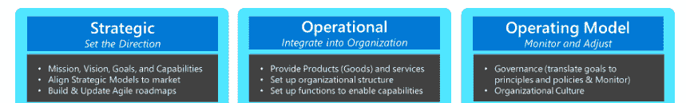

Figure 8.1 – The three pillars of the Zero Trust Playbook

The first pillar (strategic) establishes a strategy and creates a roadmap to deliver on a long-term vision, creating a clear direction for all. The second pillar (operational) is where you execute that plan and integrate it into the daily running of the business, which is producing products and services. The third pillar (operating model) addresses governance and culture to enable and sustain Zero Trust—the people part of it.

This model is designed to be as follows:

- **Consistent but flexible**: This common three-pillar model sets a foundation to balance rigid structure with flexibility, providing clear direction without suffocating the creativity and agility needed for success. The consistent strategy keeps Zero Trust from floundering because people move in different directions (which happens frequently in large or complex organizations). At the same time, the model enables flexibility to apply that strategy differently to existing organizations in different industries, with different cultures and structures.
- **Actionable**: Enabling you to rapidly deliver on clear short-term goals while also constantly moving you toward long-term objectives. In this hyper-competitive agile world, you need to deliver with precision when *performing* against current responsibilities while *transforming* to meet continuously evolving needs. This model weaves strategy into your existing assets, structure, and personnel in a journey that has clear governance guardrails to monitor and keep it on track.

The playbooks use this three-pillar model to drive progress forward in an integrated way while maintaining the visibility and flexibility you need to be agile and adjust your course as you go.

Now, let's take a look at the playbook structure.

## Playbook structure

Now that we understand the model, let's dive into the playbook structure and how it is woven throughout the playbooks. This chapter will take a deeper dive into each of the three pillars (strategic, operational, and operating model) and then summarize how they tie together into a single, coherent, detailed model that is implemented in phases. We will use *Acme* examples for different industries throughout this chapter and the rest of the playbook to show how to apply these in real life in different industries.

## Playbook layout

The playbook series provides a single overarching approach that is then detailed in role-specific guidance. This naturally provides immediate actionable guidance while keeping everyone in the organization focused on working in the same direction. This approach also provides clarity and structure while maintaining flexibility to adapt the playbook to your organization and changing requirements. You can start anywhere and continuously improve on it, but we encourage business leadership to sponsor a larger initiative to improve coordination across teams. While a musical instrument can be used by a musician to play a song solo, music sounds better when played by a full orchestra.

For each element of the playbook, we will cover what it is, why the element is important to include, who will do it, and how to do it.

图 8.2 说明了本书如何包含整个旅程的高层次概述，其中每个手册为每个角色提供更详细的说明：

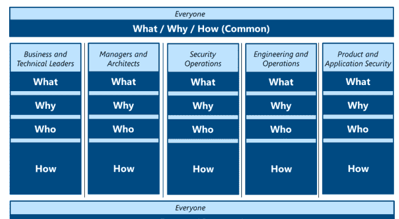

图 8.2 – 手册结构

在手册中，战略支柱为零信任的成功奠定基础，运营支柱在您的组织中执行它，而运营模式支柱则提供治理（护栏）、文化变革和培训以[content]
图 8.2 说明了本书如何包含整个旅程的高层次概述，其中每个手册为每个角色提供更详细的说明：

图 8.2 – 手册结构

在手册中，战略支柱为零信任的成功奠定基础，运营支柱在您的组织中执行它，而运营模式支柱则提供治理（护栏）、文化变革和培训以平滑路径。

值得注意的是，零信任战略支柱和运营模式支柱在不同组织和行业之间往往非常相似。运营支柱是您将零信任根据组织当前的架构、文化和行业要求进行量身定制的地方。

## 介绍 Acme Bank 示例

> “告诉我，我会忘记。教我，我会记住。让我参与，我就会学会。”
> — 本杰明·富兰克林

概念在应用于真实示例时变得更有意义。我们将在本章中使用 Acme Bank 示例来解释三支柱模型在现实世界中如何运作。

Acme Bank 正在进行一项大规模、复杂的数字化转型计划。Acme 正在将新开发和许多现有工作负载迁移到云端，并正在开设三项新的金融服务业务。其中包括引入点对点（P2P）支付，将在欧洲、美国、日本和印度运营。该银行以提供具有成本效益且安全的借贷能力而自豪，重点关注零售银行业务。该组织在多个司法辖区支持这些计划时面临重大的安全和合规挑战。首席信息安全官和董事会决定采用零信任方法，以提供统一的安全战略来管理风险。

## 战略支柱

> “由于没有准备，你就准备失败。”
> 
> — 本杰明·富兰克林

图 8.3 说明了三支柱模型中的战略支柱：

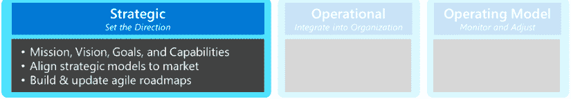

图 8.3 – 战略支柱

- 使命、愿景、目标和能力
- 将战略模型与市场对齐
- 构建并更新敏捷路线图

战略通过定义最终状态（使命和愿景）、实现该最终状态所需的内容（目标、能力和战略模型）以及如何实现（敏捷路线图）来为组织设定方向。

要明确的是，组织不会通过做零信任来赚钱（或实现其使命）。零信任是组织的使能因素，使企业能够通过防止损失和实现业务机会来实现其使命并赚钱。零信任提供关键的安全保障，使组织能够抵御（激烈且不断增长的）安全风险。

由于零信任不是组织的实际使命，因此将零信任工作聚焦并优先用于实现该使命并降低对其的风险至关重要。为此，您需要了解组织的愿景、使命、能力和方向，以便识别零信任如何防止损失并创造机会。

## 如果我们没有书面业务战略怎么办？

请注意，您的组织可能没有以易于消费的格式清晰记录的当前战略（许多组织都没有）。问题“组织的业务能力和方向是什么？”可能在您的组织中尚未被提出、充分回答、写下来或广泛传达（或书面答案可能已过时）。

这没关系，您仍然可以实施零信任。我们将在过程中进行解释，并提供我们在大多数组织中看到的示例，以帮助您开始实施零信任。特别是，您应重点从数字化转型战略开始，因为这是业务战略中最相关的方面（并且更有可能拥有当前文档）。

我们建议您同时努力获得对组织业务战略的更清晰见解，因为这会为您的数字化转型和零信任工作增加清晰度。

## 敏捷路线图

> “计划本身并不重要，但规划是必不可少的。”
> 
> – 温斯顿·丘吉尔

战略中最关键的元素之一是路线图，它概述了如何实现该业务愿景。在当今不断变化的世界中，该路线图必须是敏捷的，以便在您学习时能够进行调整和更改。

图 8.4 说明了此敏捷路线图如何帮助指导您的组织在项目的短期、中期和长期阶段：

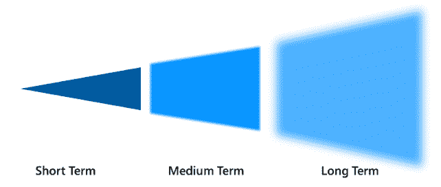

## 什么是敏捷路线图？

敏捷路线图在短期内非常清晰，随着时间的推移变得更加模糊或不确定。敏捷路线图旨在随着不断变化的外部环境而演进（由定期流程和重大的外部事件触发）。让我们更仔细地看看这一点：

- **短期**：要素定义得非常清晰，有很高的信心它们将按计划实现。
- **中期**：要素仍然具体，但以更抽象的方式定义。所有这些在付出努力和满足先决条件后都可以实现，但在如何以及何时实现的具体细节上信心较低。
- **长期**：要素以更具愿景的方式定义，细节和信心水平要低得多。

您如何定义短期、中期和长期的具体要求可能会因组织的文化、行业和其他因素而异（例如，在最近的安全事件后需要迅速采取行动的紧迫性）。为了帮助您思考，短期目标通常以月为单位衡量（不超过 6 个月），长期目标通常不超过 3 年（且不少于 1 年）。

战略（以及路线图）应预期会根据不断变化的条件进行调整。当目标和优先事项发生变化时，我们需要能够适应这种变化。通常，这只是重新确定优先顺序，决定什么先做或后做，但有时涉及对路线图的新的补充或完全移除某项内容（例如，组织搁置了一个项目，因此我们不再需要保护“xyz”技术能力）。为了应对这种常规变化，您需要设定期望并建立一个流程来处理预期和意外的路线图更新。

*最重要的是，敏捷路线图仍然是一个路线图，有愿景和目标。它只是更频繁地适应不断变化的条件。*

## 微软 – 云世界中敏捷路线图规划的一个示例

您可以从中汲取灵感的一个敏捷路线图规划示例是微软的“学期”规划系统。微软使用这种方法以 6 个月为间隔来构建敏捷开发规划。

微软各地的开发团队使用此流程来协调规划。每个团队每 6 个月进行一次单独的学期规划练习，以确定优先事项并确定哪些工作可以在下一个学期完成，哪些工作将推迟到以后的学期。此外，来自所有团队的领导者会进行联合规划练习，以协调联合项目和团队间依赖关系，确保每个人都能按预期一致交付。这些计划在 6 个月期间内会由开发团队定期重新审视，以根据变化进行调整（通常根据客户反馈或竞争格局的变化重新确定现有任务的优先顺序）。

学期规划流程本身也会根据从以前学期学到的经验定期进行优化和调整。6 个月对某些行业来说可能太快或太慢，但这个现实世界的例子有助于让您了解，并且恢复），和治理。

- **尽早集成安全**：让安全团队与正在以 DevOps/DevSecOps 方式开发新资产的应用团队紧密配合。这可确保新业务能力在发布时符合当前安全标准（并且随着这些流程的每次迭代而稳步改进）。这有时被称为*向左移*——指的是将安全更早地集成到时间线中。

现在我们了解了零信任背景下敏捷路线图是什么样的，让我们看看战略流程如何使构建此路线图成为可能。

## 构建零信任战略

*图 8.5* 中的此流程显示了如何构建*零信任战略*，该战略以业务战略为依据并与其保持一致：

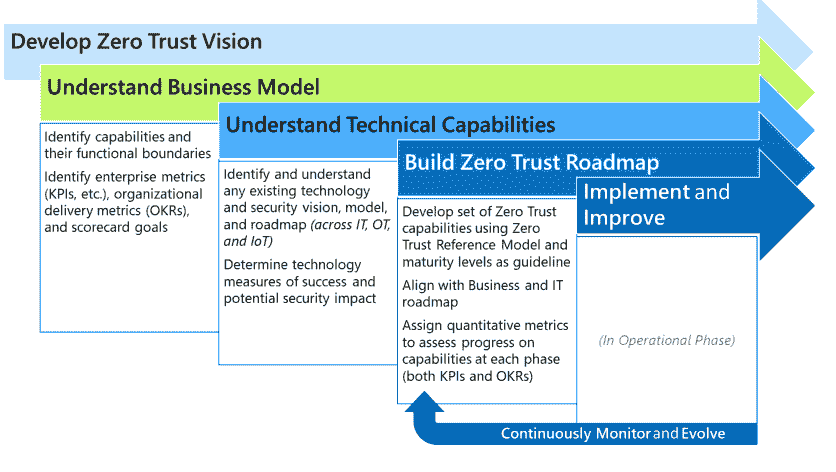

图 8.5 – 开发零信任战略

构建战略支柱的过程如下：

- 1. **制定零信任愿景**：与组织的愿景、使命和可量化目标保持一致。这有助于您创建专注且可衡量的零信任战略。
- 2. **了解业务能力**：识别您的业务能力及其功能边界（如果尚未定义），并将其映射到您的零信任能力。如 *图 8.6* 所描述，零信任能力以业务能力为依据并与其相连。*安全和业务团队*中的利益相关者都需要了解这些能力及其相互关系。

- 3. **理解技术能力**：识别你的技术能力及其功能边界，然后将其映射到你的零信任能力。如 *图 8.6* 所描述，零信任能力受技术能力影响并与其相连。你需要确保 *安全和技术团队两者* 的利益相关者都理解这些能力及其相互关系。

- 如果你已有现有的企业级高层技术能力地图，那么将这些能力映射到该地图上至关重要。

- 4. **制定零信任路线图**：此分阶段路线图按优先级顺序规划了需要遵循的旅程。有关详细信息请参见 *第 9 章，零信任六阶段计划*。

- 5. **实施并改进**：随着路线图的实施（*在随后的运营阶段*），你不可避免地会了解到技术、业务和威胁环境的变化，这些变化要求你重新确定项目的优先级，或在路线图上增加、更改或删除项目。

## 关于能力的一点快速提醒

这是对我们之前介绍的一个关键概念和术语的快速提醒。为了提供商品或服务，组织必须具备 *能力*——例如能够为产品定价、交付产品或服务、评估网络安全风险、检测网络安全攻击或从网络安全攻击中恢复。

定义能力使我们能够将组织 *做什么* 与 *如何做* 抽象开来（后者会随时间变化并在组织之间有所不同）。这使我们能够在一段时间内持续地管理和改进结果。

总结一下，战略阶段汇集了所有业务和技术背景，以提供零信任能力的信息（这些能力也连接并统一了这些能力）。战略流程设定了方向并为组织成功奠定基础，如 *图 8.6* 所示：

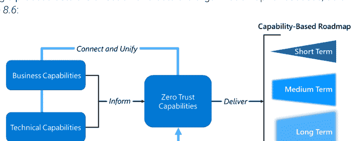

图 8.6 – 战略模型

**业务能力** 和 **技术能力** *提供信息* 给组织的零信任能力。这些 **零信任能力** 通过 **能力驱动的路线图** 在 **短期、中期和长期** 内 *交付*。

*要明确的是，零信任很大程度上始于你已有的东西，并在其基础上构建以满足当今的需求。*

在我们交付这些能力的同时，它们会以敏捷的方式持续衡量、监控和改进。这确保了我们纳入当前最重要的优先事项和背景，而不是严格坚持昨天制定的计划——当时我们了解较少，且基于经常发生变化的优先事项。这种方法使零信任安全能够保持敏捷和适应性，并与不断发展的业务、技术、安全和零信任能力保持一致。

## 衡量你在执行的同时转型的效果如何

你应该衡量组织 *快速适应新环境* 的能力以及 *在继续运营当前业务的同时执行转型的效果如何*。

我们将在手册的多个部分中稍后介绍如何使用记分卡和其他指标来衡量成功。

## Acme 示例 – 战略支柱

我们将使用 Acme Bank 的示例来展示战略支柱是如何整合在一起的。*Acme Bank 的工作流程在图 8.7 中描述：*

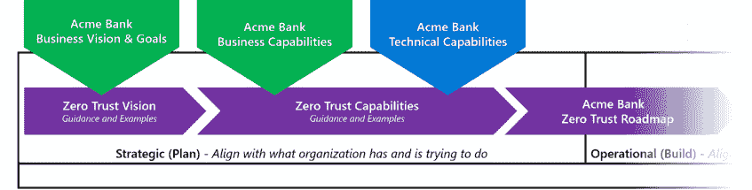

图 8.7 – Acme Bank 的战略支柱

首先，Acme 基于其业务愿景制定了 **零信任愿景声明**：

*零信任将使 Acme Bank 成为一家安全的全球零售银行服务提供商。*

然后，Acme 制定了 **零信任使命声明**，以将该愿景应用于 Acme 的使命：

*Acme Bank 的零信任将实现“终身客户”模式，客户可以在任何地方安全地进行银行业务，同时也允许员工在任何地方安全地工作以支持这些客户需求。*

Acme 然后设定了具有明确 **目标和关键结果 (OKR)** 的雄心勃勃的业务目标，以形成其 *数字化企业路线图* 计划。

业务目标如下：

- **目标**：从任何地方实现现代端到端体验：
  - **目标**：启动 *随时随地安全工作* 计划，长期目标是永久支持灵活的混合办公：
    - **关键结果**：在 3 个月内，80% 的所有员工将在美国和欧洲司法辖区内能够随时随地工作，并在 6 个月内实现全球范围。
    - **关键结果**：员工、合作伙伴、供应商之间的 99% 的身份验证以及关系转换将使用强身份验证。
  - **目标**：启动 *随时随地银行* 计划，以支持强大的敏捷全球品牌能力：
    - **关键结果**：在 12-18 个月内，70% 的所有客户可以使用任何渠道进行银行业务。
- **目标**：鉴于波动性、风险增加和成本，实现可持续增长：
  - **目标**：实现全球提供 *P2P* 金融服务的能力：
    - **关键结果**：所有美国和欧洲系统中有 80% 将能够支持自适应身份验证以支持全球市场。
    - **关键结果**：关键的 **受保护健康信息 (PHI)**、**个人身份信息 (PII)** 或 **个人身份财务信息 (PIFI)** 数据中有 90% 将在 1 年内支持数据令牌化。
- **目标**：投资基础设施和支持系统以实现并维持这一变革：
  - **目标**：提供全球混合多云环境：
    - **关键结果**：在 2 年内将所有核心运营迁移到全球混合多云模式，其中 80% 的应用程序托管在云平台上。
- **目标**：发展 **持续学习 (CL)** 文化以应对持续变化：
  - **目标**：以可持续的方式培养支持持续变化所需的技能，建立知识保留和无摩擦运营：
    - **关键结果**：在 6 个月内启动技能提升计划，该计划基于继续专业教育学分支持所有角色的增量学习。
  - **目标**：发展一个强调安全和快速变化的敏捷企业价值观体系：
    - **关键结果**：在 6 个月内制定流程、教育、治理和沟通，以教育、推广和传达组织价值观体系。
    - **关键结果**：在 6 个月内在所有业务职能中建立 *假设已遭入侵、明确验证* 和 *最小权限* 的安全文化。

*Acme* 确定了支持这些目标所需的关键 **业务能力**，包括存款、风险管理、欺诈、支付和汇款、银行卡和无担保贷款。

*Acme* 还确定了支持这些目标所需的关键 **技术能力**，包括构建在混合多云平台上运行的微服务支持架构。

基于该业务和技术背景，*Acme* 然后根据零信任参考模型设计了支持这些业务目标所需的关键 **零信任能力**。这些包括以下内容：

- **自适应访问控制** 以在多个司法辖区（及其不断变化的合规需求）中提供集中、一致且基于策略的身份验证和授权
- **以数据为中心的安全保护** 以确保 **客户数据** 和 **知识产权 (IP)** 在技术环境中得到一致保护
- **安全区域** 以提供保护的简洁性和一致性，以满足安全目标和合规要求

*Acme* 制定了分阶段的 **零信任路线图**，以在 2 年内建立这些能力。这一 *安全数字化企业路线图* 计划基于本手册并根据 *Acme* 的业务目标、OKR 和能力进行定制。

该路线图帮助 *Acme* 决定何时以及如何启用每个能力，将其与业务和技术能力联系起来，并帮助公司了解人员和流程将如何与运营和运营模式联系起来。路线图包含与关键业务、技术和零信任目标、指标和具体计划相关的具体行动。

Acme 计划每 3-6 个月重新审视本路线图中的优先级，以确保其仍与自身需求保持一致（竞争、技术、威胁态势等）。

## 运行支柱

运行支柱专注于在当前环境中将战略付诸执行的落地。此支柱关注如何将零信任整合到日常运营、组织结构、业务职能和业务流程中：

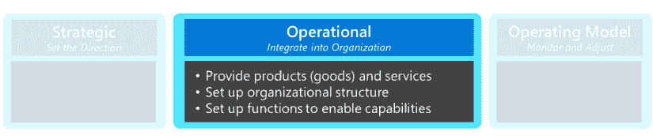

图 8.8 – 运行支柱

大多数组织并非从零开始定义一切的初创公司；它们是在运营一家成功的企业，承担日常责任（通常包括上市公司每季度报告业绩）。

*组织不能为了实施零信任而停止生产；它们必须在转型过程中保持日常运营和绩效。* 组织必须在同时向零信任（和数字化转型）战略中的新方法过渡的同时，继续生产产品和服务。例如，运输组织必须在更新车队的同时每天运营车队。

这种双重要求意味着你必须了解组织如何提供商品和服务，以便在更新流程和技术时保持其正常运行。组织结构是怎样的？用于运营业务的业务流程是什么？每天提供这些服务（业务职能）的团队、部门、分支机构和职能单元是什么？

## 安全运营集成

零信任影响运营环境中的多个方面。运营学科也能以不同方式从零信任方法中受益。

## 庞大的技术资产

数字技术资产不断面临失控蔓延的风险，技术团队不断管理这种动态。数字世界使得以惊人的规模和速度复制和更改任何数字资产变得容易（文件、图片等），这既带来了快速业务增长的潜力，也带来了问题的快速增长。

虽然数字资源本身易于复制，但人力和财务资源并不会如此快速或容易地扩展。从经典模型转向零信任有助于组织获得对这一庞大资产的可见性和控制力，从而防止资产被敌对势力窃取或滥用。

安全团队中通常存在的两个运营学科是**安全运营**（**SecOps**）和态势管理。让我们更详细地了解它们：

- **SecOps**：该安全团队执行快速攻击检测、响应和恢复（有效地相当于安全领域的消防组织）。这通过减少攻击者访问业务资产的时间来降低组织风险，限制其造成损害的能力。

零信任的一个关键假设是攻击者能够并且会可靠地渗透网络边界。这一假设为成熟的安全运营方法管理这一新现实创造了若干具体要求。这并不意味着其中一些可能尚未在你的组织中采用，以应对不断变化的威胁、技术平台和组织流程。

*零信任对安全运营的影响包括：*

- **起源和构成**：安全运营团队（又称 SecOps 或 SOC）通常是组织中为处理警报和活跃事件而创建的首批安全专业之一。根据团队规模和成熟度，SecOps 还可能包括主动威胁狩猎（查找逃过检测的攻击）、**事件管理**（**IM**，管理重大攻击的非技术方面）以及**威胁情报**（**TI**）。
- **安全技术的演进**：在零信任方法中假设存在入侵，要求 SecOps 超越传统网络技能和工具，扩展到其他技术（身份、终端、应用程序、数据等）。这种可见性的扩展是管理企业网络内部资产的攻击以及网络边界外部的攻击（云服务、移动设备等）所必需的。

一些组织已经开始多样化数据源和技能的过程，这使它们在零信任方面领先一步。在损害扩散之前快速可靠地遏制对任何业务资产的攻击，需要完全采用 *第 4 章，标准零信任能力* 中描述的零信任能力，以及安全运营角色的 playbook 中所述的内容。

- **与其他运营团队的集成**：在零信任方法中假设存在入侵，还要求 SecOps 与其他运营团队集成，以在关键业务利益相关者（法律、通信、人力资源等）和技术资产（IT 运营、DevOps 和 **运营技术 (OT)** 运营团队）方面提供有效覆盖。一些组织已开始这一进程，以应对技术资产、技术发布节奏和威胁态势的变化——零信任拥抱并在此基础上构建你已有的跨团队集成。
- **指标成熟度**：零信任还要求安全运营成功指标与限制攻击者访问技术资产的时间（例如驻留时间）这一业务成果保持一致，通常以事件后的 **平均修复时间 (MTTR)** 来衡量。

采用成熟风险管理方法的组织可能已经采用了类似的成功指标，这使它们在零信任方面领先一步。额外的成功指标在安全运营角色的 playbook 中进行了讨论。

- **TI**：零信任要求 SecOps 建立或完善 TI 能力，以向公司各利益相关者通报当前的安全威胁和见解。该功能是必需的，以确保业务领导者、技术领导者、架构师和从业人员了解当前的主要威胁，以便他们能够做出与其角色相适应的明智决策。

一些组织可能已经开始建立 TI 能力以捕获和分享他们所学到的知识，而另一些组织可能已将该能力成熟化以提供战略见解（而不仅仅是战术技术信息）。这些将使组织在安全运营的零信任方面领先一步，更多内容在安全运营角色的 playbook 中讨论。

- **安全态势管理**：这个（新的）安全团队是治理的主动运营职能，主动监控潜在风险。该职能通过发现环境中攻击者可用来获取业务资产并造成损害的虚拟“漏洞”来降低风险。他们与资产保护团队密切合作以堵住这些漏洞。

*零信任对态势管理的影响包括以下内容：*

- **起源和构成**：态势管理团队是新的，通常作为零信任战略的一部分而创建。该职能将之前分离的安全职能融合在一起，包括漏洞管理和合规审计。该职能通常是在出现允许 **持续监控 (CM)** 潜在风险（可被攻击者利用）的新工具后而创建的。这种长期期望的能力直到云工具出现后才变得切实可行，这些工具可在技术资产的大部分范围内提供按需洞察。

## 密切合作

SecOps 和态势管理团队是密切相关的职能，各自不同但必须密切协作和沟通。这些职能管理同一风险的两个不同方面——态势管理处理潜在风险和运营的预防方面，而 SecOps（或 SOC）团队专注于对已实现风险的快速响应。

这类似于消防员（SecOps/SOC）与消防检查员（态势管理）之间的关系。

安全责任也成为正常技术运营责任的组成部分，包括以下内容：

*零信任对资产保护的影响包括以下内容：*

- **安全资产保护**：这是 IT 和 **业务单元 (BUs)** 中管理技术资产（IT、OT、IoT 和 DevOps）在其整个生命周期（部署、正常运行、维护、支持等）中的团队的责任。*零信任战略的资产为中心特性要求在资产生命周期的任何地方保护资产，这通常需要进行更改。*
- **将安全与日常运营集成**：IT 和业务单元中的这些团队需要在其流程中集成安全实践和团队。这有助于防止安全事件，快速遏制活跃攻击的风险，并迅速恢复正常业务运营。这涉及更新指标、流程和工具，以确保这些团队能够成功地将安全集成到其使命中。
- **优先考虑安全维护**：零信任战略假设攻击者能够并且会获得组织网络的访问权限，要求每个资产都得到保护（而不是依赖“攻击者不会进入网络”这一错误的假设）。这就要求优先可靠地执行所有资产在其生命周期内的基本安全卫生要素。基本安全卫生包括措施，例如快速安装安全更新/补丁以及为新旧资产应用推荐的安全配置。如果这些安全任务优先级较低，组织将经历更多安全事件，并且每次事件造成的损害更大。
- **将安全集成到基础设施自动化中**：安全任务应集成到自动化流程中，例如 **基础设施即代码 (IaC)**。组织越来越多地采用这些方法来管理技术资产不断增加更多资产和资产类型的成本和复杂性。尽早集成安全和合规工具有助于防止安全问题以及后期改造带来的额外成本/复杂性。

- **DevOps 演进为 DevSecOps**：在创建和更新应用程序的 DevOps 流程中加入安全要素，就形成了 DevSecOps。DevSecOps 降低了成本和安全阻力，因为更多安全问题在流程早期就被发现并修复，而此时修复成本低、难度小（通常称为 *左移*）。这要求创建和拥有资产的团队在开发流程早期就整合安全实践。DevSecOps 有助于缓解供应链安全风险，例如 2020 年影响 SolarWinds 的风险。

## 什么是 DevOps 和 DevSecOps？

经典的 IT 模式将软件 **开发** 和 IT 运营（**运营**）分设为不同的团队。许多组织正在迈向采用现代 DevOps 方法，将两者融合为单一的组织职能。加入 **安全** 就形成了 **DevSecOps**。

*集成是运营成功的关键——孤岛式的运营方法行不通。在后续章节中，我们将深入探讨运营依赖关系，涉及哪些角色，以及每个角色为实现集成所做的工作。*

## “安全管理”在哪里？

术语 *安全管理*（或信息安全管理）有时用于描述多个与 **IT 服务管理**（**ITSM**）关系密切的运营和运营模型学科。我们选择将安全管理拆分为其核心能力，以提高清晰度和可操作性。

Zero Trust 通过以下方式解决安全管理：

- **安全治理** 与运营团队合作制定安全策略和标准。该学科还支持针对外部要求和内部政策与标准合规报告活动，包括安全架构，并承担着向利益相关者汇总和分发战略威胁情报（安全威胁的高层级摘要）的新兴责任。
- **系统资产保护** 将安全策略和标准应用于系统资产。这通常由运营和管理资产的 IT、DevOps 和业务线团队执行。
- **态势管理** 确保政策得到执行并使资产保护团队取得成功。这些团队监控仪表板并与各团队协作，帮助他们执行政策、识别满足政策的挑战，并向治理团队提供反馈。反馈可能包括不合规趋势的背景信息、改进政策的建议、工具或教育方面的差距识别等。

现在我们了解了 Zero Trust 的运营支柱，让我们看看如何将其在您的组织和行业中落地。

## 定制是运营支柱的关键

虽然 Zero Trust 策略在不同组织之间可能相似，但运营支柱必须根据您的组织进行调整。我们需要了解组织及其运作方式，以便成功集成 Zero Trust。我们需要了解独特的产品、业务流程、业务职能和组织结构。

我们需要了解参与人员以及他们支持的业务职能。以下是不同运营模式的一些示例：

- 一家 **医疗支付方**（保险公司）与患者、提供者（医生和护士）等合作，提供理赔处理和提供者资质认证等业务职能。
- 一家 **制造商** 与分销商、零部件供应商和原材料供应商合作，然后提供零部件、成品或设备的设计和装配。制造商依赖于 OT，例如 **工业控制系统（ICSs）** 来控制物理过程。
- 一家 **金融机构** 在提供贷款、投资服务、咨询服务等方面与个人消费者、企业客户和政府监管机构合作。

我们在整个系列中包含了许多 *Acme* 示例，以帮助您将 Zero Trust 定制到您的组织。

## 关于业务职能和业务流程

作为参考，**业务职能** 是业务的主要组成部分，例如 *生产*、*理赔处理（以保险公司为例）* 或 *销售*。这些职能也可以根据需要进一步细分，例如将销售拆分为 *企业销售* 和 *中小企业销售*。每个业务职能通常与一个或多个 **组织单元（OUs）** 和一组 **业务流程** 相关联。

例如，*销售* 可能具有 *潜在客户开发* 和 *成交* 等业务流程。业务流程也可以跨越业务职能和组织边界以提供业务服务（提供客户反馈、更新价格等）。*图 8.9* 说明了业务流程如何跨越多个业务职能：

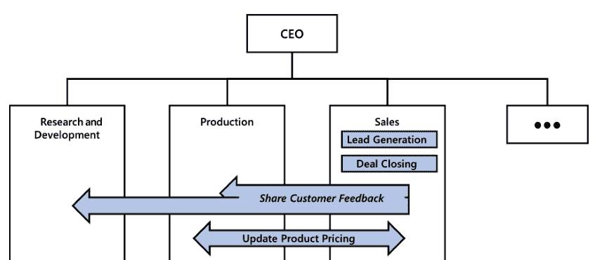

图 8.9 – 业务职能和业务流程

现在让我们看看如何构建运营支柱。

## 构建运营支柱的过程

> “没有战略，执行就是盲目的。没有执行，战略就是无用的。”
> 
> – Morris Chang

此流程展示了如何将您的 Zero Trust 策略集成到现有的运营环境中：

- 1. **确定您的产品模型**，以将 Zero Trust 路线图与组织生产的产品（商品和/或服务）及其生产方式保持一致。
- 2. **确定业务职能**，包括组织结构、**标准作业程序（SOPs）** 和总体业务流程。业务职能有时也被称为部门、事业部、单元或团队。虽然 Zero Trust 不会改变这些内容，但它可能会影响组织结构，并可能修改业务流程。
- 3. **确定** 跨越组织结构和业务职能运行的 **业务流程**，以实现商品和服务的生产。Zero Trust 需要对业务流程进行高层级理解，因为在数字化转型期间（有时多次）它们可能会被更改、修改、创建或自动化。

## 注

> 这里 **数据和资产中心化** *显著提升组织的敏捷性和生产力*。将业务资产视为一个包含敏感数据的文件，该文件无论去向何处都受到保护（而不是依赖访问它的每个系统的安全性）。不必每次流程变更时都重新审视触及该文件每个系统的安全性，数据文件始终保持安全。Zero Trust 限制了为保持安全所需的工作量以及将流程适应新要求所产生的摩擦，使团队能够更快地工作，在付出更少努力（和成本）的情况下更安全。这导致业务敏捷性提高和业务生产力改善，使团队能够朝着共同目标协同工作，而不是相互对抗。

- 4. **开发 Zero Trust 服务和组件**：Zero Trust 引入了新的服务和组件，它们将与环境中现有的技术服务和组件交互。在我们开发 Zero Trust 解决方案架构时，我们定义了一组核心 Zero Trust 服务以及实现这些服务所需的组件，然后在整个技术体系中使用这些服务和组件来支持业务流程。

以下是一些示例：

- **资产中心架构** 确保所有业务资产都有身份，以便进行简单灵活的安全决策。这提供了简洁性和清晰度，既加速业务敏捷性，又降低组织风险。资产中心架构为 *所有* 业务资产建立身份、分类和/或标签，包括在其生命周期中持续存在的应用程序、数据、用户、设备等。这允许轻松编写和维护能够跟上业务速度（角色变化、资产敏感性、业务合作伙伴关系、供应商关系等）的策略。
- **自适应访问控制** 使组织能够应对与数字生态系统中的合作伙伴和其他实体关系的持续演变，以及所涉及实体的数量。它通过使用基于策略的模型并借助人工智能等现代技术以自动化方式动态管理变更来实现（包括业务模式、技术以及安全威胁/监管变化）。最后，它允许人员和设备的自动化自助服务和自助注册。
- **通过权利管理实现数据中心化**：使组织能够在其整个生命周期中保护现有敏感文档。这降低了数据泄露的风险（因为敏感文档始终受到保护），并降低了这样做的成本和工作量（因为您不必在不同系统中使用数十种不同方式来保护它们）。

- **通过令牌化服务实现数据中心化支持**：这些服务减少了组织需要保护的敏感数据副本数量。建立令牌化服务允许通过用对单一受良好保护的敏感数据主副本的引用替换多个敏感数据副本来降低风险地共享数据。这也通过依赖关系减少赋能了处理敏捷交付的业务、技术和安全团队（团队不必等待其他团队更新其加密组件或防火墙等等），并成为无摩擦演进的巨大推动者。随着团队处理不同的场景——**软件即服务 (SaaS)** 提供商、新合作伙伴和客户、进入新的业务领域，或远程工作和不断变化的组织结构等场景——这成为竞争优势的来源，降低成本和风险并提高敏捷性。
- **端点和应用威胁检测**：组织通常会开发组件和服务，使安全分析师能够检测并清理计算机操作系统（即端点）和应用程序上的感染。随着越来越多的团队开发网站和移动应用程序以实现数字体验，这些开发团队应使用通用的 Zero Trust 组件，以便他们不必自行构建组件（或在没有这种基本安全保护的情况下运行）。
- **隐私设计计划**：组织经常会制定计划来管理隐私，以应对不断涌现的隐私法规，例如欧盟的**《通用数据保护条例 (GDPR)》**、**《加州消费者隐私法案 (CCPA)》**，或巴西的**《Lei Geral de Proteção de Dados (LGPD)》**。

这些运营支柱要素中的每一个在手册后面都有更详细的描述。

## Acme 示例 – 运营支柱

Acme 现在正转向将路线图付诸运营，并专注于使其 *可操作* 以抓住快速成果并实现持续的增量进展。这需要了解业务的运营模式并将 Zero Trust 映射到其上。*图 8.10* 说明了 *Acme Bank* 的运营支柱：

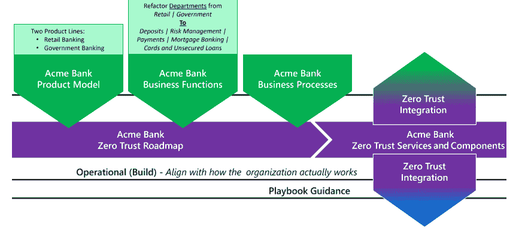

### 图 8.10 – Acme Bank 的运营支柱

**就其产品模型而言**，Acme 的产品（商品和服务）是零售和政府银行业务。

目前，Acme 为支持该产品模型而设立的 **业务职能** 组织在零售银行和政府银行之下，但 Acme 发现这种每个能力的重复会减缓敏捷性。作为其路线图的一部分，Acme 正在根据其业务能力——存款、风险管理、支付、抵押贷款银行、信用卡和无担保贷款——重新组织所有部门，每个部门通过子能力在适当的情况下同时支持零售和政府市场。

Acme 的 Zero Trust 计划是该路线图的安全部分，并重点关注以下内容的早期优先排序：

- **资产中心架构** 以简化 Acme 在众多单个资产上应用策略的能力，为自适应访问控制奠定基础
- **自适应访问控制** 能力，以确保在常规和预期的流程变化期间对资产进行强访问控制
- **数据中心化** 以简化安全共享数据并在业务流程频繁演进期间减少摩擦
- 集中的 **隐私设计** 能力以允许轻松进入和访问新司法辖区

## Zero Trust 集成改变 Acme 的业务流程：

- **资产中心架构** 为 *Acme* 业务领导者创造了责任，即识别其最有价值资产的业务所有者以确定风险和访问策略。这确保了这些资产的风险被那些了解这些业务资产影响的人所理解并得到良好管理，而不是依赖安全团队在没有上下文的情况下平等地保护所有资产。

*Acme* 预计这将减少常见攻击（如勒索软件或 **拒绝服务 (DoS)**）造成的损害和业务影响的“爆炸半径”。这是因为 *Acme* 的基于策略的访问将减少可能不必要地相互通信并受影响的资产数量（类似于减少人际接触限制疾病传播的方式）。与自适应访问控制相结合，这也将使 *Acme* 能够灵活应对不断发展的数字生态系统。

- **数据中心化** 加快了 *Acme* 的信用卡/借记卡身份验证合作伙伴入职流程，因为 *Acme* 不再需要共享敏感数据的完整副本来入职合作伙伴。它还显著降低了组织的风险状况，并使合规变得简单易实施，因为包含敏感数据的流程数量减少了。

- **自适应访问控制**：*Acme* 将在资产中心架构的基础上，通过实施现代基于策略的访问控制来提供灵活性以及不会中断用户和干扰业务流程的强安全性。

基于策略的执行提供了跟上业务关系流动演变的敏捷性——在数字世界中今天的合作伙伴明天可能是子公司，随后不久可能成为竞争对手或客户。

自适应访问控制还集成了静默安全机制，例如 TI 和 **行为分析 (BA)**，以捕获异常，例如已知不良位置、偏离正常用户行为模式的偏差以及使用不合规或受感染设备的连接。此外，*Acme* 正在采用强身份验证，提供强（通常为 **无密码**）登录方式，这些登录方式更易于使用且更安全。

*Acme* 专注于 *可重用* 的 **Zero Trust 服务和组件**，这些服务和组件可为多个业务流程和职能启用这些能力。*Acme* 优先创建自适应访问控制架构、数据分类方案、令牌架构和令牌服务、隐私设计服务以及资产中心架构。

在采购和构建这些组件和能力时，*Acme Bank* 将使其与不同的业务职能保持一致，以便业务流程变化和组织结构影响是无缝的。*Acme* 还将把其当前的技术资产和安全策略与行业标准（如 **SOA 参考架构 (SOA RA)** 标准和 Zero Trust 参考模型）进行映射。这使 *Acme* 能够利用现有基础设施和行业标准来了解应采购（或构建）什么、它如何融入当前技术资产以及它如何影响业务。

这种方法确保 Acme 的 Zero Trust 计划具有可操作性并产生预期和承诺的结果，确保路线图在持续变化的世界中使 Acme Bank 能够实现并得到保障。

## Acme Bank 的思维转变

Acme 认识到这是一次重大的思维转变。

Acme 的当前模型类似于通过保护其房屋（例如网络）并限制其永远不离开来保护国家领导人及其数据。

Acme 正专注于将思维转变为 Zero Trust 方法，即将安全附加到个人及其数据，无论他们身在何处、去往何处。这使 Acme 能够在任何地方安全地开展业务。

## 运营模型支柱

> > "坏公司被危机摧毁，好公司挺过它们，伟大公司因它们而变得更好。"
> > 
> > — Andy Grove

你必须在行进中不断驾驶汽车，无论你计划得有多好。运营模型要素在行进中监控和调整战略和执行，保持其一致并按计划进行，如图 8.11 所示：

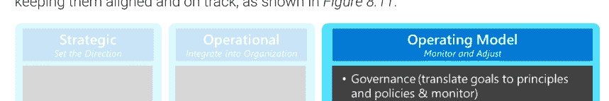

图 8.11 – 运营模型支柱

运营模型支柱反映并管理组织运营的方式。Zero Trust 是一项企业级计划，需要与组织的业务运营模型集成并协调一致才能成功。

这始于认知——组织是作为单一的整体组织运营？还是多个独立的子公司？还是介于两者之间？

如此重大的变革也需要认识到它影响的不仅仅是字面上的业务和技术能力；人们也会发生变化。人们做出决策并开展工作，他们遵循的流程将使业务持续进行，而组织文化将在人们面临新情况或困难情况时指导决策。

The operating model elements of Zero Trust effectively provide the glue that holds Zero Trust together. These include the following:

- **Business operating models** control organizational focus and rhythms. These models determine funding, metrics, and support from senior leaders and mid-level management. Zero Trust initiatives don’t often change the operating model but must discover it, understand it, and align it with how the organization actually works.

You don’t want to allow autonomy if the organization is one single entity (as that will fracture the strategy and execution). You also don’t want to waste effort trying to impose control across autonomous BUs (which can and will choose to ignore you when they want, regardless of how hard you try).

- **Governance** lays out the guardrails to keep people on track, enabling them to work together seamlessly. Governance determines decision rights (who makes which decisions) and lays out process frameworks to connect teams and guide how they work and interact with each other. The governance process frameworks operate at strategic, team, and practitioner levels in the organization.

*Figure 8.12 shows how these governance process frameworks tie together:*

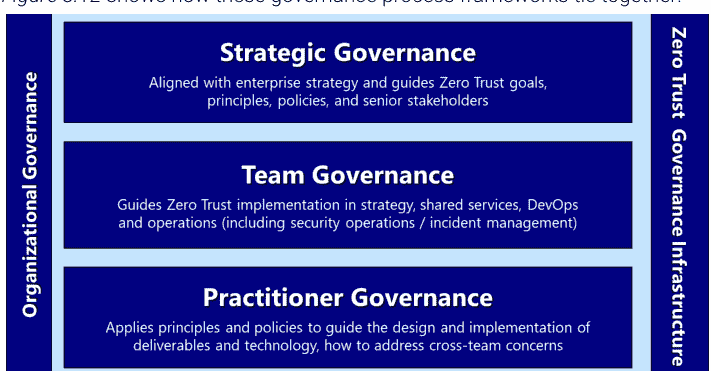

**Figure 8.12 – Different parts of a Zero Trust governance process framework**

- **Cultural norms** create a CL organization by establishing learning processes and instilling values into the organizational culture. You must ensure that your organization’s cultural framework establishes and reinforces a shared value of CL. A CL culture is critical to agility as it enables people to acquire the right skill sets as they go while executing efficiently.

*Without a culture that reinforces the importance of a value, policies and rules will always fall by the wayside and fail.*

Because of the disruptive nature of Zero Trust and digital transformation, we must ensure people have clarity on this new (and potentially unfamiliar) cultural norm. Reinforce the message and signal its importance by delivering and modeling it consistently on all channels—in processes, metrics, the wording you choose in team meetings, and so on.

The following diagram describes the points in the business operating model where you integrate measures such as governance to sustain Zero Trust:

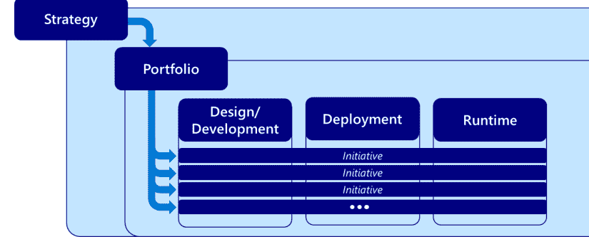

Figure 8.13 – Zero Trust operating model process

Strategy influences the whole organization, the portfolio applies to all initiatives, and then each initiative includes a design/development, deployment, and runtime (ongoing operations) phase.

Let's look at an Acme example to illustrate how to apply these Zero Trust operating model elements in the real world.

## Acme example – operating model pillar

How does Acme Bank weave in Zero Trust and become a CL organization across the whole enterprise? Figure 8.14 illustrates the operating model pillar at Acme Bank:

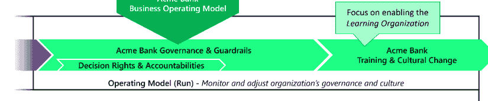

Figure 8.14 – Acme Bank's operating model pillar

First, the leadership assessed the current **business operating model** and determined that they currently have a *unified model* enterprise with a single unified enterprise approach across all business lines in the organization.

The unified model means that all stakeholders (including the IT and business organizations) must undertake a common journey and work together as a single organization. This also influences all technology decisions (such as component reuse, infrastructure purchases, and so on).

A key enabler and success criterion for an enterprise Zero Trust initiative is the development of a framework for **governance and guardrails**. (Note that some organizational cultures favor the use of the term *guardrails* instead of *governance* to signal a proactive empowerment approach to oversight.) Governance and guardrails permeate people, processes, and technology—laying the foundation for people to work together, for risk to be managed, and for changes to be well understood.

*Acme* started its Zero Trust governance framework by capturing **decision rights and accountabilities**—which is effectively a modern agile approach to what was once handled by a **Responsible/Accountable/Consulted/Informed (RACI)** framework. *Acme* started with existing business decision makers in control of business assets, functions, and business processes, then added Zero Trust-specific decision owners.

The governance framework also includes the organizational structure for Zero Trust and guardrails for the following:

- *Strategic process model* covering strategic processes (such as developing and maintaining the roadmap)
- *Operational processes* for things that are in use (including IT operations and security operations)
- *Development processes* to ensure the reuse of Zero Trust components

Concurrently, *Acme* is moving toward establishing a CL organization through **training and cultural change**. *Acme* decided to build on its existing training infrastructure but pivoted to preferring **Massive Open Online Courses (MOOCs)** and favoring **just-in-time (JIT)** training over prescheduled courses when possible. *Acme* also focused on gamification and rewarding continuing professional education rather than static qualification and certification approaches. *Acme* also defined, funded, and staffed an internal **communication plan** that detailed communication vehicles (webinars, podcasts, and so on) and ensured Zero Trust communications are done on a recurrent, consistent basis.

*Acme's* leaders also hold themselves accountable for CL using those same courses, and *Acme Bank* executives are encouraged to publicly discuss their own mistakes and learnings during this transformation to give "social permission" for everyone in the organization to do the same.

Finally, Acme is extending the organizational core values to include a **Zero Trust value system** that integrates concepts such as *least privilege*, *assume compromise*, and *verify explicitly* into the organizational thinking, language, and metrics, such as performance reviews.

In summary, the operating model keeps Acme's Zero Trust strategy and execution (operations) on track. This is done by integrating Zero Trust into the business operating model and governance mechanisms and by reinforcing a culture of CL.

## Stitching it all together with the Zero Trust Playbook

Now that we have all three pillars of the model, we can put them together and move forward on making it real at scale. We now implement *sustainable and effective* Zero Trust capabilities that all fit together in an actionable, living, breathing strategy—the Zero Trust Playbook.

We will next look at the overall system of three interconnected pillars and their individual components. We will introduce the six-stage plan in Chapter 9, The Zero Trust Six-Stage Plan, and then proceed to build it throughout the rest of the playbook.

Figure 8.15 describes each playbook component and how they all flow together, much like a blueprint describes all aspects of a building's architecture:

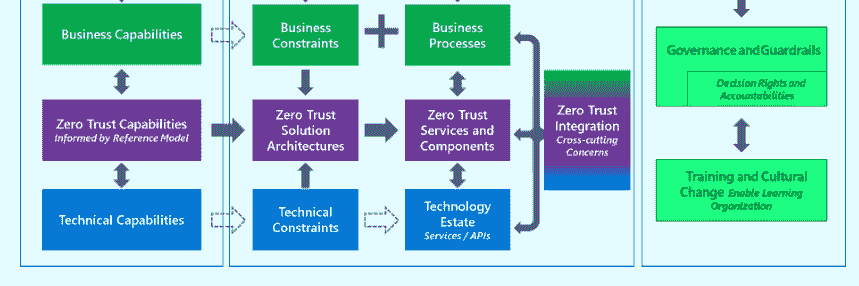

Figure 8.15 – Zero Trust Playbook overall components and relationships

This diagram explains the relationships in the overall system:

- Each of the dark green boxes at the top of the pillars represents an existing business element of the organization, the *business strategy*, *business operations*, and *business operating model*.
- In the **strategic** pillar, *business capabilities* and *technical capabilities* align with and support the *business strategy*. The *Zero Trust capabilities* you define (starting with The Open Group Zero Trust Reference Model) provide modern digital era security to *business capabilities* and *technical capabilities*, linking them together. Note that existing technical security capabilities are included in *technical capabilities*.
- In the **operational** pillar, *business operations* are informed by the *business strategy* and *business operating model* from the other pillars:
  - In the left column of this pillar, the *business constraints* you operate under are informed by *business capabilities* (in the strategic pillar) and are aligned to *business operations*. *Technical constraints* are informed by *technical capabilities* (in the strategic pillar). The *Zero Trust solution architecture* is built based on *Zero Trust capabilities*, *business constraints*, and *technical constraints*.
  - In the right column of this pillar, *business operations* come to life as *business processes* (and *business functions*), while the *technology estate* reflects *technology constraints*. *Zero Trust services and components* are hosted in the *technology estate* and interact with *business processes*.
  - The *Zero Trust integration* drives cross-cutting changes in *business processes*, the *technical estate*, and *Zero Trust services and components*.
- In the **operating model** pillar, *governance* and *guardrails* keep Zero Trust on track, critical components of which are *decision rights and responsibilities*, which ensure clear ownership of decisions. *Training and culture change* helps support *governance* and *guardrails* and drives the transformation to a learning organization.

## Zero Trust integration drives changes

*Zero Trust integrations* are how *Zero Trust services and components* realize value from Zero Trust investments. This integration drives cross-cutting efforts that ensure Zero Trust services and components become a normal part of business processes, business functions, and the technology estate of the organization. “Cross-cutting” concerns are those that span several of these elements (processes, functions, and technical services) within the organization:

- **Adaptive access example**: Take an example such as modern policy-based adaptive access control that explicitly validates the trust of the user account and the device

在允许访问资产之前。此 *Zero Trust 服务* 具有潜在价值，但该价值要到将其集成到技术环境和业务流程中后才会实现。*一旦完成集成*，该服务将提高安全性并实现 *易于开展业务*——组织可以轻松添加新的合作伙伴和客户，员工可以轻松且安全地在家工作，并且可以根据风险和威胁的变化轻松修改和更新策略。

- **数据令牌化示例**：另一个例子是数据令牌化服务，它允许您减少需要跟踪、保护和报告的敏感数据（如 PII）的副本数量。这类似于在游戏厅用代币玩电子游戏而不是现金——您不太担心代币被盗，因为使用该代币需要回到您的系统中使用。一旦这种服务被广泛用作 *Zero Trust 集成*，您需要保护的数据副本就会更少，因此泄露的影响会更低（降低爆炸半径），并且由于安全和合规工作大幅减少，您的应用程序开发和合作伙伴入职将变得更快、更敏捷。

您应在技术环境和业务运营模式中的大多数或所有应用程序和系统架构中持续实现 Zero Trust 集成。这创造了具体且可衡量的价值，因为组织充分发挥了 Zero Trust 能力（如资产和数据中心化、适应性资产管理以及安全区域）的价值。

我们将在手册的后续章节中进一步阐述这一点。

## Summary

在本章中，我们了解了手册的三大支柱以及它们如何实现安全敏捷性，并将安全与组织的业务和技术优先事项及流程集成。我们了解了战略路线图是如何形成的以及其中涉及的背景，运营支柱如何实施该路线图，以及运营模式如何让您监控和调整 Zero Trust 以保持其在正轨上。

接下来是 *第 9 章，Zero Trust 六阶段计划*，它描述了将三大支柱分解为具体实施阶段和指导性可操作步骤的六阶段方法，以协调跨角色的整体旅程。手册中的按角色指导将这些内容转化为每个角色的语言和文化，概述了 Zero Trust 带来的变化以及每个角色由此产生的日常任务和常规。
