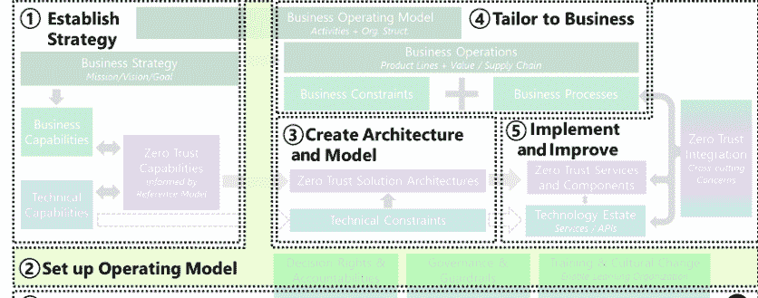
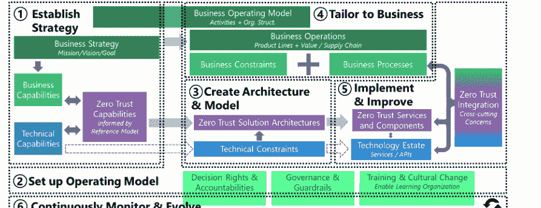
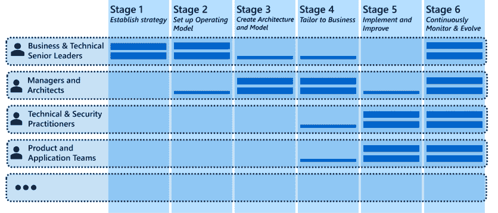
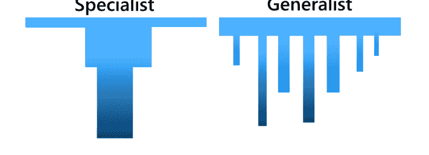
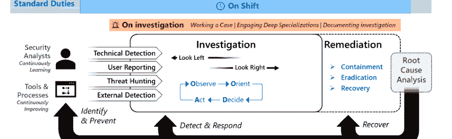
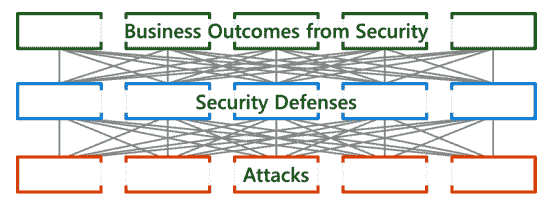
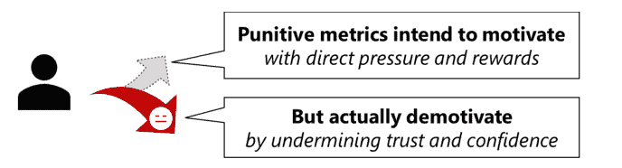

## The Zero Trust Six-Stage Plan

> *愿景没有执行只是空想。*
> *执行没有愿景只是混乱。*

现在我们对 Zero Trust 及其将 Zero Trust 集成到组织中的三支柱模型有了清晰的认识，让我们更详细地规划旅程。

在本章中，您将了解手册用于指导 Zero Trust 在整个组织中规划和推广的六阶段计划。这些阶段使您能够构建、维持并持续改进 Zero Trust。

这些阶段通过确保组织中所有合适的利益相关者在正确的时间参与并拥有做出决策所需的正确背景，从而帮助您避免项目失败的常见原因。这有助于避免因缺乏关键背景（或因被过多无关细节淹没）而导致浪费和混乱。六阶段计划提供了一个中心参考点，使人们能够清楚地了解将做什么、为什么要做、何时做、谁来做以及它应该如何运作。

本章包括以下主题：

- **六阶段计划概述**，介绍整体方法以及每个阶段的摘要
- **手册阶段详解**，包括每个阶段的步骤、关键利益相关者以及每个步骤的描述：
  - **第 1 阶段 – 建立战略**
  - **第 2 阶段 – 建立运营模式**
  - **第 3 阶段 – 创建架构和模型**
  - **第 4 阶段 – 根据业务定制**
  - **第 5 阶段 – 实施并改进**
  - **第 6 阶段 – 持续监控和演进**

**即将启动！**
我们即将结束第一本书，它就像一次大型启动会议，让所有利益相关者达成一致。一旦我们都理解了本章中的六个阶段，我们将在下一章（也是最后一章）中了解基于角色的方法，并转向指导我们执行的 playbook！

六阶段方法融合了敏捷方法的优点与传统战略规划的优点。通过将短期即时行动与长期战略方向相结合，这实现了灵活性和速度，同时不失去对端到端转型的关注。

这将帮助安全团队在六个阶段中转变为业务团队的完整合作伙伴，自然地将安全集成到业务流程中。此过程使安全能够变得敏捷，并支持不断发展以满足变化业务需求的敏捷业务。

现在，让我们了解将在 Zero Trust 手册系列中使用的六阶段计划。

## Overview of the six-stage plan

现在，是时候列出在整个手册中使用的阶段了。这些阶段指导 Zero Trust 的端到端实施，就像建筑项目计划帮助规划执行任务的顺序一样（例如，先浇筑混凝土基础，然后搭建建筑框架，然后进行电气布线和管道安装，等等）。

六阶段流程基于经过验证的架构建立了坚实的 Zero Trust 基础，这些架构也根据您组织独特的需要和业务运营模式进行定制。该流程还使您能够让组织各地的合适利益相关者参与进来，确保您拥有多样化的内部视角参与，以规避可避免的挑战和常见的沟通误解。这种包容性方法仔细平衡了标准方法与您独特的组织需求，以确保您在 Zero Trust 方面取得成功。

*图 9.1 显示了六个阶段叠加在上一章所述的手册组件之上：*

这些六个阶段将在整个手册中使用，以指导 Zero Trust 计划：

- **第 1 阶段 – 建立战略**：此第一阶段使 Zero Trust 计划朝着正确的方向发展。它首先通过发现 *业务战略* 并制定与之互补的具有 *使命*、*愿景* 和 *目标* 的 Zero Trust 战略，将 **Zero Trust** 定位到我们所处的背景中。接下来，我们了解现有的 *业务能力* 和 *技术能力*，以便定义建立在其之上并连接它们的 *Zero Trust 能力*。此过程还参考了当前的 *业务运营模式*（业务日常如何运作），以便 Zero Trust 在落地时取得成功。

第 1 阶段还定义了将用于衡量 Zero Trust 战略整体进展和影响的目标、目标和关键成果。

图 9.1 – Zero Trust 手册实施阶段概述

### Stage 2 – Set up an operating model
下一阶段是定义与您的业务运营模式保持一致的管理 Zero Trust 的运营模式。此运营模式包括决策权和问责制的定义，以便明确谁做出什么决策。此阶段还建立了治理和护栏，为整个组织的 Zero Trust 设定规则和政策。

运营模式的最后一部分使我们能够关注我们在第 7 章《Zero Trust 成功是什么样》中讨论的人文同理心关键成功因素。这为您的文化引入了学习和实验元素以及统一组织的意识。这使每个人都能够应对持续转型中将面临的持续挑战和不熟悉情况的流动。这还允许您组织中的人员以敏捷的方式跨团队协作，这对持续转型的成功至关重要。

培训和文化元素还使您组织中的人员能够回答 Zero Trust 带来什么变化、为什么这些变化很重要以及他们预计如何支持它。当这些问题的答案清晰时，Zero Trust 变得真实，团队会受到启发分享想法并规划对其日常工作体验和生产力的改进。

### Stage 3 – Create the architecture and model
接下来，我们为组织规划基础的 Zero Trust 能力。此阶段基于 The Open Group 的 Zero Trust 参考模型（在整个手册系列中引用）建立核心 Zero Trust 解决方案架构。由于这将在当前技术环境中实施，我们将其与平台的技术约束保持一致，并

使用中的技术（基于在 *阶段 1* 中发现的技术能力）。本阶段还确立了安全所需的关键运营纪律（或为零信任而更新它们）。

- **Stage 4 – Tailor to the business**：在规划零信任的基础组件之后，我们以更精细的细节对其进行整合和对齐。这确保零信任被规范化到日常运营中，并根据您组织的独特需求进行调整。在本阶段，模型和架构会根据您组织的 *业务运营模式* 和 *业务运营* 中的独特 *业务约束和业务流程* 进行定制。

- **Stage 5 – Implement and improve**：现在我们已掌握业务和技术环境的完整背景，可以在不担心被本应预见的大问题绊住的情况下，规划并构建特定的 *零信任服务和组件*。本阶段是零信任上线并在组织的 *技术资产* 中可用的阶段。在实施和学习新事物的过程中，这可能需要对计划进行小的调整。

最重要的方面是服务和组件与业务流程的 *零信任整合*，它推动业务流程和技术资产的跨领域变革。*这种整合使零信任能够通过改善组织而为其创造价值。*

- **Stage 6 – Continuously monitor and evolve**：零信任必须像您动态组织的任何其他部分一样持续演进，即使初始项目团队已转向其他工作。监控变化的需求并进行调整主要通过治理和 guardrails 来完成。*培训和文化变革* 使整体学习型组织成为可能，并提供支持这种持续变化的关键文化基础，让每个人都有权限看到变化的需求并提出满足这些需求的变更。明确定义的 *决策权和问责制* 提供了清晰度，帮助您快速识别任何所需变更的所有者和审批者。

*图 9.2 显示了每个阶段所涉及的元素：*

图 9.2 – 零信任 playbook 实施阶段的详细视图

现在，让我们谈谈使用 playbook 方法。

## 有效使用 playbook 阶段

为了帮助您使用六阶段方法，我们将在本章后面提供表格，将每个阶段分解为更细化的步骤。每个步骤都包括描述和涉及的利益相关者列表。这创建了 playbook 方法的简明摘要，您可以根据需要快速参考。

顺序很重要。在执行时，我们强烈建议按照所呈现的顺序来构建各个要素。这一理想的零信任工作顺序将指导各种规模的组织，包括大型全球组织。我们在确保关键依赖关系在需要之前到位的同时，仔细平衡了快速执行和价值实现。

如果团队跳过步骤或在没有跨组织支持的情况下构建单个项目，您的组织仍能获得价值，但如果没有更大的框架，就无法实现零信任的全部好处。这种推荐顺序基于数十年的经验，总结了在零信任等大型举措中 consistently 有效的做法（以及无效的做法）。

## 关键概念

在深入细节之前，让我们明确定义在 playbooks 中使用的几个关键概念：

- **Minimum viable product (MVP)**：在整个 playbooks 中，我们将使用 MVP 技术从任何 playbook 要素的最小可行版本开始。这种方法使您的团队既能快速学习（在流程早期最大化学习量），又能迅速交付价值。我们将在 playbooks 的战略和实施中都使用这种方法，应用于整体战略路线图以及单个能力和举措。
- **The learning organization**：这描述了一种方法，即组织中的每个人都共享一种文化假设，将失败和障碍视为学习和改进的机会。数字化转型、云转型和零信任都需要采用这种持续学习和改进组织人员和流程的心态。

这种心态通过以下方面变得真实：

- **Human empathy**：如 *第 7 章，零信任成功的样子* 中所述，这是领导者宣扬新行为并公开实践以供所有人观摩的地方。
- **Organizational processes**：这些确保学习被积极记录在文档、机构知识和流程变更中，而不是丢失或被遗忘。
- **Learning systems and processes**：这些方面使按需持续学习成为可能并鼓励进行。它们通常以小块的学习体验形式构建，使用游戏化等现代技术来提高参与度、享受度和保留率。

我们将在整个 playbooks 中使用 *学习型组织* 来描述已将这种心态融入其文化的组织。

## 敏捷交付与 playbooks

敏捷交付和流程今天在各行业被广泛采用，并且通常与 *现代数字企业* 相关联。由于 playbooks 不绑定于任何特定的流程方法论，这些流程在不同组织之间可能差异很大。此外，一些组织仍遵循 *瀑布* 方法（或准瀑布）是由于文化、合规或业务驱动因素。这一 playbook 系列如何融合敏捷和瀑布流程的最佳实践来推动零信任成果？

让我们来看一下：

- **A roadmap, but an agile roadmap**：六阶段方法创建的路线图建立在能力-指标-文化方法之上，既允许明确的方向又提供灵活性。它具有流程模型（应根据组织的交付模式进行定制），并提出了一种方法，在短期内提供高度信心，中期提供合理信心，长期提供总体高层方向。这为多个团队提供了清晰、可操作的指导，同时使组织能够通过定期路线图评审来适应和改变。
- **The playbook stages have a logical relationship between stages**：这种结构通过确保解决即时优先事项的努力会不断将组织向前推进到北极星理想的最终状态，从而创造敏捷性。其中一些阶段变化的频率不如其他阶段——例如，治理框架、业务运营模式和能力以较慢的速度演进。
- **Roadmap time frames can be adapted**：一些组织可能拥有非常成熟的敏捷流程和交付团队，每 6 到 12 个月运行一次所有路线图阶段。其他组织可能有 1 到 2 年的路线图。您的路线图长度将取决于组织的运营模式和驱动因素（业务、技术、安全、零信任、监管以及其他未知破坏性驱动因素）。您可以并且应该根据您的组织或生态系统定制时间框架。
- **The playbooks integrate agility into the implementation**：阶段 3、4 和 5 在我们实施阶段 1 和 2 中开发的内容时通常会快速迭代。阶段 6 将是基于组织及其所处的环境而进行的持续迭代过程。数字组织是持续学习组织，持续演进，而零信任正是支持这一点——能够不断更新以满足不断演进的数字环境的能力。
- **The playbooks provide tailoring guidance with examples**：每个 playbook 都将更深入地探讨阶段的实施方式，并提供如何将其定制到您组织的如何操作指南。

## 避免分析瘫痪和过度工程

需要避免的一种反模式是团队陷入 *分析瘫痪* 陷阱，这发生在他们试图为每个阶段设计 *完美* 的解决方案时（通常是因为团队担心一旦发布就永远无法更改）。剧本通过将迭代方法整合到动态路线图、运营模式和其他流程中来避免这种情况，以确保敏捷性、持续适应和持续学习得到规范化。这减少了在过度工程上浪费的时间和资源，并避免了与组织运营模式相悖的方法（而这些方法更可能失败）。迭代过程使团队能够使用敏捷方法在推进过程中验证决策和路线图，而无需寻找在规划阶段可用信息中可能不存在或不可见的 *完美* 解决方案。

*始终确保团队了解运营模式、运营环境和驱动因素，以便他们能最好地确定每次迭代的“足够好”标准。*

## 剧本阶段详解

以下表格解释了每个阶段的步骤以及谁负责并推动它们。这些表格提供了端到端旅程的详细视图。剧本将这些内容细化为角色特定的细节和指导，为每个角色提供充分的清晰度。*第 10 章，零信任剧本角色，* 为这些角色以及为每个角色提供的指导提供了说明性参考。

### 第 1 阶段 – 建立战略

第一阶段为整体成功奠定基础——定义清晰的愿景和方向，规划实现目标的计划和优先路线图，并获得组织各高级利益相关者的认同。这确保每个人朝着同一方向前进，从而不同团队不会相互冲突。

以下是本阶段的步骤：

- 1. 制定零信任愿景。
- 2. 了解业务能力。
- 3. 了解技术能力。
- 4. 敲定零信任能力。
- 5. 构建零信任路线图。

*表 9.1* 更详细地介绍了这些步骤：

| Playbook Step | Who | Description |
|---|---|---|
| Stage 1 – Establish a strategy |  |  |
| **Develop a Zero Trust vision** | • Organizational senior leaders (especially Business, Risk, and Compliance leaders) • Technology senior leaders (especially Security, Risk, and Technology /IT leaders) | *This step establishes the vision that will guide all other Zero Trust work.*  **Security leaders** own the Zero Trust vision and author this with input from their teams. The leadership playbook includes guidance and examples.  **Business leaders** provide ownership, engagement, input, and alignment on the changes and impact on the business. They lay out the guardrails from a business perspective and define the business impact in terms of opportunity and returns.  **Technical leaders** provide input on the impact on technology domains, vision, and roadmap.  To ensure broad awareness and buy-in, the vision, mission, and goals should be reviewed by leaders across the technology and business leadership of the organization. |
| **Understand the business capabilities** | • Organizational senior leaders • Technology senior leaders • Architects (especially enterprise architects if present) | *This step captures the business capabilities that the Zero Trust capabilities align with.*  Security leadership performs a business capability assessment to capture insights into the business capabilities of business leaders. This often requires gathering input from business leaders and collating the capabilities into a single capability-based view of the organization. The final product should be reviewed, validated, and approved by the business leaders of the organization.  This assessment will typically include a capability map – for Zero Trust, this is usually limited to a high-level document. An organization's enterprise architecture and business leadership team may take this deeper and define a full business landscape, but that is not normally necessary for Zero Trust. |
| Stage 1 – Establish a strategy |  |  |
| Understand the technical capabilities | - Security leaders - Technology leaders - Enterprise architects (if present) | *This step captures the technical capabilities that Zero Trust capabilities will build on and integrate with.*  Security leaders should collaborate with technical leaders to jointly assess the technical capabilities. Because IT and security teams often don't collaborate closely, this activity should be used to start catalyzing collaborative relationships. The discovery process must explicitly include both IT capabilities and security capabilities, and the output should be shared across both IT and security teams.  The technical capability assessment will typically include a capability map and a high-level technology landscape. For Zero Trust, this is usually limited to a high-level document.  The capability assessment should use a standard document. Standards such as **The Open Group Reference Architecture Standard** should be used to leverage a common, shared definition of capabilities (Acme examples are included throughout the playbooks) to both accelerate the process and start from an accepted industry understanding. An organization's enterprise architecture and business leadership may take this deeper and define a detailed landscape, but that is not normally necessary for Zero Trust. |
| Stage 1 – Establish a strategy |  |  |
| **Finalize the Zero Trust capabilities** | - Organizational senior leaders (especially risk and compliance) - Technology senior leaders (especially security and technology leaders) - Architects (especially security and enterprise architects if present) | *This step defines the Zero Trust capabilities that will be integrated into business processes and the technology estate.*  Security leaders and their teams identify and finalize the organization's Zero Trust capabilities with risk leaders, compliance leaders, and enterprise architects (if present). This should start with The Open Group Zero Trust Reference Model, which defines high-level industry-standard Zero Trust capabilities.  Note: The Zero Trust capabilities are composed of Zero Trust components and services defined later in the architecture. |
| Stage 1 – Establish a strategy |  |  |
| **Build the Zero Trust roadmap** | - Organizational senior leaders - Technology senior leaders - Architects (especially security and enterprise architects if present) - Managers | *This step defines the Zero Trust roadmap, which identifies which Zero Trust capabilities are in scope, which will be delivered first, and how each will be integrated into business and technical capabilities.*  This roadmap is executed in phases aligned with the organization's business operating model and release cycles and focuses on identifying the MVP for each capability and initiative. Each phase establishes a Zero Trust capability, enhances an existing one until a target level of maturity is reached, or integrates one with business or technology processes. The impact of these goals should be quantifiable and measurable as **key performance indicators (KPIs)** or **objectives and key results (OKRs)** and captured in the roadmap.  The roadmap phases are in a high-level, prioritized order for capabilities and initiatives, balancing quick wins and incremental progress while establishing foundational dependencies first.  Each initiative in the roadmap includes estimates for associated resources, risks, dependencies, and metrics. It also identifies targeted key results for each Zero Trust capability and KPIs for each phase.  The implementation of the roadmap extends through the *implement and improve stage.*  This is ideally built by security architects and managers in close partnership with business and technical managers (and enterprise architects if present). This is sponsored and approved by security, business, and technology leadership.  In a smaller organization without those formal roles, you can get IT architects, technical managers, or technology leaders to coordinate and author these in partnership with technical teams. |

## 第二阶段 – 建立运营模式

本阶段确保零信任与贵组织的运作方式保持一致。这将为您取得成功做好准备，并主动清除零信任在贵组织文化、治理和运营模式中的潜在障碍。

本阶段的步骤如下：

- 1. 确定您的业务运营模式。
- 2. 制定您的治理框架。
- 3. 制定文化变革和技能发展。

表 9.2 详细介绍了这些步骤：

| 剧本步骤 | 负责人 | 描述 |
|---|---|---|
| 第二阶段 – 建立运营模式 |  |  |
| **确定您的业务运营模式** | - 组织高级领导者 - 技术高级领导者 - 架构师（尤其是安全、企业和业务架构师） - 企业安全集成（副首席信息安全官及员工、安全[业务]分析师） | *本步骤捕获您将用于聚焦和优先考虑战略、治理框架和政策的业务运营模式。*  本步骤由安全领导者负责，并涉及安全分析师、业务架构师和业务领导者。  这应包括发现贵业务的运营方式以及贵组织用于治理它的风险管理框架。  注意：请记住，路线图需要更新以使其与业务运营模式保持一致。 |
| **制定您的治理框架** | - 组织高级领导者 - 技术高级领导者 - 架构师（尤其是安全、企业和业务架构师） - 企业安全集成（安全[业务]分析师） | *本步骤构建指导您的零信任运营模式的治理框架，该框架与您的业务运营模式保持一致。*  该框架提供了将一切联系在一起的组织粘合剂，包括以下关键组成部分： - 组织结构 - 流程模型 - 目标 - 原则 - 政策  这通常由安全领导者负责，由业务架构师在安全架构师和分析师的支持下构建。企业架构师参与将治理框架的要素嵌入并编织到组织的技术交付治理框架中。 |
| **制定文化变革和技能发展** | - 组织高级领导者（包括 **人力资源（HR）** 和业务） - 技术高级领导者 - 企业安全集成（副首席信息安全官及员工、安全[业务]分析师） - 架构师（尤其是安全架构师） - 相邻角色（业务分析师、培训师，以及如有内部就绪和沟通团队） | *本步骤确定所需的组织文化变革并规划如何实施。*  本步骤建立在您对业务运营模式的理解之上。  这包括以下内容： - 评估您的业务文化和价值体系 - 评估谁需要技术、业务流程等方面的培训 - 制定实施此变更的计划  生成的计划通常包括以下要素： - 为团队设定 OKR - 在员工绩效评估流程中设定目标（包括高级管理人员以树立榜样） - 建立培训计划（包括持续的维持流程） - 建立沟通计划（包括持续的强化流程）  本步骤由安全领导者负责，并得到其他角色的支持。整个组织都受到影响，因此业务领导者和技术领导者必须支持此项工作。 |

表 9.2 – 第二阶段 – 建立运营模式

接下来，我们准备规划架构和流程。

## 第三阶段 – 创建架构和模型

本阶段创建具体的计划，以指导技术和业务团队，确保架构、流程和日常运营建立零信任所需的所有组件。

本阶段的步骤如下：

- 1. 开发您的零信任解决方案架构。
- 2. 制定零信任的政策和程序。
- 3. 建立零信任运营。

表 9.3 详细介绍了这些步骤：

| 剧本步骤 | 负责人 | 描述 |
|---|---|---|
| 第三阶段 – 创建架构和模型 |  |  |
| 开发您的零信任解决方案架构 | - 技术高级领导者（尤其是安全、风险和合规） - 架构师（安全、技术和企业架构师，如有） | *本步骤为企业构建量身定制的零信任模型和架构。*  本步骤将参考模型和架构转化为贵组织的具体且可操作的文档。您将把参考文档定制为组织的 技术环境 并映射能力以制定零信任解决方案架构。这是通过运营支柱完成的工作中的一个基本部分，我们将在剧本中详细说明流程。  此任务由安全架构师完成，并将涉及技术架构。 |
| **制定零信任的政策和程序** | - 风险和合规角色（风险团队、合规团队） | *本步骤为您的零信任计划构建零信任政策和程序。*  零信任政策和程序在敏捷性与可持续性之间取得平衡，并满足 **治理、风险和合规（GRC）** 需求。  所有政策和程序都应以 *零信任* 原则为指导，假设已遭入侵，强制执行最小权限，并明确验证信任。  政策和程序支持以下内容： - 对资产和身份进行分类 - 使用安全区域 - 通过涵盖数字身份和自适应访问管理，建立零信任 **身份和访问管理（IAM）**  这通常是风险、合规、安全分析师和安全架构团队的领域。它由安全领导层负责，导致安全、风险和合规政策的更新，并在实施过程中向下转化为业务和技术团队。  在零信任 *持续学习* 背景下，该计划还应建立学习材料并更新治理框架，以确保 *全组织* 对政策和程序的理解和应用。 |
| **建立零信任运营** | - 技术高级领导者（尤其是安全、风险和合规） - 架构师（尤其是安全架构师） - **安全运营（SecOps/SOC）** - 安全态势管理 - 技术工程和运营 - 安全态势管理 | *本步骤为您的零信任计划构建运营要素。*  零信任在整个组织的操作中引入安全变更，包括以下内容：  - **SecOps/SOC 现代化**：零信任使 SecOps 专注于快速检测、响应和恢复世界各地的业务资产。这侧重于最大限度地减少对手可以访问环境的时间（以 **平均修复时间（MTTR）** 衡量）。 - **态势管理**：组织还将建立态势管理职能，以监控整体安全风险敞口（使用云服务的实时数据）。这些团队将监控已知风险，并积极支持技术运营团队（IT、OT 和 DevOps），以便在攻击者发现并利用之前迅速缓解风险。此持续合规职能为许多控制措施提供 **按需审计**。 - **共享战略威胁情报**：与整个组织的团队共享有助于为业务风险决策、架构变更、技术控制和技术团队工作优先级提供信息。  这是一项与安全架构、SecOps/SOC、态势管理、风险和合规团队的协作工作。它由安全领导层负责，并在实施过程中转化为业务和技术运营团队。 |

现在我们对战略路线图、架构和流程有了清晰的认识，可以开始规划实施工作。

## Stage 4 – 针对业务进行定制

本阶段将这些零信任组件与组织内所有正确的位置和利益相关者进行对齐和连接。

本阶段的步骤如下：

- 1. 确定您的产品模型。
- 2. 确定业务职能和组织结构。
- 3. 确定组织的业务流程。

*表 9.4 详细介绍了这些步骤：*

| 剧本步骤 | 负责人 | 描述 |
|---|---|---|
| Stage 4 – 针对业务进行定制 |  |  |
| **确定您的产品模型** | - 组织高级领导者（包括产品和业务线领导者） - 技术高级领导者（尤其是安全） - 安全态势管理 - 架构师（尤其是安全、业务和企业架构师） - 管理人员 - 应用和产品安全 | *本步骤捕获您组织的产品模型。*  企业销售商品和服务，这些统称为 *产品*。该产品模型有助于您了解零信任如何应对与产品相关的三个关键要素：  - **风险**：作为潜在损失的来源。 - **机会**：作为提高组织成功的机制。这通常表现为在现有业务线中增加收入，或通过进入新的业务线或地区来开拓新的收入来源。 - **做生意便利性**（以敏捷性和成本衡量）。  这种背景有助于将零信任与组织的收入联系起来，并确定哪些业务职能和流程受到影响，零信任将如何集成和影响它们，以及如何最好地衡量这种影响。这种影响将以人员、组织结构、业务流程和能力来描述。  该举措将由安全领导者主导，使用安全架构、企业架构和业务领导者。 |
| **确定业务职能和组织结构** | - 组织高级领导者 - 技术高级领导者（尤其是安全） - 架构师（尤其是安全、业务和企业） - 管理人员 - 相邻/辅助角色（尤其是业务分析师） - 企业安全集成（副首席信息安全官及员工、安全[业务]分析师） | *本步骤捕获您组织提供人员和结构以交付组织提供的产品的业务职能。*  创建业务职能的高层次评估，以了解零信任将如何影响业务职能和组织结构。  业务职能提供交付组织提供的产品的人员和结构。对业务职能进行高层次评估，以了解零信任将如何影响业务职能和组织结构。  该举措将由安全领导者主导，使用业务架构资源。它还将涉及中级和高级业务和技术领导作为信息来源并验证信息。其成果通常包括培训、重新组织以将零信任作为组织能力纳入其中，以及建立程序和政策。业务职能所服务的零信任能力指标也将被审查。 |
| **确定组织的业务流程** | - 组织高级领导者 - 技术高级领导者（尤其是安全） - 架构师（尤其是安全、业务和企业） - 管理人员 | *本步骤捕获交付组织提供的产品的业务流程。*  在本步骤中，您创建业务流程的高层次评估，以了解零信任将如何影响业务职能和组织结构。  重要的是保持此次初步发现的范围轻且广（深入一英寸，宽达一英里），以免陷入过多细节或过度设计。第一次整体发现应大致了解零信任将如何影响业务流程。例如，零信任可能实现自助式身份和访问管理。对于中型至大型零售商或银行等组织而言，这可能产生巨大影响。  我们将在角色特定的剧本中查看这些流程的细节。  该举措由安全领导者主导，使用安全和业务架构资源。它还将涉及中级和高级业务和技术领导，他们作为信息来源和审阅者。零信任影响通常包括培训、重新组织以将零信任作为组织能力纳入其中，以及建立程序和政策。业务职能所服务的零信任能力指标也将被审查。 |

表 9.4 – Stage 4 – 针对业务进行定制

现在，我们准备实施零信任并启动持续改进循环。

## Stage 5 – 实施并改进

本阶段构建零信任并使其成为现实，将其与业务流程和技术资产集成。

本阶段的步骤如下：

- 1. 构建零信任的可重用组件
- 2. 建立最佳实践
- 3. 实施并改进

表 9.5 涵盖本阶段的步骤：

| 剧本步骤 | 负责人 | 描述 |
|---|---|---|
| Stage 5 – 实施并改进 |  |  |
| **构建零信任的可重用组件** | - 架构师（尤其是安全、业务和企业） - 管理人员 - SecOps - 应用和产品安全 | 本步骤构建在生产环境中实施的零信任组件和服务。这些将在组织内用于许多应用程序和业务流程。  本步骤使用 MVP 技术快速开发和部署每个组件的最小可行版本，并最大化从真实反馈和验证中学习。  这些零信任组件和服务为企业采用零信任奠定了基础，使用诸如安全信任区域、自适应身份验证以及为数据中心性开发“令牌”服务等要素。  我们强烈建议采用“先配置后定制”的方法（以避免定制解决方案的成本/复杂性），优先顺序如下： 1. 如果可用，重复使用现有组件。 2. 如果可用，购买标准组件。 3. 仅在需要时构建定制组件。  如果构建组件不是您的核心业务实践，请寻找购买来满足需求（这在 **软件即服务 (SaaS)** 世界中可以相当快速完成），并避免除非绝对必要之外的定制（因为它们会给您的组织带来长期维护负担）。 |
| **建立最佳实践** | - 架构师（尤其是安全、业务和企业） - 管理人员 - SecOps - 技术工程和运营 - 应用和产品安全 | 本步骤建立可重复的模式和最佳实践，以指导团队和从业人员，帮助他们避免浪费时间和精力。 |
| **实施并改进** | 整个组织 | 本步骤是组织实施路线图的时候。  组织中的所有角色都参与本步骤。  在路线图、治理框架以及文化、培训和沟通计划到位后，组织应开始执行路线图。在每个周期中开始迭代和衡量，根据来自真实环境的经验教训在过程中不断改进和演进。  这是一个持续的过程，一直执行到路线图结束，并导致一种敏捷的持续改进方法。  只要团队与其它团队保持沟通，每个团队都应感到有能力推进其职责。为了避免这种快速创新模式中的冲突，团队应不断与其他团队分享他们的计划，征求反馈，并密切关注其他团队正在做什么。这有助于每个人实时调整。 |

表 9.5 – Stage 5 – 实施并改进

随着零信任上线，世界将不断变化，因此我们需要在运营过程中采用持续改进的方法，不断对其进行更新。

## 第 6 阶段 – 持续监控与演进

本阶段代表运行并持续改进零信任的持续性工作。随着零信任能力上线并投入运营，我们将持续监控和改进它们，以适应不断变化的业务、技术和安全环境。这确保您的组织具有敏捷性，能够应对您面临的各种威胁和机遇。

*表 9.6 涵盖了本阶段的步骤：*

| 剧本步骤 | 负责人 | 描述 |
|---|---|---|
| 第 6 阶段 – 持续监控与演进 |  |  |
| **运营并改进零信任能力** | 全体组织 | *这是组织将零信任能力从路线图实施并整合到日常运营和使用的过程中，对零信任进行持续运营和持续改进。* |

本阶段侧重于维持和改进，使用 KPI 和 OKR 层面的指标来跟踪零信任的成功情况并校准和改进能力。

组织将使用治理框架来监控并持续改进零信任。

这通常包括以下工作：
- 确保有人在监控监控系统
- 处理“漂移”或配置或流程的不合规情况（并着重从任何偏差中学习）
- 根据新技术可用性、业务需求变化、攻击态势演变或其他来源，改进或更新零信任系统中的任何组件（架构、模型、能力、集成等）
- 更新监控系统和指标，以提高对零信任的可见性

**表 9.6 – 第 6 步 – 持续监控与演进**

这结束了构建您的零信任能力并将安全与业务优先事项、风险和运营模式保持一致的六个剧本阶段。这将使您的组织在安全且敏捷的运营方面取得成功。

## 摘要

在本章中，我们了解了构建零信任的六阶段流程，该流程将在整个剧本中使用。

我们介绍了剧本的详细步骤、每个步骤的负责人以及他们需要在组织内与谁合作。这一六阶段流程使您能够将零信任从概念状态转变为完全实施和运行，减少组织风险并实现运营成功。

接下来是本书的最后一章，*第 10 章，零信任剧本角色*，我们将从基于角色的视角审视零信任之旅。

## 10

## Zero Trust Playbook Roles

> > "你的职业生涯就是你的事业，而你就是它的首席执行官。"
> > — Andy Grove

现在我们对零信任、三大支柱以及六阶段剧本之旅有了清晰的认识，让我们看看如何将其落实到每个角色——从首席执行官和董事会成员到技术分析师和工程师。

本章从基于角色的视角审视零信任之旅，这补充了上一章所述六阶段计划的战略视角。这两种视角的结合带来了对零信任之旅清晰的三维视图。这也为剧本系列的其余部分奠定了基础，每本书都针对一组相关角色的旅程。

*这对我意味着什么？*

基于角色的视角对于个人专业人员、经理和高层领导充分理解零信任至关重要。这一视角阐明了它如何影响日常工作，为治理和其他组织规划提供信息，并使有效的技能和职业规划成为可能。本章后面 *基于角色的方法* 部分提供了更多细节和背景，说明为什么剧本中这种基于角色的零信任视角如此关键。

这是《零信任介绍与剧本概览》一书的最后一章，为每个人准备旅程。阅读完本章后，我们可以发挥自己的作用实施零信任并开始享受这一变革带来的好处！

本章包括以下主题：
- 剧本中使用的 **基于角色的方法** 摘要
- 零信任在安全、技术和业务中转型的 **角色说明性列表**
- 剧本为每个角色提供的 **按角色指导** 描述
- 使用我们的 Acme Bank 示例 **使其真实**
- 讨论 **零信任剧本系列的下一步**

将本章视为介绍零信任的虚拟启动会议的最后一部分。在这本书之后，我们每个人都会阅读自己角色的剧本，以获得针对如何在组织中支持零信任的具体说明和指导。这类似于大型项目团队与所有利益相关者举行一次大型启动会议，然后分成较小的团队来规划和执行每个工作流。

每个后续剧本都包括一组受零信任影响方式相似的相关角色（安全运营、业务和技术领导者、产品和应用安全等）。每个剧本都描述了这些角色如何将总体计划应用于其工作和职责并进行定制。剧本还包括 Acme 示例的使用，以说明如何将指导应用于不同行业、规模和类型的组织。

现在，让我们看看剧本中的基于角色的方法以及为什么这对您很重要。

## 基于角色的方法

*感知过滤你所看到的内容并改变你在世界中的行为方式。*

我们都通过个人经历、个人身份以及当时所扮演的角色的视角来理解周围的世界。当我们将自己的角色视为朋友、兄弟姐妹、学生、教师、老板、员工、客户、供应商、所有者、审计员或其他角色时，我们看到的东西会有所不同。这会影响我们看到和听到的内容，以及我们在任何情况下的行为方式。

我们的工作也是如此——我们通过职业身份和在组织内扮演的角色（s）的视角来感知挑战、解决方案和机遇。

因此，零信任剧本为受零信任影响并需要支持零信任的业务、技术和安全角色提供逐角色指导。剧本中的每个角色在零信任中都有重要且独特的作用，无论它是作为偶尔的兼职职责、多个人员共享的职责，还是专业团队的专职工作。

这种基于角色的方法提供了清晰度并实现了即时可操作性。每个角色都将相关背景以熟悉的语言呈现，概述人员需要执行的任务，并提供有关在组织中与谁合作的明确指导。这避免了因试图弄清楚确切该做什么、为什么需要做、谁来做以及如何运作而造成的浪费和困惑。

本节涵盖剧本中基于角色的方法的以下四个关键方面：
- **角色与六阶段计划的整合**：描述剧本如何将基于角色的方法与六阶段之旅整合
- **角色相关术语**：描述剧本如何定义和使用与角色相关的术语
- **零信任影响每个人**：总结零信任如何影响组织中的每个角色
- **角色定义和命名**：描述剧本如何定义角色范围和名称，包括何时与当前行业规范不同

让我们从剧本如何将基于角色的方法与六阶段计划整合开始。

## 角色与六阶段计划的整合

*剧本将这种以角色为中心的视角与六阶段计划整合，以在零信任的战略、规划、实施、运营和持续改进贯穿过程中推动速度和清晰度。*

图 10.1 说明了六阶段计划与按角色指导相结合如何为组织中的所有角色提供清晰度：

图 10.1 – 说明不同角色在不同阶段如何参与的图示

该图示显示了 **业务和技术高级领导者** 如何在零信任采用初期深度参与，设定战略和文化的方向。这一第一阶段为剩余工作奠定基础并提供指导，并确立其对组织的重要性。

**清晰带来敏捷**。初期建立的战略和文化作为持续的持久指导方针，使人们获得授权，加快进展并提高敏捷性。这种清晰度使人们能够在不断变化的环境中快速而自信地做出与零信任和组织目标一致的本地决策。

在下一阶段，**经理和架构师** 做了大量工作来规划详细的架构、模型和流程，使零信任适应独特的业务流程。

The Zero Trust capabilities are then implemented by practitioners, including **technical and security practitioners** and **product and application teams**.

All roles help **continuously monitor and evolve Zero Trust**.

Each playbook expands into many more details for each role's involvement. Now, let's clarify some key terminology in this role-based approach.

## Role-related terminology

The playbook uses several terms that have similar but not identical meanings:

- A **discipline** is an area of study that often requires multiple roles and specializations to practice. Some examples of professional disciplines include security operations, architecture, application security, technical leadership, and business leadership.
- A **role** is a collection of tasks that someone performs to enable a capability on an ongoing basis. A role is often assigned to a single person, but multiple people may fulfill the role in a larger organization, or the same person may perform multiple roles in a smaller organization.
- A **role specialization** describes how generally or narrowly tasks are defined for a role. Highly generalized roles span many different tasks while highly specialized roles focus narrowly on a few related tasks. Some roles will always be generalists (such as architects) to drive consistency across many teams in the organization, while others can become more specialized (such as engineers) as the organizational function matures and team size grows.
- Figure 10.2 illustrates the skill and task profiles of extreme specialists and generalists on this spectrum:

Figure 10.2 – Task and skill profiles for highly specialized roles versus generalist roles

Generalist roles (low specialization) perform many types of different tasks, often in smaller organizations where resources are limited. Highly specialized roles perform fewer and similar tasks and are often found in large organizations that require efficiency, scale, and mastery of individual skill sets.

The playbook defines roles in their fully specialized end state (as seen in large organizations) and provides guidance to quickly adapt this to more generalized roles in smaller organizations. The playbook does this by showing the full creation and evolution journey for each role, which is described in the *Role creation and evolution* section later in this chapter.

**Notes**
**Stay aware of context and changes**: During a transformation such as Zero Trust, even the most specialized roles must maintain a strong sense of the context around the organization to understand which assumptions are changing and how.
**Shift to capability-centric**: Many roles and specializations are shifting with Zero Trust to a capability-centric focus from a tool-centric or technology-centric definition and scope.

Now that we understand the role-based approach, why it’s important, and the terminology, let’s discuss who is affected by Zero Trust.

## Zero Trust affects everyone

Every role in an organization is affected by Zero Trust—sometimes in small ways and sometimes in large transformative ways. Some illustrative examples include the following:

- Everyone, including frontline workers, must watch carefully for phishing emails and scams from cyber attackers
- Board members and business leaders must integrate security into business and risk discussions.
- Senior technology leaders must build and maintain an agile strategic roadmap that aligns security and technology investments with business priorities and risks
- Technology and security architects and engineers must integrate security into technology designs and security control designs to enable resilience to cybersecurity attacks
- Security operations must find and remove attacker access to business assets using new tools and approaches
- Security and technology managers must update project priorities and processes based on the organization’s strategy, risk, and **threat intelligence (TI)**
- Compliance professionals must keep up with a steady flow of new regulatory requirements by using on-demand reporting and by collaborating with teams across the organization

As with digital transformation and cloud transformations, which it usually accompanies, Zero Trust transformation shifts roles into a more agile, informed, and automated approach. This brings out the best of human skills and abilities while computers take on more repetitive and manual tasks, *improving both the daily experience and the effectiveness of security.*

Now, we will take a look at the playbook approach for role definition and naming.

## Role definition and naming

The playbook uses industry-standard terminology and role definitions when possible, including formally defined standards and de facto standards from common practice.

You may encounter new or unfamiliar role terminology in some cases, including the following:

- **New required roles** that don’t exist in common practice today. An example of this is **enterprise security integration**, a role focused on aligning security activities and investments with business risk and strategy. This role is critical to Zero Trust as it provides real-time representation for security at business and technology strategy meetings and brings business context to security strategy, planning, and investment decisions.
- **Evolved scope and mission**: Some disciplines and associated role(s) expand or evolve the scope of current roles significantly. Some examples include the following:
  - **Security posture management** evolves from vulnerability management discipline and roles. This change has two main dimensions:
    - The scope of the role increases from only software vulnerabilities to all types of vulnerabilities, including technical operational practices and security configurations
    - The engagement model for the role becomes proactive to assist and engage with technology operations teams on solutions, not just reporting scan results
  - **TI** evolves significantly from a common scope of managing technical **Indicators of Compromise (IoCs)** such as file hashes and IP addresses to a full intelligence discipline. This role now analyzes and reports on threat actors, motivations, goals, and what they mean to the organization's business, technology defenses, processes, and more.
  - **Architect alignment** focuses on outcomes rather than technology silos. For example, network and identity architects become access architects who coordinate solutions across all access technologies to ensure a seamless user experience and security posture across the technical estate.
- **Increased specialization of role definitions**: Some roles are defined in greater detail in the playbook than is commonly seen in industry. For example, security operations Tier 3 analyst roles often perform multiple different jobs of *detection engineering*, *threat hunting*, and *attack simulation* (red and purple teaming). Each of these specializations is defined separately to recognize discrete outcomes, work processes, and skill sets (even if they are performed by a single team or person in some organizations).

## Industry dynamics and inconsistent terminology

You may have noticed that role terminology for information security and technology is inconsistent and changes regularly. This is primarily driven by two factors:

- **These industries are still new**: Both technology and security industries have very little history compared to others with centuries or millennia of history, such as building architecture, civil engineering, and others. Many areas of the technology and security industry haven't identified norms and standards, while other areas have had multiple independent standards defined that haven't been fully reconciled.
- **These industries are naturally disruptive**: These industries either generate or manage disruption as a part of their normal value creation. The technology industry primarily creates value by introducing valuable changes to business models and processes of other industries that increase speed, efficiency, and reach (often opening up new markets in the process). The security industry is focused on managing risk arising from the disruptive activities of criminals and governments who are seeking to benefit from the work of existing organizations.

New and changing terminology is often required to develop and validate new concepts and reframe existing concepts in these industries. Because new terminology can be distracting and Zero Trust is designed to manage continuous change, the playbook strives to define any new terminology to be durable across changes to technology, threat landscape, and business models.

## Role planning and vendor RBAC models

Organizations should use the guidance in this playbook as a primary source to design roles rather than basing them on **role-based access control (RBAC)** definitions in vendor products such as enterprise identity systems. The vendor definitions are optimized for assigning permissions within a product, while the playbook roles are optimized for driving organizational success and reducing organizational risk.

Now, let's review an illustrative list of roles that are key to a Zero Trust transformation.

## Illustrative list of roles

This is an illustrative list of roles impacted by Zero Trust and roles with a clear part to play in the success of Zero Trust, digital, and cloud transformations.

表 6.1 中的角色可能会随时间演变，但预计只有有限的微小变化：

| 角色类型 | 角色 |
|---|---|
| 组织高级领导 | 董事会成员 **首席执行官 (CEO)** **首席财务官 (CFO)** **首席运营官 (COO)** **首席法务官 (CLO)** **首席隐私官 (CPO)** **首席风险官 (CRO)** 产品和业务线领导 传播/公共关系总监 |
| 相邻/辅助角色 | 人力资源 业务分析师 内部准备/培训 内部和外部沟通 |
| 风险和合规角色 | 风险团队 合规和审计团队 |
| 技术高级领导 | **首席数字官 (CDO)** **首席信息官 (CIO)** **首席技术官 (CTO)** **首席信息安全官 (CISO)** 企业安全集成 技术总监 安全总监 |

| 角色类型 | 角色 |
|---|---|
| 架构师 | 企业架构师 |
|  | 安全架构师 |
|  | 基础设施架构师 |
|  | 业务架构师 |
|  | 信息架构师 |
|  | 访问架构师 |
|  | 解决方案架构师 |
|  | 软件/应用架构师 |
| 管理者 | 技术经理 |
|  | 安全经理 |
|  | **安全运营 (SecOps)** 经理 |
|  | 产品线经理 |
|  | 产品负责人 |
| 安全态势管理 | 安全态势管理 |
|  | 安全治理与合规管理 |
|  | 人员安全（用户教育和内部风险） |
| 技术工程与运营 | 云工程与运营 |
|  | 端点/生产力 |
|  | 身份 |
|  | 基础设施 |
|  | 网络 |
|  | 数据安全 |
|  | **运营技术 (OT)** 安全 |
|  | 安全态势工程与运营 |

| 角色类型 | 角色 |
|---|---|
| 应用和产品安全 | 应用团队经理 软件安全工程师 软件开发人员 **物联网 (IoT)** 安全 |
| 安全运营 | 分诊分析师 调查分析师 威胁狩猎 检测工程 攻击模拟（红队和紫队） **事件管理 (IM)** TI |

表 10.1 – 使能零信任的角色说明性列表

现在，让我们回顾一下手册为每个角色提供的指导。

## 按角色指导

手册指导帮助每个角色应对向零信任的转型、管理持续的零信任运营，并应对即将到来的持续变化。

为每个角色提供的指导量因其与零信任的参与程度而异。安全和技术角色在许多方面都会受到零信任的影响，而首席执行官、首席财务官和董事会成员等业务领导者经历的变化较少（尽管他们的行动对其他所有人的成功至关重要）。

每个角色的指导在以下方面提供清晰的指导：

- 角色使命和目的
- 角色创建与演进
- 关键角色关系
- 所需技能和知识
- 工具和能力
- 零信任对每个角色的影响和当务之急
- 手册阶段参与情况
- 零信任中的角色日常
- 定义和衡量成功

## 角色使命和目的

手册包括了角色在安全和业务风险方面的关键且持久使命的描述。

该指导为每个角色中的人员提供了一个个人指南针，说明如何以兼职方式构建他们的 (IR)** 任务以监控攻击并做出响应。以下是一个示例概述：

- **阶段 1**：随着工作量的增长和资金的到位，随后会创建安全运营职能，使用专用资源执行 IR。
- **阶段 2**：随着工作量和资金的持续增长，IR 通常会分为 *分诊* 分析师角色（通常称为 Tier 1），专注于高 volumes 的攻击检测，以及 *调查* 分析师角色（通常称为 Tier 2），专注于高复杂性的调查。
- **阶段 3 和 4**：随着安全运营的持续增长，资源通常会专门用于各种主动职能（有时称为 Tier 3），专注于 *威胁狩猎*、*检测工程*、*TI* 和 *攻击模拟*（红队和紫队）。这可能是一个执行多种专业化的单一角色（阶段 3），或专注于其中每项的专用资源（阶段 4）。图表中还指出了额外的深度专业化和专业化。

这个例子展示了 *角色创建与演进* 指导如何使你能够将这些角色映射到你的组织，无论团队规模或角色专业化如何。大型组织中的人员可以利用此来了解自己的角色和同事的角色。小型组织中的人员可以了解一个角色执行的多种专业化，并获得有关优先事项的见解。

所有规模的组织都可以规划当前角色的更新以及如何随着组织需求的演变和资金的可用而投资于未来的角色专业化。大型组织通常拥有执行专门任务的专用安全和技术专业人员，而小型企业、机构和非营利组织通常负担不起为每个专业化配备专人。

## 并非总是关于规模

有时，较小的组织可能具有其他同等规模组织所没有的更高的网络安全要求。网络安全要求可能由组织的商业模式、**知识产权 (IP)**、地理位置、公众形象和其他因素驱动。例如，金融服务组织或选举活动可能面临比员工人数相同的非营利组织更高的网络安全威胁和风险。

在适当的情况下，每个角色的指导还指出了如果没有专用角色，通常由谁来执行该专业化。这当然不适用于首席执行官，但在组织成长过程中，对于 IT 和技术角色来说是 ☺ 常见的。

## 并非总是直线进行

并非每个团队都是以这种直接的线性方式构建的——许多团队是由于合并、收购、重组或其他变化而创建的。

手册使用这种线性增长方法，因为你可以通过比较团队的规模和专业化水平并找到最接近的整体匹配，从而将其适应不同的情况。

## 关键角色关系

手册描述了该角色如何在安全和零信任主题上与其他角色和专业化进行交互。它描述了这些关系的性质以及支持该关系的关键流程和协作主题。

这有助于这些角色中的个人了解他们应该联系谁以及出于什么原因。这也有助于有意和协作的流程规划、团队蓝图制定和关系建设。*这可以帮助组织和个人克服“孤立的孤岛”动态，即团队之间不交流，这为每个人创造了无尽的挑战。*

## 所需技能和知识

剧本描述了该角色的核心能力，使个人能够有效高效地每日履行角色职责。

本指导帮助管理者规划和优先安排团队成员的培训和继续教育。它也使个人能够规划职业和技能发展，以便持续贡献并保持价值。

## 各角色的工具和能力

这描述了每个角色如何融入零信任价值链，通过描述角色与零信任能力及工具的关系。这包括以下内容：

- 确定该角色所支持的零信任能力
- 确定该角色所依赖的工具和技术
- 描述自动化和人工智能（AI）对该角色的影响和重要性

本指导可实现对特定技术能力的获取和流程规划的规划与优先排序，以及报告对齐和标准合规。这也使组织能够识别自动化机会，以便有效规划和优先安排这些投资。本指导还讨论了 AI 对该角色的影响，包括经典机器学习（ML）模型和生成式 AI，例如能够实现聊天或 Copilot 用户界面的大型语言模型（LLMs）。

## 标准零信任能力

本节使用来自 The Open Group 零信任参考模型的标准能力定义。举例来说，该标准模型定义了以下一级能力：

- 资产中心性 (AC-1)
- 自适应访问控制 (AAC-1)
- 数字身份 (DI-1)
- 以资产为中心的保护 (ACP-1)
- 以资产为中心的安全运营 (ACSO-1)
- 态势管理 (SPM-1)
- 零信任治理 (ZTG-1)
- 安全区域 (SZ-1)
- 控制管理 (CM-1)

## 各角色的零信任影响和要求

这描述了零信任对角色的影响以及角色对零信任的贡献。本节减少了对 *零信任对每个角色意味着什么* 的困惑，明确了零信任下什么会改变、什么不会改变的期望。

这提供了与零信任相关的变化的清晰度，*减少可能导致分心、错失机会和放缓的困惑和恐惧。*

## 各角色的剧本阶段参与

剧本描述了哪些角色参与六阶段计划的每个步骤、如何参与以及哪些部分不参与。

这通过 *明确谁在何时参与的期望* 加速了规划和执行。这也有助于建立团队合作和协作，因为团队和角色知道何时共同工作以实现共同成果。

## 各角色零信任的一天

剧本描述了构成角色零信任日常体验的具体工作任务和运营模式。

每个人都将立即且清晰地理解 *如何让零信任在自己的角色中落地*。这也使同事能够更有效地与该角色协作，并使管理者更好地指导该角色的人员。

让我们看一个例子。

## 调查分析师的一天

例如，*安全运营调查分析师*（有时称为 *二级分析师*）在以下模式下运作：

- **标准职责**：与即时事件或监控队列无关的职责
- **值班中**：监控检测队列以查找新的检测结果
- **调查中**：处理案件
- **调查中**：参与深度专业化
- **调查中**：记录调查

图 10.4 说明了这些调查分析师模式：

图 10.4 – 调查分析师的运营模式

正如剧本帮助我们理解零信任如何影响角色的日常一样，它也帮助我们理解如何定义和衡量成功。

## 定义和衡量成功

*安全成功的本质是攻击者的持续失败。*

剧本描述了使个人和组织成功成为可能的关键角色成果，包括如何观察和衡量这些成果。

这种最终类型的指导有助于规划组织指标、团队指标、投资优先排序和个人职业目标。

*安全很困难，而衡量安全成功可能更困难。* 衡量安全成功至关重要，但也伴随着重大挑战。你必须理解安全投资并不容易或直接与业务成果（或攻击）对齐。你还必须谨慎确保安全指标通过学习推动积极成果，并且不会因让人们为其无法控制的成果负责而使其失去动力。

让我们先从安全（以及衡量安全成功）为何复杂说起。

## 安全对齐悖论

安全是一个高度复杂的学科，使其既难以管理，也难以用简单清晰的术语衡量。图 10.5 说明了这种复杂性：

图 10.5 – 安全对齐悖论的概念说明

安全防御与安全带来的业务成果之间存在 *多对多* 关系——没有单一的防御措施能实现单一的业务成果，而每项措施都部分实现多个业务成果。同样，有效缓解攻击通常需要多种防御技术，并且永远不可能 100% 有效（这迫使我们假设存在被攻破的情况，正如我们在 *第 7 章，零信任成功的样子* 中详细讨论的那样）。安全团队必须独立管理攻击、防御和风险，并必须借助人类专业知识、流程、框架和技术将它们映射在一起。

虽然我们希望能够做出诸如 "*如果我们实施这种防御，我们就能完全阻止所有这些攻击并彻底消除业务风险*" 的陈述，但它们根本不成立。虽然安全销售人员可能倾向于做出此类隐含或明确的产品声明，但这种承诺在现实世界中是站不住脚的。

## 指标不应具有惩罚性

指标的主要关注点应是推动个人、团队和组织的持续学习和改进。我们强烈建议不要将任何安全指标直接与个人绩效挂钩，尤其是那些可能受外部因素影响的指标。

*让人们为其影响或控制范围之外的行为负责是不公平的，也无助于激励或提高生产力。*

许多安全成果超出了组织控制范围。安全成果受资源充足且高度积极的攻击者、安全研究人员、监管机构、供应商/供应方安全实践等影响。此外，大多数组织在其技术资产中存在大量技术债务，这些债务由当前员工从前任继承而来（如未考虑安全而设计且难以维护的系统）。

此外，指责个人会破坏成功实现零信任、数字化及云转型的学习、信任和持续改进文化。当这种组织信任受到破坏时，*实现良好的风险和安全成果会更困难。*

图 10.6 说明了惩罚性指标如何导致非预期后果：

图 10.6 – 让人们为超出其控制范围的因素负责的后果

无论你的安全指标是在改善、恶化还是保持不变，你都必须始终关注提出相同的三个问题：

- 外部环境发生了什么变化？
- 我们做得怎么样？
- 我们如何改进？

## 客观指标是一段旅程

在撰写本书时，客观且全面地衡量安全非常困难。虽然技术系统上有很多原始信息可用，但行业仍处于基于客观测量提供一致安全洞察的早期阶段。

虽然金融学科已建立了诸如 **公认会计原则（GAAP）** 和 **国际财务报告准则（IFRS）** 等标准，但网络安全领域尚不存在此类标准。在这方面行业正在快速成熟，但标准和工具方面仍存在许多差距。

剧本中推荐的指标专为应对这些挑战而设计。我们建议你使用剧本中的指标来衡量安全成功。

## 按角色指导的总结

综合来看，所有这些按角色的指导将使指定角色的人员在零信任世界中取得成功。这也将帮助其他人更有效地与其他角色互动，并帮助团队管理者更好地指导团队成员。

现在我们了解了每个角色的指导，让我们看看 Acme Bank 如何应用剧本的基于角色的指导。

## 使其成为现实

本节展示了我们 Acme Bank 的朋友们（我们在第 8 章《采用三支柱模型》中提到过他们）如何通过应用 Zero Trust Playbook 系列为其角色和团队制定了最高优先级。

Acme 认识到 Zero Trust 是一项长期举措，但希望现在就实现 Zero Trust！Acme 采取敏捷方法，各团队立即着手最高优先级，同时基于 playbook 制定更详细、更完整的计划。Acme 预计团队将随着环境变化和学习而调整其优先事项和计划，但他们不会等待才开始 Zero Trust。

Acme Bank 召开了 Zero Trust 启动会议，与银行领导层以及来自技术和安全团队的其他领导和利益相关者共同参加。该小组讨论了业务和 Zero Trust 优先事项，确定了银行各团队立即着手的最高优先级。每个团队都在优先考虑 Zero Trust，并将通过本章详细说明的新风险委员会向小组提供定期状态更新，同时继续运营业务并不断学习。

每个团队还被要求使用 playbook 为 Zero Trust 制定更详细的计划，与其他团队分享计划和成功衡量指标，并通过新的风险委员会定期报告进展。

Acme Bank 关键角色的优先领域如下：

- Acme 的 CEO 专注于通过组织问责制和文化支持 Zero Trust。

CEO 的前两项 Zero Trust 优先事项如下：

- **Accountability and risk management**: 建立正式的问责结构和流程，以支持对安全风险的有效和协作决策。这包括以下内容：

- **Accountability**: CEO 已要求业务战略团队更新组织记分卡和衡量指标，以反映安全风险在整个组织中共享。业务领导者将对其决策的安全风险结果负责，就像他们对其决策的业务绩效结果负责一样。

- **Risk management**: CEO 赞助成立了一个风险委员会，为 **business units (BUs)**、技术、合规和安全利益相关者之间协作讨论和管理风险提供流程。该论坛还将跟踪接下来列出的业务线和组织职能中所有 Zero Trust 最高优先级的进展。

- **Culture**: CEO 正在积极将关键要素整合到组织文化中，这些要素对于实现和支持数字化转型和 Zero Trust 转型是必需的。CEO 已批准资金用于推动这些文化要素的教育和赋能的举措，包括培训计划、绩效评估流程更新等。CEO 还将亲自公开树立这些文化属性，定期就此发表讲话，并庆祝体现这些价值观的人们的选择。

文化要素包括以下内容：

- **Continuous learning**: 每个人都应采用 *growth mindset*，专注于坦诚承认错误并从中学习（而不是隐藏错误或寻找替罪羊）

- **Security is everyone's job**: 每个人都参与保护组织的数据、系统、客户和合作伙伴的安全

- **Collaboration across roles**: 每个人都被授权为他人的成功做出贡献并在他人工作的基础上建设，而不是让团队和组织孤岛相互竞争

- Acme 的 CIO 和 CDO 专注于将安全集成到技术战略和日常运营中，包括战略性扩展到 **peer-to-peer (P2P)** 支付。

CIO 和 CDO 分享以下最高 Zero Trust 安全优先事项：

- **Security culture and process integration**: CIO 和 CDO 将安全集成到技术和开发团队的文化和日常流程中作为最高优先事项。这将包括三个主要关注领域：

- **Shifting security left**: CDO 专注于将安全集成到新工作负载和系统的完整开发生命周期中。安全将在流程开始时集成，从需求定义和设计开始。这将取代当前在流程接近尾声时引入安全以扫描应用程序以供批准的做法。将安全左移（提前到流程中）将减少因最后一刻的安全问题而导致按计划交付能力出现非计划延迟，降低流程后期修复安全问题的成本，并降低组织遭受攻击的风险。

- **Security hygiene initiative**: CIO 和 CISO 共同发起一项联合倡议，通过应用众所周知的最佳安全实践（有时称为 *security hygiene*）来改善组织的安全态势。这将由 CIO 的技术团队和 CISO 组织中的新 **posture management** 团队共同执行。

- **Policy and governance**: CIO 和 CDO 还要求每个项目和架构在获得资金批准前必须包含安全要求。

- **Zero Trust technologies**: CIO 优先实施能够实现顶级 Zero Trust 能力的技术的实施。这些包括 adaptive access、asset-centric security operations 和 security posture management tools。

- *Acme’s CISO* 专注于构建安全战略并指导其执行。CISO 的前两项优先事项如下：

- **Strategy alignment**: 将安全战略与业务和技术战略保持一致并进行整合。安全领导层将参加所有主要业务技术战略会议，以将安全与业务和技术战略执行进行整合和对齐。这将主要由 CISO 新聘的 **enterprise security integration** 团队支持，专注于推动风险和战略集成。

- **Security strategy implementation**: CISO 专注于与其团队落地战略并实施快速成果以使战略成为现实。CISO 已要求其领导团队对各团队进行 Zero Trust 和相关文化变革的教育，分享组织的 Zero Trust 优先事项，并开始实施快速成果。CISO 的初始关注领域如下：

- **Security hygiene**: 新成立的 **security posture management** 团队正与多个技术团队（**infrastructure engineering and operations**、endpoint/productivity **engineering and operations**、和 **application and product security** 团队）合作，以提高安全卫生实践的严谨性。这将专注于快速应用安全补丁、定期备份并快速恢复业务关键系统，以及在所有系统上应用一致的安全配置基线。这将推动以资产为中心的方法，覆盖所有网络位置中的所有资产。

- **Adaptive access**: CISO 正在推动访问控制从以网络 perimeter 为中心的方法向基于风险的自适应访问方法的根本转变。这确保所有用户访问依赖于明确验证的信任/风险级别，而不是网络位置。这将由 **identity and access** 团队领导（在他们的小节中详细介绍）。

- **Asset-centric security operations**: CISO 正在推动安全运营的转型，以实现无论网络位置如何都能对资产进行快速响应。这由 **security operations** 团队领导（在他们的小节中详细介绍）。

- *Acme's architects* (**security architects**、**enterprise architects**、和 **solution architects**) 专注于提供明确的指导以使技术团队及其工作保持一致。架构师的前两项优先事项如下：

- **Building a clear vision of the end state**: 提供图表和文档，以简单清晰的方式描绘新组件和现有组件如何连接以实现 Zero Trust 能力和成果

- **建立原则、政策和标准**：更新或创建这些指南和规则，为所有技术和安全团队提供实现该愿景的清晰指导
- **应用架构愿景、原则、政策和标准**：为支持 Acme 商品和服务的提供而实施业务能力的解决方案架构。
- *Acme的* 其他部门（**相邻 / 辅助角色**）正在支持安全战略的制定和执行。一些关键的计划变更包括：
  - **人力资源** 正在建立新的岗位、职业路径，并确保培训材料支持这些变化。
  - **业务分析师** 正与安全和交付团队密切合作，将零信任方法整合到业务战略规划和流程中。他们还将零信任融入 Acme 的产品供应，以及与客户的安全和信任沟通中。
  - **内部准备/培训** 团队正在更新现有培训材料并创建新培训，重点确保所有角色都拥有支持零信任所需的定制化背景。这包括面向内部员工以及合作伙伴、供应商和客户的培训。
  - **内部和外部沟通** 团队正在更新管理安全事件的流程，以便与内部员工、客户和合作伙伴进行沟通。他们正将零信任整合到组织与安全和信任相关的品牌和形象沟通中。他们与培训、安全、法务和人力资源团队密切合作，分析 Acme Bank 的业务运营模式和文化，并阐述持续学习和改进将如何改变它们。
- *Acme的* **安全运营** 团队正专注于迅速将当前以网络边界为中心的方法转变为与业务优先事项和现代技术相一致的 *资产中心* 方法。

SecOps 总监的头两项优先事项如下：

- **与成果导向方法保持一致**：将指标、目标、流程和文化转变为关注组织风险成果，而非当前以技术和工具为中心的方法。SecOps 总监将把文化聚焦于业务风险成果、持续学习以及团队合作（SecOps 内部以及与技术团队合作伙伴）。这首先将重点放在减少攻击者在任何网络位置的任何资产上的停留时间，通过对主要攻击进行快速响应和恢复。
- **资产中心工具**：将工具和自动化从以网络边界为中心的流程更新为资产中心的 **扩展检测与响应**（**XDR**）工具，这些工具无论系统和数据位于何种地理位置或网络位置都能提供保护。SecOps 团队将重点放在身份、终端、应用和其他技术的教育和培训上，以使团队的技能超越基于网络的方法。

团队将优先采用更新的基于云的工具以降低开销和维护成本。这与生产力团队从构建和 *安装本地工具* 转向 **软件即服务 (SaaS)** 协作工具的转变类似。

- *Acme的* **身份和访问** 团队（**访问架构师**、**身份工程和运营**、**网络工程和运营**）正专注于将当前团队和工具转变为 *自适应访问方法*。

**身份和访问总监** 的头两项优先事项如下：

- **自适应访问能力**：团队将设计、设计并实施技术能力，在批准访问请求之前明确验证用户和设备的信任。这首先将重点放在验证强大的用户身份验证（**多因素身份验证 (MFA)**、行为分析以及 TI）和验证设备完整性（已应用安全卫生且设备未被恶意软件入侵）。这将确保无论用户位于传统网络边界内部还是外部，用户访问控制都保持强健。
- **访问策略统一**：网络和身份团队将与访问架构师合作，为所有访问控制创建统一且集成的策略。这将指导和规范跨网络、身份、应用、IT 操作系统、物联网设备、OT 环境等领域的访问控制。这将取代当前分散的策略，这些策略造成了许多无意的差距、重叠和缝隙，使用户沮丧、减慢流程执行速度，并为攻击者提供可利用的机会。

- **基础设施**：*Acme的* IT 工程和运营团队正专注于将安全和零信任原生地整合到其设计和运营通用基础设施元素（包括服务器、**虚拟机 (VM)**、容器、网络、存储等）的流程中。

**基础设施总监** 的头两项优先事项如下：

- **安全集成**：将安全整合到团队的工作流程、流程和文化中，而非当前“*安全是安全团队的工作*”的方法（并努力避免和/或降低安全优先级）：
- **安全卫生和态势管理**：基础设施团队是 CIO 和 CISO 共同赞助的联合安全态势计划的关键。这些团队设计并执行技术要素，以改进、维持和监控 *Acme的* 本地和多云基础设施的安全态势。这包括迅速向基础设施应用安全更新、确保基础设施遵循安全基线、备份关键系统以及验证恢复流程。这些团队还将采用新的自适应访问能力，以提高基础设施管理和访问的安全性。

- **云工作负载安全**：这些团队还利用云采用流程，将安全整合到 *Acme* 将工作负载迁移到云以及直接在云中开发工作负载的流程中。基础设施团队通过为新迁移的工作负载建立安全登陆区，使安全成为这些流程的原生部分。更早在流程中整合安全（左移）可降低后期应用安全措施的成本和难度，并降低安全风险。
- **安全自动化**：基础设施团队将把安全整合到所有 **基础设施即代码 (IaC)** 项目中，这些项目自动化基础设施组件的部署。这将减轻执行安全最佳实践的负担，加快执行速度，并确保依赖新 IaC 基础设施自动化的新工作负载包含安全（包括大多数新的 DevOps/DevSecOps 项目）。
- **应用和产品安全**：*Acme* 产品团队正专注于通过完整生命周期提高新应用和现有应用及服务的整体安全性，从项目批准和资金到设计、开发、运营和退役。

零信任的头两项应用和产品安全优先事项如下：

- **安全集成和文化**：每个产品和应用开发团队将专注于将安全整合到其文化、技能计划、开发流程和成功指标中。这将包括 DevOps 流程和 **持续集成/持续部署 (CI/CD)** 自动化，所有 *Acme Bank* 团队目前正在转向使用。
- **创造性破坏**：*Acme* 发现无法妥善维护的遗留能力正在限制其业务敏捷性并增加组织安全风险。作为数字化转型的一部分，*Acme* 的产品副总裁正在赞助一个流程，以识别和优先考虑需要现代化并替换的遗留系统。

*Acme* 将审查其整个应用目录，以找到应使用新业务流程、新云服务或新的定制业务应用替换的遗留工作负载。这包括客户和内部员工使用的应用和服务。*Acme* 正在利用已为云迁移开展的发现流程来构建其清单。

## 对技术资产的不同世界观

*Acme* 正在改变其查看和管理技术资产的方式，以模仿其对建筑物和车辆等物理资产所使用的流程和标准。它期望这些资产具有自然生命周期，包括折旧、必需维护以及 **生命周期结束 (EOL)** 管理。虽然 *Acme* 希望从资产中获得尽可能多的价值，但它不希望以牺牲业务效率、市场相关性和覆盖范围、监管合规性，或可能导致业务中断、数据丢失等安全风险为代价。

这个示例与我们朋友 *阿克梅银行* 合作，说明了零信任如何在各种角色中应用，以及手册如何指导您在各个层面协调这些工作。*阿克梅*'s 各个角色将使用手册制定并执行详细的计划，以参与零信任的快速采用。

现在，让我们总结本章和本书，以便我们开始执行零信任并享受其带来的好处！

## Summary

在本章中，我们了解了 *零信任手册系列* 中手册的基于角色的方法。我们回顾了基于角色的方法为何重要、涉及和受影响的角色的示例列表、手册中为每个角色提供的指导，以及 *阿克梅银行* 如何通过规划其首要任务使其成为现实。

系列中的每个特定角色手册都建立在此基础框架之上，并更深入地展开——提供特定角色的说明，以指导在每个手册阶段的实施。每个手册都展示了如何通过 *阿克梅* 示例将零信任原则和参考模型应用于每个角色以及不同的行业和组织。

## Book 1 summary

本章结束了 *零信任手册系列* 中的 *零信任介绍与手册概述* 书籍。

在整本书中，我们展示了零信任是什么、为什么对组织很重要、如何构建零信任转型，以及组织各角色如何协同工作以实施并使其成为现实。

通过本书的章节，我们了解到 *零信任手册* 如何在整个组织中实现安全现代化：

- *第1章，零信任——这就是方法*，通过介绍零信任、*零信任手册系列*，并回答有关零信任的常见问题，为我们拉开了序幕。
- *第2章，阅读零信任手册系列*，向我们介绍了手册系列中信息的结构和布局，并提出了快速从这些书籍中获取所需内容的策略。
- *第3章，零信任是当今世界的网络安全*，向我们展示了零信任是如何为我们所处的持续变化的数字时代设计的，以及为什么至关重要。本章还澄清了一些关于安全和零信任的常见混淆点。
- *第4章，标准零信任能力*，描述了在手册中引用的来自 *The Open Group* 的 *零信任参考模型* 中的标准零信任能力。随着我们不断改进零信任，这些关键要素将保持不变。
- *第5章，人工智能（AI）与零信任*，向我们介绍了人工智能以及该技术如何颠覆商业、技术、安全和整个社会。我们了解了其影响、局限性以及与零信任的关系，这些都将通过手册中为每个角色提供的指导来管理。
- *第6章，如何规划、规模化和启动零信任*，回答了关于规划和开始零信任转型的主要问题。我们还了解了关键术语的变化，以及因组织中不同团队使用术语不同而产生的常见混淆点。
- *第7章，零信任成功的样子*，涵盖了嵌入手册中的零信任的三个关键成功因素：拥有明确的战略和计划、管理思维和文化转变，以及整合人性化关怀。
- *第8章，采用三支柱模型*，阐述了手册的三个支柱（战略、运营和运营模式），并向我们展示了该模型中的要素如何协同工作，将业务、技术和安全整合以创建零信任。
- 在 *第9章，零信任六阶段计划* 中，我们了解了实施手册的六个阶段，包括“谁做什么”的详细总结。这向我们展示了手册如何将每个人聚集在一起，使零信任成为现实。
- 在 *第10章，零信任手册角色* 中，我们了解了手册中的基于角色的方法和按角色的指导。这为我们继续进入自己的角色手册奠定了成功的基础。

正如我们开始时所指出的，该系列融合了敏捷方法的优点与传统战略规划的最佳实践，使您能够灵活快速，同时不失去对端到端转型更长旅程北极星的关注。

**尽你所能做大**

我们鼓励您以尽可能大的规模开始零信任。虽然您可以从任何地方开始并获得快速成果，从而降低安全风险并实现使命，但与组织领导层赞助的全面转型相比，较小的举措在影响上是有限的。

现在，让我们谈谈该系列中的下一本书。

## What’s next in The Zero Trust Playbook Series

是时候开始执行了！

正如我们之前讨论的，这本 *零信任介绍与手册概述* 书籍充当了大型项目与所有利益相关者的启动会议。本书为我们提供了每个人将获得何种类型指导的完整背景——现在，下一步是进入我们个人角色的特定角色手册（以及根据需要为我们关键同事的手册）。这就像团队成员在大型项目中分成更小的组，以规划和执行每个工作流。

每个手册都专注于一组相关角色，并描述如何执行其六阶段计划的一部分。每个手册提供三种类型的指导，以使其对每个人都切实可行：

- **Shared context**：这描述了适用于手册中所有角色的零信任背景。例如，安全运营手册描述了 SecOps 在零信任中的整体功能以及影响所有 SecOps 角色的变化。
- **Per-role guidance**：这为该特定角色提供按角色的指导，如本章前面所述。
- **Making it real**：这展示了如何使用处于零信任之旅中的不同 *阿克梅* 组织将指导应用于现实世界。*阿克梅* 示例系列展示了如何将零信任应用于 IT、OT 和物联网的众多不同行业。它们还映射到适用于每个角色的关键行业框架和标准。

综合起来，手册中的这些指导清晰地向您展示了零信任在您的角色中（以及您团队和整个组织中的同事）将是什么样子和感觉。手册使您能够执行以下操作：

- **在现实世界中应用零信任**，通过构建和执行您组织的定制路线图来指导您的旅程
- **规划职业和技能发展**，以跟上并领先于要求

特定角色的手册为零信任影响并需要实现零信任的各种角色提供指导，包括以下内容：

- **Business leaders** 支持并推动零信任战略的顺利执行，该战略降低风险并使组织能够迅速拥抱数字业务机会。手册包括针对首席执行官、首席财务官、首席运营官、首席法务官、首席采购官、**业务线（LOB）** 领导者、董事会成员等角色的零信任特定角色指导。手册包括有关文化、财务、成功指标、组织风险和治理以及问责制的指导。
- **Technical leaders** 构建并领导零信任战略的执行，该战略同时降低风险并使数字业务流程和业务敏捷性成为可能。他们的工组建、指导并支持具体的举措，以组织和推动零信任战略的执行。手册包括针对首席信息安全官、首席信息官、首席技术官、技术总监以及其他技术和安全战略角色的特定角色指导。
- **Managers and architects** 将零信任战略转化为具体的计划、架构和流程，并协调和推动零信任举措。手册包括针对安全、技术和业务部门的经理、企业架构师、安全架构师、技术架构师、解决方案架构师等类似角色的特定角色指导。
- **Technical and security practitioners** 通过实施和运营技术和流程使零信任成为现实。这些角色使零信任能力栩栩如生，并将其整合到组织的 技术服务、组件和运营中。手册包括针对专注于基础设施端点、网络身份端点、云服务、数据、OT 等的工程和运营专业人员的特定角色指导。
- **Security operations** 应用零信任方法来管理与攻击者的实时冲突。这些角色使用零信任能力进行攻击检测、响应和恢复，使用反应式方法和主动式方法（威胁狩猎、攻击模拟等）。手册包括针对分诊分析师（又名 *Tier 1*）、调查分析师（又名 *Tier 2*）、威胁猎人、检测工程师、攻击模拟（红队和紫队演练）、IM、TI 等的特定角色指导。
- **Product security and application security** 角色确保安全集成到应用程序和服务的设计、实施和运营中。手册包括针对软件开发人员、应用团队经理、软件安全工程师、物联网安全专业人员等的特定角色指导。

*零信任未来* 书籍以对未来和即将到来的内容的关注结束了该系列。这一最后一部分探讨了零信任如何适应新兴技术，包括不断发展的 AI、物联网、元宇宙技术、情感计算等。

*游戏开始了——让我们开始吧！*

