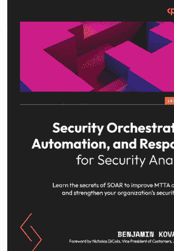
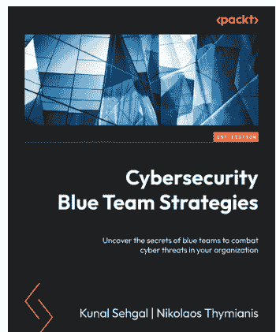
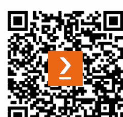

## 索引

### A
-   访问控制 40
-   Acme Bank 示例 128
-   文化要素 200
-   关键角色 199
-   零信任安全优先级 200-204
-   Acme Energy
    -   组件 111
-   敏捷交付
    -   以及剧本 160, 161
-   敏捷路线图 130
-   在零信任中 131
-   长期 130
-   中期 130
-   规划示例 131
-   短期 130
-   构建零信任战略 132-134
-   敏捷安全 75, 76
-   敏捷性
    -   应用 76
    -   原则 76
-   AI 共享责任模型 72
-   分析瘫痪
    -   避免 162
-   反脆弱性 78
-   APIs 41
-   应用和系统 43, 44
-   架构师对齐 186
-   人工通用智能 (AGI) 67
-   人工智能 (AI) 20, 43, 61, 98, 194
    -   影响 63-66
    -   对零信任的影响 73, 74
    -   局限性 67-69
-   以资产为中心和以数据为中心的安全 115-118
-   资产保护 40
-   假设被入侵 42
-   假设失败 23
-   假设成功 23

### B
-   爆炸半径 23
-   董事会 (BoDs) 97
-   业务资产 40-42
-   业务能力 134
-   业务高管 15
-   商业智能 (BI) 58
-   商业模式 21
-   企业对企业 (B2B) 50
-   企业对消费者 (B2C) 50
-   业务单元 (BUs) 108

### C
-   能力 133
-   资本支出 (CapEx) 91
-   精英中心 (CoE) 72
-   ChatGPT 21
-   经典 AI 62
-   明确的战略和计划 95
-   云原生应用保护平台 (CNAPP) 工具 56
-   云安全联盟 (CSA) 5
-   云安全态势管理 (CSPM) 56
-   持续集成 / 持续交付 (CI/CD) 82
-   客户关系管理 (CRM) 53
-   网络犯罪 22
-   网络安全 23, 119
-   网络安全和基础设施安全局 (CISA) 5

### D
-   数据 42
    -   生命周期保护 43
-   数据泄露调查报告 (DBIR) 122
-   数据中心化 42
-   拒绝服务 (DoS) 54, 147
-   国防部 (DOD) 5
-   DevOps 141
-   DevSecOps 141
-   数字时代
    -   变化 20
    -   定义成功 21
-   数字生态系统 40
-   分布式拒绝服务 (DDoS) 54

### E
-   端点检测和响应 (EDR) 52
-   企业资源规划 (ERP) 53
-   企业安全集成 111, 186
-   显式信任验证 115
-   扩展检测和响应 (XDR) 工具 57
-   外部攻击面管理 (EASM) 56

### F
-   平坦网络 44
-   基础能力 49, 50

### G
-   一般公认会计原则 (GAAP) 198
-   生成式 AI 62, 63
-   治理 40
-   图形用户界面 (GUIs) 64

### H
-   人类同理心 120
    -   关键文化主题 121
    -   零信任 121

### I
-   角色说明性列表 187, 190
-   事件响应 (IR) 任务 192
-   入侵指标 (IoCs) 186
-   工业控制系统 (ICSs) 91, 142
-   信息安全 23
-   信息技术 (IT) 3
-   创新安全 40
-   知识产权 (IP) 41, 98, 193
-   国际财务报告准则 (IFRS) 198
-   物联网 (IoT) 设备 20, 50, 98
-   IT 运营 91
-   IT 服务管理 (ITSM) 141

### K
-   关键文化主题
    -   对攻击者冷静理性的看法 122
    -   成长心态和持续学习 121
    -   包容性和多样性 122, 123
    -   持续变化的常态化 121
    -   零信任转型 123

### L
-   大语言模型 (LLMs) 21, 62
-   学习型组织 160
-   业务线 (LOB) 领导者 15
-   业务线 (LOBs) 48

### M
-   机器学习 (ML) 20, 57, 62, 194
-   受管服务提供商 (MSPs) 3
-   大规模开放在线课程 (MOOCs) 151
-   平均修复时间 (MTTR) 139
-   Microsoft 数字防御报告 (MDDR) 122
-   最小可行产品 (MVP) 160
-   模型崩溃 65

### N
-   国家网络安全中心 (NCSC) 5
-   国家标准与技术研究院 (NIST) 4, 38, 97
-   国家安全局 (NSA) 5
-   NIST AI 风险管理框架 URL 66

### O
-   客观指标 198
-   按需审计 172
-   Open Group 零信任参考模型 38, 39
    -   应用和系统 43, 44
    -   业务资产 40, 41
    -   数据 42
    -   生命周期数据保护 43
    -   数字生态系统 40
    -   元素 39
    -   安全学科 40
    -   安全区域 44-46
-   开源软件 (OSS) 99
-   运营支出 (OpEx) 91
-   运营模式 91
-   运营模式支柱 148-150
    -   Acme 示例 150-152
-   运营支柱 91, 137
    -   Acme 示例 145-148
    -   构建过程 143-145
    -   业务功能 142
    -   业务流程 142
    -   安全运营集成 138-142
    -   定制 142
-   运营安全能力 55-58
-   运营技术 (OT) 90, 91
-   运营 38

### P
-   点对点 (P2P) 支付 128, 200
-   按角色指导
    -   能力和工具 194
    -   日常体验 195
    -   调查分析师的日常体验 195
    -   剧本阶段参与 195
    -   角色创建与演进 191, 193
    -   角色使命与目的 191
    -   零信任影响与当务之急 195
-   支柱 126
    -   运营模式支柱 126
    -   运营支柱 126
    -   战略支柱 126
-   剧本
    -   以耐久性为重点 18
    -   以成果为重点 18
    -   实际案例 18
    -   以安全为重点 18
-   剧本系列结构 13, 14
    -   业务与技术领导力剧本 14, 15
    -   未来 18
    -   主题剧本 15-17
    -   零信任概述与剧本介绍 14
-   设计即隐私 (PbD) 51
-   主动安全风险管理 111
-   产品 174

### Q
-   质量保证 (QA) 68

### R
-   勒索软件 32, 33
-   弹性 48
-   投资回报率 (ROI) 81
-   基于角色的方法 182
    -   影响零信任的因素 185
    -   关键方面 182
    -   与角色相关的术语 184, 185
    -   将角色与六阶段计划集成 183
-   角色定义与命名
    -   演进的范围与使命 186
    -   专业化程度提高 186
    -   行业动态与不一致的术语 187
    -   新所需角色 186
-   角色指导
    -   按角色指导 190
-   与角色相关的术语
    -   学科 184
    -   角色 184
    -   角色专业化 184
-   角色 12

### S
-   规模化敏捷框架 (SAFe) 82
-   安全敏捷性
    -   神话与误解 77, 78
-   安全方法、安全思维和文化转变
    -   以资产为中心和以数据为中心的安全 115, 117
    -   业务使能者 100
    -   业务风险 97-99
    -   网络安全 119
    -   显式信任验证 115
    -   安全漏洞 112-114
-   使能安全决策 102-104
-   安全责任 101, 102
-   安全风险问责 105
-   安全漏洞
    -   角色 114, 115
-   安全学科 40
-   安全信息和事件管理 (SIEM) 57
-   安全领导者 15
-   安全管理
    -   态势管理 141
    -   安全治理 141
    -   系统资产保护 141
-   安全思维和文化转变 95
-   安全方法 96, 97
-   安全运营 40, 57
-   安全运营中心 (SOC) 57
-   安全运营 (SecOps) 57, 91, 138, 192
    -   角色 12
-   安全编排自动化与响应 (SOAR) 57
-   安全风险问责
    -   Acme Energy 111
    -   避免危险的误解 106, 107
    -   管理安全风险 108-110
-   安全成功
    -   定义 196
    -   衡量 196
    -   避免惩罚性指标 197, 198
-   安全对齐悖论 196, 197
-   安全区域 44-46
    -   示例 45
-   左移 132
-   简单模型
    -   能力 37, 38
    -   通过一致性 37, 38
-   单点登录 (SSO) 52
-   六阶段计划
    -   创建架构和模型 157, 170-172
    -   定制业务 158, 173-176
    -   持续监控和演进 158, 179, 180
    -   实施和改进 158, 176-178
    -   设置运营模式 157, 167-169
    -   概述 156
    -   建立战略 156, 162-166
    -   在剧本中使用 159
-   SOA 参考架构 (SOA RA) 147
-   软件即服务 (SaaS) 145
-   软件物料清单 (SBOM) 49
-   标准操作程序 (SOPs) 143
-   标准零信任能力 194
-   战略支柱 129
    -   敏捷路线图 130, 131
    -   示例 134-136
-   监控与数据采集 (SCADA) 91

### T
-   技术能力 134
-   技术债务 27
-   技术资产 90
-   技术资产 27
-   技术领导者 15
-   术语混淆 89
-   威胁情报 (TI) 12, 185
-   主题剧本
    -   架构角色 16
    -   产品和应用安全 17
    -   安全运营 (SecOps) 16
    -   安全态势和合规角色 16
    -   SOC 角色 16
    -   技术工程与运营 17

U
用户和实体行为分析 (UEBA) 57
V
虚拟机 (VMs) 49
虚拟专用网络 (VPN) 52
W
世界经济论坛 (WEF) 5
Z
零信任 1, 2, 19
Acme Bank 示例 199-205
AI 安全风险，管理 69, 70
应用，到组织 79-83
能力 46
能力，作为安全通用语言 47
能力，优先排序 89
能力参考 47, 48
诫命 35, 36
定义 4, 5
执行计划 85-87
高层支持 84
常见问题 26-35
治理与敏捷 87, 88
角色示例列表 187, 190
当务之急 23-26
实施 6
影响 23-26
重要性 7
大型转型 84
神话与误解 79
需求 8, 9, 19, 20
网络安全，考虑因素 59, 60
优先事项，用于管理 AI 风险 70-72
项目，开始于 83
原因 7
角色指导 190
范围 7
较小举措 85
转型 8
零信任能力
类别 48-58
零信任集成
变化，推动 153, 154
零信任手册
优势 127
布局 127, 128
支柱，实施 152, 153
阅读策略 11, 12
结构 127
零信任手册系列 3
需求 3
零信任参考模型 38
零信任路线图 136
零信任成功因素 93, 94
明确的策略和计划 94
人文关怀 94
安全思维和文化转变 94

Packtpub.com

订阅我们的在线数字图书馆，即可完全访问超过 7,000 本书籍和视频，以及业界领先的工具，帮助您规划个人发展并提升职业生涯。欲了解更多信息，请访问我们的网站。

## 为什么订阅？

- 使用来自 4,000 多名行业专业人士的实用电子书和视频，花更少时间学习，花更多时间编码
- 使用专为你打造的技能计划提升学习效果
- 每月获得一本免费电子书或视频
- 完全可搜索，便于快速访问重要信息
- 复制、粘贴、打印和书签收藏内容

您知道 Packt 为每本出版的书籍都提供电子书版本，支持 PDF 和 ePub 文件吗？您可以在 packtpub.com 升级到电子书版本，作为印刷书籍客户，您有权享受电子书折扣。请通过 customercare@packtpub.com 与我们联系了解更多详情。

在 www.packtpub.com，您还可以阅读大量免费技术文章，订阅各类免费通讯，并获得 Packt 书籍和电子书的独家折扣和优惠。

## 您可能感兴趣的其他书籍

如果您喜欢这本书，您可能对 Packt 出版的其他这些书籍感兴趣：

### 安全编排、自动化和响应（面向安全分析师）

Benjamin Kovacevic

ISBN: 978-1-80324-291-0

- 熟悉并调查各种威胁类型和攻击者技术
- 分析电子邮件安全解决方案日志并了解电子邮件流和头信息
- 实际调查各种 Windows 威胁和攻击
- 分析 Web 代理日志以调查 C&C 通信属性
- 了解使用 SOAR 平台的一般好处
- 将手动调查转变为自动化场景
- 了解如何管理已知的误报和低严重性事件以加快解决速度
- 使用各种 Microsoft Sentinel playbook 操作探索技巧
- 了解 Palo Alto XSOAR、Microsoft Sentinel 和 Splunk SOAR 等工具的概览

### 网络安全蓝队策略

Kunal Sehgal, Nikolaos Thymianis

ISBN: 978-1-80107-247-2

- 了解蓝队运营及其在保障企业安全方面的作用
- 探索蓝队日常职能和使用的工具
- 从蓝队视角熟悉风险评估和管理
- 发现有效防御策略及其运营的制定方法
- 了解构成良好治理计划的关键因素
- 熟悉用于降低风险的预防性和检测性控制措施

## Packt 正在寻找像您这样的作者

如果您有兴趣成为 Packt 的作者，请访问 authors.packtpub.com 并立即申请。我们已与数千名开发人员和技术专业人士合作，帮助他们与全球技术社区分享见解。您可以提交通用申请、申请我们正在招聘作者的特定热门主题，或提交您自己的想法。

## 分享您的想法

现在您已完成 *零信任概述和手册介绍*，我们很想听听您的想法！如果您从 Amazon 购买了本书，请点击此处直接前往本书在 Amazon 的评论页面分享反馈，或在您购买的网站上留下评论。

您的评论对我们和技术社区非常重要，将帮助我们确保提供优质内容。

## 下载本书的免费 PDF 副本

感谢您购买本书！

您喜欢在旅途中阅读，但无法随身携带印刷书籍吗？

您的电子书购买与您选择的设备不兼容吗？

不用担心，现在每本 Packt 书籍都附带一本免费的 DRM-free PDF 版本。

随时随地在任何设备上阅读。直接从您喜爱的专业技术书籍中搜索、复制和粘贴代码到您的应用程序中。

福利还不止于此，您还可以独家获得折扣、通讯和每日收件箱中的精彩免费内容。

按照以下简单步骤获取福利：

https://packt.link/free-ebook/978-1-80056-866-2

- 1. 扫描二维码或访问下面的链接
- 2. 提交您的购买证明
- 3. 就这样！我们会直接将免费 PDF 及其他福利发送到您的电子邮件

